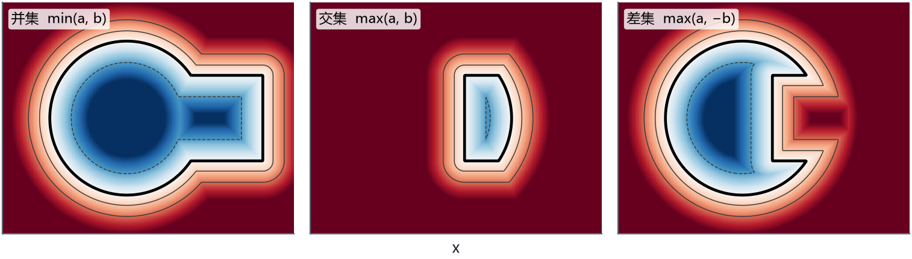
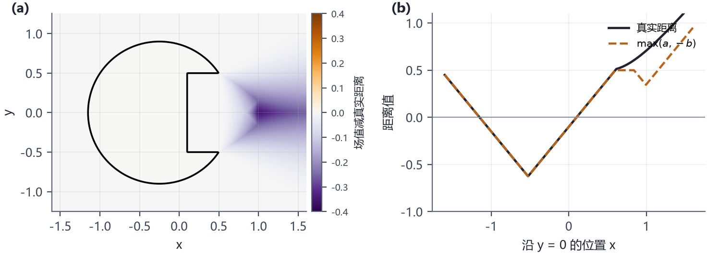
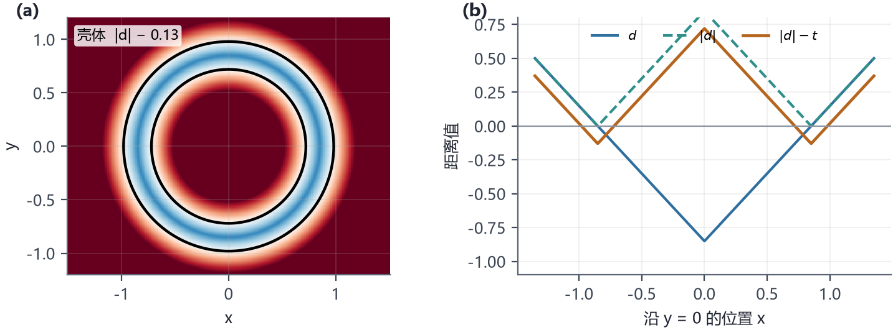

# 第 5 章 布尔运算

## 5.1 一条接缝

两个球相交，交线是一圈圆。用网格做，这条圆要单独处理：两个球的三角形在交线处互相穿插，需要切开、删掉内部的面、把边界缝起来，还要保证新生成的顶点落在同一条曲线上，否则接缝处会有微小的裂缝，渲染时漏光，做布尔运算时出错。

用距离场做，两个球各写一个公式，取最小值

$$f(\mathbf{p})=\min\big(d_A(\mathbf{p}),\,d_B(\mathbf{p})\big) , \tag{5.1}$$

接缝就在 $d_A=d_B$ 的地方，那里两个函数的值相等，梯度不同，于是零等值面有一个折角。这个折角就是交线，它自动出现，不需要任何拓扑操作。

这一章说明 (5.1) 为什么对，以及它对在哪里、不对在哪里。结论是：并集在外部精确，交集在内部精确，差集在内部的"被减区域"精确，其余地方只有符号是对的。这个区别在渲染上几乎看不出来，在碰撞与偏移上必须知道。

## 5.2 并集

先把"到并集的距离"这件事写清楚。设 $S=A\cup B$，则

$$\mathrm{dist}(\mathbf{p},A\cup B)=\min\big(\mathrm{dist}(\mathbf{p},A),\ \mathrm{dist}(\mathbf{p},B)\big) . \tag{5.2}$$

证明只用两句。一方面，$A\cup B$ 包含 $A$，所以到并集的距离不大于到 $A$ 的距离，同理不大于到 $B$ 的距离，故 $\le\min$。另一方面，设 $\mathbf{s}^*$ 是并集上离 $\mathbf{p}$ 最近的点，它必然属于 $A$ 或属于 $B$，若属于 $A$ 则 $\lVert\mathbf{p}-\mathbf{s}^*\rVert\ge\mathrm{dist}(\mathbf{p},A)\ge\min$，若属于 $B$ 同理，故 $\ge\min$。两头一夹，等号成立。

符号部分要单独看。若 $\mathbf{p}$ 在并集外，两个距离都是正的，$\min$ 给出正值，没问题。若 $\mathbf{p}$ 在 $A$ 内但在 $B$ 外，$d_A<0<d_B$，$\min$ 取 $d_A$，符号正确，数值是到 $\partial A$ 的距离，而 $\partial A$ 的那一段如果被 $B$ 盖住，它就不是并集的边界，此时的值偏大（更负），也就是内部距离被高估。图 5-2 会给出这个误差的量级。

两个都在内时，$\min$ 取更深的那个，同样高估深度。所以并集的场有一个清晰的分界：外部精确，内部不精确但符号正确，且值不小于真实深度。

这一点对步进没有影响，因为步进发生在外部。对碰撞有影响，因为穿透深度会被高估，物体陷进去得比看起来深。

## 5.3 交集

交集的距离场是

$$f(\mathbf{p})=\max\big(d_A(\mathbf{p}),\,d_B(\mathbf{p})\big) . \tag{5.3}$$

为什么是最大值？把上一节的论证反过来用。$\mathbf{p}$ 在交集外时，最近的边界可能来自 $A$ 也可能来自 $B$，而 $\max$ 取的是两个距离中较大的那个，恰好对应"较远的那一面"，这个值一般大于真实距离，所以外部不精确。

$\mathbf{p}$ 在交集内时，两个 $d$ 都是负的，$\max$ 取绝对值较小的那个，也就是离得最近的那一面，这正是内部深度。所以交集的性质与并集相反：内部精确，外部不精确。

推导可以写成一句话：内部深度等于到各个边界距离的最小值，取负号之后变成负距离的最大值。这就是 $\max$ 的来源。

## 5.4 差集

$A$ 减去 $B$，记作 $A\setminus B$，等于 $A\cap B^{c}$，其中 $B^{c}$ 是补集。补集的距离场就是 $-d_B$，因为内外互换。代入交集公式

$$f(\mathbf{p})=\max\big(d_A(\mathbf{p}),\,-d_B(\mathbf{p})\big) . \tag{5.4}$$

这个式子的行为可以逐区检查一下。在 $A$ 内、$B$ 外，$d_A<0$、$-d_B<0$，$\max$ 取较浅的那个，也就是离最近的边界近的那一面，正是内部深度。在 $B$ 内，$-d_B>0$，$\max$ 取正值，把这块判成外部，符合"被减掉"。在 $A$ 外，$d_A>0$。

图 5-1 三个面板把三种运算画在一起，同一个圆与同一个盒子。并集是两块粘起来的外轮廓，交集是中间那片透镜状的区域，差集是圆被盒子咬掉一个缺口。三个场的零等值面都干净，没有一处自交或者退化。



图 5-2 把差集的误差算了出来。左边是场值减去真实距离，缺口里有一片明显的负误差，最大到 $0.4$ 左右。右边是沿中线的剖面，虚线是 $\max(a,-b)$，实线是真实距离，两条线在 $A$ 的边界附近重合，进了缺口之后分开，虚线给出的是到盒子边界的距离，而真实距离是到缺口内壁的距离，两者不是一回事。



低估的方向是安全的，这一点值得记住。差集在缺口里低估距离，意味着步长变小、步数变多，但不会穿模。如果某个实现给出的是高估，那就要小心了。

## 5.5 绝对值：壳体与对称

对一个场取绝对值再减一个常数

$$f(\mathbf{p})=\lvert d(\mathbf{p})\rvert-t , \tag{5.5}$$

得到的是原表面向两侧各偏移 $t$ 形成的壳体，厚度 $2t$。图 5-3 是一个球壳，剖面里 $|d|$ 把负的一半翻上来，形成一条 V 形的谷，谷底在原来的表面上；再减 $t$ 之后谷底抬到零以下，零等值面变成两条平行曲线。



这个算子在建模里用得极多。做一块板，先做一个平面，取绝对值加偏移，得到有厚度的板；做一根管子，先做一条线段的距离场，取绝对值，得到半径可调的管壁。它也用来做"处处等厚"的偏移，因为 $|d|-t$ 的两层表面到原表面的距离都是 $t$。

绝对值算子对 Lipschitz 性质是中性的：$|d|$ 在 $d=0$ 处不可微，但斜率从 $-1$ 跳到 $+1$，长度仍然是 1，所以整体仍然 1-Lipschitz。减常数不改变梯度，也不改变 Lipschitz 常数，只改变等值面的位置。

但要小心一件事。$|d|-t$ 是精确距离只在壳体的内部，也就是 $|d|<t$ 的区域内。壳外的部分，场值等于"到原表面的距离减去 $t$"，而真实的距离是"到壳外表面的距离"，两者差一个 $t$ 的平移，数值上等于 $d-t$ 与 $d$ 的差别。这个差别在步进时表现为步长偏大，可能穿模。所以壳体的场一般要乘一个保守因子，或者只在壳体附近使用。

## 5.6 布尔运算与 Lipschitz

上面所有运算都可以写成一个统一的命题：两个 1-Lipschitz 函数的逐点 $\min$、$\max$、取负、取绝对值，仍然是 1-Lipschitz 的。

证明用不等式。设 $f=\min(f_1,f_2)$，对任意两点

$$f(\mathbf{p})-f(\mathbf{q})=\min_i f_i(\mathbf{p})-\min_j f_j(\mathbf{q})\le f_k(\mathbf{p})-f_k(\mathbf{q})\le\lVert\mathbf{p}-\mathbf{q}\rVert , \tag{5.6}$$

其中 $k$ 是使 $f_j(\mathbf{q})$ 取到最小值的那个下标。第一个不等号是因为 $\min_i f_i(\mathbf{p})\le f_k(\mathbf{p})$，第二个用了 $f_k$ 的 Lipschitz 性。交换两点得到另一边，结论成立。$\max$ 的情形把不等号方向翻一下即可，取负是显然的，取绝对值是 $|f|=\max(f,-f)$ 的组合。

所以布尔运算永远不会破坏步进的安全性。它破坏的是精确性，而且破坏的位置有规律：并集在外部精确，交集在内部精确，差集在 $A$ 内 $B$ 外精确。换句话说，精确区就是"最近点确实落在参与运算的那个物体的真实边界上"的区域。这句话可以当作一条判据，用来判断自己写的组合式在哪些地方可以信。

组合多个物体时，代码是一个循环

```python
import numpy as np

def union_all(p, shapes):
    d = np.full(p.shape[:-1], np.inf)
    for s in shapes:
        d = np.minimum(d, s(p))
    return d

def subtract(p, a, b):
    return np.maximum(a(p), -b(p))
```

这段代码里没有任何拓扑信息，也没有"合并"这个动作。物体之间可以任意穿插、共面、相切，都不需要特判。这是距离场相对网格布尔的最大好处：网格布尔要处理共面、共线、自交、数值退化这一堆情况，距离场不需要，因为它根本不构造边界。

代价在别处。第一，场只给出距离，不给出材质编号，多材质模型要给每个区域单独标记，第 16 章会碰到。第二，布尔之后如果想再对结果做一次平滑，平滑会把接缝的折角抹掉，这个抹掉的量由参数控制，第 6 章讲。第三，薄壁结构在布尔之后容易出现内部与外表面距离过近的区域，那里场的变化剧烈，采样精度要求高。

---

这一章的三条公式很短，含义要说清。并集取最小值，因为到并集的距离是到各部分距离的最小值；交集取最大值，因为内部深度是到各边界距离的最小值取负；差集是交集的特例，把被减的场取负即可。三者都保持 1-Lipschitz，所以步进永远安全。三者都只在特定区域精确，判断依据是最近点落在谁的真实边界上。绝对值算子给出等厚壳体，同样保持 Lipschitz，但壳外的场值有系统偏移。

下一章把最小值换成一个平滑的最小值。接缝从折角变成圆弧，代价是场的精确性又退了一步，而且参数不再是零。
