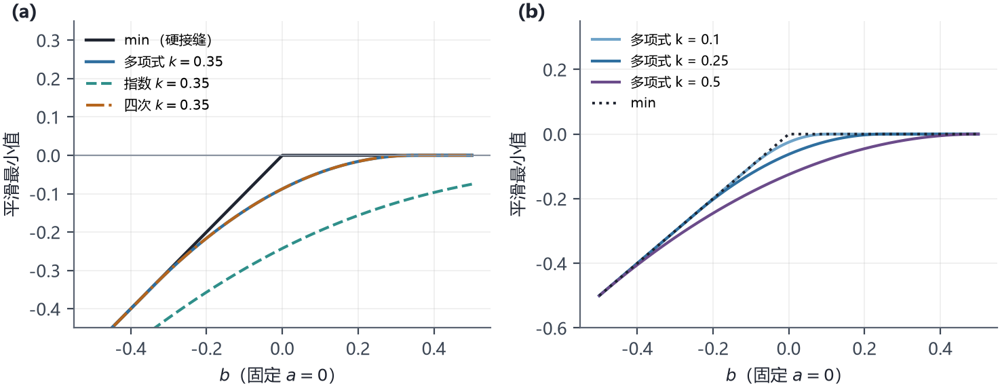
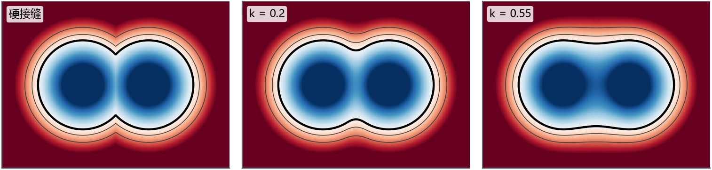
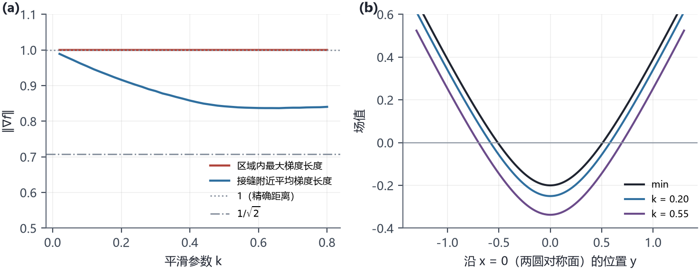

# 第 6 章 平滑并集

## 6.1 接缝上那道硬边

两个球用并集拼起来，接缝处是一条折角。渲染出来，折角上有一条亮线，亮线的两侧各有一条暗线，光从侧面打过来时尤其明显。这条亮线不是模型做错了，是法线在这里不连续：折角一侧的法线朝向一个方向，另一侧朝向另一个方向，中间没有过渡，着色模型在两侧各算一次，中间的像素只能取其中一个。

真实的物体很少有这种完美的折角。铸件的转角有圆角，皮肤的褶皱是圆的，两块面团的接缝是抹平的。要在网格上做出这个圆角，得手工切一刀再补一圈面，参数化很难看。

平滑并集（smooth minimum，简称 smin）把这件事变成一个参数。图 6-1 是它的行为：两条曲线在远处各自是一条直线，靠近交点时被"拉"到一起，交点被压下去一点，形成一段圆滑的过渡。参数 $k$ 控制这段过渡的宽度，$k=0$ 时退化成 $\min$。



## 6.2 多项式形式

最常用的一种是二次多项式修正。取

$$h=\operatorname{clamp}\!\left(\frac{1}{2}+\frac{b-a}{2k},\,0,\,1\right) , \tag{6.1}$$

然后

$$\operatorname{smin}(a,b,k)=b+(a-b)h-k\,h(1-h) . \tag{6.2}$$

这个式子要分段看。

当 $b-a\ge k$ 时，$h=1$，(6.2) 给出 $b+(a-b)=a$，而 $a<b$，所以结果是 $\min$ 取到的 $a$，修正项 $h(1-h)=0$。当 $a-b\ge k$ 时，$h=0$，结果是 $b$，同样是 $\min$，修正项为零。所以过渡区只在 $|a-b|<k$ 的范围里，宽度正好是 $k$。

在过渡区里，$h$ 从零线性变到一，前两项是 $a$ 与 $b$ 的线性插值，最后一项是一个开口向下的抛物线，在 $h=1/2$ 处取到最小值 $-k/4$。所以两个场相等的地方，结果比 $\min$ 低了 $k/4$。

导数也值得检查。把 (6.2) 对 $b$ 求导，注意 $h$ 对 $b$ 的导数是 $1/(2k)$

$$\frac{\partial f}{\partial b}=1-h+(a-b)\frac{1}{2k}-k(1-2h)\frac{1}{2k} . \tag{6.3}$$

在 $h=1$ 时，第一项为零，第二项为 $-k/(2k)=-1/2$，第三项为 $+1/2$，总和为零，与 $\min=a$ 对 $b$ 的导数一致。在 $h=0$ 时，第一项为一，第二项 $+1/2$，第三项 $-1/2$，总和为一，与 $\min=b$ 一致。过渡区内部，导数在零与一之间平滑过渡。所以这个拼接是 $C^1$ 的，法线连续，接缝处的硬边消失。

图 6-2 是二维效果。$k=0$ 时接缝是一个尖角，两个球的外轮廓在那里相交成一个 V。$k=0.20$ 时尖角被填成一段圆弧，圆弧的半径明显大于球本身的曲率，所以看起来像一个焊点。$k=0.55$ 时两个球几乎融成一个花生形，原来各自的轮廓只剩下一段。



## 6.3 其他形式

指数形式写成

$$\operatorname{smin}_{\exp}(a,b,k)=-k\log\left(e^{-a/k}+e^{-b/k}\right)=\min(a,b)-k\log\left(1+e^{-|a-b|/k}\right) , \tag{6.4}$$
ight)=\min(a,b)-k\log\left(1+e^{-|a-b|/k}
ight) , 	ag{6.4}$$
ight)=\min(a,b)-k\log\left(1+e^{-|a-b|/k}
ight) , 	ag{6.4}$$

第二个等号是把较大的那个场提出来，避免指数下溢，实际写代码时都用这个形式。$k	o0$ 时它退化为 $\min$。

这个形式光滑到任意阶，看起来很美，实际用起来有一个问题：它的过渡带没有明确的边界，$a$ 与 $b$ 相差 $10k$ 时仍有微小的修正，相差 $3k$ 时修正已经在千分之一量级但还在。图 6-1 左边那条虚线就是它，尾部拖得很长。这意味着整个场都被轻微地压低了，不只是接缝附近。对渲染影响不大，对需要精确距离的场合不合适。

四次形式是另一种截断的写法

$$\operatorname{smin}_{4}(a,b,k)=\min(a,b)-\frac{k}{4}\left(\max(k-|a-b|,0)/k\right)^{2} . \tag{6.5}$$

过渡区的宽度同样是 $k$，$a=b$ 处的压低量是 $k/4$，与多项式相同。它的导数在边界处为零而不是匹配 $\min$ 的斜率，实际上它的过渡更"软"一些，但在边界处仍然是 $C^1$。

还有一类是幂平均

$$\operatorname{smin}_{p}(a,b)=\left(a^{-p}+b^{-p}\right)^{-1/p} , \tag{6.6}$$

它只对正的场有定义，且 $a,b$ 必须远离零，否则数值上会爆掉或出现除零。实际用得很少，知道有这个东西就行。

## 6.4 参数 k 的几何含义

$k$ 不是一个无量纲的"软硬程度"，它有长度量纲，直接对应几何尺寸。三件事可以定量。

过渡区宽度是 $k$。这是 (6.1) 里 $|a-b|<k$ 的直接结果，两个场相差小于 $k$ 的地方才会混合。

接缝被压低 $k/4$。两个场相等处的场值从零变成 $-k/4$，意味着零等值面向外移动了 $k/4$，也就是两个物体在接缝处"长胖"了一点。这是平滑并集的副作用，视觉上通常正是想要的，因为它把接缝填满了，但做精密装配时要减掉这个量。

圆角半径约 $0.85k$。这个数可以从两个垂直半空间的情形推出来。设 $a=x$，$b=y$，两者相等处 $f=x-k/4$，等值面在 $x=y=k/4$ 处过零。如果这段过渡是一个半径为 $r$ 的圆弧，它与两条坐标轴相切，圆心在 $(r,r)$，那么这条弧离原点最近的点在 $(r-r/\sqrt2)(1,1)$，沿对角线的距离是 $r(\sqrt2-1)$。令它等于 $k/(2\sqrt2)$，解出

$$r=\frac{k}{2\sqrt2(\sqrt2-1)}=\frac{1+\sqrt2}{2\sqrt2}k\approx 0.854\,k . \tag{6.7}$$

所以想让接缝圆角是 2 毫米，$k$ 取 2.34 毫米。这个换算在建模时很有用，因为美术说的"圆角"是半径，公式里填的是 $k$。

## 6.5 对 Lipschitz 性质的影响

图 6-3 左边是在两个球的并集上测出来的梯度长度。区域内的最大值恒等于一，与 $k$ 无关，这一点符合 5.6 节的结论：$\min$ 与 $\max$ 的任意组合保持 1-Lipschitz，而平滑最小值是 $\min$ 加上一个有界的修正，修正的梯度把总梯度拉回到一以内。所以平滑并集永远不会破坏步进的安全性。

代价在效率上。接缝附近平均梯度长度随 $k$ 增大而下降，从 $k=0$ 时的接近一降到 $k=0.8$ 时的 $0.83$。这意味着接缝附近每一步只能走真实距离的八成多，步数相应增加两成左右。这个代价可以接受，比起场不精确带来的穿模风险，多走几步很便宜。



精确性的损失在哪里？平滑并集在任何地方都不等于真实距离，因为真实距离在接缝处有折角，而平滑后的场是一个光滑函数，光滑函数不可能等于一个有折角的函数。差别的量级是 $k$，只出现在过渡区内。过渡区外，$|a-b|>k$ 时公式严格等于 $\min$，所以远处的场值与硬并集完全一样。

这给出一个实用的判据：$k$ 应当明显小于场景里最小的特征尺寸，否则过渡区会吞掉细节。一颗螺丝的螺纹间距是 0.5 毫米，$k$ 就不能取到 1 毫米，否则螺纹会被抹平。

## 6.6 用法

代码很短

```python
import numpy as np

def smin(a, b, k):
    if k <= 0.0:
        return np.minimum(a, b)
    h = np.clip(0.5 + 0.5 * (b - a) / k, 0.0, 1.0)
    return b + (a - b) * h - k * h * (1.0 - h)

def smin_all(fields, k):
    d = fields[0]
    for f in fields[1:]:
        d = smin(d, f, k)
    return d
```

$k$ 要特判零，因为 (6.1) 的分母是 $k$。多个场依次平滑时，顺序会影响结果：先平滑哪两个，接缝的形状不一样。这一点在多物体建模时要注意，美术调参时看到的形状与代码里的顺序是绑定的。

另一个陷阱是 $k$ 不能全局统一。一个场景里既有米级的家具又有厘米级的零件，用同一个 $k$ 要么家具的接缝看不出来，要么零件的形状被抹掉。实际做法是按物体尺度分别取 $k$，或者在层次结构的不同层用不同的 $k$，第 15 章的分层结构正好提供了这个能力。

平滑之后的接缝曲率变大，高光会在那里拉成一条亮带。这是物理上正确的：圆角的曲率半径小，高光自然窄而亮。但如果 $k$ 太大，接缝的曲率会小于球本身的曲率，高光反而变宽，看起来像涂了一层蜡。这个界限大约在 $k$ 等于球半径的三分之一处，超过之后接缝的圆角半径就大于球半径了。

---

这一章讲了平滑并集的构造与代价。多项式形式在 $|a-b|>k$ 时严格等于 $\min$，过渡区内是二次修正，$C^1$ 拼接，$a=b$ 处压低 $k/4$，对应圆角半径约 $0.85k$。它保持 1-Lipschitz，所以步进安全，代价是接缝附近步长变短、步数增加两成。精确性在过渡区内损失，量级为 $k$，所以 $k$ 必须小于最小特征尺寸。

下一章换一个方向：不改函数的值，改函数的自变量。平移、旋转、缩放、重复、扭曲，这些操作让一个形状变成很多个，也让距离场在更大的范围内失效。
