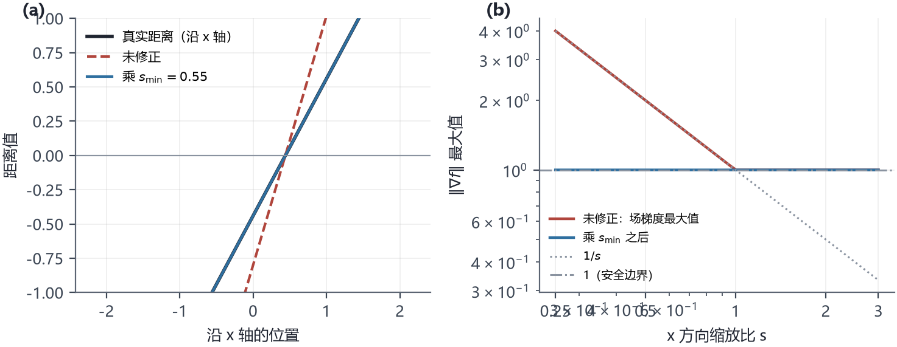
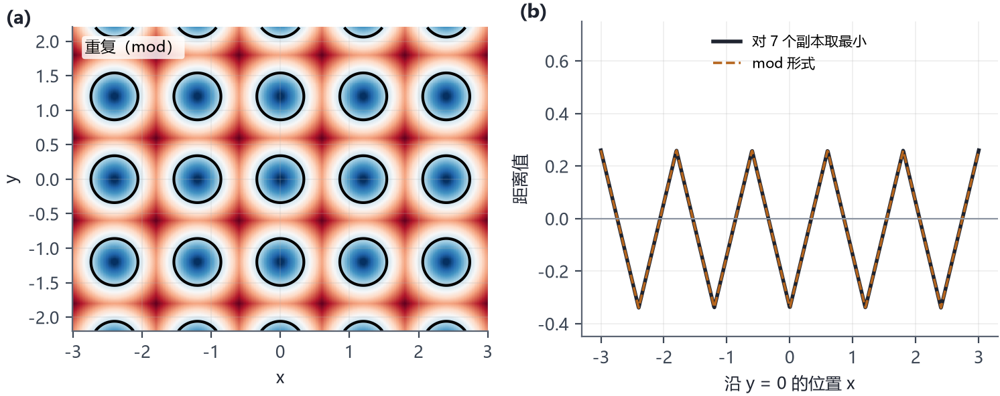
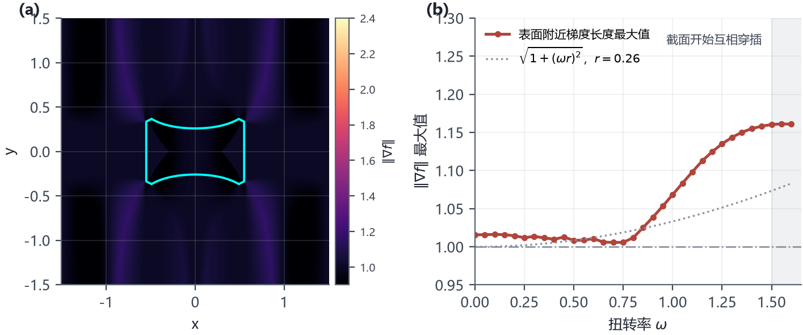

# 第 7 章 域变换

## 7.1 一个被压扁的球

把一个球的公式乘上一个缩放矩阵，让它变成一个椭球，看起来只是改了几个数。渲染出来问题就来了：沿着长轴方向，表面比实际位置靠外一点，沿着短轴方向靠里一点，偏差不大，但光线从长轴方向射过来时会直接穿过去，落在球后面。

原因很直接。距离是在欧氏度量下定义的，把坐标拉伸之后，原来的公式算的仍然是"在拉伸后的坐标里"的距离。这个量与原空间的距离之间差了一个方向依赖的因子，不是常数。

这一章讲的是所有的"把点搬到别处再求距离"的操作。平移和旋转不改变度量，精确；缩放、重复、镜像、扭曲各自改变度量或者改变定义域，后果一个比一个复杂。判断的标准始终是同一条：变换之后的函数还满足 1-Lipschitz 吗，还等于真实距离吗。

## 7.2 平移与旋转

设原来的场是 $d$，物体做刚体变换，旋转 $\mathbf{R}$、平移 $\mathbf{t}$。空间中的点 $\mathbf{p}$ 对应的原空间位置是 $\mathbf{R}^{\mathsf T}(\mathbf{p}-\mathbf{t})$，于是

$$d_{\text{rigid}}(\mathbf{p})=d\big(\mathbf{R}^{\mathsf T}(\mathbf{p}-\mathbf{t})\big) . \tag{7.1}$$

这个式子是精确的。理由是刚体变换保持两点之间的距离，最近点也跟着一起转，距离值不变；梯度也跟着转，$\nabla d_{\text{rigid}}=\mathbf{R}\,\nabla d$，长度还是一。

所以平移与旋转是距离场里最安全的操作，随便用。造型时把每个基本体放在自己的局部坐标系里，用一个 $4\times4$ 矩阵搬到世界空间，这一步不会引入任何误差。

## 7.3 缩放

均匀缩放也是这样。把坐标除以标量 $s$，再把结果乘回来

$$d_{\text{scale}}(\mathbf{p})=s\,d(\mathbf{p}/s) . \tag{7.2}$$

这个式子同样是精确的，因为均匀缩放把所有距离同比例放大，最近点也同比例移动。

非均匀缩放没有这个好运。设缩放向量 $\mathbf{s}=(s_x,s_y,s_z)$，最自然的写法是

$$f(\mathbf{p})=d\big(\mathbf{p}\oslash\mathbf{s}\big) , \tag{7.3}$$

其中 $\oslash$ 是逐分量相除。$f$ 与真实距离的比值随方向变化：沿 $x$ 轴方向，真实距离是 $s_x$ 乘以原空间的对应距离，而 (7.3) 给出的正是原空间的对应距离，所以比值是 $1/s_x$；沿 $y$ 轴是 $1/s_y$。一般地，

$$\frac{f(\mathbf{p})}{d_{\text{true}}(\mathbf{p})}\in\left[\min_i\frac{1}{s_i},\ \max_i\frac{1}{s_i}\right] . \tag{7.4}$$

图 7-1 左边是一个被压扁的圆，$s_x=0.55$，$s_y=1$。未修正的场沿 $x$ 轴的斜率是 $1/0.55\approx1.8$，正是真实距离的 1.8 倍，于是它在表面上取零，跑出去之后比真实距离增长得快，光线按它步进就会越过表面。

修正的办法是乘上最小的缩放分量

$$f_{\text{safe}}(\mathbf{p})=s_{\min}\,d\big(\mathbf{p}\oslash\mathbf{s}\big),\qquad s_{\min}=\min_i s_i . \tag{7.5}$$

为什么这个因子够用？看梯度。由链式法则

$$\nabla f=\left(\frac{1}{s_x}\partial_x d,\ \frac{1}{s_y}\partial_y d,\ \frac{1}{s_z}\partial_z d\right) , \tag{7.6}$$

它的长度不超过 $\max_i(1/s_i)=1/s_{\min}$，因为 $\nabla d$ 的长度是一。所以 $f$ 是 $1/s_{\min}$-Lipschitz 的，乘上 $s_{\min}$ 之后回到 1-Lipschitz，步进安全。

图 7-1 右边把这件事量化了。未修正的场在 $s<1$ 时梯度超过一，随 $s$ 减小而增大，$s>1$ 时梯度不足一，是保守的。乘上 $s_{\min}$ 之后曲线被压到一以下，代价是 $s>1$ 时过于保守，步数按 $s_{\max}/s_{\min}$ 增加。

有一个细节值得注意。图 7-1 左边乘了 $s_{\min}$ 的曲线在长轴方向与真实距离完全重合，这不是巧合：沿长轴方向，真实距离就是 $s_{\min}$ 乘以原空间的距离，而 $s_{\min}$ 恰好是这个方向的缩放。在别的方向上，修正后的场严格小于真实距离，所以整体是保守的。

工程上还有一个更省的做法：如果缩放比接近一，比如 $s\in[0.9,1.1]$，直接用 $s_{\min}$ 修正，多走一成的步数；如果差别很大，比如做一块薄板 $s=(10,10,0.1)$，那就不该用缩放，直接用盒子的公式，因为盒子的公式本来就支持任意长宽比。

## 7.4 镜像与重复

镜像用绝对值实现。关于 $x=0$ 平面镜像

$$d_{\text{mirror}}(\mathbf{p})=d\big(|p_x|,\,p_y,\,p_z\big) . \tag{7.7}$$

这个操作在几何上是精确的：把点折到正半空间，再算距离，得到的正是到"镜像后的物体"的距离。梯度在 $p_x=0$ 处有一个跳变，但长度还是一，所以仍然是 1-Lipschitz 的。用它可以把一个半边模型变成完整模型，代价只有一次绝对值和一次求值。

重复用取模实现。周期为 $\mathbf{s}$ 的无限阵列

$$d_{\text{repeat}}(\mathbf{p})=d\big((\mathbf{p}+\tfrac12\mathbf{s})\bmod\mathbf{s}-\tfrac12\mathbf{s}\big) , \tag{7.8}$$

这里的 $\bmod$ 是逐分量的。它把任意点折进以原点为中心、边长为 $\mathbf{s}$ 的那个格子里，然后算到格子内那一份物体的距离。

这个操作什么时候精确？条件是那一份物体完全落在格子里，且格子正好是它的 Voronoi 胞。晶格点的 Voronoi 胞就是那个立方格子，所以只要物体不超出格子，任意点到最近的一份的距离就等于到格子内那一份的距离。图 7-2 右边把 mod 形式与"对七个副本取最小"的结果画在一起，两条曲线完全重合，说明在这个例子里它是精确的。

如果物体超出格子，mod 就不再精确。此时最近的一份可能在相邻的格子里，而 mod 只会给你当前格子里那一份，于是场被高估，步进可能穿模。补救的办法是把周期取大一些，或者用两层不同相位的重复再取最小值，后者相当于把格子错开一半，覆盖更宽的范围，代价是求值次数翻倍。

还有一个隐蔽的问题：重复之后的场在格子边界上是连续的，但梯度不连续，因为从一侧过来时最近点在左边，从另一侧过来时在右边。这会在物体阵列之间的中轴面上产生一圈"褶皱"，法线在那里跳变。渲染时看不出来，因为那里离表面远；做软阴影时要小心，因为软阴影会在中轴附近采样。

## 7.5 扭曲与弯曲

扭转（twist）的写法是把点绕某个轴旋转，旋转角随另一个坐标线性变化。绕 $x$ 轴扭转

$$\theta=\omega x,\qquad \mathbf{q}=\big(x,\ \cos\theta\,p_y-\sin\theta\,p_z,\ \sin\theta\,p_y+\cos\theta\,p_z\big) , \tag{7.9}$$

然后 $f(\mathbf{p})=d(\mathbf{q})$。

这个变换不是等距的。它把平面截面旋转，旋转量随 $x$ 变化，于是原来垂直于轴的直线变成了螺旋线，长度被拉长。拉长的比例可以算：一个离轴距离为 $r$ 的材料点，沿 $x$ 走 $dx$，实际弧长是 $\sqrt{dx^2+(r\,d\theta)^2}=dx\sqrt{1+(\omega r)^2}$。所以沿 $x$ 方向的局部伸缩率是 $\sqrt{1+(\omega r)^2}$。

这个伸缩率直接决定了场的梯度长度。$\nabla f=J^{\mathsf T}\nabla d$，$J$ 的最大奇异值就是上面的伸缩率，于是

$$\lVert\nabla f\rVert\le\sqrt{1+(\omega r_{\max})^2} , \tag{7.10}$$

其中 $r_{\max}$ 是材料点离轴的最大距离。图 7-3 是把一个长方体绕 $x$ 轴扭转之后测出来的结果，梯度长度的最大值从一涨到 $1.16$，$\omega=1.6$ 时理论估计是 $1.08$，同一个量级，差距来自 $r_{\max}$ 取的是半宽而不是对角。

扭转率再大，形状本身会出问题。截面旋转得太快，相邻截面互相穿插，物体在几何上已经不成立了，场虽然还有值，但零等值面自交。图 7-3 右边灰区之后测量值不再单调，就是这件事的表现。

弯曲（bend）同理。把 $x$ 方向卷成一个半径为 $R$ 的圆

$$\theta=x/R,\qquad \mathbf{q}=\big((R+p_z)\cos\theta-R,\ (R+p_z)\sin\theta,\ p_y\big) , \tag{7.11}$$

内侧被压缩，外侧被拉伸，伸缩率是 $1+p_z/R$。所以弯曲之后场的 Lipschitz 常数是 $\max|1+p_z/R|$，在 $p_z>-R$ 的范围内等于 $1+|p_z|_{\max}/R$。半径越小，误差越大。

## 7.6 修正的三种策略

变换之后场不精确，处理方式有三类，各有各的适用场合。

乘一个保守因子，也就是 7.3 节的 $s_{\min}$ 或者 (7.10) 的倒数。简单，全局有效，代价是整体步数增加。因子可以按包围盒算出一个上界，不必逐点算。

分区处理。把空间分成变换剧烈的区域与平缓的区域，只在剧烈区域用保守因子。扭转的例子是离轴越远伸缩越大，所以可以按半径分档，内圈用精确步长，外圈用保守步长。

换一种表示。非均匀缩放的盒子，与其缩放球，不如用盒子的公式；弯曲的管子，与其弯曲一条直线，不如用圆环的一段。解析形状的公式通常已经把各种比例吸收进去了，能换就换。

三条策略里，第一条最常用，第三条最省事，第二条需要额外的结构支持。第 9 章会把第一条讲成一套可操作的流程，包括怎么估因子、怎么检测过冲。

---

这一章的分类标准是"变换是否改变度量"。平移旋转不改变，精确；均匀缩放按比例改变，乘回比例就精确；非均匀缩放逐方向改变，只能乘最小缩放分量退回保守；镜像精确，重复在物体不超出格子时精确；扭转和弯曲改变度量且随位置变化，只能用一个上界退回保守，而且变换太强时形状本身会自交。

下一章继续在造型上走，讲圆角、倒角、壳体这三类算子。它们的共同点是直接在距离值上做加减，因此对 Lipschitz 性质的影响可以精确地算出来。
