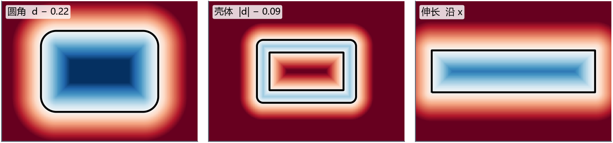
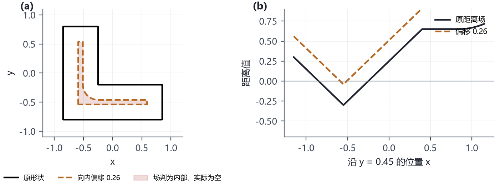
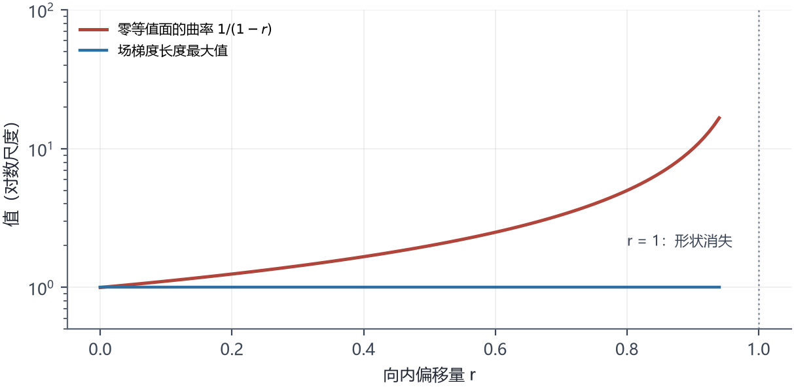

# 第 8 章 圆角、倒角与壳体

## 8.1 一条边的三种处理

一个盒子的十二条棱，在渲染里是十二道镜面高光。现实中的盒子很少有这种棱，铸件的棱是圆的，钣金的棱是折的，塑料件的棱既有圆也有 45 度的小倒角。这三种处理在距离场里对应三个算子，都只改一个常数或者加一个夹取。

它们比平滑并集更好控制，因为不涉及两个场之间的混合，只涉及一个场与一个标量之间的关系。代价是它们改变了场的定义域，改变的方式决定了什么时候会失效。

## 8.2 圆角

圆角算子是把场减去一个半径

$$f(\mathbf{p})=d(\mathbf{p})-r . \tag{8.1}$$

它的意思是：把零等值面从原来的位置向外推 $r$，推出来的曲面就是原曲面的外偏移面。图 8-1 左边是一个盒子减去 0.22，四角变成了半径 0.22 的圆弧，直边向外平移了 0.22。

为什么减去一个常数就是外偏移？因为距离场的水平集 $\{d=t\}$ 就是距离表面为 $t$ 的那张曲面，这是一条定义上的恒等式，不需要证明。减去 $r$ 只是把水平集 $t=r$ 重新命名为零等值面。

偏移面的形状有两点要看。在凸的部分，比如盒子的棱，偏移面是一段圆柱面或者球面，半径正好是 $r$，这是圆的来源。在凹的部分，比如两个面相交的内角，偏移面会向内收缩，收缩半径可能小于零，也就是曲面自交。

自交的条件可以精确写出来。4.4 节给出过平行曲面的主曲率

$$\kappa_t=\frac{\kappa}{1+\kappa t} , \tag{8.2}$$

其中 $t$ 是偏移量。向外偏移 $t=r>0$，若原曲面的某处曲率半径为负（凹），$\kappa<0$，当 $r$ 接近 $1/|\kappa|$ 时分母趋近于零，曲率发散，偏移面在那里出现尖点；超过这个值，偏移面就自交了。

所以圆角算子的适用范围是：$r$ 必须小于场景里最尖锐的凹处曲率半径。做一个零件的内圆角，半径取 2 毫米，而零件上有一个 1.5 毫米的凹槽，那么减 2 毫米会让凹槽处的场自交，零等值面出现一个不该有的环。

## 8.3 倒角

倒角是把棱切掉一个斜面。写法是把原来的场与一个平面场取最大值

$$f(\mathbf{p})=\max\big(d(\mathbf{p}),\ \mathbf{n}\cdot\mathbf{p}-c\big) , \tag{8.3}$$

其中的平面沿着要切掉的那个棱摆好，$\mathbf{n}$ 朝外，$c$ 决定切多深。取最大值的道理与 5.3 节的交集一样：新形状是原形状与半空间的交集。

对盒子来说，一次倒角只影响一条棱，十二条棱要加十二个平面，或者更省事，用一个"倒角盒"的专用公式：先算到棱的距离，再与一个斜面比较。图 8-1 没有画倒角，因为它与圆角在轮廓上的区别很小，主要区别在曲率：圆角的曲率是连续的，倒角的曲率在斜面与面相交处跳变，高光在那里会断成两条。

这个区别在渲染上是好事还是坏事取决于要做什么。要真实感，用圆角，因为加工出来的棱总有圆角；要工业设计里的硬朗感，用倒角，因为它的高光是有棱有角的。

倒角对 Lipschitz 性质的影响与布尔运算完全一样：取最大值保持 1-Lipschitz，精确性在外部丢失。这没有关系，因为倒角只在表面附近有效。

## 8.4 壳体

壳体算子是把场取绝对值再减厚度

$$f(\mathbf{p})=\lvert d(\mathbf{p})\rvert-t . \tag{8.4}$$

5.5 节已经用过它，这里补充一点三维的细节。壳体的内外两张表面间隔 $2t$，每张到原表面的距离都是 $t$。这个性质让壳体成为做薄壁件的标准手段，因为厚度是常数，不会像缩放那样在弯曲处变薄。

壳体的一个常见用法是把它与圆角叠加。$|d|-t$ 给出等厚的壁，再把结果减去一个小的 $r$，壁的边缘就圆了。两个算子都是加减常数，顺序无所谓，结果一样。

壳体的失效方式与圆角相反。它的零等值面有两张，内张在 $d=-t$ 处，外张在 $d=t$ 处。若原形状的最小厚度小于 $2t$，内张会自交，壳体在薄处变成实心，甚至翻转。这个条件比圆角更容易触发，因为薄壁件的厚度往往就在 $2t$ 附近。

## 8.5 伸长

伸长是把形状沿某个方向拉长，拉长的部分保持截面形状。它的写法有一个技巧：先把坐标夹取到一段区间，再求值

$$\mathbf{q}=\mathbf{p}-\operatorname{clamp}(\mathbf{p},\,-h,\,h),\qquad f(\mathbf{p})=d(\mathbf{q}) . \tag{8.5}$$

这个式子的意思是，把一个盒子沿 $x$ 方向伸长，等价于把点沿 $x$ 方向"折"回原来的盒子范围内，然后算距离。夹取之后 $\mathbf{q}$ 的 $x$ 分量是零，$y,z$ 分量原样保留，所以得到的是"到一条线段的距离"，再套上原来的截面。

这个技巧不只用于盒子。任意的截面形状配上 (8.5)，都能沿一个方向拉成柱体，而且保持精确：夹取是一个正交投影，不改变垂直于该方向的坐标，投影到的线段上每一点都是最近点，所以 (8.5) 给出的确实是距离。

图 8-1 右边是把一个盒子沿 $x$ 伸长 0.55 的结果。截面没有变，长度变了，两端是平的而不是圆的，这是与胶囊的区别：胶囊的两端是半圆，伸长出来的柱体两端是截面本身。

伸长也可以沿一个任意线段做，这时把 (8.5) 的夹取换成一个线段投影

$$\mathbf{q}=\mathbf{p}-\mathbf{a}-\operatorname{clamp}\!\left(\frac{(\mathbf{p}-\mathbf{a})\cdot\mathbf{b}}{\mathbf{b}\cdot\mathbf{b}},0,1\right)\mathbf{b} , \tag{8.6}$$

其中 $\mathbf{b}$ 是线段方向与长度。这就是 3.3 节胶囊公式里的投影，只是那里最后减的是半径，这里套的是任意截面。

## 8.6 对 Lipschitz 性质的影响

三个算子都保持 1-Lipschitz，理由各不相同但都很短。

减常数不改变梯度，显然保持。取绝对值把梯度方向翻了个面，长度不变。夹取是一个到凸集的正交投影，$1$-Lipschitz，复合之后仍然 $1$-Lipschitz。取最大值在 5.6 节证过。

所以这三个算子都不会让步进穿模。但"不会穿模"不等于"形状是对的"，图 8-2 与图 8-3 是两个例子。

图 8-2 左边是 L 形向内偏移 0.26 的结果。橙色的虚线是 $d+0.26$ 的零等值线，它在内拐角处收成一个锐角，两条边几乎碰在一起，再大一点就会自交。真实的向内偏移在那里应该是一段半径为"原曲率半径减 $r$"的圆弧，不是锐角。锐角是场在局部不再等于距离的表现：那里最近点不再唯一，中轴离表面比 $r$ 还近。

图 8-3 把同一件事推到了极限。横轴是偏移量 $r$，红线是零等值面的曲率，蓝线是场梯度的最大值。红线在 $r$ 接近 1 时发散，形状在 $r=1$ 处缩成一个点然后消失；蓝线是一条水平线，从头到尾等于一。只用"梯度长度是否为一"来检验这个场，它在 $r=0.99$ 时仍然完全合格，而那时的零等值面已经是一个半径 0.01 的圆，曲率一百。

## 8.7 用法上的三条经验

第一条，圆角的半径要小于最尖的凹处曲率半径。做零件时先看最窄的凹槽，圆角不能超过它的一半。这条限制来自 (8.2)，不是实现问题。

第二条，壳体厚度要小于最薄处的半厚。薄壁件的壁厚如果是 2 毫米，壳体的 $t$ 不能超过 1 毫米，否则内外两张面会互相穿过去。

第三条，伸长与圆角的组合可以替代很多手工建模。一根带圆头的杆，做法是先做一个盒子，沿轴向伸长，再减去一个圆角半径；一个带倒角的板，做法是盒子减去圆角再与平面取交。这些组合都不引入新的失效模式，只要每一步的常数在允许范围内。

还有一件事要提。这三个算子都是全局的：减去一个 $r$，所有表面都偏移 $r$，不能只圆某一条棱。要只处理局部，得先用一个区域函数把影响范围限制住，常见做法是用平滑最小值把"圆角版本"与"原始版本"按空间位置混合，混合的代价是那个区域内的场变得不精确，回到第 6 章的问题。

---

这一章讲了三个只改常数或者加一次夹取的算子。圆角是减常数，靠水平集的定义直接得到偏移面，适用范围受最尖的凹处限制；倒角是与平面取最大值，曲率不连续是它的特征；壳体是取绝对值再减厚度，受最薄处限制；伸长是夹取坐标，精确且与截面无关。四个算子都保持 1-Lipschitz，所以步进安全，但形状的正确性需要另外的条件，这个条件都可以用曲率半径或者厚度写出来。

下一章处理这一篇遗留的总账：当这些算子把场变得不精确时，步进到底会出什么事，怎么检测，怎么补救。
