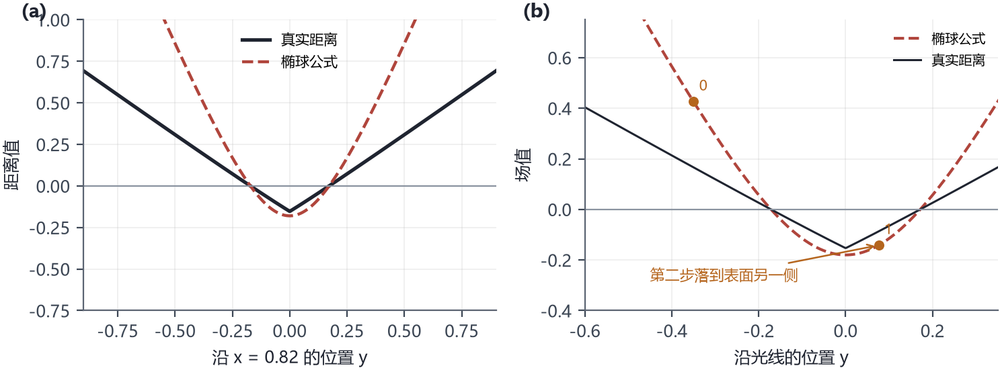
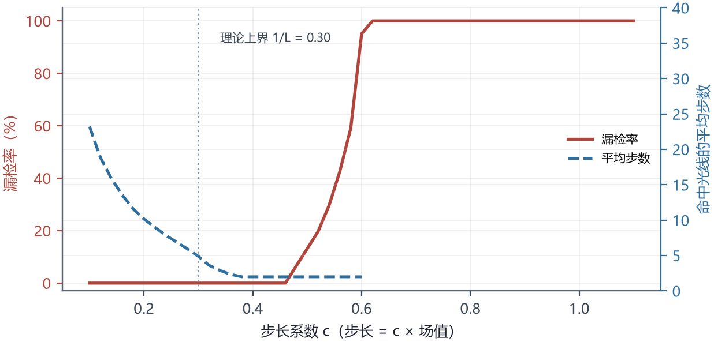
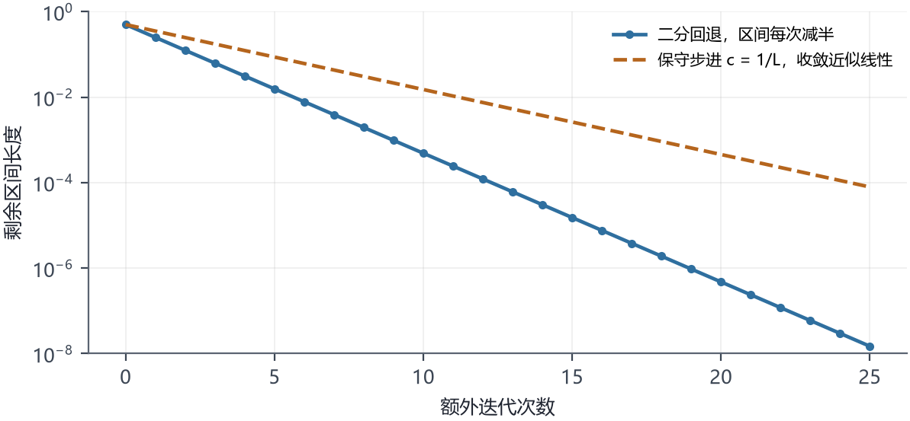

# 第 9 章 精确与近似

## 9.1 一条穿过去的光线

场景里有一块压扁的椭球，公式按 3.1 节写成"球换个坐标"，也就是

$$f(\mathbf{p})=\left\lVert\left(\frac{p_x}{a},\frac{p_y}{b},\frac{p_z}{c}\right)\right\rVert-1 . \tag{9.1}$$

渲染出来，椭球的正面看不出问题，边缘也还行。但是从薄的方向看过去，模型有一块是透的：光线从薄的一侧射进来，穿过整个物体，落在后面的地板上，地板上留下一个亮斑。

这不是材质的问题。光线确实跨过了表面，因为步长按公式算出来的值前进了，而这个值在那个方向上比真实距离大。图 9-1 左边是一条沿薄方向的剖面，公式给出的斜率是真实距离的三倍多，两者在表面处都为零，离开表面之后立刻分开。

## 9.2 过冲的条件

把条件写成不等式。设当前点在 $\mathbf{p}$，场值 $f(\mathbf{p})$，真实距离 $d(\mathbf{p})$，步长取 $c\,f(\mathbf{p})$。要保证这一步不跨过表面，需要

$$c\,f(\mathbf{p})\le d(\mathbf{p}) , \tag{9.2}$$

也就是 $c\le d/f$。这个比值在每一点都不同，但它有一个与位置无关的下界。设

$$L=\sup_{\mathbf{p}}\frac{\lVert\nabla f(\mathbf{p})\rVert}{\lVert\nabla d(\mathbf{p})\rVert}=\sup_{\mathbf{p}}\lVert\nabla f(\mathbf{p})\rVert , \tag{9.3}$$

这里用了 $\lVert\nabla d\rVert=1$。沿从 $\mathbf{p}$ 到表面的最短路径积分，$f$ 的值变化不超过 $L$ 乘以路径长度 $d$，于是 $f\le L\,d$，即 $d/f\ge 1/L$。所以 $c=1/L$ 是一致安全的，任何 $c\le1/L$ 都安全，任何 $c>1/L$ 在 $L$ 取到的地方都会跨过。

这个界是充分不必要的。$L$ 是全局最大值，而多数点的 $d/f$ 远大于 $1/L$，所以在 $c=1/L$ 时大部分步长都被压得很短，浪费严重。工程上常用的折中是取 $c$ 略小于 $1/L$，或者分区取不同的 $c$，只有在 $L$ 大的地方才用保守值。

$L$ 可以按算子的组合算出来。若 $f=f_2\circ f_1$，则

$$L(f)\le L(f_2)\,L(f_1) , \tag{9.4}$$

因为链式法则给出的雅可比是两者相乘，奇异值也是相乘。整棵造型树的 $L$ 就是各层因子的乘积，只要每一层的因子有上界，整棵树就有。

## 9.3 过冲之后

跨过表面之后发生的事情取决于实现。

最坏的一种是把"符号由正变负"当作"光线从内部出发"，直接返回无交点。这就是漏检，图 9-1 的光线就是这种情形，物体上出现一个洞。

第二种是继续步进，最后从另一侧穿出，返回一个远大于真实距离的 $t$。深度缓冲错位，物体被画到后面的墙上。

第三种是把内部当外部处理，命中点落在物体的另一侧，法线朝里。这个结果最难发现，因为几何看起来是连续的，只是光照反了：高光出现在背光侧，阴影从错误的方向投出。

软阴影的漏光与此同源。第 11 章的软阴影要在着色点与光源之间做一次步进，如果中间有一层薄壁而场高估了距离，这一步会跨过薄壁，得到"完全可见"的结论，于是光从墙里透过来。

## 9.4 量一下

图 9-2 是一组实验。一个 $a=1$、$b=0.3$ 的椭球，光线沿薄方向射入，共 61 条，横轴是步长系数 $c$，红线是漏检率，蓝线是命中光线的平均步数。

结果有两段。$c$ 小于约 $0.45$ 时漏检率为零，超过之后迅速上升，到 $0.62$ 时全部漏检。平均步数从 $c=0.1$ 时的二十多步降到 $c=0.6$ 时的三步。

实测阈值比理论上界高，这在预料之中，因为 $L$ 只在少数点上取到，多数光线的路径上没有经过那些点。这件事的教训是：**理论上界能保证安全，实测阈值只能说明"这一批光线没事"**。换一个视角、换一组光线，阈值就会变。做产品时不能用实测阈值当参数，只能用上界。

还有一点值得注意，$c$ 在 $0.45$ 到 $0.6$ 之间时漏检率部分出现，意味着同样的场景里有的光线命中、有的穿过，视觉上是"随机的洞"。这种错误最容易被误判成材质或者采样问题，排查时先看几何，再看场。

## 9.5 各类算子的 L

| 算子 | $L$ 的上界 | 说明 |
|---|---|---|
| 平移、旋转、镜像 | 1 | 等距变换，精确 |
| 均匀缩放 | 1 | 乘回比例后精确 |
| 非均匀缩放 | $\max_i s_i/\min_i s_i$ | 乘 $s_{\min}$ 之后 |
| 布尔运算 | 1 | $\min$/$\max$ 保持 |
| 平滑并集 | 1 | 修正项把梯度拉回 |
| 圆角、壳体、伸长 | 1 | 减常数、绝对值、正交投影 |
| 扭转 | $\sqrt{1+(\omega r_{\max})^2}$ | $r_{\max}$ 为离轴最大距离 |
| 弯曲 | $1+\lvert z\rvert_{\max}/R$ | $R$ 为弯曲半径 |
| 网格重建 | 依赖采样误差 | 第 14 章 |

这张表可以直接当参数用。扭转一个半径为 $r$ 的棒，$\omega r=2$ 时 $L=\sqrt5\approx2.24$，步长系数取 $0.45$，步数增加一倍多。弯曲一个板，板厚 2 厘米、弯曲半径 10 厘米，$L=1.1$，几乎不用管。

还有一类情况表里没有。把多个算子串起来时，$L$ 是乘积。一个扭曲的平滑并集再缩放，因子可能是十几，这时保守步进的代价已经不可接受，得换策略。

## 9.6 检测与回退

不估 $L$ 也能保证正确，办法是检测过冲然后回退。

每一步记录上一处的场值符号。若这一步之后符号变成负的，说明跨过了表面，此时在区间 $[t_{\text{prev}},t]$ 里二分，每次取中点，用场值的符号决定保留哪一半

$$t_{n+1}=\frac{t_n+t_{\text{prev}}}{2} , \tag{9.5}$$

区间长度按 $2^{-n}$ 收缩。二十次之后区间是初始的百万分之一，对任何实用精度都够。

图 9-3 比较了两种收敛方式。二分是指数的，斜率固定；保守步进是近似线性的，因为步长随距离缩小而线性缩小，接近表面时每一步只走剩余距离的一个固定比例。要到同样的精度，二分通常快得多，代价是每次二分要多算一次场值，而保守步进的那部分步数也差不多。

实际的做法是把两者结合。远处用 $c=1$ 直接走，因为那里场值大、误差不敏感；接近表面时（比如场值小于某个阈值）切换成二分。这样既不浪费远处的步数，也不在近处穿模。

另一种做法是限制最大步长。给定一个步长上限 $h_{\max}$，每步取 $\min(cf,h_{\max})$。这对薄结构有效，因为薄结构的厚度有一个下限，只要 $h_{\max}$ 小于最薄处的厚度，就不会一步跨两层。代价是不管场值多大，都要走那么多步，对大规模场景不合适。

## 9.7 一个容易被忽略的细节

步进的终止条件通常写成 $f<\epsilon$，$\epsilon$ 是绝对精度。这个写法有两个问题。

当场景尺度差别很大时，绝对精度不合适。一毫米的 $\epsilon$ 对一个房间没问题，对一颗螺丝就是灾难，因为螺丝的直径可能只有两毫米。处理办法是把 $\epsilon$ 按场景尺度或者按像素覆盖率来定，后者更准：屏幕上覆盖一个像素的世界尺寸就是合适的 $\epsilon$。

当光线掠射时，$f$ 下降得很慢，迭代次数会暴涨。掠射光线在表面附近走很长一段，每步只减少一点点距离，最后几十步都是在逼近。处理办法是设一个迭代上限，超了就当作命中，代价是轮廓处有一两个像素的位置误差。这个误差比无穷循环好。

还有一件事，$f$ 的符号在表面附近会受浮点误差影响。双精度下这个误差在 $10^{-16}$ 量级，没有影响；单精度下在 $10^{-7}$ 量级，对 $\epsilon=10^{-3}$ 的精度没有影响，但对 $\epsilon=10^{-6}$ 就有影响。用单精度做步进时，$\epsilon$ 不要定得比 $10^{-5}$ 更小。

---

这一章把"场不精确"这件事算成了账。过冲的条件是步长超过真实距离，一致安全的系数是 $1/L$，$L$ 是场梯度的上界，可以按算子逐层乘出来。实测的失效阈值比理论界高，但不能反过来用。补救有两条路，估一个保守因子，或者检测符号翻转再二分，前者简单后者快，实际系统里两条都用。

到这里第二篇结束。形状已经能拼出来，也能保证不穿模。下一章开始渲染，从一条光线怎么在距离场里走到表面说起。
