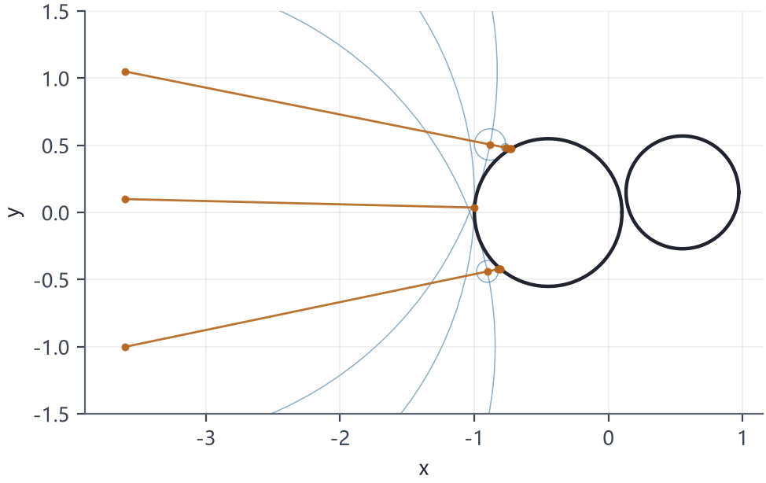
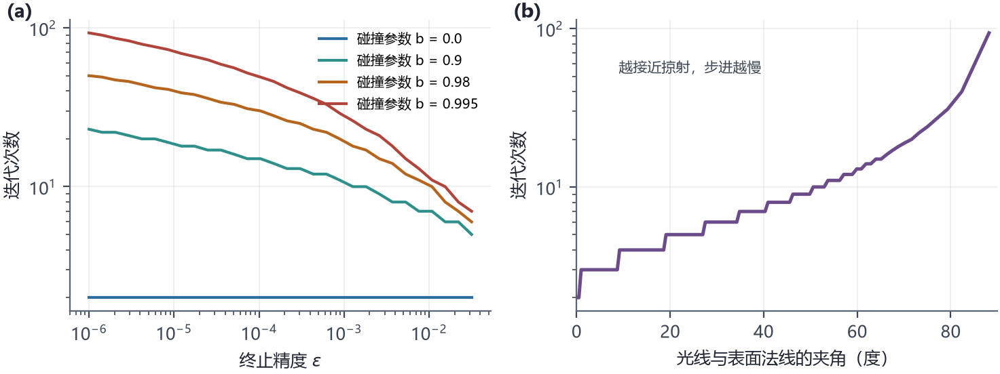
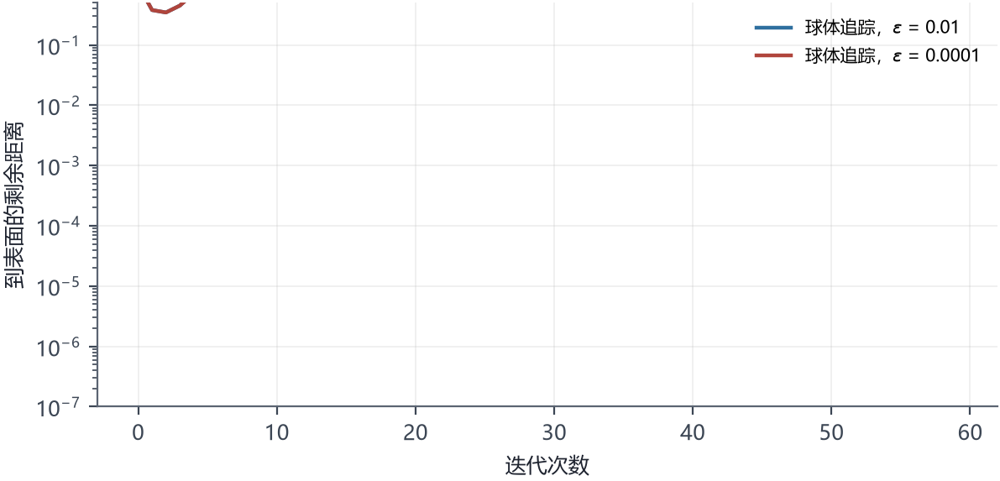

# 第 10 章 光线步进

## 10.1 一条光线走了几步

把一条光线放在距离场里，用固定的步长往前走，每步检查一次场值。步长取 $0.01$，光线要走三米，就是三百步；场景的尺度是十米，就是一千步。步长取大了会跳过薄的东西，取小了计算量翻倍。这个两难在网格渲染里也有，叫步进采样，解决办法通常是先建加速结构再求交。

距离场给的解法不一样。既然每一步都知道"离表面还有多远"，那就走那么远。图 10-1 是这个做法的几何：从当前点画一个半径等于场值的圆，这个圆不与表面相交，所以走到圆的最远处也不会碰到表面。图里的三条光线各走两三步就到了表面，都没有跨过。



这个算法叫球体追踪（sphere tracing），出自 Hart 1996 年的文章。它的伪代码不到十行

```python
import numpy as np

def sphere_trace(o, u, field, tmax=1e3, eps=1e-3, maxit=256):
    t = 0.0
    for _ in range(maxit):
        d = field(o + t * u)
        if d < eps:
            return t
        t += d
        if t > tmax:
            return None
    return None
```

## 10.2 为什么可以走这么远

步长取场值的合法性来自 2.3 节的 1-Lipschitz 性质。设当前点 $\mathbf{p}$，场值 $v=f(\mathbf{p})>0$，考虑以 $\mathbf{p}$ 为心、半径 $v$ 的球。球内任意一点 $\mathbf{q}$ 满足 $\lVert\mathbf{q}-\mathbf{p}\rVert\le v$，由 (2.6)

$$f(\mathbf{q})\ge f(\mathbf{p})-\lVert\mathbf{q}-\mathbf{p}\rVert\ge v-v=0 . \tag{10.1}$$

所以球内的场值非负，球内没有表面。走到球面上最远的那个点也是安全的，那一点的场值可能为零，也就是刚好碰到。

这条不变量还有一个更强的形式。若把步长取成 $cf$，$c\le1$，则

$$f(\mathbf{q})\ge f(\mathbf{p})-c\,f(\mathbf{p})=(1-c)f(\mathbf{p}) , \tag{10.2}$$

球内场值不小于 $(1-c)v$，也就是说下一步的场值至少是这一步的 $(1-c)$ 倍。这个界很松，实际收敛比它快得多，但它保证了不会停滞。

$c=1$ 时上界退化成零，说明刚好相切的情形会出现，这时候下一步的场值可能极小，迭代会在表面附近磨很久。实际实现里用 $\epsilon$ 提前退出，就是为了避免这种磨。

## 10.3 步长策略

纯粹的 $t\mathrel{+}=f$ 在多数场合已经够用，但有几处需要调整。

最大步长限制。当场景很大而相机很远时，第一步的场值可能是几百米，一步跨过大半个场景没有问题，但会让阴影计算里的一次步进跨越整个场景，采样点稀疏。常见做法是设一个上限 $h_{\max}$，取 $\min(f,h_{\max})$，把远处的步长压到一个可控的范围。

松弛因子。有些实现用 $1.2f$ 甚至 $1.5f$ 让步数更少，这在精确距离场上是过冲，会穿模。只有在场明显保守（比如平滑并集、缩放修正之后）时才安全，而且要有上界保证，不能凭经验。

负值处理。光线起点在物体内部时，场值是负的，$t\mathrel{+}=f$ 会让 $t$ 变小，朝反方向走。正确的做法是单独处理内部出发的光线，把它当作"从内部命中表面"，用 $|f|$ 步进或者直接求 $-f$ 的零点。

相对精度。$\epsilon$ 与像素覆盖率相关，不能取固定值。1080 行、60 度视场，一个像素在距离 $z$ 处的覆盖尺寸是 $2z\tan30^\circ/1080\approx z/935$，所以 $\epsilon$ 取 $z/1000$ 是合理的，随深度变化。

## 10.4 收敛有多快

图 10-2 左边是一个半径一的球，四条光线从远处平行射入，碰撞参数（光线到球心的距离）分别是 0、0.90、0.98、0.995。横轴是终止精度，纵轴是迭代次数，双对数坐标。

三条曲线的斜率几乎相同，说明迭代次数与 $\log(1/\epsilon)$ 成正比。这个结论对光滑的凸形状普遍成立，因为每一步的场值与剩余距离成比例，比例系数由入射角决定。碰撞参数为 0 的那条光线只有一步，因为起点在球心的正前方，场值正好等于到表面的距离。



右边把入射角拿出来单独画。横轴是光线与表面法线的夹角，从 0 度到 90 度，纵轴是迭代次数，对数尺度。夹角小于 40 度时步数在十步以内，过了 60 度开始指数上升，85 度以上要上百步。

这件事的后果是轮廓处的代价不均匀。画面中心的像素十几步，画面边缘的像素可能上百步，一条光线追踪器的总耗时由最慢的那批光线决定。处理方法有两种，一种是对掠射光线设迭代上限，超了就当命中，误差在轮廓处表现为一两个像素的圆角；另一种是用解析求交处理轮廓附近的形状，把步进留给内部。

图 10-3 是同一个过程的另一种看法。横轴是迭代次数，纵轴是到表面的剩余距离，对数尺度。曲线是阶梯状的，因为每一步走的是当前距离，剩余距离随之按比例缩小；两条曲线的差别在于终止精度不同，曲线在精度处被截断。



## 10.5 终止条件

终止条件有三类，缺一不可。

场值小于 $\epsilon$，判定命中。这是正常出口。

$t$ 超过场景的远平面，判定未命中。

迭代次数超过上限，判定未命中或者"模糊命中"。上限的作用是防止掠射光线和病态场把循环卡死，取值通常在一百到三百之间。上限太小会在轮廓处出现缺口，太大在异常场里会卡住整个着色器。

还有一类隐蔽的终止问题。一条光线在一层薄壁里前进时，场值可能一直在 $\epsilon$ 附近振荡，既不上升也不下降，此时 $t$ 增长极慢，循环靠迭代上限退出。这类光线在视觉上表现为物体表面有一层噪点，原因是命中判定不稳定。处理办法是把 $\epsilon$ 与深度绑定，或者对薄结构单独用保守步长。

## 10.6 与解析求交混合

纯步进有一个天然劣势：它不利用形状的解析信息。一个平面，用解析求交是一次除法，用步进要几步到几十步，取决于角度。一个大的三角形，解析求交是几次点积，步进要几十步。

所以实际系统通常是混合的。做法是在场里对某些形状保留解析求交的入口，遇到这些形状先做解析测试，命中就返回，未命中再让步进继续走。混合的关键是两者的 $t$ 要一致：解析求交返回的是到该形状的距离，步进返回的是到整个场的距离，两者取小。

更彻底的混合是用两层结构。外层是 BVH，里面放三角形；距离场只用于特定的物体，或者用于全局光照的近似。第 16 章会讲这个结构。

## 10.7 实现上的几处细节

**从内部出发**。相机在物体内部，或者光线穿进物体之后再出发，场值为负。这时步进的方向是错的，需要单独处理：取 $t\mathrel{+}=|f|$，并在场值由负变正时判定为出射。

**场值很大**。远处的第一步可能跨过整个场景，这时如果 $h_{\max}$ 没有设，采样点会跳过所有细节。这不影响主可见性，因为主光线只需要第一个交点；但影响阴影，因为阴影需要沿途的最小值。

**精度与尺度**。单精度浮点的相对精度是 $10^{-7}$，对一个十米的场景，绝对精度是 $10^{-6}$ 米。$\epsilon$ 取 $10^{-4}$ 是安全的，取 $10^{-7}$ 就会落在噪声里。用双精度时这个约束松两个数量级。

**循环展开**。GPU 上循环体越短越好，但展开会阻止编译器优化早退。实测下来，把"读场值、比较、累加"三步写成一次采样加一次比较，编译器的调度最好；把整个循环按四步展开反而更慢，因为每次都要检查四个出口。

**梯度与步进共用**。求出交点之后要算法线，如果法线用差分，可以复用步进时最后几次的场值，省掉几次采样。这个优化在 GPU 上值几十个百分点。

---

这一章讲了球体追踪本身。它的合法性来自 1-Lipschitz，步长取场值不会跨过表面，这个不变量是整个方法的基础。它的收敛是几何的，迭代次数与 $\log(1/\epsilon)$ 成正比，比例随入射角变差，掠射时按指数增长。终止条件要三条齐全，缺一条就会出现卡死或者缺口。

下一章从交点出发，算三样东西：法线、环境光遮蔽、软阴影。这三样都不需要额外的几何信息，只需要在表面附近再采几次场值。
