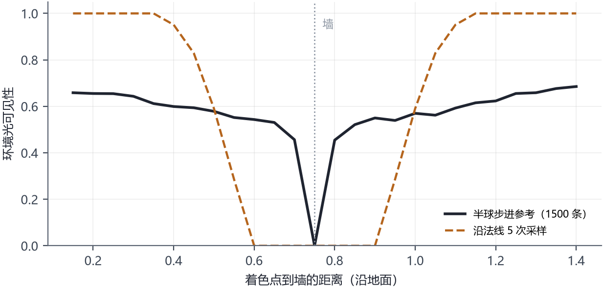
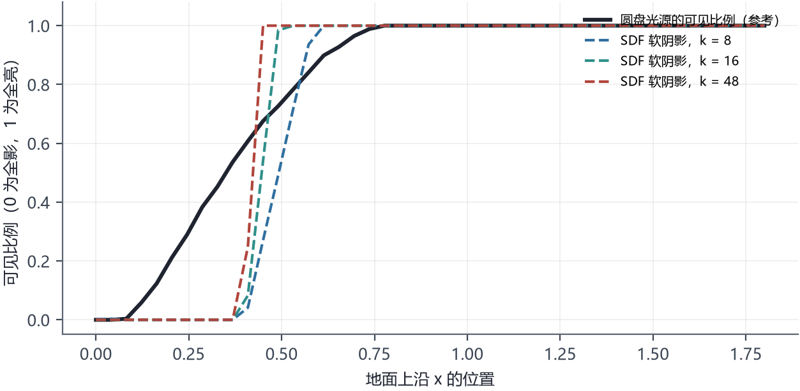
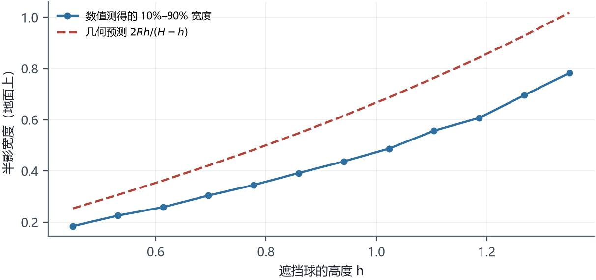

# 第 11 章 法线、环境光遮蔽与软阴影

## 11.1 接触处的那一圈黑

一个球放在地板上，球与地板的接触处有一圈阴影，靠近接触点的部分最黑，往外逐渐变亮，这个过渡的宽度大约等于球的半径。如果用一条锥形的环境光遮蔽去近似，得到的是一条均匀的暗带；如果用硬阴影，得到的是一条锐利的分界线。

真实的宽度来自光的尺寸和几何的关系。地板上的点越靠近球，它能看到的天光越少；球与地板之间的缝隙越窄，能漏进去的光越少。距离场恰好能表达这两件事，因为缝隙的宽度就是距离值。

这一章讲从距离场算出三个量：法线、环境光遮蔽、软阴影。三者都只用到表面附近的距离值，不需要场景的其他信息。

## 11.2 法线

法线就是归一化的梯度，第 4 章已经讲过。这里只补两条实践上的规则。

用解析场时不要归一化，因为梯度长度已经是一，多一次归一化只是多一次除法。用网格距离场时一定要归一化，因为差分的梯度长度会偏离一，不归一化的法线会让光照强度随位置抖动。

表面上的点不要用力差分以外的格式。前向差分在斜面上有系统偏差，法线会偏向坐标轴；中心差分要六次采样；四面体法四次采样、一阶精度，在 GPU 上最划算。

## 11.3 环境光遮蔽

环境光遮蔽（ambient occlusion）的定义是半球上可见性函数的余弦加权平均

$$A(\mathbf{p})=\frac{1}{\pi}\int_{\Omega(\mathbf{n})}V(\mathbf{p},\omega)\,(\omega\cdot\mathbf{n})\,d\omega , \tag{11.1}$$

其中 $V$ 在光线被挡住时取零，否则取一。这个量只与几何有关，与光的分布无关，所以可以在预处理阶段算好，也可以实时近似。

距离场给出的近似是沿法线采几个点，看每个点离表面有多近

$$A(\mathbf{p})\approx1-c\sum_{i=1}^{N}\Big(h_i-f(\mathbf{p}+h_i\mathbf{n})\Big) , \tag{11.2}$$

其中 $h_i$ 是从表面往外的采样距离，$c$ 是一个缩放常数。直觉是这样的：如果沿法线走一小段就碰到别的东西，说明上方被遮住了；如果走出去很远都没有东西，说明上方开阔。$h_i-f$ 这一项在开阔处为零，在贴着别的表面时接近 $h_i$。

图 11-1 是一个墙角。地面上从墙脚向外取一系列点，横轴是到墙的距离，纵轴是可见性。黑线是半球方向逐条步进得到的参考值，橙线是沿法线五次采样的估计。

两者的差距很大。开阔处参考值是 $0.6$ 左右，因为那面一米高的墙挡住了朝向它的半个方位角上的低仰角方向，这部分占整个半球的四成；而五次采样的估计给出了 $1.0$，也就是完全没有遮挡。

这个偏差的来源很清楚。沿法线采样只探测法线方向附近的一个锥，锥外的遮挡它看不到。那面墙在着色点的侧上方，仰角不高，正好在锥外。贴近墙脚时两者都趋于零，因为那时法线方向的采样立刻撞上墙；离开墙之后，参考值缓慢上升，估计值却很快就饱和到一。

这个偏差有两种补救。一种是把采样方向从法线方向改成若干个分布在整个半球上的方向，每个方向各采一次，代价是按方向数线性增长。另一种是承认这个近似只适用于"凹角"与"缝隙"，开阔处的遮蔽另行处理，比如用一张低频的环境光遮蔽贴图。

## 11.4 软阴影

软阴影的估计算法利用同一个事实：从着色点向光源走，沿途最小的"距离除以已走距离"就是遮挡的强弱

$$S(\mathbf{p})=k\min_{t\in(0,\,d_L]}\frac{f(\mathbf{p}+t\,\mathbf{u}_L)}{t} , \tag{11.3}$$

其中 $\mathbf{u}_L$ 是指向光源的单位方向，$d_L$ 是到光源的距离，$k$ 是一个放大常数。这个比值在完全无遮挡时接近 $k$，在紧贴遮挡物时接近零。

几何含义是"遮挡物在视线方向上的角尺寸"。$f/t$ 是遮挡物到视线的距离与沿视线距离之比，也就是张角的正切。取沿途的最小值，就是最"胖"的那个遮挡物。乘以 $k$ 把它映射到 $[0,1]$。

图 11-2 是一个圆盘光源、一个球、一块地板。横轴是地面上沿 $x$ 的位置，黑线是光源圆盘上采样三千个点算出的真实可见比例，三条虚线是不同 $k$ 的估计。

估计值与参考值的关系很有意思。在阴影内部两者都是零，在完全照亮的地方两者都是一，但在半影里，参考值是一条宽约 $0.6$ 米的斜线，估计值却是一条宽度不到 $0.1$ 米的陡坡。

原因在 (11.3) 的结构里。这个式子只沿一条方向（指向光源中心）走，走到的每一个点上只问"离最近的表面多远"，从来不问"光源有多大"。当光源的角尺寸大于遮挡物的角尺寸时，真实的半影很宽，而 (11.3) 给出的过渡宽度只由遮挡物的边缘决定，与光源大小无关。

$k$ 只影响过渡的位置，不影响宽度。图里三条虚线几乎重合，只是整体左右移动了一点。这一点常被误解，很多实现把 $k$ 当成"软硬"参数，实际上它控制的是"多暗才算影子"。

## 11.5 半影有多宽

半影的宽度有一个简单的几何公式。设光源半径 $R$、高度 $H$，遮挡物的高度 $h$，地板上半影的宽度近似是

$$w\approx\frac{2Rh}{H-h} . \tag{11.4}$$

推导用相似三角形。从光源边缘到遮挡物边缘，再延长到地板，这一段在地板上的投影就是半影。光源边缘相对遮挡物的偏移是 $R(1-h/H)$ 的量级，再乘上放大倍数 $H/(H-h)$，得到 (11.4)。

图 11-3 把这个式子与实测值画在一起。横轴是遮挡球的高度，纵轴是半影宽度。实测的做法是在每个高度上把参考曲线算出来，量出可见性从 0.1 到 0.9 的那一段宽度。

两者趋势一致，实测比预测窄两成左右。原因在于 10% 与 90% 这两条等值线比全影与全亮的边界更靠内，所以量出来的比几何上的完整半影窄。这个差别不影响结论：半影的宽度由光源尺寸与几何关系决定，与距离场无关，所以任何只用距离场的估计都不可能正确给出这个宽度。

要正确地做出宽半影，只能在光源上采样，也就是多发几条光线，每条对光源上的一个点做 (11.3)。发四条到八条就足以让半影的形状对起来，代价是阴影的成本乘以这个数。这是路径追踪的做法，距离场在这里只负责"这条光线通不通"，不负责"有多通"。

## 11.6 三者的共同点

法线、环境光遮蔽、软阴影都是从一个距离值里榨出来的信息，它们的可信度取决于同一个前提：距离值在采样的尺度上等于真实距离。

法线的可信度取决于差分步长附近的场是否光滑，中轴附近不成立。环境光遮蔽的可信度取决于采样锥覆盖的方向，锥外的遮挡看不到。软阴影的可信度取决于沿光线的那一段是否被充分采样，薄壁与掠射会漏。

这三种失效在画面上表现为三类不同的错误。法线错是中轴附近的条纹，环境光遮蔽错是开阔处的过亮，软阴影错是半影的过窄与漏光。排查时可以分开看：把着色换成纯法线，把 AO 单独输出成一灰度图，把阴影单独输出成一灰度图，哪个有问题一目了然。

## 11.7 一处容易忽略的偏差

(11.3) 里的 $k$ 还承担了另一个作用：抑制自阴影。着色点本身在表面上，向光源走的第一步 $t$ 很小，$f/t$ 会出现零除以零的情形。实现时通常把起始 $t$ 取成一个小的正常数，比如 $0.02$，并且把场值做一次 clamp，避免第一步就把结果打成零。这两个处理都会让靠近表面的遮挡被低估，表现为接触处的阴影不够黑。

接触处的阴影恰恰是最需要准的地方，因为人的眼睛对物体与地面之间那一圈很敏感。一个折中的做法是在贴近表面的一段用更小的步长和更严格的比例，远处放宽，也就是把迭代的起始 $t$ 与场景尺度绑定，而不是写死。

---

这一章讲了三个从距离场直接榨出来的量。法线是梯度，环境光遮蔽是法线方向上的距离，软阴影是沿光线方向的距离与距离之比。三者都便宜，也都只在特定条件下准：法线在中轴附近失效，环境光遮蔽在开阔处高估可见性，软阴影把宽半影压成窄边。

下一章换一个完全不同的用法：不把距离场当几何，而是当密度场。那里的距离值不再用来找表面，而是用来决定光在空间中走多远会被吸收。
