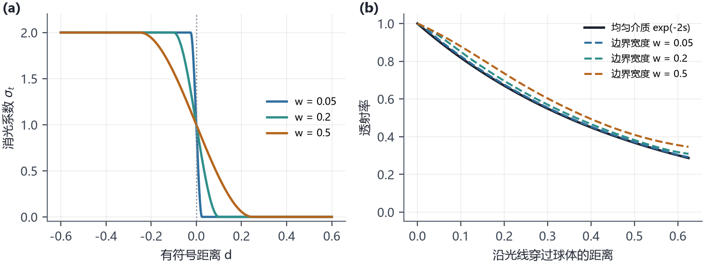
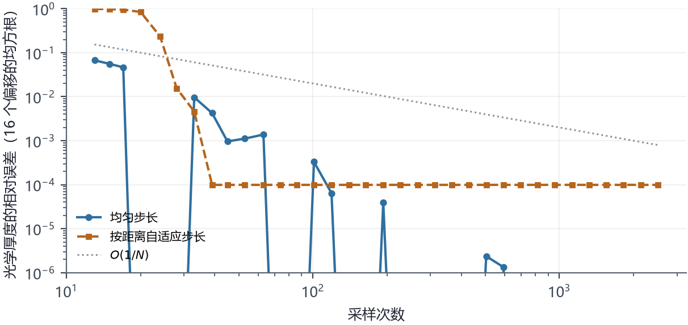
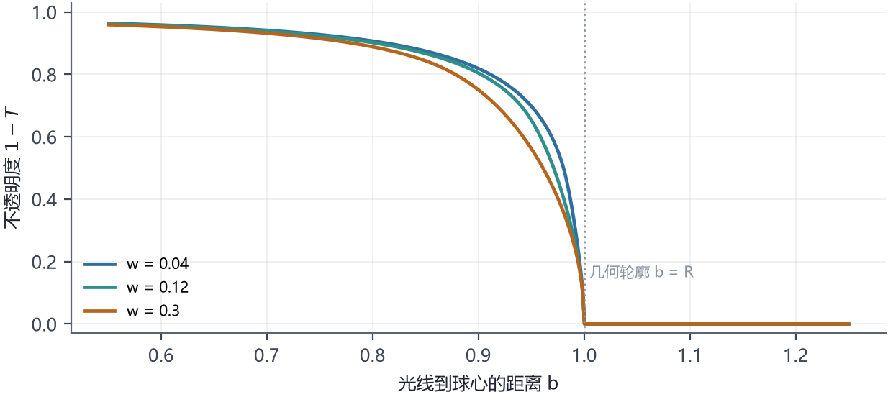

# 第 12 章 SDF 与体积渲染

## 12.1 一块蜡

一块半透明的蜡，光从背面打过来，边缘透出一层暖色的亮，中心反而不亮。这个效果用表面着色做不出来，因为表面着色只问"这一点朝哪、有多少光到这一点"，而这里的光是在材料内部走了一段才出来的。

体积渲染需要两个量：消光系数和散射系数。它们描述"光走一米会被吸收多少、被散射多少"。对真实的蜡，这两个量在内部是常数，在边界处从常数过渡到零。这个过渡带的形状，恰好可以用距离场描述。

这一章讲怎么把距离场当密度场用。核心是一个映射 $d\mapsto\sigma_t$，把距离变成消光系数；以及一个沿光线的积分，把消光系数变成透射率。

## 12.2 从距离到密度

最简单的映射是一个以表面为中心的过渡带

$$\sigma_t(\mathbf{p})=\sigma_{\max}\,S\!\left(\frac{1}{2}-\frac{d(\mathbf{p})}{w}\right) , \tag{12.1}$$

其中 $S$ 是一个把 $[0,1]$ 映到 $[0,1]$ 的光滑函数，常用的是 $S(t)=t^2(3-2t)$，$w$ 是过渡带宽度。$d$ 远小于零时 $S$ 取一，材料是实的；$d$ 远大于零时取零，材料是空的；中间是过渡。

用 $S$ 而不是直接截断，有两个原因。截断的密度场在 $d=\pm w/2$ 处不连续，沿光线积分时会在那里产生阶梯状的误差；光滑函数让误差降到二阶。第二个原因是法线：体积渲染里有时要用密度梯度做光照方向，截断的梯度是零或者无穷，用不了。

图 12-1 左边是三条不同 $w$ 的曲线。$w$ 越小，过渡越陡，越接近"实心物体"；$w$ 越大，材料越像一团雾。右边是一条掠过球体边缘的光线穿过去的透射率，$w$ 越大，同样路径上积累的光学厚度越小，透射率越高。

## 12.3 沿光线积分

体积渲染的方程是

$$L(\mathbf{p},\omega)=\int_0^{D}T(0,t)\,\sigma_s(\mathbf{p}_t)\,L_i(\mathbf{p}_t,\omega)\,dt+T(0,D)L_{\text{bg}} , \tag{12.2}$$

其中 $T$ 是透射率

$$T(a,b)=\exp\left(-\int_a^b\sigma_t(\mathbf{p}_s)\,ds\right) . \tag{12.3}$$

数值上把它离散成一串区间，每个区间取中点或者两端平均

$$\int_a^b\sigma_t\,ds\approx\sum_{k}\frac{\sigma_t(x_k)+\sigma_t(x_{k+1})}{2}\,\Delta x_k . \tag{12.4}$$

距离场在这里的作用是给了一个"哪里可以跳"的依据。空的地方距离值大，密的地方距离值小，于是步长可以取

$$\Delta x=\max\big(c\,|d|,\ h_{\min}\big) , \tag{12.5}$$

$c$ 取 0.3 到 0.5，$h_{\min}$ 是允许的最小步长。在远离表面的地方一步跨很远，靠近表面时自动变细。

## 12.4 积分的误差

图 12-2 是一个球体的光学厚度积分，横轴是采样次数，纵轴是相对误差。

均匀步长的曲线不单调。这在预料之外，但原因很清楚：密度场在一个宽度为 $w$ 的带里从零变到 $\sigma_{\max}$，如果采样点恰好落在带的两端，梯形公式误差很小；如果采样点落在带中间，误差就大。同样的场景在不同像素上有不同的采样相位，于是画面里出现条纹。

按距离自适应的曲线是单调的，因为它总在表面附近加密采样。它在 $10^{-4}$ 附近停住，这是 $h_{\min}=0.004$ 带来的下限，再细化就要减小 $h_{\min}$。

这个对比给出一条实践规则：体积渲染的采样相位要随机化。每个像素加一个抖动，把条纹变成噪声，噪声比条纹容易接受，也容易用时间去噪。

## 12.5 表面与体积的边界

同一个距离场，可以当表面用，也可以当体积用，两者的区别是 $w$ 的大小。

图 12-3 是一条光线扫过球体边缘时不透明度随冲击参数的变化。三条曲线的差别在边缘附近：$w=0.04$ 时过渡带只有几个像素宽，看起来像一条抗锯齿的边缘；$w=0.30$ 时过渡带占半径的三成，看起来像一个软边的云团。

注意中心的不透明度也随 $w$ 下降。这不是边缘效应，是因为同样的总质量被摊到了更宽的带上，密度变低。要保持中心的观感不变，$\sigma_{\max}$ 要随 $w$ 增加，$w$ 翻倍时 $\sigma_{\max}$ 大约也要翻倍。

什么时候用表面，什么时候用体积，判据是"这个物体有没有值得看的内部"。玻璃、水、蜡、烟、云有，金属、塑料、石头没有。判据的第二条是"边缘要不要软"，玻璃的边缘是硬的，因为折射率在边界处突变；云的边缘是软的，因为密度连续变化。

## 12.6 折射与内部路径

透明介质需要一个额外的处理：光线进入之后方向改变，出来之后再改变一次。用距离场可以这样做。

光线在场外步进，命中表面之后用梯度算法线，按折射定律算出内部方向，继续步进。内部步进时场值是负的，取 $|f|$ 作为步长，走到场值变正时就是出射点。出射时再折一次。

这个做法有一个隐患。折射之后光线在内部走，场值从零变负再变正，第一次变正的地方是出射点，但如果内部有空洞（比如一个中空的球），场值会再变负，光线会在内部来回，需要限制反弹次数。

另一个隐患是全反射。入射角大于临界角时，折射定律没有实数解，必须全反射。数值上要判断 $\sin\theta_t$ 的平方是否大于一，大于就反射。这个判断在着色器里是一个分支，容易出现像素级的错误，通常用一次 smoothstep 混过去。

## 12.7 相位函数

上面所有推导都只算了"有多少光被散射"，没有算"散射到哪个方向"。真实介质有一个相位函数 $p(\omega,\omega')$，描述从方向 $\omega$ 来的光被散射到 $\omega'$ 的比例。渲染里最常用的是 Henyey–Greenstein 形式

$$p(\cos\theta)=\frac{1-g^{2}}{4\pi\big(1+g^{2}-2g\cos\theta\big)^{3/2}} , \tag{12.6}$$

$g$ 是各向异性参数，取零是各向同性，取正表示前向散射（水滴、雾），取负表示后向散射（灰尘）。

这个函数与距离场无关，它是材质属性，不是几何属性。但它决定了体积渲染的采样策略：前向散射的介质，光主要沿原方向走，从背面打过来的光穿不过去；后向散射的介质，从正面打过来反而更亮。一团用距离场表示的云，看起来像不像云，几乎全部取决于 $g$ 与密度衰减的搭配，与云的形状关系不大。

## 12.8 一团烟的记忆

如果场景里有几团烟，每团烟都是一条光线的积分，成本会乘以团数。这是体积渲染最大的开销来源，也是第 13 章锥追踪要解决的问题的一部分。

距离场在这里给了一个好处：烟团的边界是光滑的，可以用较低的采样率加插值，而不会出现明显的边界。用网格表示的烟团在低采样率下会露出方块，用距离场表示不会，因为距离场本身是连续的。

坏处是距离场不适合表示乱流。烟的内部有丝状的密度变化，距离场只能表示一个整体的形状，内部的细节要么另外加噪声，要么放弃。这是距离场在体积渲染里的边界：它擅长形状，不擅长纹理。

---

这一章把距离场当成了密度场。映射是一个以表面为中心的过渡带，宽度 $w$ 控制"实心"还是"雾状"；沿光线的积分用梯形公式，步长按距离自适应；误差在均匀采样下会与密度边界发生相位干涉，产生条纹，用抖动可以换成噪声；透明介质要在内部继续步进并在出射时再折一次。

下一章把这种"沿一条方向积分"的做法扩展到"沿一个锥积分"，用一条锥代替上千条光线，代价是近似的偏差。
