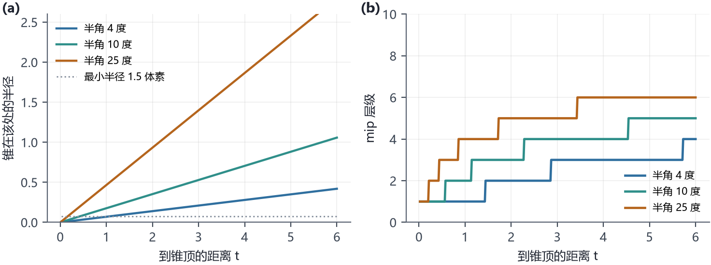
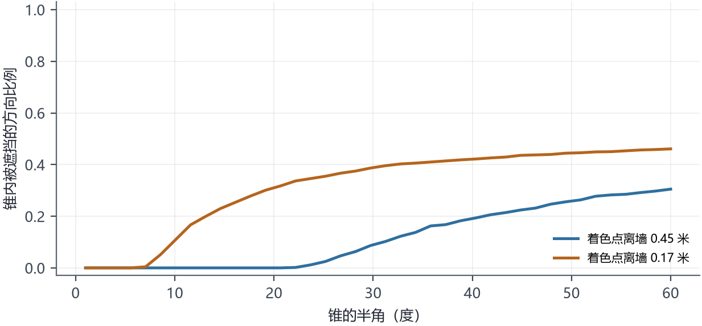
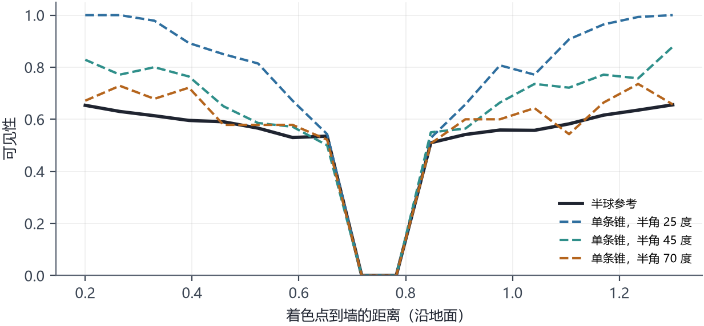

# 第 13 章 锥追踪与全局光照

## 13.1 一个像素要多少条光线

一次弹射的全局光照，每个着色点要在半球上撒几十到几百条光线，每条光线要步进几十步，每步是一次距离场求值。1080p 的画面，两百万像素，乘以这个数就是十亿级别的求值，任何硬件都受不了。

锥追踪（cone tracing）把这个数字降到个位数。它的做法是把"一条光线"换成"一条锥"，锥有张角，在一段距离之后覆盖一片面积。查询遮挡时不再问"这个方向有没有东西"，而是问"这片面积里平均有多少东西"。后者的答案可以从预先算好的层次结构里一次读出，代价与锥的粗细无关。

Crassin 等人 2011 年的工作把这个想法用在了体素上，用距离场也能做同样的事，区别在于层次结构里存的是距离而不是密度。

## 13.2 锥的足迹与层级

一条从 $\mathbf{p}$ 出发、轴向 $\omega$、半角 $\theta$ 的锥，在距离 $t$ 处的半径是

$$r(t)=r_0+t\tan\theta , \tag{13.1}$$

其中 $r_0$ 是锥顶的最小半径，取一到两个体素，避免在顶点处半径为零。

锥覆盖的那片区域，其信息可以从层次结构的某一层读出。层级的选法是让该层的体素尺寸接近锥的直径

$$l(t)=\left\lfloor\log_2\frac{2r(t)}{h}\right\rfloor , \tag{13.2}$$

$h$ 是最细一层的体素边长。$r$ 翻倍，层级加一。

图 13-1 左边是三条不同半角的锥的半径随距离的变化，右边是对应的层级。半角小的锥在很长一段距离内都停在第 0 层，半角大的锥很快就跳到高层。层级的增长是对数的，这意味着一条锥在穿过场景时只会访问十层左右，代价与场景的尺度是对数关系。

层级越高，存的值越"模糊"。最细一层存的是距离，粗一层存的是邻域内的平均占据率或者平均透射率。锥追踪真正用的是后者，因为锥要回答的是"这片区域里平均有多少遮挡"，而不是"最近的距离是多少"。

## 13.3 一条锥怎么走

锥追踪的步进与球体追踪不同。它每一步走到"当前锥半径"那么远，而不是"当前距离"那么远

$$t\mathrel{+}=\lambda\,r(t) , \tag{13.3}$$

$\lambda$ 取 0.5 到 1。走到一个新位置，读该层级的一个值，把它当作这一段路径上的平均消光系数，累乘到透射率上

$$T\mathrel{\times}=\exp\big(-\sigma\,L\big) , \tag{13.4}$$

其中 $L$ 是这一步的长度。走完整个锥，得到的 $T$ 就是这个方向上的可见性。

这个做法与球体追踪的关系值得说清。球体追踪的步长是"安全的"，保证不跳过表面；锥追踪的步长是"采样间隔"，它不保证不跳过任何东西，只是保证采样的密度与锥的尺寸匹配。所以锥追踪天然会漏掉比锥小的东西。

## 13.4 漏光

漏光是锥追踪最典型的偏差。场景里有一道窄缝，缝隙宽度小于锥在该处的直径，锥会把缝两侧的遮挡平均掉，得到的透射率是两者的平均，比真实值高。光就从缝里漏进来。

图 13-2 是一个量化。地面上一点，旁边一面一米高的墙，锥的轴向取法线向上，半角从 1 度扫到 60 度，纵轴是锥内被遮挡的方向比例。曲线在某个角度之前是零，因为锥太窄，完全没有碰到墙；过了这个角度迅速上升，然后饱和。

两条曲线的差别在起点。离墙近的那条在 8 度就开始上升，远的要到 22 度。这说明漏光的严重程度取决于"锥的半径与遮挡物距离之比"，也就是遮挡物在锥里的相对大小。

这个比较给出一个判据：要让一道宽 $g$ 的缝隙不漏光，锥在缝隙处的直径必须小于 $g$。锥的直径随距离线性增长，所以远处的缝隙一定会漏。这就是为什么锥追踪适合做低频的间接光，不适合做接触阴影。

图 13-3 把这件事放到完整的可见性上。黑线是半球参考，三条虚线是不同半角的单条锥。25 度的锥在高处给出接近 1 的可见性，而真实值是 0.6，多出来的 0.4 全是漏掉的遮挡。70 度的锥在近处反而低于参考值，因为它把墙的顶部也平均进来了，过度遮挡。

## 13.5 与屏幕空间方法的区别

屏幕空间的环境光遮蔽（SSAO）用深度缓冲重建几何，再在屏幕空间里采样。它与锥追踪的差别不在于精度，而在于信息来源。

SSAO 只能看到屏幕上的东西。屏幕外的几何、被前面物体挡住的几何，它都不知道，于是画面边缘的遮挡会丢失，物体与背景之间的接触阴影会消失。

锥追踪看的是完整的场景数据，没有这个限制。代价是它需要一份场景的层次结构，这份结构要么预计算，要么每帧更新，动态物体的更新成本不低。

另一条差别是半影的宽度。SSAO 的采样半径是固定的像素数，与场景尺度无关，于是近处的缝隙和远处的墙角得到同样的模糊程度；锥追踪的半径随距离增长，与真实的半影增长一致，虽然具体的宽度仍然是近似的。

锥追踪的成本可以估得很准。一条锥的步数是 $\log$ 量级，每一步读一次层级结构的一个样本，代价与一次三线性插值相当。八条锥、每条三十步，就是二百四十次采样，与球体追踪的五十到一百次求值在同一量级，但它一次覆盖了整个半球而不是一个方向。

这就是锥追踪的价值：它的每一份代价买到的不是一条方向的信息，而是一片立体角的信息。代价是那片立体角的平均，细节丢了。

## 13.6 实现上的几处

锥的数量取六到八条，方向按半球均匀分布。太少会出现方向性的条纹，太多则成本上升。八面体上的六个方向加两个正交方向是一个常用的选取。

半角取 30 度到 45 度。八条 30 度的锥覆盖整个半球会有重叠，重叠部分被重复计数，结果是过暗。修正的办法是按立体角归一化，每条锥的权重乘以它的立体角占半球的比例。

层级要有上限。有的实现允许层级无限增长，结果是远处的锥读到最粗的一层，那一层几乎是整个场景的平均值，遮挡完全不随位置变化。上限通常取到体素尺寸等于场景尺寸的四分之一为止。

抖动。每条锥的起始方向加一个随机旋转，把方向性的条纹换成噪声。噪声在时间上平均掉，条纹不会。

## 13.7 一个常被忽略的常数

锥的数量与半角定下来之后，还有一项开销容易被漏掉：锥的起点偏移。着色点本身在表面上，锥从表面出发的第一步如果取得太小，会读到"距离为零"的样本，透射率直接被打成零，物体表面出现一圈黑边。

标准的处理是把起点沿法线抬起半个体素到两个体素，并且把第一步的层级强制设为最细一层。抬起的距离与体素尺寸绑定，不能写成一个固定的世界单位，否则换一个分辨率的场景就要重新调参。

## 13.8 距离场在锥追踪里的角色

用体素做锥追踪时，层次结构里存的是占据率和辐照度。用距离场做，存的是有符号距离，锥的查询变成两步：先用距离判断这段路径上有没有表面，再用一个由距离导出的遮挡量累乘。

距离场的好处是薄结构表达得准。体素在薄结构上要么占据要么不占据，二值化之后厚度信息丢了；距离场在薄结构两侧都是小正数，锥穿过去时能算出正确的光学厚度。

坏处是距离场不带方向信息。锥要估的是"这个方向上有多少遮挡"，而距离场只给"最近的东西有多远"，没有"它在哪个方向"。所以用距离场做锥追踪时，通常还要额外存一份方向性的量，比如六向的可见性或者球谐系数，否则锥只能在轴向附近做文章。

这也是为什么实际系统里锥追踪多用体素、距离场多做表面与阴影。第 18 章会把这条分工写成选型建议。

如果一定要用距离场做锥追踪，一个可行的补救是在每个格点上额外存一组方向性的可见性，比如六个轴向的透射率，或者二阶球谐。锥的查询变成"按锥的轴向插值这组系数"，代价是内存涨六到九倍，回收到的东西是方向感。这个结构与第 15 章的砖块兼容，因为它只需要在每个块里多存一块数据。

---

这一章讲了锥追踪。它把"一条光线"换成"一条锥"，用层级结构一次读出锥覆盖区域的平均遮挡，代价是精度的损失。损失有三种表现：漏光，因为锥比缝隙粗；过暗，因为锥重叠或者过度平均；层级跳变，因为层级是离散的。

第 14 章回到数据。前面所有章节都假设距离场已经存在，接下来的三章讲它怎么从网格算出来、怎么存、怎么被路径追踪器查询。
