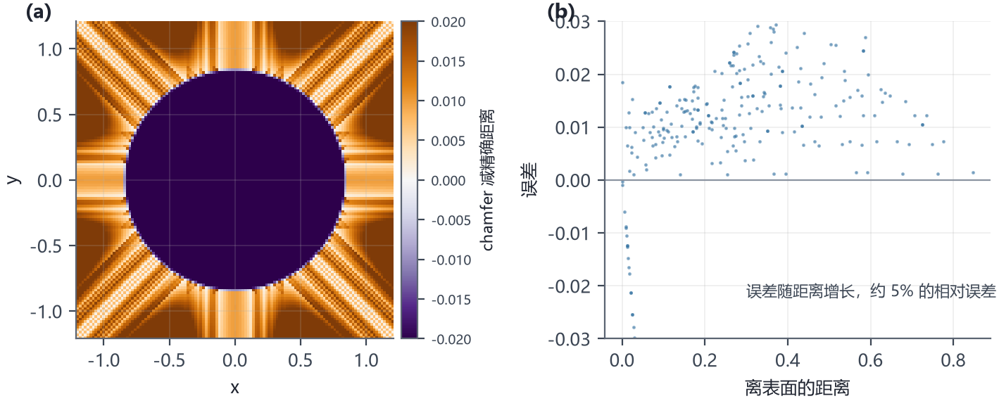
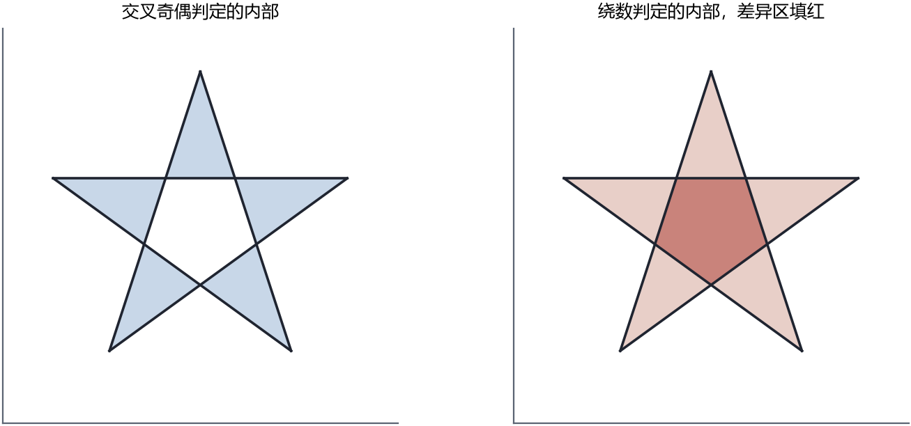
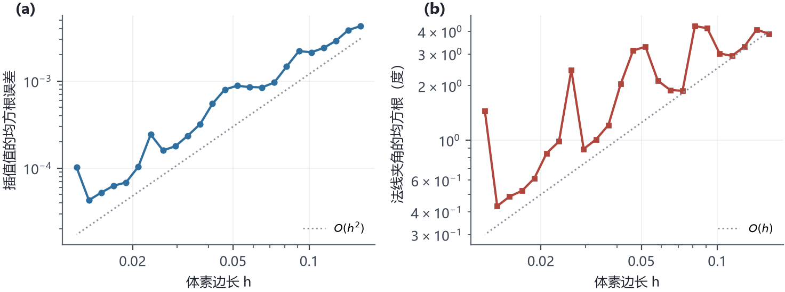

# 第 14 章 从网格生成 SDF

## 14.1 一个有洞的模型

从扫描或者雕刻得到的模型，常见的问题是它不是一个闭合的、无自交的曲面。手臂和躯干贴在一起的地方，两张面穿过去了；袖口是一个开口；扫描的接缝处有一圈重复的面。

把这样的模型转成距离场，两步都会出问题。算距离要先把表面离散成点集或者三角形，这一步还算稳；判内外要发一条射线数穿过的次数，遇到自交就会数错，遇到开口就会数出无意义的奇偶。

这一章讲这两步，以及它们的失败方式。先说结论：距离可以算准，符号判不准。这是从网格生成 SDF 的根本困难，所有工程上的技巧都是在回避它。

## 14.2 距离变换

距离场的离散版本是：在规则网格的每个格点上，存到最近表面的距离。给定一个占据掩码，这件事叫欧氏距离变换（Euclidean distance transform，EDT）。

定义是

$$D(\mathbf{i})=\min_{\mathbf{j}:\,\text{occ}(\mathbf{j})=1}\lVert\mathbf{i}-\mathbf{j}\rVert . \tag{14.1}$$

朴素算法对每个格点扫一遍所有占据格点，复杂度 $O(N^6)$，三维下不可用。

精确算法利用了距离的平方可以按坐标分解这件事。先沿 $x$ 做一维变换，再沿 $y$，再沿 $z$，每一步都是求

$$D_{k}(j)=\min_{i}\big(D_{k-1}(i)+(j-i)^2\big) , \tag{14.2}$$

这是一个下包络问题，可以用一次线性扫描解出来，因为每个抛物线的交点单调移动。三步做完，得到的就是三维的平方距离，总复杂度 $O(N^3)$，也就是每个格点常数次操作。

近似算法更简单，两遍扫描，每次用邻居的值加一个固定的权重

$$D(\mathbf{i})=\min\Big(D(\mathbf{i}),\ D(\mathbf{i}-\mathbf{e})+w(\mathbf{e})\Big) , \tag{14.3}$$

其中 $\mathbf{e}$ 取六个或二十六个方向，$w$ 取 $1$ 或者 $\sqrt2$、$\sqrt3$。这叫倒角距离（chamfer distance），第一遍从前向后扫，第二遍反向。

图 14-1 是一个圆在 $h=0.02$ 的网格上做倒角变换的结果。左边是误差图，误差呈放射状的条纹，沿坐标轴方向为零，沿对角线方向最大。右边是误差随距离的分布，误差随距离增长，大约是距离的百分之五。

百分之五听起来不多，但对步进是致命的：一个五米的场景，误差二十五厘米，足以让光线穿过一层墙。所以倒角距离只能用作初值或者用于不要求精确的场合，真正的渲染要精确 EDT。

还有一件事要提。EDT 给出的是到体素中心的最小距离，而真实表面穿过体素内部，所以即使精确 EDT 也有半个体素的系统偏差。修正的办法是在采样时用三线性插值，并且把表面位置定义为场的零等值面，而不是最近的体素中心。

## 14.3 窄带

完整的三维 EDT 要 $O(N^3)$ 的时间和内存。对 $512^3$ 的网格，这是 1.3 亿个格点，每个四字节是 512 MB，勉强能放下，再大一倍就不行了。

窄带（narrow band）只算表面附近的一层。带宽取 $k$ 个体素，需要计算的格点数约为 $kA/h^2$，$A$ 是表面积。对一个一米见方的模型，$h=2$ 毫米、$k=3$，格点数是 $6\times1/4\times10^{-6}=150$ 万，六兆字节。

带外的格点怎么办？两种做法。

一种是把带外的值统一设成一个常数，比如 $k h$。这会让步进在带外给出过小的步长，因为真实距离可能远大于这个常数。步数变多，但不会穿模。

另一种是用层次结构，粗层存远处的距离。这是第 15 章的内容。

窄带的宽度选择有一个权衡。窄带越宽，远处的步长越准，步数越少；越窄，内存越省。经验上 $k$ 取 3 到 8，再宽的话内存增长得比收益快。

## 14.4 符号

距离好算，符号难判。给定一个闭合曲面，判定一个点在里还是在外，标准做法是从这个点发一条射线，数它与曲面相交的次数，奇数次在内，偶数次在外。

图 14-2 是二维的同一个问题。一个五角星，用奇偶规则判定，中间的五边形是空的，因为它被两条边各穿一次；用绕数规则判定，中间的五边形是实的，因为绕数是二。两种规则给出的"内部"不一样，而这两种站在几何上都可以自洽。

三维网格的失败情形有四种。

**自交。** 两张面穿过去，射线在那里穿过偶数次，符号判反。表面附近看不出来，因为距离是对的；深入内部才出错，表现为物体中间有一块是空的，光穿过去，阴影漏出来。

**开口。** 模型没有封口，射线从开口出去，奇偶的结果取决于射线从哪个方向发出。这种模型的"内部"本身没有定义，任何算法都只能给出一个约定。

**薄壁与共面。** 射线恰好沿着一个三角形走，或者从一个顶点穿过，数值上会漏数或者多数。处理办法是给射线加一个随机的微小偏移，每个格点用不同的偏移，把系统性错误变成随机噪声。

**退化三角形。** 面积为零的三角形，法线没有定义，射线求交会给出 NaN，而 NaN 参与比较之后符号就乱了。

绕数规则（generalized winding number）对自交更宽容，Jacobson 等人 2013 年的做法是对每个三角形计算它对绕数的贡献，复杂度是 $O(N^3)$ 的暴力版本或者用层次加速的版本。它对开口网格也给出一个连续的值，可以按 0.5 截断，得到"最合理"的内外划分。代价是计算量大，通常是 EDT 的几十倍。

第三种做法是法线投影。对每个格点找最近的三角形，用该三角形的法线判断格点在正面还是背面。这个做法对自交不敏感，因为它只看局部；但它对法线的朝向敏感，法线不一致的网格会给出碎片化的符号。

实际工程里的组合是：先用绕数或者射线奇偶给出一个初值，再用形态学的方法清理孤立的错误（三维的连通性标记），最后用一次平滑把符号边界对齐到距离的零等值面。三步下来，绝大多数模型的符号能对，剩下的错误集中在薄壁与自交处，靠人工标记解决。

## 14.5 插值误差

网格上存的是离散值，查询时要插值。三线性插值是最常用的，它的值误差是

$$\lvert f_{\text{interp}}-f\rvert\le\frac{h^2}{8}\max\lvert\partial^2 f\rvert , \tag{14.4}$$

二阶导在距离场里是曲率，所以误差正比于 $h^2\kappa$。对曲率半径一米的表面，$h=2$ 毫米时误差是 $0.5$ 微米，可以忽略。

法线的误差不同。三线性插值的梯度在每个格子里是常数，跨格子时跳变，所以法线误差是一阶的，而且不随 $h$ 的平方下降。图 14-3 是实测：左边是值的均方根误差，斜率是二；右边是法线夹角的均方根误差，斜率是一，$h=0.1$ 时达到四五度。

这个不对称解释了为什么网格距离场的渲染里，几何轮廓看起来还行，高光却很脏。位置误差是二阶的，法线误差是一阶的，后者才是视觉上的瓶颈。

改进的办法有两个。一是插值用三次的（三三次），值的误差降到四阶，法线的误差降到二阶，代价是每次查询要读六十四个格点。二是把法线单独存一份，用八面体编码存两个字节，查询时直接插值法线，不通过对距离求导得到。后者的代价是内存翻倍，收益是法线质量大幅提升，实际系统里更常用。

## 14.6 流程

把上面几步串起来，从网格生成距离场的流程是这样的。

读入网格，建立三角形的 BVH。对每个格点，用 BVH 求最近三角形的距离，得到无符号距离。同时用一条射线（方向随机，起点是格点）与 BVH 求交，数穿过的次数，得到符号。写入窄带，带外标记为未计算。

第二步，对窄带做一次符号的连通性清理，把与邻居符号矛盾的孤立格点翻过来。

第三步，如果带外需要值，用层次结构填充，或者用窄带边界做外推。

第四步，可选地对整个场做一次平滑，把插值带来的高频噪声压掉。平滑会削减细节，所以半径要小于最细的特征。

整个流程的耗时分布大概是：最近距离查询占七成，符号判定占两成，其余占一成。要提速就从最近距离查询下手，比如用更粗的网格算初值，再在窄带内细化。

---

这一章讲了从网格生成距离场的两件事。距离用精确 EDT 或者倒角变换，前者 $O(N^3)$，后者快但有百分之五的误差；符号用射线奇偶或者绕数，前者在自交与开口网格上失效，后者更稳但更慢。插值带来二阶的值误差与一阶的法线误差，后者是视觉上的瓶颈，值得单独存一份法线。

下一章讲算完之后怎么存。同样精度的距离场，用不同的结构，内存可以差两个数量级。
