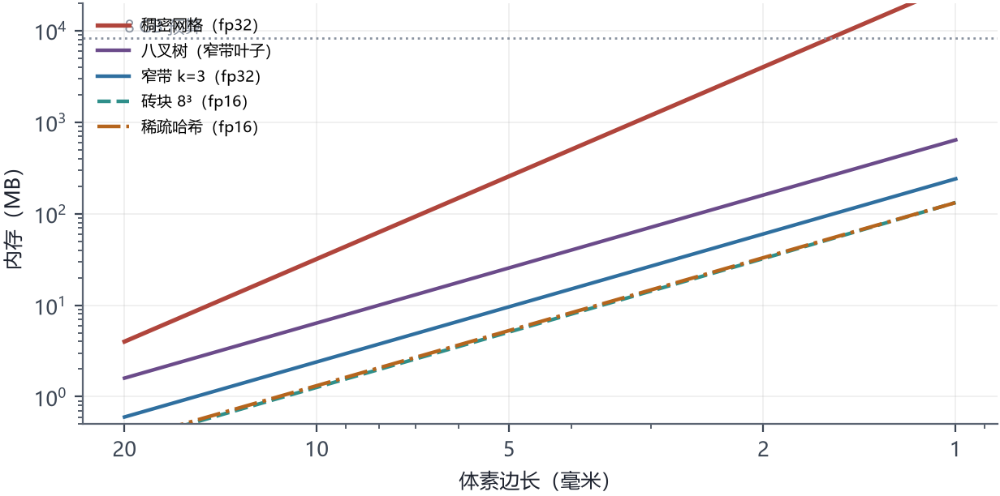
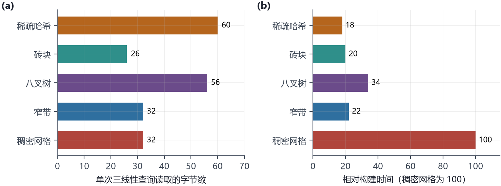
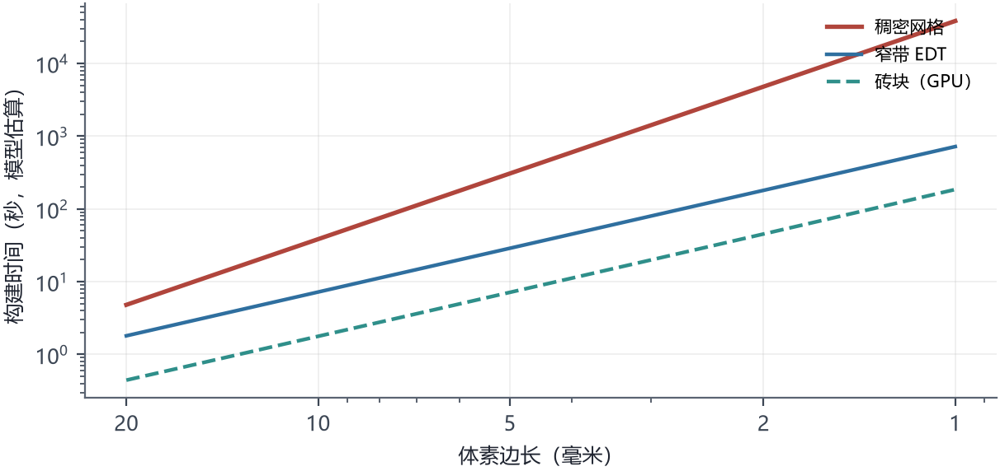

# 第 15 章 数据结构与压缩

## 15.1 一张放不下的距离场

一个两米见方的场景，距离场的分辨率取一毫米，格点数是一千的立方，十亿个。每个存四字节的浮点，四吉字节。这还只是一个场景，没有算上法线、材质、光照。

分辨率降到两毫米，内存降到五百兆，可以接受了，但一毫米才勉强够看清手指的粗细。降到四毫米，内存六十四兆，手指就变成一根棍子。

距离场的内存问题比网格尖锐得多。网格只在表面附近存数据，代价正比于表面积；稠密距离场正比于体积。这个差别在分辨率提高时被放大：分辨率翻倍，网格涨四倍，稠密场涨八倍。

这一章讲怎么把这个八倍改回四倍，以及改不回来的时候怎么办。

## 15.2 稠密网格

最直接的结构是一个三维数组

$$M_{\text{dense}}=4\left(\frac{L}{h}\right)^3\ \text{字节} , \tag{15.1}$$

$L$ 是场景边长，$h$ 是体素边长，四字节是单精度浮点。

这个结构的好处是查询便宜：三线性插值读八个相邻格点，地址由坐标直接算出，没有指针追踪，没有分支。GPU 上这是最快的结构。

坏处是内存与体积成正比，而距离场真正有用的部分只在表面附近。一个房间里，空气占九成的体积，那些格点的距离值只用来让步进跨过大步，精度完全不重要，却占着同样的内存。

## 15.3 窄带

只算表面附近的一层，带宽 $k$ 个体素，需要的格点数是

$$M_{\text{band}}=8k\,\frac{A}{h^2}\ \text{字节} , \tag{15.2}$$

$A$ 是表面积，系数八来自"带宽 $2kh$ 的体积除以 $h^3$ 再乘四字节"。

对一个两米见方、表面积十平方米的模型，$h=2$ 毫米、$k=3$，格点数是 $1.5\times10^7$，六十兆字节。比稠密的四吉字节小六十倍。

窄带的查询需要一个索引，把空间坐标映射到带内的位置。最简单的索引是一个粗网格，每个格子记录"这一块有没有带内数据"，有的话再查一张哈希表。这一步的代价是查询多了几次内存访问。

带外的值怎么处理，决定了窄带能不能直接用于步进。若带外一律返回 $kh$（带半宽），步进在带外每步只走三格，穿过一个空旷的房间要几百步。若带外返回一个更大的值，需要额外的结构支持，这就引出了下面几种。

## 15.4 八叉树

八叉树把空间递归地一分为八，只在不空的节点里继续分。叶子是带内的体素，节点只存"哪个子节点存在"。

叶子数等于窄带的格点数，节点数比叶子数多出七分之一（每一层的节点数是下一层的八分之一，等比求和的极限是一比七）

$$M_{\text{oct}}=N_{\text{leaf}}\left(1+\frac{1}{7}\right)\times8\ \text{字节} , \tag{15.3}$$

八字节是每节点两个 32 位字，一个存子掩码与叶子标志，一个存子节点偏移或者叶子的值索引。这个编码是 Laine 与 Karras 2010 年的做法。

查询时从根往下走，每层做一次坐标判断与一次位运算，深度是 $\log_8 N$。对 $512^3$ 的网格，深度是九层，也就是九次内存访问，比稠密网格的八次相邻读取要贵，但比 BVH 的深度遍历便宜。

八叉树的缺点是构建慢，而且 GPU 上的分歧严重：相邻像素走的路径不同，同一个 warp 里的线程会在不同层上停住，利用率下降。这是它在实时渲染里不如砖块流行的主要原因。

## 15.5 砖块

砖块（brick）把空间切成固定大小的块，通常是 $8^3$，块内是稠密数组，块之间用一张粗网格索引。

$$M_{\text{brick}}=2N_{\text{vox}}+4N_{\text{brick}}\ \text{字节} , \tag{15.4}$$

两字节是半精度浮点，四字节是每块的索引。块数大约是 $A/(64h^2)$，索引的开销可以忽略。

这个结构的查询特别适合 GPU：先查粗网格一次，再在块内做八次相邻读取，地址计算简单，没有循环。块的大小取八，是因为八的三次方是五百一十二，正好是半个缓存行到一行的量级，一次读取能把整个块的前半部分带进缓存。

压缩来自两处。一是半精度，距离值的量级在场景尺寸以内，半精度的相对精度是千分之一，对 $h=2$ 毫米的体素，绝对精度是两微米，够用。二是空块不分配，一个房间里大部分块是空的，索引里标记为"远"，查询时直接返回一个大值。

## 15.6 稀疏哈希

大场景（城市、地形）没有明确的边界，八叉树需要一个包围盒，砖块需要一张粗网格。稀疏哈希（sparse hash）用哈希表把坐标映射到砖块，不需要包围盒，也不需要在空旷处分配。

查询的代价是一次哈希计算加一次表查找，冲突用线性探测。哈希函数取坐标的三个大素数乘积异或，或者在 GPU 上用一小段位运算。

稀疏哈希的好处是可以流式加载：相机走到哪里，就把那里的砖块建出来，远处的释放。代价是哈希表本身要维护，扩容时有停顿。

## 15.7 分层

锥追踪需要 mip 链，也就是同一片区域在多个分辨率下的平均值。距离场的 mip 不能简单地对距离值取平均，因为平均值不是距离。正确的做法是把距离转成占据率再平均，或者存一个"平均距离"加上"距离的方差"，查询时按需要还原。

分层结构还有一个用处是让步进在大范围内跨得更快。一个房间里，最粗的一层只有几个格点，步进先在最粗的层上走，快碰到东西时再降级。这个做法叫层次步进，能把空旷处的步数从几百降到十几。

## 15.8 定量对比

图 15-1 是四种结构的内存随体素边长的变化。场景两米见方，表面积十平方米，纵轴对数尺度，红色虚线是 8 GB 的预算。

数字可以逐个读出来。$h=2$ 毫米时，稠密网格四吉字节，窄带六十兆，八叉树一百六十兆，砖块三十兆。

稠密网格在 1.7 毫米处越过 8 GB。窄带与砖块的曲线几乎平行于它，但整体低两个数量级，要到 0.2 毫米才越线。

八叉树在一百六十兆，比窄带高。原因是每个节点八字节，而窄带的一个体素只占四字节，再乘上节点数多出的七分之一，总共是二点七倍。这不是八叉树不好，是"每个体素一个节点"这种编码方式浪费。用更紧凑的编码（比如 Laine 与 Karras 的四叉树加位掩码）能把开销压到两三倍。

图 15-2 是查询与构建的对比。左图是单次三线性查询读取的字节数，右图是相对构建时间。

稠密网格的查询是三十二字节，八个角各四字节。砖块的二十六字节是八个半精度角加一次索引，反而更少。八叉树与哈希的五十到六十字节主要花在路径上。

构建时间的差别更大。稠密网格要对十亿个格点各做一次最近三角形查询，即使有 BVH 也是分钟级。窄带只对带内的一千五百万个格点做，快六十倍。砖块再加一层 GPU 并行，又快一倍多。

图 15-3 把构建时间单独画出来。三条线的斜率不同：稠密是三次，窄带与砖块是二次。这意味着分辨率提高时，窄带的优势会继续扩大。

## 15.9 怎么选

四条经验。

**单个物体、需要精确查询、内存不紧张，用稠密网格加半精度。** 它的代码最简单，查询最快，调试最容易。

**中等场景、静态、要跑在 GPU 上，用砖块。** 它兼顾了内存与查询效率，还天然支持空块跳过。

**大场景、需要流式，用稀疏哈希。** 它不需要包围盒，可以按需加载。

**需要层次遍历（锥追踪、层次步进），用八叉树或者带 mip 的砖块。** 八叉树的分歧问题在锥追踪里不那么严重，因为锥的路径比光线长，每个线程走的层数差不多。

有一件事要提醒。所有这些结构的收益都依赖"表面只占体积的一小部分"这个前提。对一团烟、一块云，这个前提不成立，因为体积内部处处有值。这时的正确做法不是换结构，而是换表示：用低分辨率的稠密网格加程序化噪声，而不是高分辨率的窄带。

---

这一章算了内存的账。稠密网格正比于体积，窄带、砖块、八叉树正比于表面积，两者相差一到两个数量级，而且分辨率越高差得越多。查询的代价差别不大，构建的代价差别很大。选结构的依据是场景规模、是否需要流式、是否需要层次遍历这三条。

下一章把距离场接进路径追踪器。那里要解决的问题不是内存，而是采样：路径追踪需要一个关于面积的概率密度，而距离场不提供。
