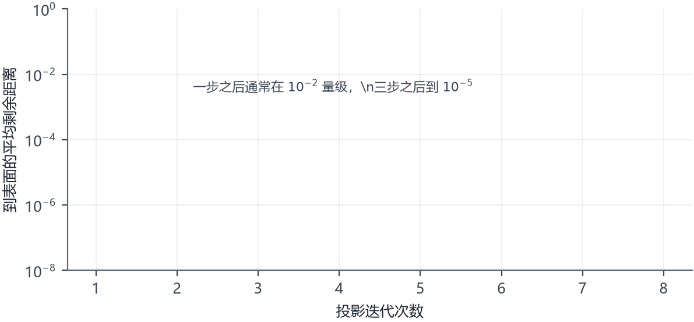
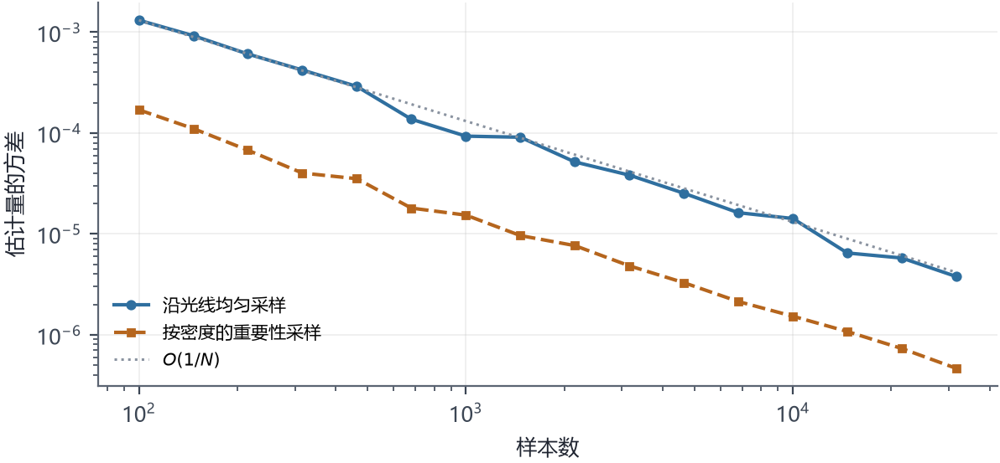
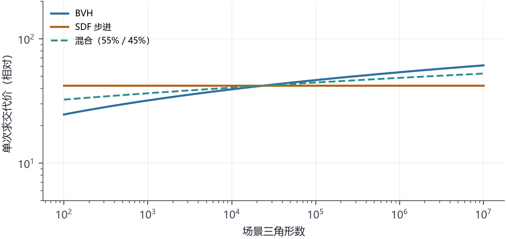

# 第 16 章 接进路径追踪

## 16.1 求交成了，画面还是不对

把球体追踪塞进路径追踪器，第一版通常能出图：球、盒子、布尔组合都正确，硬阴影也对。问题出在采样上。

从光源采一个点，连接到着色点，算出来的亮度比预期亮一倍或者暗一半，取决于形状。用半球均匀采样算间接光，噪点比网格版本大得多，收敛也慢。镜面反射倒是没问题，因为它是确定性的。

原因不在求交，在概率密度。路径追踪的每一步都要在某个空间里采样，采样必须带一个关于测度的密度。网格有面积测度，三角形有参数化，球面有立体角。距离场什么都没有，它只回答"这个点离表面多远"。

这一章讲怎么在这种情况下把 pdf 凑出来，以及凑不出来的地方怎么办。

## 16.2 求交与法线

求交就是球体追踪，第 10 章给过。在路径追踪器里它需要返回三样东西：命中距离 $t$、法线 $\mathbf{n}$、以及"是否命中"。

法线用解析梯度或者差分，第 4 章给过。要注意的是符号：从内部命中的时候法线朝里，着色时要不要翻转取决于材质是单面还是双面。

不需要 pdf，因为主光线的采样是相机给出的，与几何无关。二次光线（反射、折射）的方向由 BSDF 采样给出，也不需要几何的 pdf。只有一类光线需要：从表面向光源采样，或者从光源向表面采样。这时要折算到面积或者立体角。

## 16.3 面积采样的困难

路径追踪里最常见的操作是"在光源表面上采一个点"。网格上这件事是选一个三角形，按面积加权，再在三角形里采一个重心坐标。距离场没有三角形，也没有面积。

三种绕法，各有代价。

第一种是准备一份低模。距离场负责渲染，低模负责采样。两者的一致性靠构建时保证：低模是从同一个距离场提取的，采样点投影到零等值面上。缺点是低模本身有误差，投影之后点的分布不均匀。

第二种是用拒绝采样。在一个包围盒里均匀撒点，落在表面附近的接受。接受率正比于表面积除以包围盒表面积，对一个薄的东西很低，对球还行。

第三种是投影。先在一个方便的参数域里采点（比如球面、平面），再用距离场把它投到表面上

$$\mathbf{q}_{k+1}=\mathbf{q}_k-d(\mathbf{q}_k)\,\nabla d(\mathbf{q}_k) . \tag{16.1}$$

这个迭代就是 2.2 节的最近点公式，一步之后误差是二阶的，三步之后通常到 $10^{-5}$ 以下。图 16-1 是一个环面上的实测，纵轴是投影之后的剩余距离。

投影之后点的分布会变形。参数域里均匀的点，投到曲率大的地方会变密。要修正就得乘一个 Jacobian，而这个 Jacobian 需要曲率，也就是二阶导。第 4 章说过二阶导在网格距离场上不可靠，所以这个修正常常被省略，代价是曲率大的地方采样偏密，方差偏大但不是有偏。

## 16.4 按距离的重要性采样

距离场真正擅长的是另一类采样：沿一条光线采样，或者在一个体积里采样。那里的"距离"直接给出了一个可用的 pdf。

考虑一条穿过介质的光线，单次散射的贡献是

$$L=\int_0^{D}T(0,t)\,\sigma_s(t)\,L_i(t)\,dt . \tag{16.2}$$

被积函数里有一个 $T$，它随 $t$ 指数衰减。均匀采样会在这个指数上浪费大量样本：大部分样本落在 $T$ 已经接近零的地方，贡献可以忽略。

按 $T$ 采样就解决了。对均匀介质，$T$ 是指数的，采样公式是 $t=-\ln(1-\xi)/\sigma_t$，权重退化成常数。对非均匀介质，$T$ 没有解析式，但可以用距离场做一个近似：距离值小的地方密度大，采样应该密。

图 16-2 是一个薄层介质的例子。消光系数在 $t=0.3$ 附近有一个高斯峰，被积函数集中在那里。均匀采样的方差比按密度采样的方差大一个数量级，两者的斜率都是 $1/N$。

这个结果值得强调：重要性采样不改变收敛速度，只改变常数。要把方差降到十分之一，要么样本数乘十，要么把采样分布换对。前者是线性成本，后者是一次性成本。

## 16.5 与 BVH 混合

距离场不是万能的。一个雕花的表面，用距离场要很高的分辨率，用 BVH 只要几千个三角形。反过来，一个平滑的有机形状，用 BVH 要几十万三角形，用距离场只是一个公式。

所以实际系统是混合的：大块的、平滑的、需要布尔与形变的物体用距离场；小的、硬的、带纹理的物体用 BVH。两者在同一个场景里，求交时各走各的路径。

图 16-3 是成本模型。横轴是场景的三角形数，纵轴是单次求交的相对代价。BVH 是对数增长，SDF 是常数。两条线交叉在一千面左右，这个数与第 1 章的估算一致。

混合的关键是排序。一条光线要先判断它可能碰到哪些物体，按距离排序，从近到远测试。这一步需要一个顶层结构，通常是一个 BVH，叶子里放两种东西：三角形簇和距离场的包围盒。

光线从光源向表面采样的那一步要特别处理。光源如果是三角形组成的，按面积采样没有问题；如果光源本身是一个距离场，就得先把它投到低模上，或者在光源的包围盒里拒绝采样。两种做法都会引入很小的偏差，后者更大一些，因为拒绝采样接受的那些点并不是按面积均匀分布的。

距离场的包围盒求交要留余量。距离场在盒子边界处的值不是零，如果盒子正好贴着物体，光线从盒子里穿出来的时候可能还没到表面。余量取两三个体素，或者取场在盒子边界上的最小值。

## 16.6 透射与折射

透明介质的处理在第 12 章提过，这里补三个细节。

进入与离开要区分。光线从外到内，法线朝外，用 $\eta_1/\eta_2$；从内到外，法线要翻转，比例取倒数。判断依据是场的符号，不是法线的朝向，因为法线可能因为差分噪声而反了。

内部步进要用 $|f|$。场在内部是负的，直接 $t\mathrel{+}=f$ 会让光线倒退。用 $|f|$ 之后，内部的行为与外部的球体追踪完全一样，只是命中条件是场值由负变正。

全反射要显式判断。按折射定律，若

$$\eta_1\sin\theta_i>\eta_2 , \tag{16.3}$$

则没有实数的折射角，必须全反射。这个判断在着色器里是一个分支，相邻像素可能走不同的分支，产生锯齿。常见做法是用一次 Fresnel 计算得到一个概率，按概率随机选择反射还是折射，这样既避免了分支，又得到了正确的能量分配。

色散是另一件事。真实的玻璃对不同波长有不同的折射率，折射之后不同颜色的光线分开。距离场不知道波长，所以色散只能靠多次采样不同的 $\eta$ 来实现，成本乘以波长数。

## 16.7 一个排序上的陷阱

混合结构里最容易出错的地方是排序：一条光线可能既命中距离场的包围盒，又命中盒子里某个三角形的 BVH。如果两个结构各自返回一个 $t$，取较小的那个看起来对，实际上不对，因为距离场的包围盒是保守的，盒内可能有空腔，光线可能在盒内什么也没碰到。

正确的做法是让距离场返回"是否命中"，而不是"盒子的入射距离"。盒子只用来加速跳过，命中与否由步进决定。

## 16.8 怎么验证

距离场渲染器最容易出的错不是画面难看，是能量不对。验证的办法是白炉测试（white furnace test）：把场景放进一个各向同性的均匀辐射场里，材质的反照率为一，渲染结果应该与背景完全一致，误差在千分之一以内。

这个测试能查出三类错误。一是法线方向错，会让某些面变暗；二是自相交，光线在表面内部打转，能量被吸收；三是 pdf 与 BSDF 不匹配，某个方向被重复计数。

第二类错误在距离场里很常见，因为步进的 $\epsilon$ 与场景尺度不匹配，光线在表面附近来回跳。白炉测试会把它放大成一个可见的暗斑。

第三个验证是解析对比。用一个球、一个平面、一个平行光，手算出解析解，与渲染结果逐像素比较。这个对比能查出 $1/\pi$ 之类的常数错误，这类错误在白炉测试里是看不出来的，因为它会同时缩放入射与出射。

还有一个更细的验证：把同一个形状同时用解析式和网格距离场渲染两遍，逐像素相减。差异应当只在轮廓附近，且随分辨率提高而收缩。如果差异出现在物体的平坦区域，说明法线或符号判定有问题；如果差异出现在内部，说明步进穿模。

---

这一章讲了三件事。求交与法线已经有现成的做法；面积采样是距离场的短板，三种绕法各有代价；沿光线采样是它的长项，因为距离值天然给出了一个可以用的 pdf。混合策略是现实中的答案，大块平滑的用距离场，小而硬的用 BVH。

下一章换一个完全不同的表示：不用公式也不用网格，用一个神经网络拟合距离函数。
