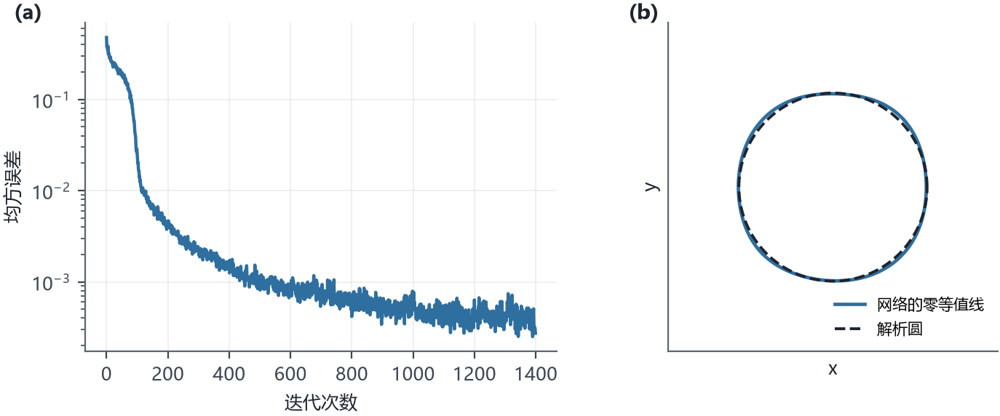
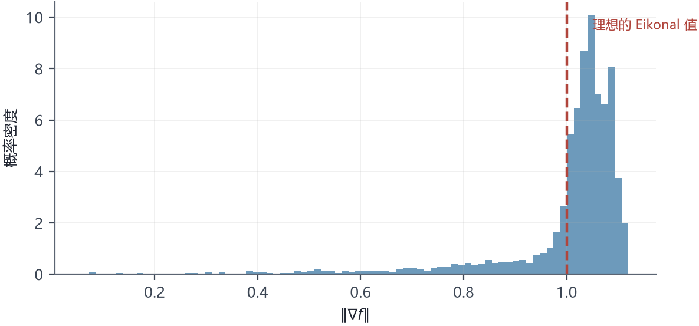
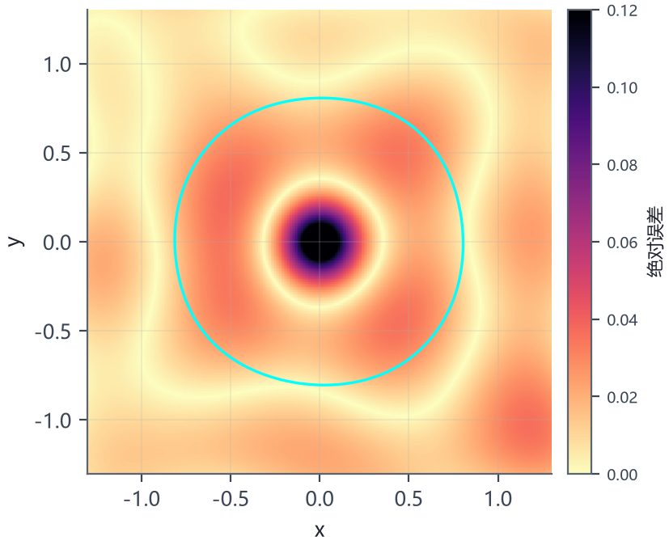

# 第 17 章 神经 SDF 与可微表示

## 17.1 一个没有公式也没有网格的形状

一个雕刻出来的兔子，既没有解析式，也不可能为了渲染单独存一份一毫米的距离场。它只有一堆扫描点，或者几百张照片。

神经网络给了一个折中的办法。训练一个小网络，输入是三维坐标，输出是一个数，这个数被训练成"到表面的距离"。训练好之后，这个网络就是一个距离场，查询一次是一次前向传播。表示的大小是网络的权重，几十万到几百万个浮点，与形状的复杂度无关。

这个想法最早由 Park 等人 2019 年的 DeepSDF 系统化，之后出现了把它接到体积渲染里、用图像直接训练的工作，还有把它做成可微分层、接进可微渲染器的尝试。这一章讲它的构造、正则项、训练方式，以及它与解析距离场的实质差别。

## 17.2 表示与损失

网络本身很普通，两三层全连接加一个激活函数

$$f_\theta(\mathbf{x})=\text{MLP}(\mathbf{x};\theta) , \tag{17.1}$$

输出是一个标量。目标是让它逼近真实的有符号距离。

有一个实现上的细节决定了成败：输入的坐标直接送进网络效果很差，因为网络对高频变化的拟合能力不足，表面会变得像面团。标准的做法是先把坐标过一个位置编码（positional encoding）或者用周期激活函数（SIREN），把坐标傅里叶展开到高维，让网络在高频上有响应，再从中取出细節。代价是高频成分也会放大噪声，训练不足时表面会出现波纹。

训练数据是采样点与它们的真值。采样点分两类：在表面附近采密的点（用网格算精确距离），在空间里随机采疏的点。真值来自第 14 章的流程。损失是

$$\mathcal{L}=\frac{1}{N}\sum_{i}\big(f_\theta(\mathbf{x}_i)-d(\mathbf{x}_i)\big)^2 . \tag{17.2}$$

只训练这个损失会得到一个"值对、梯度不对"的网络。先说值：图 17-1 左边是训练过程，均方误差在一千四百步后降到 $3\times10^{-4}$；右边是训练好的网络的零等值线与真实圆的对比，两者几乎重合，只在镜头可见的尺度上有一层极薄的偏差。

再说梯度。图 17-2 是同一个网络在空间中的梯度长度分布：表面附近集中在 $1.05$ 左右，还有一条长长的尾巴拖到 $0.1$。

$5\%$ 的高估意味着什么？意味着步长比真实距离大百分之五，球体追踪的不变量被破坏，光线在掠射时可能穿过表面。这个偏差不大，但在薄结构上足以漏光，而且在网络的训练范围之外会更大。

## 17.3 正则项

修补的办法是在损失里加一项，强制梯度长度为 1

$$\mathcal{L}=\frac{1}{N}\sum_i\big(f_\theta(\mathbf{x}_i)-d(\mathbf{x}_i)\big)^2+\lambda\,\frac{1}{M}\sum_j\big(\lVert\nabla_{\mathbf{x}}f_\theta(\mathbf{x}_j)\rVert-1\big)^2 . \tag{17.3}$$

这就是 Eikonal 正则，Gropp 等人 2020 年的 iSDF 用它来在没有真值的情况下训练，只在表面附近约束值，全空间约束梯度。

两项的作用不同。第一项决定表面在哪里，第二项决定表面之外的距离怎么长。后者在数据稀疏的地方尤其重要，因为那里只有 Eikonal 项在约束。

$\lambda$ 的选择是一个权衡。$\lambda$ 太小，梯度仍然偏离 1；$\lambda$ 太大，网络会把所有地方的梯度都压成一，代价是牺牲细节，因为细节意味着局部的高梯度。经验上 $\lambda$ 取 $0.1$ 到 $1$ 之间，并且随训练进程逐渐增大。

梯度的计算有两种。一种是解析的，对网络的结构求导，一次反向传播拿到 $\nabla_\theta\lVert\nabla_{\mathbf{x}}f\rVert$，需要二阶导，框架支持就行。另一种是有限差分，四次前向传播，简单但慢，还会引入截断误差。

## 17.4 一个网络表示多个形状

单个网络的容量有限。要让一个网络表示一类形状（比如所有的椅子），DeepSDF 的做法是给网络加一个潜码

$$f_\theta(\mathbf{x},\mathbf{z})=\text{MLP}(\mathbf{x},\mathbf{z};\theta) , \tag{17.4}$$

其中 $\mathbf{z}$ 是一个 256 维的向量，每个形状一个。训练时联合优化网络参数与每个形状的潜码，这叫自编码器式的训练（auto-decoder）。查询时给一个新的潜码，网络就输出一个新形状。

这个结构的用处是泛化与补全。给一个残缺的扫描，优化潜码让它拟合已有的部分，缺失的部分由网络先验补上。这在逆向工程与内容生成里很有用。

代价是潜码的插值不保证有意义。两个潜码的中点，对应的形状可能是两者的"平均"，也可能是某个不存在的怪物，取决于训练数据的分布。

## 17.5 不用真值：体积渲染式训练

从网格算真值需要网格。有些场合只有照片，这时用体积渲染的方式训练。

做法是把距离转换成一个密度，用体积渲染的公式算出图像，与照片比较。转换式子是

$$\sigma(\mathbf{x})=\alpha\,\Phi\!\left(\frac{-f_\theta(\mathbf{x})}{s}\right) , \tag{17.5}$$

其中 $\Phi$ 是一个光滑的阶跃函数（比如 sigmoid），$s$ 控制过渡的宽度。距离为负（内部）的地方密度接近 $\alpha$，为正的地方接近零。

训练时用第 12 章的体积积分算像素颜色，与照片的差作为损失，反传到网络。这个方法叫 NeuS 一类的方法，它不需要三维真值，只要相机位姿。

难点在 $s$ 的退火。$s$ 太大时表面很模糊，梯度信号弱；太小时密度接近二值，梯度几乎为零，训练不动。标准做法是从大到小逐渐减小 $s$，先用粗尺度找到大致形状，再用细尺度细化。

## 17.6 提取网格

网络训练好之后，如果要接到传统的渲染管线里，需要提取网格。做法是在一个规则网格上求值，用 marching cubes 提取零等值面（Lorensen 与 Cline 1987）。

提取的分辨率决定细节的保留。图 17-3 是网络在整个空间上的绝对误差分布，误差在表面附近最小，在远处增大，在训练范围之外急剧增大。

误差在远处增大这件事有实际后果。球体追踪的第一步通常在远处，那里网络高估距离，步长偏大；靠近表面时误差变小，步长变保守。所以用网络距离场做步进时，要么乘一个保守因子，要么在远处用层次结构代替网络。

## 17.7 与解析距离场的差别

四件事。

**速度。** 一次网络前向是几十次乘加，比一条解析公式慢几十倍，比一次网格三线性插值慢十几倍。对一条要步进五十次的光线，这个差别决定它能不能实时。

**可微。** 网络对输入可微，也对参数可微。这让它可以直接接进可微渲染器，用图像梯度优化形状。解析公式也可微，但参数化是固定的；网格不可微；这是网络唯一的独有优势。

**精度。** 解析公式是精确的，网格的误差由分辨率决定，网络的误差由容量与训练决定，通常比同内存的网格差一到两个数量级。

**保证。** 解析公式的 1-Lipschitz 是构造保证的，网格的 Lipschitz 由插值方式决定，网络什么都没有。Eikonal 正则只是软约束，训练不充分或者外推时会失效。

## 17.8 用在什么地方

三个场景值得用。

一是形状的压缩与传输。一个扫描的模型，网格几百兆，网络权重几兆。精度差一点，但对预览、对远程协作足够。

二是可微优化。要从图像反推形状，或者从形状反推物理参数，网络是唯一可微的表示。

三是补全与生成。残缺的扫描、稀疏的视角，网络先验能补出合理的形状。

反过来，三个场景不该用。需要精确接触的物理仿真，需要保证不穿模的渲染，需要实时的大规模场景。这三处网络的误差与速度都不合格。

---

这一章讲了神经距离场。表示是一个小网络，损失是值拟合加 Eikonal 正则，没有真值时用体积渲染训练，提取网格用 marching cubes。它与解析距离场的实质差别在速度、精度与保证：可微是它唯一的独有优势，其余三项都更差。

下一章把四种表示放在一起，按五个维度比较，给出选型的判断依据。
