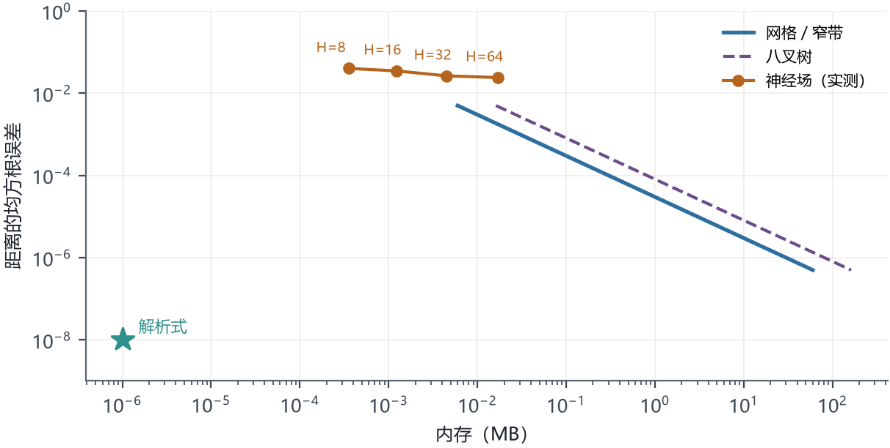
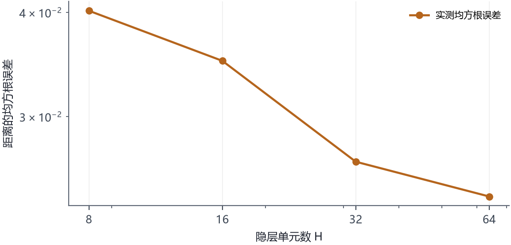
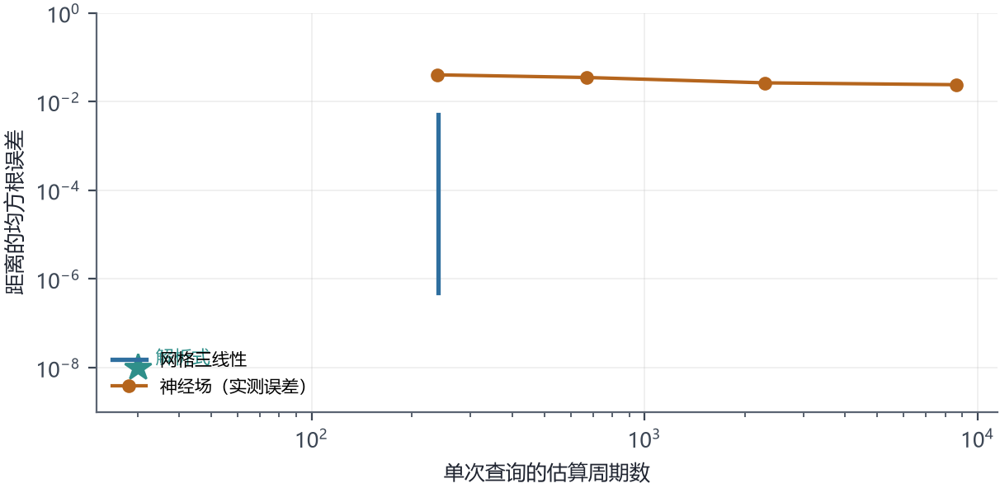

# 第 18 章 表示的选择

## 18.1 三个团队，三种答案

第一个团队做一个产品展示页，模型是设计师做的，几万个三角形，要的是干净的轮廓和准确的高光。他们选了网格，一个字都没提距离场。

第二个团队做特效，要一团会融合、会弯曲、会随时间变形的软体。他们选了距离场，因为布尔与形变在网格上做不了。

第三个团队做扫描数据的压缩与预览，要在网页上一秒内加载一个模型。他们选了神经场，因为权重只有几百千字节。

三个答案都对，因为三个问题的约束不同。这一章把四种表示放在同一张桌子上，按五个维度比较，给出可以照着走的判断。

## 18.2 五个维度

精度、内存、构建时间、可微性、硬件友好度。

精度不只是"误差多少"，还要看误差的性质：网格的误差随分辨率二次下降，但法线误差只线性下降；网络的误差在训练范围内小，外推时急剧变大；解析式没有误差。

内存要与分辨率绑定才有意义。脱离精度谈内存没有价值，所以下面的比较都是"同等精度下的内存"。

构建时间是产品层面的约束。离线渲染可以等一小时，实时应用不能等一秒。

可微性决定能不能做优化。形状要从图像反推、要从物理量反推，只有可微的表示能上梯度。

硬件友好度是一个容易被忽略的维度。同一个算法，在 GPU 上写成不同的结构，性能可以差三倍，因为它决定了缓存命中率与线程分歧。

## 18.3 精度与内存

图 18-1 是四种表示在"精度—内存"平面上的位置。横轴是内存，纵轴是距离的均方根误差，双对数坐标。

网格的曲线是一条斜率为负二的直线，因为误差按 $h^2$ 下降而内存按 $h^{-2}$ 上升。八叉树与它平行，整体右移二点七倍，这是节点编码的开销。

神经场的四个点在网格曲线之上。也就是说，在同等内存下，网络比网格差。这个结论可能出乎意料，但它是可重复的：对一个简单的、光滑的、有解析式的形状，网格的三线性插值几乎是作弊，它把形状的信息压在了八个角上，而网络必须用一个全局的参数化去拟合。

网络的优势在别处。它的内存与形状的复杂度无关，只与精度要求有关。一个雕花的模型，网格要一亿个格点，网络还是几百千字节，代价是精度差一个数量级。所以图 18-1 的比较对简单形状不公平，对复杂形状反而偏向网络。

网络的精度由容量决定。图 18-3 是四个不同隐层宽度的网络在同一个形状上的实测误差：$H=8$ 时 $0.040$，$H=64$ 时 $0.014$，参数量从一百涨到四千，误差只降了不到三倍。收益递减很明显，这决定了神经场的精度天花板：想要再降一个数量级，参数要涨两个数量级。

解析式在图的左下角，误差为零，内存可以忽略。它是唯一的"免费午餐"，代价是它只能表示能用公式写出来的形状。

## 18.4 精度与查询时间

图 18-2 换了一个横轴：单次查询的估算周期数。

网格的曲线是一条竖线，因为查询代价与分辨率无关：不管网格多细，都是读八个角。这条竖线的高度由精度决定，精度越高，竖线越靠下，但横坐标不变。

网络的曲线是斜的，因为参数量越多，前向越慢。$H=64$ 时参数量约四千，前向要八千次乘加，比网格贵十几倍。

解析式在最左边，三十个周期左右。对一条要步进五十次的光线，三十与两百四十的差别是每像素一万五千个周期与一万两千个周期，听起来差别不大；但网格还要算地址、判边界、处理缓存未命中，实际差距通常更大。

## 18.5 构建时间

第 15 章给过数字，这里只做汇总。稠密网格的构建与体积成正比，两米见方、一毫米的分辨率要几分钟；窄带与砖块与表面积成正比，同样精度下几十秒；八叉树在两者之间，因为要建树。

神经场的构建是训练，与场景的复杂度关系不大，与精度要求关系很大。一个 $H=64$ 的网络在单卡上要几小时，$H=512$ 的要几天。这是它最大的门槛。

解析式的构建时间是零，因为它不需要构建。

## 18.6 可微性

只有神经场与解析式是可微的。网格有插值，插值对坐标可微（分段线性），但对网格里存的值不可微，因为值是离散的；要让它可微，得把值也变成可优化的变量，那就是"可学习的网格"，属于另一个话题。

可微性带来的是优化能力。要从一张照片反推形状，损失对形状参数的梯度必须存在。网格做不到，只能靠有限差分或者代理模型；网络可以直接反传。

## 18.7 硬件友好度

三件事决定硬件友好度：内存访问的规律性、分支的分歧、数据类型的支持。

网格的访问是完全规律的，地址由坐标算出，缓存友好，支持半精度。这是它在 GPU 上无敌的原因。

砖块的访问是"一次索引加八次相邻"，规律性稍差，但仍然可以预测，是实时系统的默认选择。

八叉树与哈希的访问是"指针追踪"，每一层的地址依赖上一层的结果，延迟高，而且相邻线程的路径不同，分歧严重。

解析式没有内存访问，只有算术，理论上最快。但它的分支多（每个形状一个分支），在 GPU 上要小心组织，通常用"全部计算再选择"的方式避免分歧，代价是算了很多无用的东西。

神经场是密集的矩阵乘法，非常规律，但计算量大，而且不容易用低精度（半精度的累加误差会毁掉小网络的精度）。

## 18.8 一张表

| 维度 | 解析式 | 网格 / 窄带 | 八叉树 / 砖块 | 神经场 |
|---|---|---|---|---|
| 精度 | 精确 | $O(h^2)$，法线 $O(h)$ | 同网格 | 训练范围内较好，外推差 |
| 内存（同精度） | 可忽略 | 表面积 × 带宽 | 略高于网格 | 与复杂度无关 |
| 构建时间 | 零 | 分钟级 | 分钟级 | 小时到天 |
| 可微性 | 对参数可微 | 不可微 | 不可微 | 完全可微 |
| 硬件友好度 | 算术密集，分支多 | 最好 | 好（砖块）/ 差（树） | 规律但计算量大 |

这张表不能替代判断，因为五个维度的权重依项目而定。一个离线渲染器可以把构建时间放到最后，一个手机游戏必须把它放第一。

## 18.9 怎么选

按下面的顺序问自己五个问题，每个问题的答案把候选砍掉一半。

**形状能用公式写出来吗？** 能，用解析式。球、盒、圆环、胶囊、圆锥、平面，这些覆盖了工程模型的一大半。用公式的收益是精确、免费、可微，没有任何理由不用。

**需要布尔、圆角、平滑、重复吗？** 需要，用距离场。网格上做这些要重拓扑，成本高且不可逆。

**需要每帧更新吗？** 需要，用网格或者砖块，并且限制在低分辨率。距离场的更新是距离变换，成本不低；网络的更新是重新训练，不可能。

**需要从图像反推形状吗？** 需要，用神经场。这是唯一可微的表示。

**场景有多大？** 超过一公里，用稀疏结构加流式；否则稠密网格就够。

五个问题走完，答案通常唯一。走不完的情况是"既要又要"，那时的做法是混合：解析式做基本体，网格做细节，距离场做布尔与软阴影，神经场做离线的高质量重建。混合的代价是接口与一致性，第 16 章讲过一部分。

## 18.10 一个常见的误判

最后一个提醒。距离场最容易被高估的地方是"求交快"，最容易被低估的地方是"造型自由"。

求交快这件事，只在场景的三角形数很大时才成立。几万个三角形的场景，BVH 只要几十个周期，距离场要几百，后者更慢。真正让距离场不可替代的是造型：布尔、圆角、平滑、形变、重复，这些在网格上要么做不了，要么要重拓扑。

所以判断要不要用距离场，不要问"求交快不快"，要问"形状要不要被程序化地编辑"。要，就用；不要，就用网格。

第二个误判是"距离场精度高"。解析式确实精确，网格与八叉树的精度由分辨率决定，与精度相匹配的内存往往是几十到几百兆，而同样精度的三角形网格只要几兆。距离场的精度是花内存买来的，不是天生的。

## 18.11 一个具体的例子

一个家具配置器，场景里有沙发、桌子、书架，用户会换颜色、换尺寸，但不改形状。

这个场景不该用距离场。形状是固定的，没有布尔，没有形变，软阴影用阴影图加一点屏幕空间就够。用网格，几千个三角形，一张贴图，背景可以用一张预计算的立方图。距离场在这里只会增加构建时间与内存。

同一个产品加上"自由拼装"：用户可以拿一块布洒在一堆物体上，或者把两个沙发融在一起。这时距离场就有价值了，因为"洒在一块东西上"是形的变形，"融在一起"是平滑并集。做法是混合：静态的家具用网格，可编辑的部分（布、软体）用距离场，两者共用一个顶层结构。

---

这一章把四种表示放在一起比了五个维度。解析式精确且免费，但只能表示公式能写的形状；网格在同等精度下最省内存、最快，但不能被程序化编辑；八叉树与砖块是网格的稀疏版本，用一点查询代价换内存；神经场与复杂度解耦、完全可微，但精度与速度都更差。

四者不是替代关系，是分工关系。一个成熟的渲染器里通常四种都有，各自负责自己擅长的部分。知道每种在哪里失效，比知道它在哪里有效更重要。
