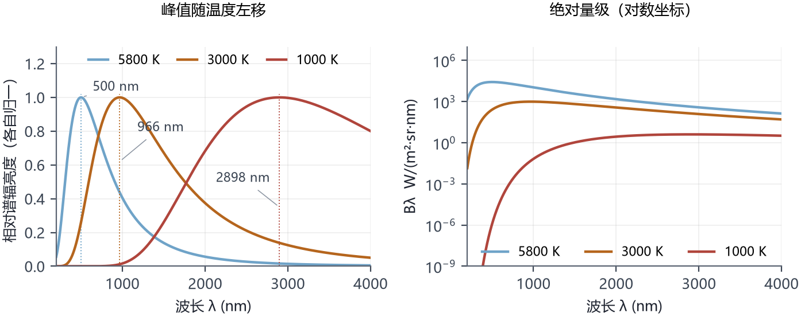
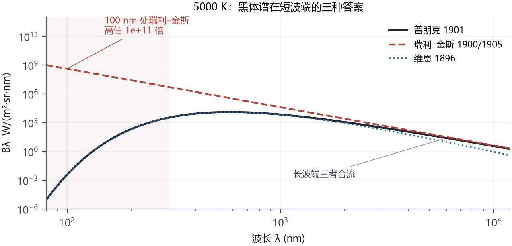
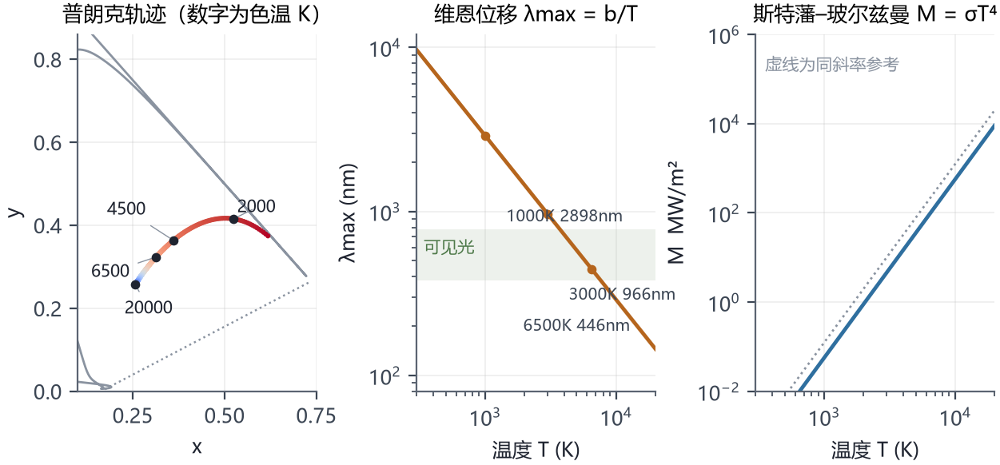

# 第 1 章 黑体辐射与普朗克的量子假设

## 1.1 一块烧红的铁

把一块铁放进炉子里，温度一点一点升上去，会看到三件事同时发生。

它先变成暗红，亮度很低，只在暗处看得见；再往上升，红色变亮，往橙色偏；到了很高的温度，它发白，白得刺眼，颜色反而不再往蓝端走了。三件事里最反直觉的是第一件和第二件的比例：从 1000 K 升到 3000 K，温度只涨了三倍，总辐射能量涨了八十一倍。

这正是 1900 年之前物理学最尴尬的一道题。当时有两套公式，一套在长波端对、短波端错，另一套反过来。两套都对各自的一端给出了漂亮的结果，合起来却无处安放。要弄清楚为什么会出现这种局面，得先把“一个热的物体应该发出什么样的光谱”这个问题说成可以计算的形式。

先做一个理想化的替换。真实物体的表面有氧化层、有粗糙度、有选择性的吸收带，算起来没完。物理学家把问题换成一个封闭的空腔，腔壁上开一个小孔，光从小孔漏出来。小孔里的辐射与腔壁处于热平衡，它的光谱只取决于温度，与腔壁用什么材料、什么形状无关。这样的东西叫黑体（blackbody），因为它吸收一切入射光，不反射。

这个标准模型的好处是它把材料删掉了。留下的只有一个温度，和一堆在腔里来回传播的电磁波模式。接下来要数的就是这些模式有多少个。

## 1.2 空腔里的驻波

一个边长 $L$ 的立方腔里，电磁波只能以驻波的形式存在：在每个方向上，腔长必须是半波长的整数倍。把波矢写成 $\mathbf{k}=(k_x,k_y,k_z)$，条件就是 $k_i=\pi n_i/L$，$n_i$ 是正整数。每个允许的整数三元组对应一个模式，每个模式有两个偏振。

模式在 $k$ 空间里是均匀排布的，密度是 $(L/\pi)^3$。半径为 $k$ 的球内有 $4\pi k^3/3$ 的体积，除以单模式体积再乘 2（偏振），得到模式数

$$N(k)=\frac{8\pi k^3}{3}\left(\frac{L}{\pi}\right)^3=\frac{8\pi L^3}{3\pi^3}k^3 . \tag{1.1}$$

换成频率，$k=2\pi\nu/c$，对 $\nu$ 求导，再除以体积，得到单位体积、单位频率区间内的模式数

$$n(\nu)\,d\nu=\frac{8\pi\nu^2}{c^3}\,d\nu . \tag{1.2}$$

这个式子说明高频端的模式比低频端多得多，因为 $\nu^2$ 增长。回忆一下弦上的驻波：频率越高，能塞进去的波节越多，可选的“形状”越多。三维空间里这个增长是二次的。

下一步是给每个模式分配能量。经典统计物理的答案叫能量均分定理：在温度 $T$ 下，每个二次型自由度平均携带 $k_BT/2$ 的能量，一个模式有两个自由度（电场与磁场），所以是 $k_BT$。于是单位体积、单位频率的能量密度是

$$u(\nu)=\frac{8\pi\nu^2}{c^3}k_BT . \tag{1.3}$$

把能量密度换成辐亮度（乘 $c/4\pi$），再把频率密度换成波长密度，得到

$$B_\lambda^{RJ}=\frac{2ck_BT}{\lambda^4} . \tag{1.4}$$

这就是瑞利–金斯公式。瑞利 1900 年给出，金斯 1905 年补上了常数因子。

它的问题一句话就能说完：$\lambda\to0$ 时 $B_\lambda\to\infty$。这不是“算得偏大”，是发散。一个 5000 K 的物体，按这个公式，在 100 nm 处的辐亮度比实测高十一个数量级，到 10 nm 处高出一百二十多个，越往短波越离谱。空腔里的总能量是 $B_\lambda$ 对全波长的积分，而这个积分发散，也就是说一个常温的空腔里应该装着无穷大的能量。这个结论荒谬到有了专门的名字，叫紫外灾难（ultraviolet catastrophe）。

图 1-1 左边是三条黑体谱的归一化曲线，右边是同一组曲线的绝对刻度。右图的对数纵轴从 $10^{-9}$ 一直画到 $10^{6}$ W/(m²·sr·nm)，跨度十五个数量级。这个跨度本身就是问题的一部分：可见光只占其中很窄的一段，而经典公式在短波端给出的能量会一路冲出图外。

有一点要说清楚，免得把责任推错地方。瑞利–金斯公式在长波端是**对的**，不是近似对，是严格对。微波背景辐射、射电天文学里的热辐射，用的就是它的极限形式。它的失效只发生在 $h\nu$ 与 $k_BT$ 可比的地方，也就是短波、低频温度。这一点后来成了普朗克公式必须满足的第一个检验：在 $h\nu\ll k_BT$ 时必须退回瑞利–金斯。

## 1.3 普朗克的那一步

1900 年 10 月，普朗克在柏林物理学会的报告里给出了一条能同时拟合两端的公式。他的做法先是内插：维恩 1896 年的公式在短波端很准，瑞利–金斯在长波端很准，两者的熵对能量的二阶导数形式不同，普朗克把这两种形式拼成一个一般式，再让实验数据定下其中的常数。公式先出来，解释在后。

拼出来的结果是

$$B_\lambda(T)=\frac{2hc^2}{\lambda^5}\cdot\frac{1}{e^{hc/(\lambda k_BT)}-1} . \tag{1.5}$$

拿它做两次极限检查。$\lambda\to\infty$ 时指数项展开，$e^x-1\approx x$，分母里出现 $hc/(\lambda k_BT)$，$h$ 约掉，剩下的正好是 (1.4)。$\lambda\to0$ 时指数项压倒一切，$B_\lambda\to0$，比任何幂次都快。两端都对上了。

要让它成立，得给“每个模式分多少能量”换一个答案。普朗克假设腔壁上的振子只能以 $h\nu$ 为单位吸收和放出能量，能量是 $0,h\nu,2h\nu,\dots$ 这样的离散值，不能连续变化。按这个假设重新做统计平均，一个模式的平均能量不再是 $k_BT$，而是

$$\bar{E}(\nu)=\frac{h\nu}{e^{h\nu/(k_BT)}-1} . \tag{1.6}$$

把 (1.6) 代回 (1.2)，就得到 (1.5)。$h$ 的数值是 $6.626\times10^{-34}$ J·s，$k_B$ 是 $1.381\times10^{-23}$ J/K，两个都是从拟合里定出来的，后来才成为基本常数。

到这里要回答一个问题：为什么说这个假设在当时只是数学手段。

普朗克本人并不认为能量真的一份一份存在。他把它看成一种记账技巧：振子与场交换能量时，账面上只能以 $h\nu$ 为单位转账，但场本身仍然是麦克斯韦方程组描述的连续波。他在给朋友的信里把这件事称为“绝望之举”，此后多年一直试图把量子化从推导里消掉，让它退回经典电动力学的某个角落。直到 1905 年爱因斯坦说光本身就是一份一份的，1913 年玻尔把量子化搬到原子能级上，量子才从一个数学技巧变成一个物理主张。

这个区别对渲染有直接影响。如果量子化只是腔壁振子的记账规则，那么连续场论仍然成立，辐亮度仍然是一条可以随意取值的连续函数；如果光本身是量子，那么“一条光滑的光谱”就是一个统计描述，它的背后是有限个离散事件。前者对应这本书后面十六篇里用的全部工具，后者是这本书第一篇要交代的底账。两种描述在光子数很大时给出同一个答案，差别只在光子数小的时候露出来，第 4 章会把这条界线画出来。

顺带说一句为什么 (1.5) 里的指数项长得像玻色–爱因斯坦分布。把 (1.6) 除以 $h\nu$，得到的是一个模式里的平均光子数 $\bar{n}=1/(e^{h\nu/k_BT}-1)$。这正是化学势为零的玻色–爱因斯坦分布。光子数不守恒，腔壁可以随意产生和消灭光子，所以化学势为零。第 2 章会讲化学势不为零的情形，那时候这个式子要改。

## 1.4 谱的形状

(1.5) 有两个可以直接读出来的性质。

第一个是峰值位置。对 $\lambda$ 求导令其为零，得到 $\lambda_{\max}T=b$，其中 $b=2.8978\times10^{-3}$ m·K。这就是维恩位移定律，维恩在 1893 年从热力学论证得到，早于普朗克。温度越高，峰值越往短波跑，而且是反比关系：温度翻倍，峰值波长减半。

第二个是总能量。把 (1.5) 对全波长积分，得到 $M=\sigma T^4$，$\sigma=5.670\times10^{-8}$ W/(m²·K⁴)。斯特藩 1879 年从实验数据猜出这个四次方，玻尔兹曼 1884 年用热力学给了证明。四次方意味着温度的小变化会带来亮度的大变化：3000 K 与 3100 K 只差 3%，总辐射差 14%；灯丝老化导致温度掉 5%，亮度掉 18%，这也是白炽灯用久了明显变暗的原因。

把两个定律代进具体数字，可以看清量级。5800 K（接近太阳表面）的峰值在 499.6 nm，落在绿蓝之间，峰值谱辐亮度是 $2.69\times10^4$ W/(m²·sr·nm)；3000 K（白炽灯丝）的峰值跑到 965.9 nm，进入近红外，可见光区只剩下峰值的尾巴，峰值谱辐亮度 995；1000 K（暗红的热铁）峰值在 2897.8 nm，可见光区几乎是零，谱辐亮度 4.10。这就是为什么白炽灯的效率低：九成以上的能量被送进了人眼看不见的红外。

图 1-2 把三种公式放在一起，温度固定为 5000 K。普朗克曲线在 500 nm 附近有一个宽峰，两侧都往下走；瑞利–金斯在长波端与它重合，往短波走一路向上，在 100 nm 处已经高出十一个数量级；维恩公式在短波端贴合，往长波走偏低，因为它的指数形式在 $h\nu\ll k_BT$ 时衰减得太快。三条曲线的分岔位置就是量子效应开始显形的位置。

图 1-3 把 (1.5) 投影到色度平面上。左边那条彩色的弧线是普朗克轨迹，每个点是一个温度的黑体在 CIE xy 图上的位置。温度从右下往左上走，2000 K 在橙色区，6500 K 靠近白点，20000 K 已经进入蓝色区。右边两张小图分别是维恩位移与斯特藩–玻尔兹曼的图示，两条都是直线，因为在对数坐标下它们分别是斜率为 $-1$ 和 $4$ 的幂律。

## 1.5 渲染里的黑体

渲染器里用到黑体的地方比想象的多，而且大多不是“物理正确的热辐射”，是借它的形状当参数。

最常见的是色温。光源的色温定义为“与它有相同色度的黑体的温度”，这个量只描述色度，不描述光谱。摄影里标 3200 K 的灯、标 5600 K 的日光，说的都是这个。实现上通常不去积分普朗克公式，而是查表或用普朗克轨迹的多项式拟合，把色温映射到 xy，再映射到 RGB。这条路在只关心色度的场合够用。

第二种是自发光材质。钨丝灯、蜡烛、火焰、熔岩、炽热的金属，都可以用 (1.5) 乘一个发射率来近似。这里要说清楚它的局限：真实的钨丝不是黑体，它的发射率在可见光区约 0.45，在近红外约 0.2，而且随波长变化，所以钨丝灯的实际光谱比同温度的黑体更偏红、红外成分更少。火焰更不是黑体，它的颜色来自碳粒的连续热辐射加上激发态分子的窄带发射，蜡烛火焰的黄色主要来自碳粒，蓝色底部来自化学发光。用黑体拟合火焰只能得到大致的色调，得不到它真正的光谱结构。

第三种是给“没有光谱数据的光源”造一个合理的谱。给一个色温，套上 (1.5)，就得到一条连续、光滑、物理上说得通的 SPD。这在光谱渲染里很常用，因为真实光源的实测光谱不易获得，而黑体至少保证了色度与形状的一致性。

这三种用法有一个共同的隐患，值得在实现时记住：**色温相同不等于光谱相同**。两个 6500 K 的光源，一个是黑体，一个是“蓝光芯片加荧光粉”的 LED，色度可以调到几乎一样，光谱却完全不同。用它们照同一块窄带反射的材料，反射光的颜色会差很多。第 5 章会用一个具体的场景把这件事算一遍，这里的结论只要记住一句：黑体谱是一个模型，不是一个保证。

## 1.6 数值上怎么算

(1.5) 看起来简单，直接照抄进代码会在两处出错。

第一处是单位。$B_\lambda$ 的量纲是 W/(m³·sr)，因为分母里的 $\lambda^5$ 用的是米。渲染器里的波长一般用纳米，密度也要换成“每纳米”，所以要把结果乘 $10^{-9}$。忘了这一步，整体亮度会差六个数量级，而且因为误差是常数因子，色调映射之后可能看不出来，只在和其他光源比对时暴露。

第二处是指数。$hc/(\lambda k_BT)$ 在短波端很大，$\lambda=380$ nm、$T=1000$ K 时已经到了 37，$e^{37}$ 接近 $10^{16}$，单精度浮点直接溢出。用双精度能拉到 $e^{709}$，但 $\lambda=100$ nm 处仍然会出问题。稳妥的写法是用 `expm1(x)` 算 $e^x-1$，它在 $x$ 很小时保留有效位数，在 $x$ 很大时和 `exp(x)` 一样；同时把短波端截断到 100 nm 以外，因为那一段的辐亮度已经在 $10^{-9}$ 以下，对可见光的贡献可以忽略。

还有一个选择是写成频率形式：$B_\nu=2h\nu^3/c^2\cdot1/(e^{h\nu/k_BT}-1)$。两种写法描述的是同一个场，但作为**密度**它们不是同一个函数，换算时要乘一个 Jacobian：$B_\lambda=B_\nu\,c/\lambda^2$。这个因子在普朗克轨迹、色度积分、光源功率归一化里都要出现，忘了它会把峰值位置算错一倍多。写代码时最好只保留一种形式，所有输入输出都在入口和出口换算，中间不要混用。

---

这一章的主线是一次失败。经典物理数清了腔里有多少个模式，也用能量均分定理给每个模式分了能量，两步都没有错，合起来却给出一个发散的结果。普朗克把能量的交换改成一份一份的，公式立刻收敛，而且两端都对。他自己不相信这一步的物理含义，用了十几年想把它退回去，退不回去。十几年后，同一个 $h$ 出现在光电效应的公式里，出现在氢原子的能级里，量子才从记账技巧变成世界的性质。下一章从爱因斯坦 1905 年的那篇论文讲起，那里量子第一次被安到光自己身上。
