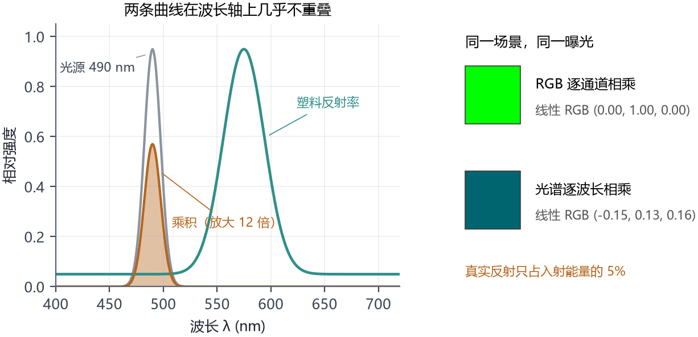
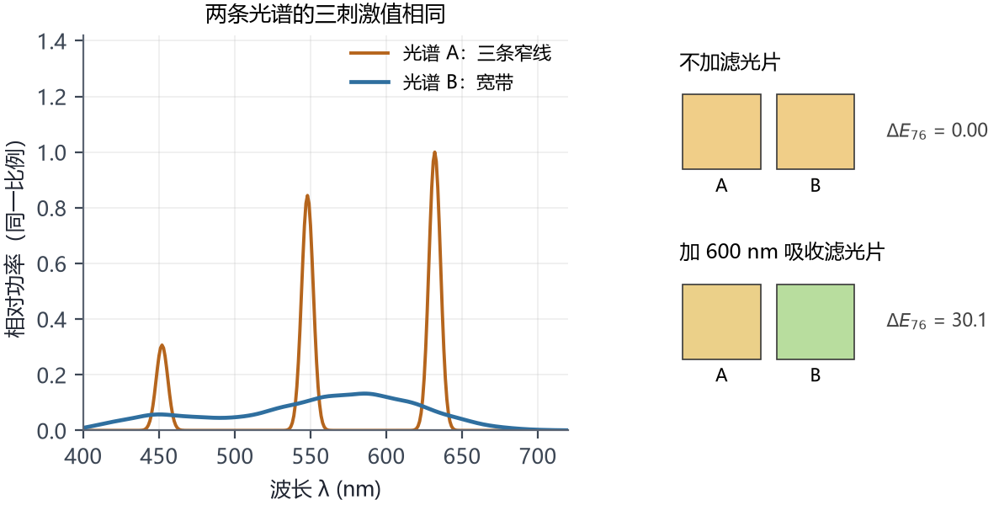
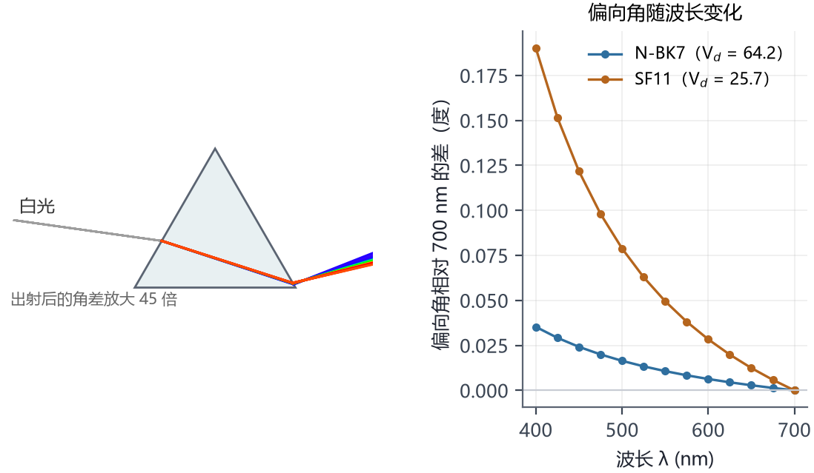

# 第 1 章 一个错误的颜色

## 1.1 青色灯下的黄色塑料

场景可以小到只有三样东西。一盏青色 LED，中心波长 490 nm，半高宽 18 nm；一块黄色塑料板，570 nm 以上反射率接近 0.9，500 nm 以下不到 0.06；一面白墙当背景。相机正对塑料板，中间没有别的东西。

任何 RGB 路径追踪器都会把这块塑料渲染成一块明亮的绿色。它的推理链条很清楚：这盏灯的 RGB 大约是 $(0,0.8,1)$，青的；塑料的 RGB 大约是 $(1,1,0.05)$，黄的；逐通道相乘得到 $(0,0.8,0.05)$，绿的。曝光一开，就是一块饱和度很高、亮度接近白墙的绿板。

真实情况是另一回事。那盏灯只发出 490 nm 附近的光，而这块塑料在 490 nm 的反射率只有 0.06。光打上去，九成以上的能量当场变成热，反射出来的只有一点点。把相机对准它，看到的是一块几乎全黑的板子，颜色偏青，亮度只有白墙的百分之五。图 1-1 把两条路径并排放着：上面是两条曲线在波长轴上相乘，乘积几乎是零；下面是两个色块，同一个场景、同一个曝光，一个亮绿，一个近乎黑。

这个错误不是曝光错了，也不是色调映射错了。把曝光压低，整张图一起变暗，塑料仍然是绿的；把曝光推高，塑料会先过曝成白色。错误发生在第一步：渲染器把"这盏灯是青的"和"这块塑料是黄的"当成了两条完整的信息，实际上它们各自只是投影之后的三个数。青色的三个数里没有说能量集中在 490 nm，黄色的三个数里也没有说 500 nm 以下不反射。两个"没说"撞在一起，乘法就把一个不存在的重叠算成了一个存在的重叠。

换一组光源和材质，错误的方式会变，量级不会小。钠灯照红苹果、蓝色激光照橙色纸张、汞灯照荧光笔，都会出现同一类偏差，偏差的大小取决于光源光谱和材质反射率在波长上的重叠程度。RGB 渲染器不知道"重叠"这件事存在，所以它也无从判断自己错得多厉害。

## 1.2 三个数装不下一整条曲线

要把这件事说清楚，先得知道 RGB 到底是什么。

一条光谱 $S(\lambda)$ 描述单位波长区间内携带的功率。人眼把它压缩成三个数，做法是乘上三条固定的响应曲线再积分：

$$X=\int S(\lambda)\,\overline{x}(\lambda)\,d\lambda,\qquad Y=\int S(\lambda)\,\overline{y}(\lambda)\,d\lambda,\qquad Z=\int S(\lambda)\,\overline{z}(\lambda)\,d\lambda . \tag{1.1}$$

$\overline{x},\overline{y},\overline{z}$ 是 CIE 1931 标准观察者的配色函数，第 3 章会给出它们的数值。$(X,Y,Z)$ 叫三刺激值，颜色的全部感知信息（在一阶近似下）就在这三个数里。

三个积分是三个线性泛函。线性意味着加色混合成立，两束光叠加，三刺激值直接相加；也意味着这个映射不是单射：它的核空间是无穷维的。任何一条满足

$$\int N(\lambda)\,\overline{x}(\lambda)\,d\lambda=\int N(\lambda)\,\overline{y}(\lambda)\,d\lambda=\int N(\lambda)\,\overline{z}(\lambda)\,d\lambda=0 \tag{1.2}$$

的光谱 $N$ 加进 $S$ 里，三刺激值一点不变。这样的 $N$ 叫同色异谱黑（metameric black），$S$ 和 $S+N$ 互为同色异谱体（metamers）。人眼看不出它们的区别，物理上它们是两条不同的光。

图 1-2 是一个构造出来的例子。光谱 A 是三条 9 nm 宽的窄线，光谱 B 是十一条宽带高斯叠出来的平滑曲线。两条曲线形状毫无共同之处，三刺激值却完全相同，色差 $\Delta E_{76}$ 是 0.00。把它们先后送进同一块吸收 600 nm 附近的滤光片，A 几乎没有损失，B 被挖掉一大块，两者立刻分开，色差 30.1。这就是同色异谱的实际后果：**两条看起来一样的光，与物质作用之后可以完全不一样。**

对显示来说，同色异谱是好事，它让三原色显示器成为可能：不必复现光源的光谱，只要三刺激值对上，看起来就一样。对渲染来说，同色异谱是麻烦的来源。渲染不只是"显示一个颜色"，它要计算光与物质的相互作用，而这个相互作用是逐波长的乘法。把光谱压成三个数之后再做乘法，等于在一个对乘法不封闭的子空间里做运算，误差正比于被丢掉的核空间的成分。

这个误差在什么条件下可以忽略，在什么条件下会失控，是第 4 章的主题。这里先记住一个判据：**只要场景里出现了窄带结构——窄带光源、窄带吸收、窄带发射——三个数就不够用了。** 色散和荧光是两种更彻底的例外，它们连"逐波长独立"这个前提都要改。

## 1.3 颜色是读数，光是光谱

把上面的讨论收一下，可以给光谱渲染一个工作定义：在光传输的整个过程中，用随波长变化的光谱功率分布表示光；波长是积分变量，参与采样和权重计算；只有在写最终图像时，才把光谱投影成 XYZ 或 RGB。

这个定义里每一句都在排除一种偷懒的做法。

"整个过程中"指的是光源、材质、介质、相机响应、路径权重，全都保留波长。只在光源处用光谱、材质处仍用 RGB 的做法不算；那样做只是给 RGB 渲染加了一点装饰，一旦光穿过有色的玻璃就会露馅。

"波长是积分变量"指的是渲染方程本来只对方向积分，光谱渲染把它扩展成对方向和波长同时积分。既然是积分，就要用蒙特卡洛，就要有概率密度，就要处理方差。这是第 6、7 章的内容，也是全书技术上的主线。

"最后才投影"指的是渲染器内部搬运的不是颜色，而是光谱。你可以把它想成一条 380 到 780 nm 的曲线在场景里走，最后才被三条响应曲线压成三个数。中间任何一步提前压成 RGB，都会把同色异谱的信息丢掉，而且丢掉的量无法估计。

代价很直接。RGB 渲染每条路径携带三个浮点数，光谱渲染携带 $n$ 个波长上的采样值，$n$ 通常是 4 到 16。求交和可见性测试是共享的，但光谱评价、波长采样、概率密度计算、内存带宽都要乘以 $n$。更麻烦的是噪声：每个像素的 XYZ 三个积分都靠有限样本估计，波长样本少的时候，彩色噪声会比亮度噪声更刺眼。

值得说清楚的是，$n$ 不是"整条光谱只用 $n$ 个点表示"。一条路径带 $n$ 个波长，一个像素通常有几百到几千条路径，所以一个像素的波长样本总数是路径数乘 $n$。样本不是均匀铺在波长轴上的，而是随机或分层分布的，但总量并不小。渲染器也从不重建整条光谱——它只需要 XYZ 三个积分，而配色函数是三条很宽的曲线，对光滑光谱用少量样本估计三个积分，误差可以接受。如果目标是画出一条光滑的 SPD 曲线，4 个点当然不够，但那是光谱重建，不是渲染。

## 1.4 四个 RGB 渲染器答错的场景

第一个是棱镜。白光穿过一块玻璃棱镜，出射面上会散开成一条彩带。原因是折射率随波长变化：玻璃对 400 nm 的折射率比 700 nm 大约 0.018（N-BK7），对 SF11 这样的重火石玻璃大约 0.035。这个差别在几何上被放大，出射方向随波长单调变化。图 1-3 画了 13 条波长光线穿过一块 SF11 等边棱镜的轨迹，入射角 8 度，出射后 400 nm 与 700 nm 的偏向角相差 0.18 度。0.18 度听起来很小，但它与传播距离成正比，一米的距离上就是 3 mm 的位移，足够让一条细光线在屏幕上明显分开。

RGB 渲染器通常给玻璃一个折射率，最多给红绿蓝三个。一个折射率意味着所有波长走同一条路径，出射光仍然是一束白光，棱镜完全失效；三个折射率意味着光被分成三条离散的线，红、绿、蓝各走一条，中间没有连续的橙色、黄色、青色。真实的棱镜给出的是一条连续谱，三个通道给不出这个连续性，无论怎么调那三个折射率。

第二个是玻璃球后面的焦散。平行光穿过一个玻璃球，球后会聚出一条亮线。玻璃有色散时，不同波长的焦点位置错开：蓝光折射率大，聚焦得近一些；红光折射率小，聚焦得远一些。于是那条亮线的边缘带上颜色，靠近球的一侧偏蓝，远的一侧偏红。这不是在材质上加一个彩虹纹理能解决的事，它来自几何——不同波长的光线走的是不同的路径。要在渲染器里得到它，波长必须参与路径追踪，而不是在着色阶段被投影掉。

第三个是荧光。荧光笔、洗衣粉里的增白剂、某些矿石和生物组织，会吸收短波的光，把一部分能量以更长的波长重新发射。紫外灯照白纸，纸发出偏蓝的白光，因为纸里的增白剂吸收了紫外，在 440 nm 附近发射。这个过程改变了波长，输入和输出不在同一个波长上。RGB 渲染器没有"波长"这个概念，也就无从表示"380 nm 进、440 nm 出"。它可以假装荧光材质只是另一种颜色，但那样得到的图像在物理上不成立：能量不守恒，颜色随光源变化的方式也是错的。

第四个是彩色阴影。两盏灯，一盏钠灯，一盏汞灯，在 RGB 渲染器里都可以被调成接近白色。它们照在同一面白墙上，墙看起来是白的。在墙前放一个物体，两盏灯投下的阴影颜色应该不一样：钠灯的阴影偏橙，汞灯的阴影偏青。RGB 渲染器把两盏灯都当成白色，两个阴影也就都是灰色，这个差别彻底消失。人眼对这种差异很敏感，因为它来自光谱，而不来自亮度。

这四个场景的失效方式不同，根源是同一个：RGB 渲染器在一个比真实世界小的模型里做物理。这个模型在光谱足够宽、足够平滑时工作得很好，误差只有百分之几，肉眼看不出来。一旦出现窄带结构、波长转换或者波长相关的几何，模型就不够用，而且它不知道自己不够用。

## 1.5 这本书的路线

整本书按依赖顺序排成四篇。

第一篇处理光和颜色，不谈渲染。第 2 章建立辐射度量学，把"光有多亮"变成可以积分的量，重点是辐亮度沿光线不变这条性质——路径追踪器搬运的就是它。第 3 章给出配色函数和三刺激值，把 CIE 1931 的数据、XYZ 到 sRGB 的转换矩阵写成具体数字，并说明它们从哪来。第 4 章把 RGB 渲染的假设摊开：它等价于用三个基函数表示光谱，再在这个对乘法不封闭的三维子空间里做运算，由此可以得到误差的判据。

第二篇把波长放进渲染方程。第 5 章写出带波长的渲染方程和路径积分，说明 throughput 从三个数变成一条曲线意味着什么。第 6 章把波长当成随机变量，给出波长积分、分层采样、按视觉响应的重要性采样，以及方差怎么算。第 7 章讲 hero wavelength：一条路径为什么应该共享几何、共享之后估计量还是不是无偏、代价在哪里。第 8 章处理资产问题——绝大多数纹理是 RGB 的，怎么把它变成光谱，Jakob-Hanika、Jung、Mallett-Yuksel 三条路线各做了什么取舍。

第三篇是波长不再独立的地方。第 9 章讲色散，给出 Cauchy 与 Sellmeier 系数、几种玻璃的实际数值、棱镜几何和逐波长折射的实现。第 10 章讲介质，吸收与散射系数都随波长变化，路径长度也跟着变。第 11 章讲荧光，一个二维的再辐射核把输入波长映到输出波长，能量守恒的约束也在这一章。第 12 章给偏振留一个接口，说明它和光谱是两个正交的扩展，以及同时打开时数据要怎么组织。

第四篇落到代码。第 13 章给出一个能跑的最小光谱路径追踪器，Python 加 NumPy，结构照抄路径追踪器的骨架，只把颜色换成光谱。第 14 章讲验证：白炉、解析对比、单像素探针、色差度量，以及和 RGB 渲染器对比时用什么判据说"这里 RGB 一定会错"。最后是一个完整的色散玻璃康奈尔盒，把前面所有部件接起来。

如果你只想解决一个具体问题，可以直接跳到对应章节。想做色散玻璃，读第 9、13、14 章；想把现有 RGB 资产接进光谱渲染器，读第 8 章；想搞清楚为什么彩色灯光下的阴影总是灰的，读第 1 到第 4 章。第 5 到第 7 章是公共部分，任何一条路线都会用到。

---

这一章想说的其实只有一句：颜色是光谱的一个读数，不是光本身。读数会丢掉信息，丢掉的部分在光与物质相互作用时会被放大。青色灯照黄塑料之所以错得离谱，不是因为渲染器算错了乘法，而是因为它在错误的表示上做乘法。把波长放回渲染方程，代价是四到十六倍的算术和一套新的采样理论，换来的是在这种场景下不再答错。
