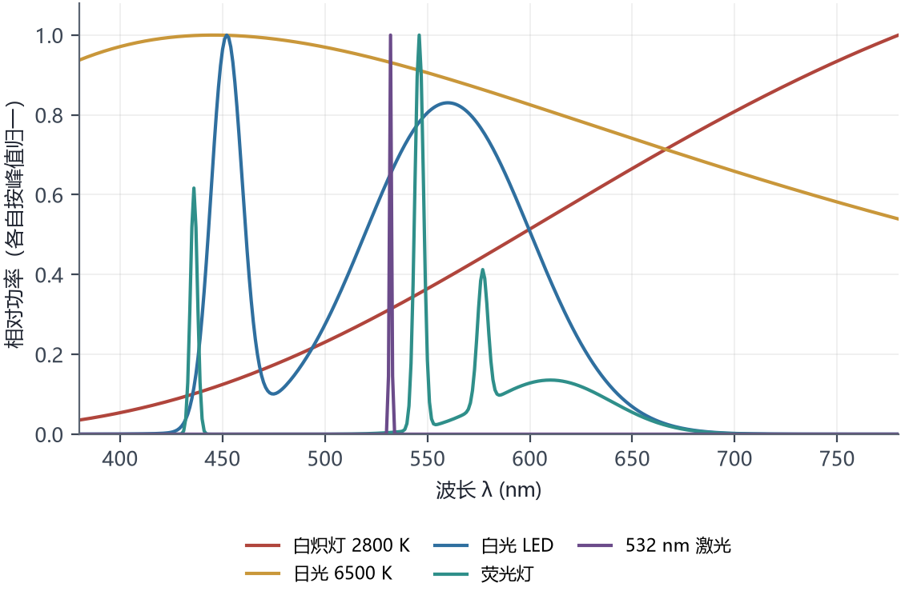
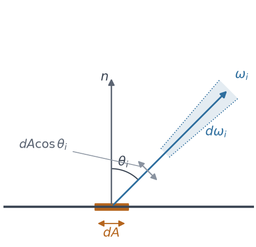
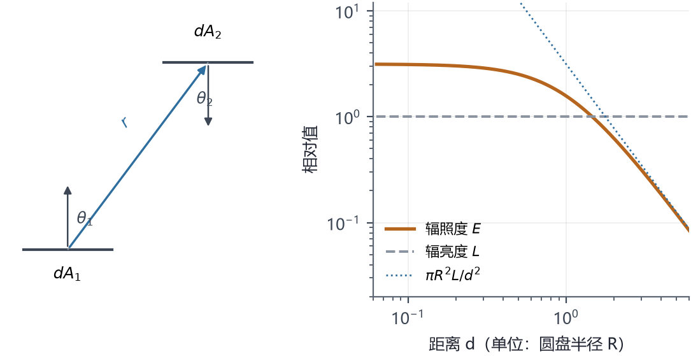

# 第 2 章 光、波长与辐亮度

## 2.1 一束光能带走多少能量

抬头看太阳，低头看一张白纸上的反光，两者都可以说"很亮"，但这句话对渲染没有用。渲染器要算的是一个可以相加、可以相乘、可以对方向积分的量。物理上用的量是能量，具体说是单位时间里携带的能量，也就是功率。可见光的功率大约在毫瓦到千瓦的量级上，取决于你看的是屏幕还是太阳。

从功率到辐亮度要经过三次除法，每一次除法都回答一个不同的问题。

第一次除以波长区间，回答"能量分布在哪一段波长上"。这一步把功率变成光谱功率分布（spectral power distribution，SPD），单位是 W/nm。图 2-1 画了几条常见光源的 SPD。

第二次除以面积，回答"这些能量落在多大的一块面上"。垂直于传播方向取一块面积 $dA_\perp$，穿过它的功率是 $d\Phi$，辐照度定义为

$$E=\frac{d\Phi}{dA_\perp}. \tag{2.1}$$

单位是 W/m²。地面上的太阳直射大约是 1000 W/m²，这是一个辐照度。

第三次除以立体角，回答"这些能量来自多大的一个方向范围"。立体角是平面角在球面上的推广：以观测点为顶点，一块球面面积除以半径的平方，

$$\Omega=\frac{A}{r^{2}}. \tag{2.2}$$

单位是球面度（sr），整个球面是 $4\pi$ sr。在球坐标下，一块方向微元占的立体角是

$$d\omega=\sin\theta\,d\theta\,d\varphi , \tag{2.3}$$

其中 $\theta$ 是从极轴量起的极角，$\varphi$ 是方位角。

三次除法合起来，得到辐亮度（radiance）：

$$L(x,\omega)=\frac{d^{2}\Phi}{dA\cos\theta\,d\omega}. \tag{2.4}$$

这里的 $dA$ 是表面上的面积微元，$\theta$ 是表面法线与方向 $\omega$ 的夹角。单位是 W/(m²·sr)。它同时管住了面积、方向和投影，是四个辐射度量里最细的一个。

## 2.2 为什么除以投影面积

公式 (2.4) 的分母里有个 $\cos\theta$，它的来由值得单独说清楚，因为实现时最容易在这里出错。

一束平行光斜着照在纸面上，纸面收到的功率是一定的，但纸被"摊开"了：本来正对着光只有 $A$ 的面积，倾斜之后被照到的面积变成 $A/\cos\theta$。反过来，如果已知纸面的面积 $dA$，真正挡住这束光的是它在垂直于光方向的平面上的投影，面积是 $dA\cos\theta$。图 2-2 画的正是这件事：表面上一块 $dA$，法线 $n$，方向 $\omega_i$，夹角 $\theta_i$，表面上那块面积在垂直于 $\omega_i$ 的平面上的投影长度是 $dA\cos\theta_i$。

如果不除这个 $\cos\theta$，那么同一束光斜着照在不同的表面上，算出来的 $L$ 会不一样。可"这束光有多亮"不应该取决于它照在什么东西上。除以投影面积之后，$L$ 只描述光本身，与接收面的朝向无关。这不是一个修正项，而是一次单位换算：把"表面面积"换算成"垂直于光线的截面积"。

同一个道理反过来用，就得到辐照度和辐亮度的关系。给定表面上一点收到的各方向辐亮度 $L_i(x,\omega_i)$，把它乘上投影因子再对半球积分，得到辐照度：

$$E(x)=\int_{H^{2}}L_{i}(x,\omega_{i})\cos\theta_{i}\,d\omega_{i}. \tag{2.5}$$

这个式子是渲染方程的前身：渲染方程里的 $\cos\theta_i$ 就是从这里的 $dE_i$ 来的，不是额外加的权重。

## 2.3 辐亮度沿光线不变

为什么路径追踪器搬运的是辐亮度，而不是辐照度或功率？因为辐亮度在真空里沿一条光线传播时不随距离变化。

取两块微小面元 $dA_1$ 和 $dA_2$，相距 $r$，连线与各自法线的夹角是 $\theta_1$ 和 $\theta_2$，如图 2-3 左。从 $dA_1$ 看 $dA_2$，$dA_2$ 张开的立体角是

$$d\omega_{1}=\frac{dA_{2}\cos\theta_{2}}{r^{2}}. \tag{2.6}$$

从 $dA_1$ 发向 $dA_2$ 的功率是 $L_1$ 乘上投影面积再乘立体角：

$$d^{2}\Phi_{12}=L_{1}\,\frac{dA_{1}\cos\theta_{1}\,dA_{2}\cos\theta_{2}}{r^{2}}. \tag{2.7}$$

同一束光到达 $dA_2$ 时，也可以写成 $L_2$ 乘上 $dA_2$ 的投影面积和 $dA_1$ 在 $dA_2$ 处张开的立体角 $d\omega_2=dA_1\cos\theta_1/r^2$：

$$d^{2}\Phi_{12}=L_{2}\,\frac{dA_{1}\cos\theta_{1}\,dA_{2}\cos\theta_{2}}{r^{2}}. \tag{2.8}$$

中间没有吸收和散射时，(2.7) 与 (2.8) 描述的是同一份功率，两边的几何因子完全相同，约掉就得到 $L_1=L_2$。

这个结论有一个前提：两块面元要足够小，小到它们各自张开的方向范围可以忽略。面元一旦变大，$dA_2$ 上不同点到 $dA_1$ 的距离和角度不同，(2.6) 就不再成立，$L$ 只能"逐点"守恒。图 2-3 右把这件事算了一遍：一个半径 $R$ 的圆盘光源，轴线上距离 $d$ 处的辐照度是

$$E(d)=L\pi\,\frac{R^{2}}{R^{2}+d^{2}} , \tag{2.9}$$

在 $d\gg R$ 时退化成平方反比 $L\pi R^2/d^2$，在 $d<R$ 时趋于饱和值 $\pi L$。辐亮度 $L$ 在整条曲线上是一条水平线，辐照度却按 $1/d^2$ 掉下去。

这个性质决定了路径追踪器怎么写。相机传感器收到的辐亮度等于光线离开最后一个表面时的辐亮度，中间的距离、透镜、光圈只影响有多少条光线进来，不影响每条光线携带的值。如果路径上累积的是辐照度，每一次反弹都要额外补偿距离平方，误差会很快累积起来。

它还解释了一个日常错觉：相机离物体远了，物体在画面里变小，但表面亮度没变。变的是它覆盖的像素数，不是每个像素收到的辐亮度。

## 2.4 光谱辐亮度是一个密度

到目前为止的所有量都还没有波长。把波长加进去，最自然的做法是给每个量加一个"每纳米"：

$$L(x,\omega,\lambda)=\frac{d^{3}\Phi}{dA\cos\theta\,d\omega\,d\lambda}, \tag{2.10}$$

单位是 W/(m²·sr·nm)。这个量叫光谱辐亮度，它是一个密度：$L(\lambda)\,d\lambda$ 才是有量纲的辐亮度，$L(\lambda)$ 本身是"每纳米的辐亮度"。要把某个波段内的辐亮度取出来，得积分：

$$L=\int_{\lambda_{\min}}^{\lambda_{\max}}L(\lambda)\,d\lambda . \tag{2.11}$$

密度量和普通量的区别，最好像对待速度那样对待它。速度是"每小时多少公里"，瞬时速度不能当距离用；光谱辐亮度是"每纳米多少辐亮度"，一个波长上的值不能当能量用。写代码时这个区别会具体地出现：如果采样波长是按某个概率密度 $p(\lambda)$ 抽的，那么把样本累加进像素时必须除以 $p(\lambda)$，而不是乘以某个固定的 $\Delta\lambda$。

可见光区间在书里统一取 $[380,780]$ nm。不同文献会用 360 到 830，或者 400 到 700，差别主要落在两端响应很小的区域。有些渲染器把区间定在 360 到 830 nm，是为了让紫外和近红外也进入计算，从而让荧光和上转换有地方可去。

## 2.5 渲染方程里的位置

把带波长的量放回渲染方程，得到

$$L_{o}(x,\omega_{o},\lambda)=L_{e}(x,\omega_{o},\lambda)+\int_{H^{2}}f_{r}(x,\omega_{i},\omega_{o},\lambda)\,L_{i}(x,\omega_{i},\lambda)\cos\theta_{i}\,d\omega_{i}. \tag{2.12}$$

结构和 RGB 版本一模一样，只是每个量多了一个 $\lambda$。方程对每个波长独立成立——这是第 5 章要展开的事，也是光谱渲染能共享路径追踪代码的根本原因。

这里最容易被跳过的是 $f_r$ 的定义。它不是"出射辐亮度除以入射辐亮度"，而是

$$f_{r}(\omega_{i},\omega_{o})=\frac{dL_{o}(\omega_{o})}{dE_{i}(\omega_{i})},\qquad dE_{i}=L_{i}\cos\theta_{i}\,d\omega_{i} . \tag{2.13}$$

分子是出射辐亮度，分母是入射微元辐照度，两者不是同一种量，所以 $f_r$ 的单位是 1/sr，而不是无量纲。

为什么分母必须是 $dE_i$ 而不是 $L_i$？把 (2.12) 的积分项拆开看就明白了：

$$L_{o}=L_{e}+\int_{H^{2}}f_{r}(\omega_{i},\omega_{o})\,dE_{i}(\omega_{i}) . \tag{2.14}$$

积分真正累加的是来自各个方向的微元辐照度，材质只负责把这个微元辐照度按比例变成出射辐亮度。$f_r$ 是那个比例系数。如果写成 $L_o/L_i$，相当于把分母换成了某一个方向的辐亮度，但积分里根本没有这一项。

举两个数的例子。光束 A：$L=1$，$\Delta\omega=0.1$，$\theta=0^\circ$，贡献的 $dE_i\approx0.1$。光束 B：$L=10$，$\Delta\omega=0.001$，$\theta=80^\circ$（$\cos\theta\approx0.17$），贡献的 $dE_i\approx0.0017$。B 的辐亮度是 A 的十倍，但它对表面的贡献不到 A 的六十分之一。只有用 $dE_i$ 才能把这个顺序摆对。

量纲也能验证这一点：

$$\frac{1}{\mathrm{sr}}\times\frac{\mathrm{W}}{\mathrm{m^{2}\cdot sr\cdot nm}}\times 1\times\mathrm{sr}=\frac{\mathrm{W}}{\mathrm{m^{2}\cdot sr\cdot nm}} . \tag{2.15}$$

右边仍是光谱辐亮度。$L_i$ 分母里的 sr 与 $d\omega$ 的 sr 抵消一次，$f_r$ 的 1/sr 留下来。哪一步少了一个 sr，量纲立刻对不上。

BSDF 还要满足逐波长的能量守恒：

$$\int_{H^{2}}f_{r}(\omega_{i},\omega_{o},\lambda)\cos\theta_{o}\,d\omega_{o}\le1\quad\text{对每个 }\lambda . \tag{2.16}$$

注意是每一个波长都成立，不是 RGB 平均之后成立。一个材质在 RGB 下看起来守恒，完全可能在某个窄波段反射率大于 1；光谱渲染必须在每个波长上检查这件事，第 14 章的白炉测试就是查这个。

## 2.6 几个数量级

单位不是形式主义。做能量对比时，一个丢掉的 $\pi$ 或者一个漏掉的 1/nm 会让整张图的亮度差一个数量级，而色调映射会把这种错误藏起来。下面这组数字可以当尺子用。

太阳在大气层外的总辐照度是 1361 W/m²，穿过大气到达地面，晴天正午大约 1000 W/m²。太阳盘面张开的立体角约 $6.8\times10^{-5}$ sr，用 (2.5) 反推，盘面辐亮度大约是 $1.5\times10^{7}$ W/(m²·sr)。可见光部分占太阳辐射的百分之四十五左右，摊到 400 nm 的带宽上，平均每纳米大约 1 W/(m²·sr·nm)。这个数字说明光谱辐亮度的典型量级在 $10^{0}$ 附近，用单精度浮点表示没有问题。

人眼适应的是亮度而不是辐亮度。晴天的太阳盘面亮度约 $1.6\times10^{9}$ cd/m²，晴空约 $5\times10^{3}$ cd/m²，两者相差三十万倍。一张白纸在室内灯光下大约 100 cd/m²，显示器白屏大约 200 到 300 cd/m²。这些数字跨了七个数量级，这也是渲染器内部必须用浮点、最后才做色调映射的原因。

最后提醒两个常见错误。第一，把光源的 SPD 当成辐亮度直接用，少掉了面积和立体角，结果不同大小的光源强弱比例全错。第二，把辐照度当成辐亮度累积，距离一变就要额外补偿——而辐亮度本来就不需要补偿。单位检查不能保证物理一定对，但能挡掉很大一部分低级错误，而且是唯一一种可以只靠一支笔就完成的检查。

---

这一章建立的是语言。辐亮度是路径追踪器搬运的量，它沿光线不变，所以一条路径上的贡献可以一路乘回相机；光谱辐亮度是这个量再加上一个波长维度，它是一个密度，采样时必须除以概率密度；渲染方程对每个波长独立成立，BSDF 的 1/sr 和 $\cos\theta$ 分别来自它的定义和投影面积。剩下的问题只有一个：波长从哪里来，又该怎么积分。这是下一章和再下一章的事。
