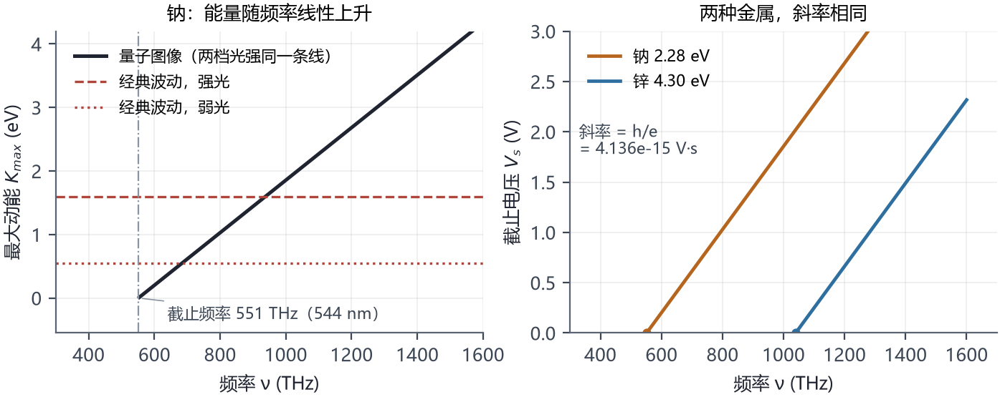
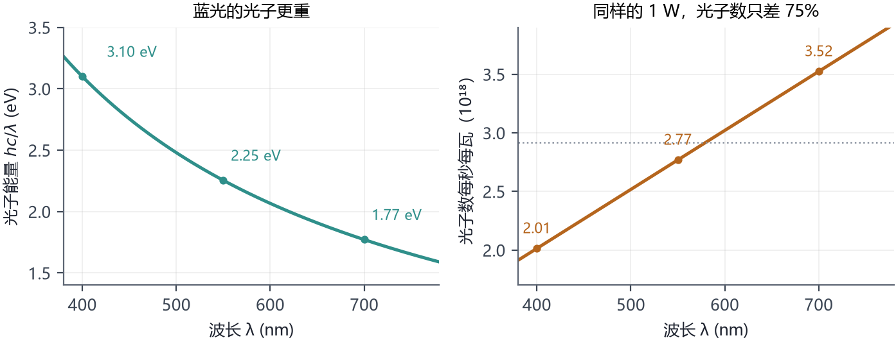
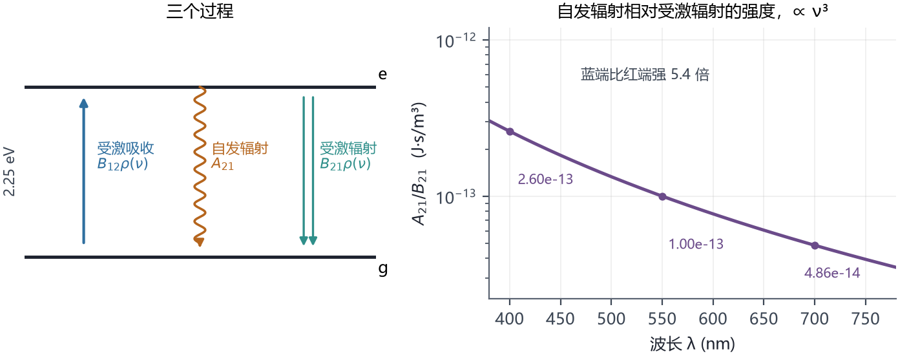

# 第 2 章 光子：能量、动量与吸收发射

## 2.1 锌板上的火花

一块擦干净的锌板放在真空中，正对着它放一块金属网，两者之间加电压。用紫外灯照锌板，网和板之间会流过电流；把灯换成同样亮度的红光，电流为零。把红光的功率加大十倍、一百倍，仍然是零。

1902 年勒纳德把这件事做成了定量实验。他在板与网之间加一个反向电压，让电场把电子推回板里，然后逐渐加大这个电压，直到电流刚好消失。这个电压叫截止电压，它乘以电子电荷就是电子离开锌板时的最大动能。结果有三条，每一条都无法用当时的波动理论解释。

最大动能与光的**频率**成线性关系，与光的**强度**无关。强度只影响电流大小，也就是每秒打出多少个电子；改变强度，截止电压一动不动。

存在一个**截止频率**，低于它无论光多强都不出电子。对锌是 4.3 eV 对应的 1040 THz，换成波长是 288 nm，落在紫外。红光 650 nm 的频率是 461 THz，差得远。

响应是**瞬时**的。经典图像里，电子要吸收足够的能量才能逃逸，一束弱光的能量摊在整个波前上，单个电子要攒够能量需要几分钟甚至更久。实验给出的延迟上限是 $10^{-9}$ s 量级。

爱因斯坦 1905 年给的解释只有一句话：光本身就是一份一份的，每份的能量 $h\nu$，一个电子一次只能吸收一份。于是

$$K_{\max}=h\nu-W \tag{2.1}$$

$W$ 是把电子从金属里拉出来需要的最小能量，叫逸出功。频率不够，单份能量不足以支付逸出功，电子出不来；频率够了，多出来的部分变成动能；强度只决定每秒有多少份，所以只影响电流。三条实验事实一次全部对上。

这个解释在当时被普遍怀疑。普朗克自己反对，认为爱因斯坦“走得太远”；密立根花了十年做实验想证伪它，1916 年的结果反而把 (2.1) 验证到了百分之一的精度，并从中测出 $h=6.57\times10^{-34}$ J·s，与普朗克的值一致。图 2-1 左边是钠的数据形状，右边是两种金属的截止电压，两条线斜率相同、截距不同。斜率就是 $h/e$，与材料无关。

逸出功由材料决定，碱金属低到 2.1 eV（铯），所以可见光就能把它打出电子；铂高达 5.6 eV，需要 220 nm 的深紫外。这解释了为什么早期实验都用锌、钠这类金属：它们的截止波长落在近紫外，用汞灯就能验证。截止频率不是一个普适常量，每个材料有自己的值，而斜率 $h/e$ 是普适的，这个分离本身就是光子图像最有力的证据之一。

## 2.2 一份能量，一份动量

(2.1) 里只有能量。要把光子当成一个粒子，还得给它动量和质量。

能量由频率给出，动量由波长给出：

$$E=h\nu=\frac{hc}{\lambda},\qquad p=\frac{h}{\lambda}. \tag{2.2}$$

两个式子合起来给出 $E=pc$。这是无质量粒子的能量动量关系，与光子静质量为零一致。动量不是凑出来的，1923 年康普顿在 X 射线被石墨散射的实验里直接测到了它：散射后的 X 射线波长变长，变长的量只与散射角有关，

$$\Delta\lambda=\frac{h}{m_ec}(1-\cos\theta)=2.426\times10^{-12}\,(1-\cos\theta)\ \text{m}. \tag{2.3}$$

$h/(m_ec)$ 叫电子的康普顿波长，值 2.426 pm。这个位移在可见光里看不出来（相对 $10^{-7}$），在 X 射线里是百分之几，正好可测。经典波动理论给不出任何波长变化：电子在入射波里做受迫振动，再以同一频率辐射，频率不该变。康普顿的结果让光子从“能量的量子”变成“有动量的粒子”，1927 年它才被普遍接受。

对渲染来说，(2.2) 最直接的用处是把“能量”和“波长”两个语言接起来。可见光的能量范围很窄：400 nm 是 3.10 eV，550 nm 是 2.25 eV，700 nm 是 1.77 eV。从 400 到 700 nm 只差 1.75 倍，算上两端完整的 380 到 780 nm 也只有 2.05 倍。作为对比，X 射线的一个光子是 keV 量级，无线电台的一个光子是 $10^{-7}$ eV 量级，两者差十个数量级。

这个不到两倍的窄范围解释了一个日常现象：可见光的颜色差异，本质上是光子能量的差异，而这个差异很小。人眼能把 1.75 倍的能量差（700 nm 对 400 nm）分辨成完全不同的颜色，靠的是三组视锥细胞的相对响应，不是能量的绝对值。第 7 章会讲这件事。

## 2.3 数量决定亮度

一只 1 W 的 550 nm 光源每秒发出 $2.77\times10^{18}$ 个光子。同样 1 W，换成 400 nm 是 $2.01\times10^{18}$ 个，换成 700 nm 是 $3.52\times10^{18}$ 个。三者的差只有 75%，因为 $h\nu$ 在这个窄带里只变了 1.75 倍。

这个 75% 是这本书里最重要的一组数字之一。它说明亮度和光子数几乎是同一件事：把功率翻倍，光子数就翻倍，波长几乎不影响换算系数。因此渲染器里那条连续的辐亮度曲线，可以放心地当成“光子通量的密度”来理解，两者只差一个平滑的 $hc/\lambda$ 因子。

图 2-2 把这两件事分开画。左图是单个光子的能量随波长变化，右图是每瓦功率对应的光子数。左图的形状决定了颜色，右图的形状几乎是平的，决定了亮度。两者相乘才是能量，这就是为什么渲染器可以把一条光谱拆成“形状”和“幅度”两部分分别处理。

拆开之后有一个直接推论：**改变亮度不需要改变光谱，改变光谱也不需要改变亮度**。渲染器里把辐亮度乘以 2，等价于把每个波长的光子数乘以 2；把 550 nm 的窄带光换成 450 nm 的窄带光而保持光子数不变，亮度几乎不变，颜色完全变了。第一章讲的黑体谱在温度变化时两件事一起变，那只是因为温度同时改变了谱的形状和幅度，不是因为颜色和亮度在物理上绑定。

这也解释了为什么“把 RGB 三个通道各自乘以同一个数”在亮度上是安全的。逐通道缩放不改变三刺激值的比例，只改变大小，与“光子数同乘一个因子”是同一件事。

## 2.4 化学势与玻色–爱因斯坦

光子是玻色子，自旋为 1，服从玻色–爱因斯坦统计。一个模式里的平均光子数是

$$\bar{n}(\nu)=\frac{1}{e^{(h\nu-\mu)/(k_BT)}-1} \tag{2.4}$$

其中 $\mu$ 是化学势。第一章的 (1.6) 是 $\mu=0$ 的特例。

$\mu=0$ 的理由是光子数不守恒。一个处于热平衡的空腔，腔壁可以随时吸收一个光子、也可以随时发射一个，没有任何守恒律约束总数。统计物理里，化学势是“粒子数变化时能量变化的代价”，既然粒子数可以自由变化，代价就是零。

但对发光器件，这个前提不成立。一个正向偏置的 LED，电子和空穴在结区复合放出光子，光子的产生率由注入电流决定，不由温度决定。这时辐射场与载流子处于准平衡，光子的化学势等于准费米能级之差，也就是 $\mu\approx qV$，$q$ 是电子电荷，$V$ 是偏压。把 $\mu=qV$ 代进 (2.4)，谱的短波端会被抬高，峰位往蓝移，这就是为什么 LED 的实际光谱比同温度的黑体更蓝，也是为什么提高驱动电压能让 LED 的发光效率在一定范围内上升。

这个区别对渲染是有意义的。黑体谱（$\mu=0$）的形状完全由温度决定，LED 谱（$\mu>0$）多了一个自由度，可以在同样的结温下把谱往蓝推。把 LED 硬套成某个色温的黑体，形状是对的，短波端的坡度是错的，照在窄带材料上会露馅。

荧光是另一种情况。荧光材料吸收一个光子，把电子激发到高能态，经过振动弛豫落回低能态，再自发辐射出一个较低能量的光子。整个过程里，吸收和发射都是与单个分子作用，化学势的作用被分子能级结构取代，结果是一个把输入波长映到输出波长的核函数。第 15 章会给出它的完整形式，这里只需要记住它的物理来源是自发辐射。

## 2.5 爱因斯坦的 A/B 系数

1916 年，爱因斯坦为了让普朗克公式从更基本的假设里推出来，假设了三种过程。1917 年的论文正式给出它们的系数关系。

一个两能级系统，基态 $g$ 能量 $E_1$，激发态 $e$ 能量 $E_2$，能级差 $h\nu=E_2-E_1$。三种过程是：

处于 $g$ 的原子遇到频率为 $\nu$ 的辐射，以正比于辐射能量密度 $\rho(\nu)$ 的速率被激发到 $e$，比例系数记 $B_{12}$（受激吸收）。

处于 $e$ 的原子会自发地掉回 $g$，速率与外界无关，记 $A_{21}$（自发辐射）。

处于 $e$ 的原子在频率为 $\nu$ 的辐射作用下，会被“推”回 $g$，速率正比于 $\rho(\nu)$，比例系数 $B_{21}$（受激辐射）。

在热平衡下，往上和往下的速率必须相等：

$$N_1B_{12}\rho(\nu)=N_2\left[A_{21}+B_{21}\rho(\nu)\right]. \tag{2.5}$$

能级占据数由玻尔兹曼分布给出，$N_2/N_1=(g_2/g_1)e^{-h\nu/k_BT}$。要求 (2.5) 对任意温度都成立，并且能反解出普朗克谱，需要两个关系：

$$g_1B_{12}=g_2B_{21},\qquad \frac{A_{21}}{B_{21}}=\frac{8\pi h\nu^3}{c^3}. \tag{2.6}$$

两个式子都不是拟合出来的，是“必须如此”。第一个来自简并度，第二个来自把 $\rho(\nu)$ 解出来之后必须与 (1.2) 的模式密度对上。

第二个式子是这一节最有用的一条。它说明自发辐射相对受激辐射的强度按 $\nu^3$ 增长。图 2-3 右边画了这条曲线：550 nm 处 $A_{21}/B_{21}=1.00\times10^{-13}$ J·s/m³，400 nm 处是 $2.60\times10^{-13}$，700 nm 处降到 $4.86\times10^{-14}$，蓝端比红端强 5.4 倍。

这个比值给出一个判据：受激辐射要想和自发辐射相比，外界辐射的能量密度必须达到 $A_{21}/B_{21}$ 的量级，也就是 $10^{-13}$ J·s/m³ 以上。太阳光在 500 nm 处按黑体公式算是 $8\pi h\nu^3/c^3$ 除以 $(e^{h\nu/k_BT}-1)$，$T=5800$ K 时这个因子是 $1/141$，所以 $\rho\approx7\times10^{-16}$，比阈值低两个数量级。换句话说，**阳光下受激辐射只有自发辐射的 0.7%**，可以完全忽略。

激光的工作点正好相反。把增益介质泵浦到粒子数反转，$N_2>N_1$，受激辐射的净增益为正；把它放进谐振腔，让 $\rho(\nu)$ 在腔内累积到远高于阈值的水平，受激辐射就压倒自发辐射。输出的是相位一致、频率极窄、方向一致的光。第 3 章会讲这种光在相干性上与普通光源差多少。

对渲染来说，(2.6) 解释了一件事：普通光源的发光几乎全是自发辐射，每个原子独立、随机、无相位关联地发射，所以光谱是一条由统计决定的连续曲线，方向是各向同性的。这意味着把自发光材质写成一个只依赖波长的函数、把发光方向当成各向同性，是有物理依据的，不是偷懒。

$A_{21}$ 本身还有一个用处：它的倒数就是激发态的寿命，$\tau=1/A_{21}$。允许跃迁的 $A_{21}$ 在 $10^{8}$ s⁻¹ 量级，对应纳秒级的寿命，这是普通荧光的尺度；如果跃迁被选择定则禁戒，$A_{21}$ 能小六到九个数量级，寿命拉到毫秒到秒，这就是磷光。两类过程在渲染里通常被归为同一个“再辐射核”，但磷光的延迟超出了即时渲染的时间尺度，辉光残留那种效果靠的是后处理，不是这里的物理。

## 2.6 一个光子的颜色，一群光子的颜色

把前面的结论收一下，有一个容易被混淆的地方需要说清。

单个光子有一个确定的能量 $h\nu$，也就有一个确定的波长。探测器记录一个光子时，只知道它的能量，不知道“颜色”；颜色是人眼的三组视锥细胞对这个能量做出的响应，是后续的事。所以严格讲，单个光子没有颜色，只有能量。

一束光的颜色由光子的**能量分布**决定。同样 1 W，全是 550 nm 的光子看起来是绿的，一半 450 nm 一半 650 nm 看起来是品红，两者的总能量相同。这个差别在第 5 章会以同色异谱的形式重新出现。

亮度由光子的**数量**决定。能量分布的形状决定颜色，分布的幅度决定亮度，两者是独立的。

这两个独立性是光谱渲染的数据结构赖以成立的前提。渲染器里一条光谱被表示成一串采样值，采样值的相对大小编码颜色，绝对大小编码亮度；路径追踪的 throughput 只缩放幅度，材质与光源改变形状；最后的 XYZ 积分同时用到了两者。如果光子的能量与数量以某种方式耦合，这个结构就散了。

真实的耦合只有一处，就是量子效率。探测器的响应不是平直的，人眼也不是。同样 1 W，700 nm 的光子比 400 nm 多 75%，但人眼对 550 nm 最敏感，对 400 nm 和 700 nm 都很迟钝，所以看起来亮度完全不同。这个耦合发生在探测器一侧，不在光源一侧，把它归到配色函数里去处理是正确的位置。第 7 章给出的三条曲线就是这件事的完整描述。

---

这一章把光从“一份能量”推到“一个有能量、有动量、有统计分布的粒子”。光电效应给了能量量子，康普顿给了动量，玻色–爱因斯坦给了分布，爱因斯坦的 A/B 系数给了吸收与发射之间的关系。四条合起来，一个光子被物质吃掉之后可能以另一个波长、另一个方向再吐出来，这个过程在普通光源里几乎全是自发辐射，在激光里则是受激辐射主导。下一章处理这些光子之间的相位关系，也就是相干性，它是这本书里唯一一个“必须越出几何光学”的地方。
