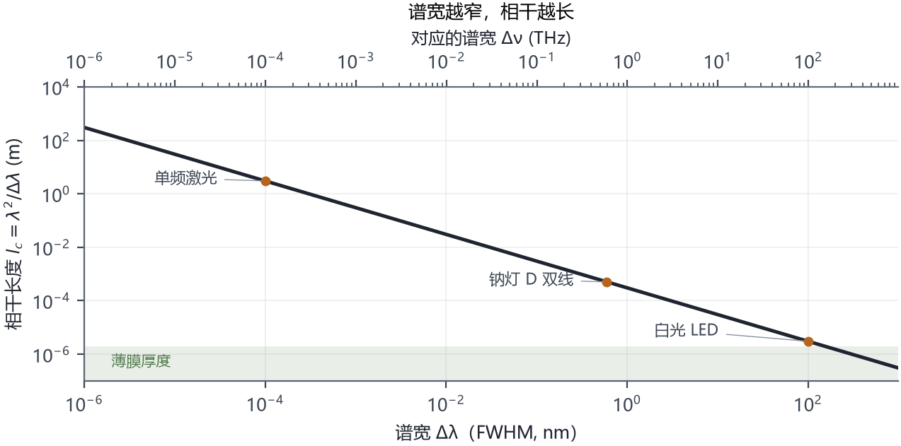
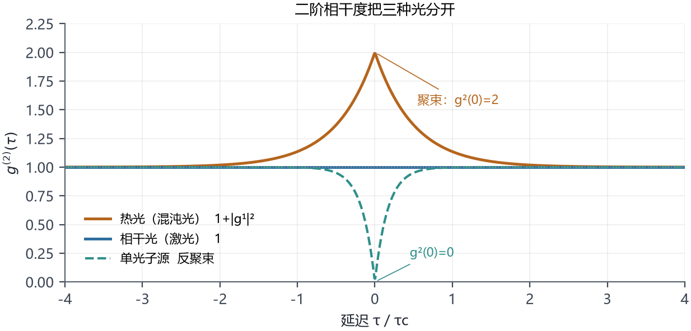
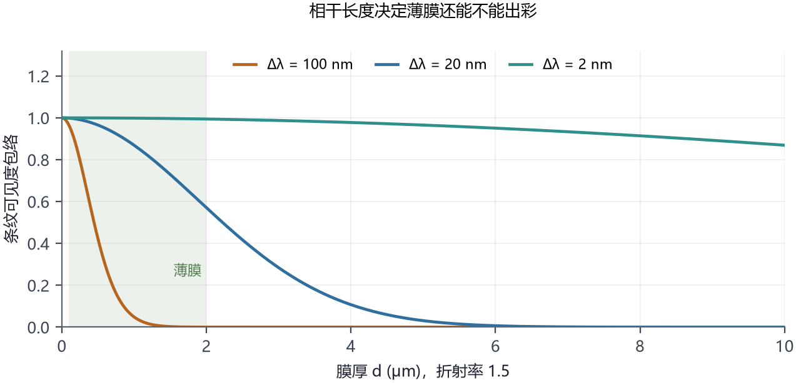
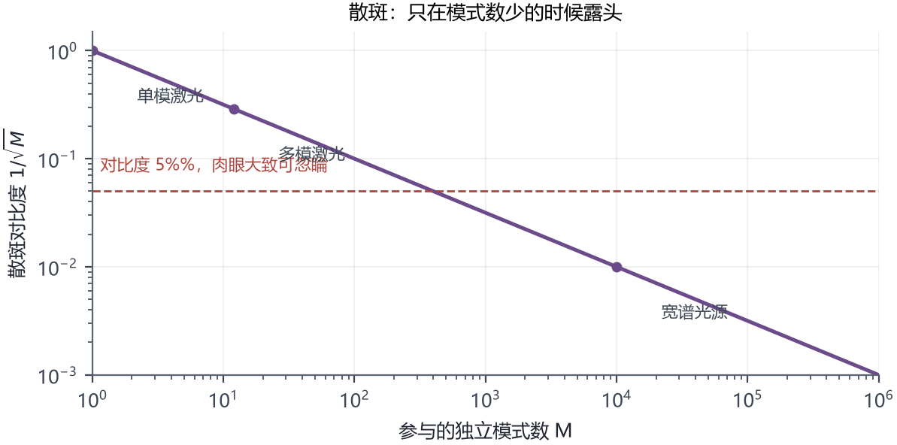

# 第 3 章 相干性：从单光子到激光

## 3.1 肥皂泡与窗玻璃

一根细铁丝弯成框，蘸上肥皂水，框上留下一层薄膜。斜着光看，膜面上有彩色条纹，红的、绿的、紫的，随视角和膜厚变化。同样的光，照在一块窗玻璃上，什么彩色也没有，玻璃只是把后面的东西照原样透过来。

两层膜的区别只有一个：厚度。肥皂膜几百纳米，窗玻璃几毫米，两者差四个数量级。

薄膜的颜色来自两件事的叠加。光在膜的上表面反射一次，在下表面反射一次再出来，两束光回到同一地点，走的距离不同，相位不同，相干叠加的结果可能是增强也可能是抵消，取决于波长和膜厚。这个叠加能不能发生，取决于两束光是否“还记得”彼此的关系。这个记忆的长度叫相干长度。

如果两层反射的光程差远小于相干长度，两束光完全相关，叠加给出清晰的条纹。如果光程差远大于相干长度，两束光的相位关系已经随机化，叠加的是一堆互相无关的强度，条纹被平均掉，只剩下一个常数，看起来就是“没有颜色”。

所以薄膜出不出彩，不是膜的问题，是光源的问题。同一层肥皂膜，用激光照，条纹会在任何厚度上都非常清晰；用白光 LED 照，条纹只在最薄的地方还有一点。第 1 章把光当成一份一份的能量，这一章要补上另一件事：这些能量一份一份地来，但它们的相位之间可能有、也可能没有关系。

## 3.2 一阶相干：两条波能不能对上

把相干性写成一个可测的量，最直接的办法是做干涉。把一束光分成两路，让其中一路多走一段距离 $\Delta$，再合起来，测合成后的强度。这个装置叫迈克尔逊干涉仪，泰曼–格林干涉仪是它的变体。

合成强度是 $I=I_1+I_2+2\sqrt{I_1I_2}\,|g^{(1)}|\cos\phi$，其中 $\phi$ 是两路的相位差，$|g^{(1)}|$ 是一个介于 0 和 1 之间的数，叫一阶相干度（first-order degree of coherence）。它的定义是

$$g^{(1)}(\tau)=\frac{\langle E^*(t)E(t+\tau)\rangle}{\langle|E(t)|^2\rangle} \tag{3.1}$$

$E$ 是复解析信号，尖括号表示时间平均。$|g^{(1)}|=1$ 表示两路完全相关，干涉条纹对比度满格；$|g^{(1)}|=0$ 表示完全不相关，条纹消失。

$\tau$ 是两路的时间延迟。$|g^{(1)}(\tau)|$ 从 1 衰减到 0 的那个时间尺度叫相干时间 $\tau_c$，对应的距离叫相干长度 $l_c=c\tau_c$。

实际光源处在这两个极端之间，叫部分相干。一盏带扩散片的 LED 灯，输出的光在空间上有一段距离内还是相关的，过了这个距离就随机化了；同一盏灯的光在时间上相关几十微米，再远就不相关。完整描述需要把 $g^{(1)}$ 写成时间与两个空间点的函数，这个函数叫互相干函数。渲染器不需要这么多，它只需要知道“相关长度是大还是小”这一个判断，所以后面只用到时间维的 $l_c$。

相干时间由光源的谱宽决定，两者是傅里叶变换的两端。谱越窄，相干越长，这条关系可以写成一个粗略的估算式

$$l_c\approx\frac{c}{\Delta\nu}\approx\frac{\lambda^2}{\Delta\lambda} \tag{3.2}$$

$\Delta\nu$ 与 $\Delta\lambda$ 是谱宽的半高宽。两个形式等价，用 $|\Delta\nu|=c\,\Delta\lambda/\lambda^2$ 换算。

拿 550 nm 试一下。白光 LED 的谱宽取 100 nm，$l_c=550^2/100=3025$ nm，约 3.0 μm。钠灯的 D 双线间距 0.6 nm，$l_c=0.50$ mm。一台单频激光的线宽可以到 $10^{-4}$ nm，$l_c=3.0$ m。

图 3-1 把 (3.2) 画成一条直线，横轴是谱宽，纵轴是相干长度，都是对数刻度。三个标记点分别落在微米、亚毫米、米三个尺度上。图上还画了一条灰带，标出典型的薄膜厚度区间 0.1 到 2 μm。只有落在灰带之上的光源，才能让这么厚的膜出彩。

## 3.3 谱宽为什么决定相干长度

(3.2) 值得单独推导一遍，因为它把“颜色纯度”和“能干涉多远”这两件看起来无关的事绑在了一起。

把光源看成一组频率连续分布的单色波，每个频率成分有自己的相位演化。两路光的时间差是 $\tau$，频率为 $\nu$ 的成分累积的相位差是 $2\pi\nu\tau$。合起来的强度是对所有频率成分的积分，干涉项是

$$\int S(\nu)\cos(2\pi\nu\tau)\,d\nu . \tag{3.3}$$

如果 $S(\nu)$ 是一条极窄的线，$\cos$ 在积分区间里几乎不变，积分出来就是 $\cos(2\pi\nu_0\tau)$，幅度不衰减。如果 $S(\nu)$ 有宽度 $\Delta\nu$，$\tau$ 一旦大到 $2\pi\Delta\nu\tau\sim1$，不同频率的 $\cos$ 取值就分散在 $[0,2\pi]$ 之间，正负抵消，积分趋零。这个临界的 $\tau$ 就是 $1/\Delta\nu$，对应的长度就是 $c/\Delta\nu$。傅里叶变换的带宽–时宽不确定性关系在这里以一个具体的形式出现。

这个推导还解释了一件事：相干长度不是光源的“质量指标”，是它的一个几何属性。一个非常亮的白光 LED 的相干长度只有微米，一个很暗的单频激光可以有几米。亮度与相干性完全独立，因为前者是光子数，后者是相位关系。第 2 章说能量与数量可以分开，这里再加一条，相位也可以分开。

## 3.4 二阶相干：光子成团

一阶相干度量的是场的相位关系，用干涉仪就能测。还有一类相干性，度量的是光子到达时间的统计规律，需要另一种量。

把一束光打到单光子探测器上，记录每个光子的到达时刻，然后统计“在 $t$ 时刻探测到一个光子”与“在 $t+\tau$ 时刻再探测到一个光子”的联合概率。归一化之后得到

$$g^{(2)}(\tau)=\frac{\langle I(t)I(t+\tau)\rangle}{\langle I\rangle^2} \tag{3.4}$$

这个量叫二阶相干度（second-order degree of coherence），也叫强度关联函数。它与一阶相干度通过一个不等式联系，对热光（谱线加宽的混沌光）取等号：

$$g^{(2)}(0)=1+|g^{(1)}(0)|^2 . \tag{3.5}$$

三种光的 $g^{(2)}(0)$ 不一样，这个差别是判别光源性质的指纹。

热光（混沌光）的 $g^{(2)}(0)=2$。物理图像是光子成团：热光源由大量独立原子自发辐射叠加而成，各原子的相位随机，叠加后的强度做随机涨落。强度大的时刻，两个探测器同时收到的概率高，所以零延迟处的关联是平均值的两倍。这种现象叫光子聚束（photon bunching）。

相干光（理想的激光）的 $g^{(2)}(\tau)=1$，与延迟无关。光子的到达是泊松过程，前后独立，没有聚束也没有反聚束。

单光子源（单个原子、单个量子点、单个 NV 色心）的 $g^{(2)}(0)=0$。一个原子发完一个光子之后要回到基态才能再发一个，所以两个探测器不可能同时收到两个光子。这叫反聚束（antibunching），是光的量子性最直接的证据，经典波动理论给不出来。

图 3-2 把三条曲线画在一起。热光在 $\tau=0$ 处有一个尖峰，$g^{(2)}(0)=2$；相干光是水平的 1；单光子源在 $\tau=0$ 处有一个凹坑，$g^{(2)}(0)=0$。

反聚束在今天不只是实验室现象。量子密钥分发靠它确认光源确实是单光子源，荧光寿命成像靠统计光子到达时间反推分子环境，单光子成像靠它把探测灵敏度推到单个光子。这些应用都不在渲染的范围里，但它们共享同一个前提：当光子数少到可以用“个”数的时候，“辐亮度”这个连续量就开始失去意义。第 4 章会把这条界线画出来。

这个量的实验意义由汉伯里·布朗和特威斯在 1956 年给出。他们想测量恒星的角直径，但大气扰动让传统的迈克尔逊干涉仪失效，于是换了一个思路：不去比较两路光的相位，而是比较两个探测器上光强的涨落是否同步。一颗有一定角直径的恒星，表面各点发出的光互不相关，但它们在两个探测器上叠加出的强度涨落却会同步，同步的程度随两个探测器的间距减小而减弱。相关函数的宽度对应恒星的角直径，这就是强度干涉。它的成立依赖于 $g^{(2)}$ 而不是 $g^{(1)}$，因此对大气扰动不敏感。

这个实验在当时引起过争论，因为直觉上“两个独立的光源不会有干涉”，而 HBT 的结果显示热光的强度涨落确实有非零关联。争论的解决靠的是把 $g^{(2)}$ 与 $g^{(1)}$ 的关系写清楚，也就是 (3.5)。1963 年格劳伯建立了光的量子相干理论，把一阶、二阶以及更高阶的相干性统一在一个框架里，这套框架今天仍然是量子光学的语言。

## 3.5 薄膜什么时候出彩

把 (3.1) 用到薄膜上，可以得到一个能算的判据。

膜的上表面反射与下表面反射是两束光，路程差是 $2nd$，$n$ 是膜的折射率，$d$ 是厚度。相位差是 $4\pi nd/\lambda$，随波长变化。条纹的可见度是这两束光的一阶相干度在该延迟处的值：

$$V(d)=\frac{\left|\int S(\lambda)\,e^{i4\pi nd/\lambda}\,d\lambda\right|}{\int S(\lambda)\,d\lambda} . \tag{3.6}$$

只取绝对值，因为 (3.6) 描述的是条纹振幅的包络，实际条纹在这个包络之内振荡。

图 3-3 是三条不同谱宽的曲线，$n=1.5$。谱宽 100 nm 的光（白光 LED、白炽灯）在 300 nm 膜厚上还有 0.72 的可见度，500 nm 降到 0.42，1 μm 时只剩 0.05，2 μm 以上完全消失。谱宽 20 nm 的光（窄带 LED、某些荧光灯）在 1 μm 上是 0.87，2 μm 上 0.57，5 μm 才掉到 0.03。谱宽 2 nm 的光在 10 μm 上还有 0.87。

这组数字解释了两个现象。肥皂泡在自然光下能出彩，因为膜的厚度只有几百纳米，落在 100 nm 谱宽的光还能维持高可见度的范围内；窗玻璃不出彩，因为几毫米的厚度上任何热光源的可见度都是零。反过来说，用一台线宽 0.01 nm 的激光照窗玻璃，边缘上可以看到极细的等厚条纹，那是抛光留下的纳米级起伏。

对渲染的含义很直接：薄膜干涉（以及所有依赖相位的光学效果）不是“材质属性”，是“材质加光源”的联合属性。同一个膜材质，在阳光下有色，在宽谱 LED 下也可能有色（因为膜薄），在白炽灯下色弱，在激光下有极清晰的条纹。把这些全部写进一个静态的薄膜 BSDF 里，等于假设了光源的相干长度无穷大，这个假设在多数场景里错得不多，在窄谱光源下会明显偏。

## 3.6 渲染里要不要管相干

这本书后面的十几章都不再提相干性，就是说：绝大多数渲染场景里可以不管它。这个判断需要条件，条件有两条。

第一条是相干长度远小于场景的几何尺度。白光 LED 的 3 μm 相干长度，相对于一个 1 m 的场景是 $10^{-6}$，任何两束光走的路程差都远大于它，干涉项被彻底平均掉。这时把强度直接相加就是对的，也就是渲染方程里的积分。这条在几乎所有日常光源下成立，因为热光源的谱宽被温度撑得很宽。

第二条是没有专门的相干光源。激光的相干长度是米到公里量级，与场景尺度可比，这时的干涉不能被忽略。散斑就是它的表现：激光照在粗糙表面上，表面各处的高度起伏在波长尺度上随机，反射光在观察面上形成明暗相间的颗粒，对比度可以到 1。图 3-4 给出了散斑对比度与参与模式数的关系。对比度按 $1/\sqrt{M}$ 下降，$M$ 是落在同一个分辨单元里的独立模式数。单模激光的 $M=1$，对比度 1；把线宽展宽到多模，$M$ 上升，对比度下降；宽谱光源的 $M$ 可以到 $10^4$ 以上，对比度掉到 1% 以下，肉眼看不见。

如果一个渲染器要处理激光，它需要的不只是光谱，还有相位，而相位在几何光学的框架里没有位置。路径追踪器搬运的是辐亮度，辐亮度是强度的量，不携带相位信息。要得到散斑，必须换成复振幅的传播，或者用一个统计模型直接合成散斑图案。这两种做法都超出了这本书的范围，属于波动光学那一册。

介于两者之间的是窄谱 LED 和某些荧光灯。它们的相干长度在几十微米到几毫米，比场景小得多，但比薄膜厚度大。这类光源下，薄膜效果仍然成立（第 3.5 节的曲线已经算过），但更厚的结构（多层膜、厚涂层）的干涉会开始衰减。渲染器如果只实现一个“相干长度无穷”的薄膜模型，在这类光源下会把厚膜的彩色算得过强。

---

这一章补上了光的另一个自由度。前面把光当成能量的一份一份，这一章说明这些份之间的相位关系可以是相关的，也可以是完全随机的，相关与否由光源的谱宽决定，用一个长度 $l_c=\lambda^2/\Delta\lambda$ 来度量。相干长度大于结构的尺度，干涉可见；小于，干涉被平均掉，只剩下强度的叠加。渲染器默认的是后一种情况，这就是为什么它可以把光当成一条曲线在场景里搬运。下一章把这条曲线与光子数接起来，说明辐亮度到底在多大程度上可以当成光子密度的期望值，以及这个等价在什么条件下失效。
