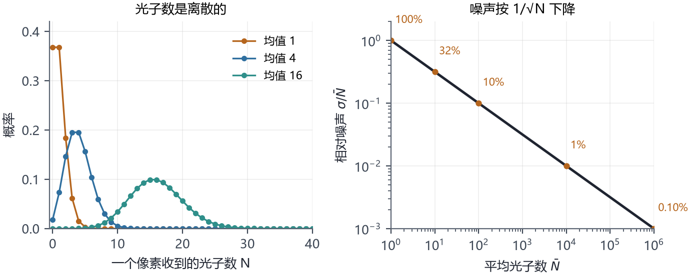
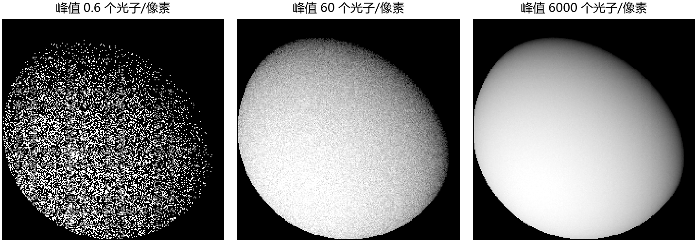

# 第 4 章 从光子到辐亮度：渲染为什么能用经典量

## 4.1 一个像素收到多少光子

取一台普通的相机，光圈 f/2，像素边长 1.4 μm，曝光时间 1/60 s，拍一个亮度 100 cd/m² 的室内场景。

先算像素的面积，$A=1.4^2\ \text{μm}^2=1.96\times10^{-12}$ m²。再算镜头收集的立体角，对 f/2 的圆孔，$\Omega=\pi/(4N^2)=\pi/16=0.196$ sr。把亮度换成辐射度量，100 cd/m² 对应约 0.146 W/(m²·sr)。550 nm 的光子能量是 $3.61\times10^{-19}$ J。

$$\bar{N}=\frac{L\,A\,\Omega\,t}{h\nu} \tag{4.1}$$

代进去，$\bar{N}=0.146\times1.96\times10^{-12}\times0.196\times0.0167/3.61\times10^{-19}\approx2.6\times10^{3}$。一个像素在一次曝光里收到大约两千六百个光子。

两千六百不是一个抽象的数字。它意味着相对涨落是 $1/\sqrt{2600}=2\%$，也就是 8 位量化的半步大小。这解释了为什么正常曝光的照片看起来是干净的：光子噪声刚好压在量化噪声以下，两者都被埋掉。

把场景换到同一个画面的暗部，亮度低 100 倍，光子数降到 26。相对涨落变成 $1/\sqrt{26}=20\%$，比量化步长大五十倍。这就是为什么照片的暗部总是脏的，而且脏的不是灰色，是彩色的——第 17 章会看到，波长采样让三个通道的噪声不相关。

(4.1) 里的每一项都可以追问，而每一次追问都会打开一个新的维度。$L$ 是辐亮度，它是这一章要接到光子上的量。$A$ 和 $\Omega$ 是几何，它们属于第 6 章。$t$ 是时间积分，在运动模糊那一侧。$h\nu$ 是单个光子的能量，它让(4.1)不能只算总功率，必须按波长分别算。

## 4.2 从光子输运到辐亮度

把(4.1)反过来读，就是这个等式：

$$L_\lambda=\frac{hc}{\lambda}\cdot\frac{d^4N}{dA\,d\Omega\,dt\,d\lambda} \tag{4.2}$$

右边是一个光子数的密度：单位面积、单位立体角、单位时间、单位波长区间里的光子数，乘上单个光子的能量，就是光谱辐亮度。这个式子把两个语言接上了，一边是离散的计数，一边是连续的场。

从这一边到那一边，中间经过的是一个取期望的步骤。光子从光源出发，在场景里被吸收、散射、再发射，每一次事件都是一个随机过程。固定一个观察点、一个方向、一个波长区间，重复实验，每次收到的光子数会不一样，但它们的平均值会稳定下来。(4.2) 里的 $L_\lambda$ 就是这个平均值的密度形式，严格写要加一个 $\langle\cdot\rangle$。

渲染方程描述的是这个平均值如何传播。它的每一项——吸收系数、散射相位函数、BSDF——都是对大量光子行为的统计平均。路径追踪器做的事，是用蒙特卡洛从同一个分布里抽样，用样本的平均去逼近这个期望。这两件事在数学上是同一个东西的两面：一般是积分方程，另一面是随机过程的期望。

这个对应关系成立的代价，是把光子的一切个体信息丢掉了。一个光子有能量、有动量、有相位、有偏振、有到达时刻，辐亮度只保留了能量分布的密度，其余全部被平均掉。所以问题不是“辐亮度对不对”，而是“被平均掉的那些东西，在什么情况下会影响结果”。接下来的三节回答这个问题。

有一个细节值得单独提：渲染方程里看不到普朗克常数。路径追踪的 throughput 是一串无量纲的比值，每次反射乘一个反射率，每次透射乘一个透射率，最后与光源的辐亮度相乘。所有这些操作都是线性的、能量守恒的，$h$ 在分子分母上各出现一次就约掉了。$h$ 只在三个地方重新出现：黑体谱的形状（第 1 章）、光子能量的换算（本章）、以及光子噪声的幅度（下一节）。前两个是确定性的，第三个是统计的。一个渲染器可以完全不提 $h$ 而把图像算对，因为它算的是期望值；只有当它需要回答“这个亮度对应多少个光子”时，$h$ 才变成不可约的。

## 4.3 三个近似的成立条件

从光子到辐亮度，中间跨过三个近似。三个都成立，渲染方程就是精确的；任何一个破了，就要改模型。

**第一个近似是光子数足够大。** 光子到达是一个泊松过程，计数 $N$ 的概率是

$$P(N)=\frac{\bar{N}^N e^{-\bar{N}}}{N!} \tag{4.3}$$

均值与方差相等，都等于 $\bar{N}$，所以相对噪声是

$$\frac{\sigma}{\bar{N}}=\frac{1}{\sqrt{\bar{N}}} \tag{4.4}$$

图 4-1 左边画了三个均值的泊松分布。均值 1 时，$P(0)=P(1)=0.37$，一个像素有 37% 的概率什么都没收到，这时“平均亮度”没有任何意义；均值 16 时分布已经对称，像一个离散化的钟形；均值上千时，泊松分布与高斯分布的区别在工程精度内消失，辐亮度就是一个可靠的量。

右边是 $\sigma/\bar{N}$ 随 $\bar{N}$ 的曲线。1 个光子对应 100% 的噪声，100 个对应 10%，$10^4$ 个对应 1%，$10^6$ 个对应 0.1%。注意纵轴是对数、横轴也是对数，这是一条斜率 $-1/2$ 的直线，与第 17 章里路径追踪的收敛率是同一个指数。这不是巧合：两者都是“用 $N$ 个独立样本估计一个均值”的方差。

**第二个近似是相干长度小于几何尺度。** 第 3 章算过，白光 LED 的相干长度是 3 μm，钠灯是 0.5 mm，单频激光是 3 m。前两者远小于场景的几何尺度，干涉项被平均掉，强度可以直接相加；后者不小于场景尺度，干涉不能忽略。辐亮度是一个强度量，它天然描述前者，描述不了后者。

**第三个近似是没有强关联。** 泊松过程假设光子之间相互独立，前后到达互不影响。这个假设对激光成立（$g^{(2)}=1$），对热光不成立（$g^{(2)}(0)=2$，光子聚束）。光子聚束会不会影响渲染？对单光子过程不会，因为一次相互作用只涉及一个光子，$g^{(2)}$ 描述的是两光子联合概率，单个光子的事件看不到它。对多光子过程会，下一节给出一个具体例子。

三个近似合起来，可以写成一句话：**辐亮度是光子数在一段足够长的时间、足够大的面积、足够宽的波长区间上的期望值，前提是这段时空尺度远大于相干尺度与关联尺度。** 后面所有的渲染器都在这个前提下工作。

## 4.4 近似碎掉的样子

四个场景。

第一个是单光子成像。2014 年 Kirmani 等人提出 first-photon imaging，每个像素只记录**第一个**到达的光子的飞行时间，然后用这个时间反推距离。这种做法把探测器灵敏度推到单个光子，代价是每个像素的信息量只有一两比特。在这种模式下，(4.2) 里的密度没有任何意义，因为分母上的 $dt$ 和 $d\lambda$ 都是零——你根本没有采样到分布，只采到了一个事件。图 4-2 是同一张图在三档光子数下的样子，最左边那一档峰值只有 0.6 个光子每像素，画面里大部分像素是黑的，亮的地方是一颗一颗的孤立点。

第二个是散斑。激光照粗糙表面，反射光的相位在波长尺度上随机，观察面上形成对比度接近 1 的颗粒。这时强度不是平滑的场，是一个随机过程的实现，单个实现与它的期望差异极大。散斑的对比度按 $1/\sqrt{M}$ 下降，$M$ 是参与平均的独立模式数。宽谱光源的 $M$ 很大，散斑被平均掉；单模激光的 $M=1$，散斑满格。渲染器如果只有辐亮度，就描述不了 $M=1$ 的情形。

第三个是暗部的光子噪声。这个不是“近似破了”，是“近似还在，但误差已经不可忽略”。26 个光子对应 20% 的涨落，这个涨落无法用提高精度消掉，只能靠增加曝光、增大光圈或者平均多帧。任何物理正确的渲染器都必须承认这一点：真实相机的暗部就是脏的，一颗 8 位量化的干净暗部是渲染器的虚构。

第四个是多光子过程，这一条最微妙。双光子吸收的速率正比于光强的平方，而光强本身在涨落，所以速率正比于 $\langle I^2\rangle$，而不是 $\langle I\rangle^2$。两者的比就是 $g^{(2)}(0)$。热光的 $g^{(2)}(0)=2$，意味着同样平均亮度下，热光的双光子吸收速率是相干光的两倍。这时辐亮度不再是一个充分统计量，同样的 $L$ 可以对应不同的物理结果，必须把 $g^{(2)}$ 也带上。

荧光介于单光子和多光子之间。吸收是一个单光子过程，所以吸收速率只看辐亮度；但发射的量子产额可能依赖激发态的寿命与周围环境，在高强度下会出现饱和。饱和把线性关系变成非线性，线性渲染方程就不再适用。这本书的第 15 章只处理线性荧光，把饱和留给读者。

讲到这里要把两种噪声分开，它们经常被混为一谈。图 4-2 里的噪声是**物理的**：它来自光源发出的光子数本身的随机性，即使你有一个完美的探测器也会看到。路径追踪器里的噪声是**估计的**：它来自用有限条路径去估计一个积分，如果你有无限的计算资源就可以消掉。两者都按 $1/\sqrt{N}$ 下降，但 $N$ 的含义不同。

这个区别有一个实际后果。很多人看到暗部脏，第一反应是提高每像素的采样数。这对路径追踪的估计噪声有效，对光子噪声无效。物理上，一个 26 个光子的像素就是有 20% 的涨落，平均一千帧可以把涨落压到 0.6%，但那已经是另一个量的估计了，不是那个像素本身的亮度。一个把曝光模型接进渲染器的实现，应该在最后一步按 (4.3) 重新抽一次泊松，才能复现真实相机的暗部质感；一个只算期望值的渲染器，给出的是一张“无限曝光”的图，干净得不真实。

## 4.5 全书的路线

把这一篇的结论摆开，可以看到一条从量子到 RGB 的链。

起点是量子电动力学：光是量子化的场，激发是光子，光子有能量、动量、相位、偏振。这个描述精确，但计算不起，一个可见光波段的光子数在 $10^{18}$ 量级。

第一步近似，把光子之间的相位关系平均掉，得到经典电磁场。这一步丢掉了相干与干涉，换来麦克斯韦方程组。第 3 章说明了这一步在什么条件下成立：相干长度小于几何尺度。这本书不处理波动光学，只在薄膜那一小节借用了它的结论。

第二步近似，把波长尺度平均掉，得到几何光学。这一步丢掉了衍射，换来光线。光线可以求交、可以追踪、可以构建加速结构，这是所有渲染器的骨架。

第三步近似，把光子的离散性平均掉，得到辐亮度。这一步丢掉了光子噪声与光子统计，换来一个连续的场，可以用积分方程描述。这一步就是这一章。

第四步近似，把光谱压成三个数，得到 RGB。这一步丢掉了同色异谱，换来三通道的算术。第 7、8 章会说明这个压缩的代价。

四步走完，剩下的是这台机器：一条光线，携带三个数，在几何体之间弹射。这就是今天几乎所有实时渲染器与大部分离线渲染器在做的事。

这本书后面每一篇，都是把上面某一步近似换回去。

第二篇（第 5 到第 8 章）不动前三步，只把第四步摊开：三个数装不下一条曲线，先建立辐亮度与配色函数的语言，再说明 RGB 渲染在什么条件下失效。

第三篇（第 9 到第 12 章）把波长放回渲染方程。这一步撤销的是第四步近似的一部分——不是撤销压缩，而是让压缩发生在最后而不是最前。渲染器内部搬运一条曲线，只在写像素时投影成三个数。

第四篇（第 13 到第 16 章）撤销“波长之间互相独立”这条额外的假设。色散让不同波长走不同的路，介质让不同波长的自由程不同，荧光让波长改变，偏振让状态从标量变成矢量。

第五篇（第 17、18 章）把前面所有东西装进一个能跑的程序，并给出一套验证方法。

按这个顺序读，每一篇都在回答同一个问题：**上一层近似丢掉了什么，这一层怎么把它捡回来，捡回来的代价是多少。** 知道代价，才知道什么时候值得捡。

---

这一章做了三件事。把辐亮度写成光子数的期望值乘上单光子能量，说明渲染器搬运的连续量其实是一个统计平均；给出这个平均成立的三个条件，光子数大、相干长度小、没有强关联；指出三个条件各自在什么场景下会破，以及破了之后图像会变成什么样。到这里，第一篇的任务完成了。光从一份一份的能量，经过统计平均，变成了一条连续的曲线。接下来这本书要处理的问题是：这条曲线有多长，能不能用三个数代替它，如果不能，该怎么把它放进渲染方程。
