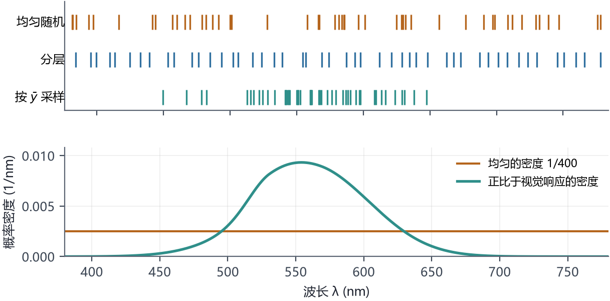
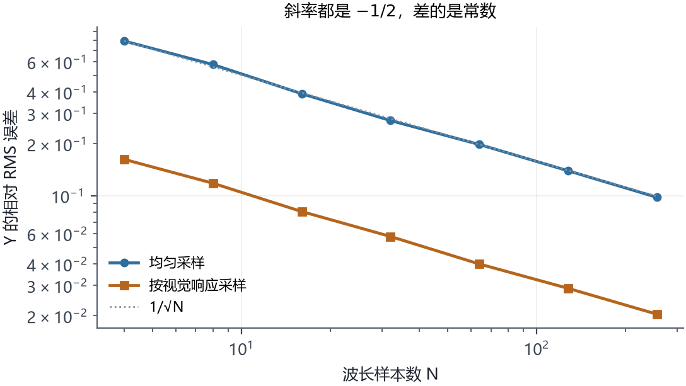
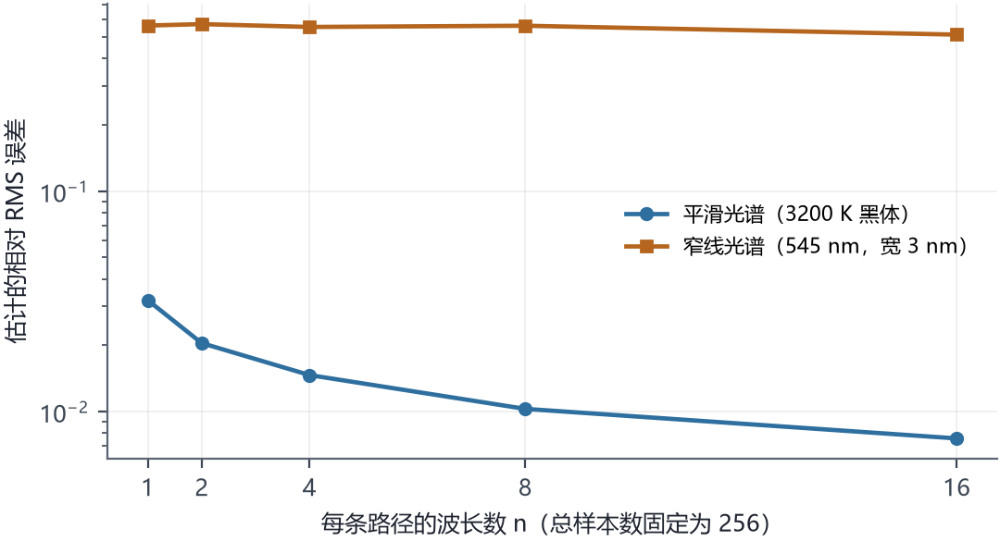

# 第 6 章 波长作为随机变量

## 6.1 一个一维积分

最终写进像素的不是某个波长的辐亮度，而是三条积分：

$$X=\int_{\lambda_{\min}}^{\lambda_{\max}}L_{o}(\lambda)\,\overline{x}(\lambda)\,d\lambda , \tag{6.1}$$

$Y$ 和 $Z$ 同理。渲染器不会解析地算这三个积分，它用蒙特卡洛。把 $f(\lambda)=L_{o}(\lambda)\overline{x}(\lambda)$ 看成被积函数，从概率密度 $p(\lambda)$ 采 $N$ 个样本，估计量是

$$\hat{I}=\frac{1}{N}\sum_{i=1}^{N}\frac{f(\lambda_{i})}{p(\lambda_{i})} , \tag{6.2}$$

只要 $p>0$ 在所有 $f\neq0$ 的地方成立，估计量就无偏。方差是

$$\mathrm{Var}[\hat{I}]=\frac{1}{N}\left(\int_{\lambda_{\min}}^{\lambda_{\max}}\frac{f(\lambda)^{2}}{p(\lambda)}\,d\lambda-I^{2}\right) . \tag{6.3}$$

这两条式子就是本章的全部基础。剩下的事情只有一件：怎么选 $p$。

方差与 $1/N$ 成正比，与 $f/p$ 的平方积分成正比。让 $p$ 的形状接近 $f$，比值接近常数，方差就小。理想的 $p$ 是 $f/I$ 本身，代进去 $(f/p)^2=I^2$，方差为零；但 $I$ 正是要算的量，$f$ 还依赖场景，不可能提前知道。实际用的是近似。

有一个容易误解的地方值得先说清楚。只采 $N$ 个波长，不等于把光谱看成"只在这 $N$ 个点上非零、其他地方为零"的函数。采样值不是函数本身，而是用来估计积分的权重。均匀采一个点估计 $\int_0^1x\,dx$，样本是 $x=0.75$ 时估计量是 $0.75$，不是零；采很多点再平均才会收敛到 $0.5$。光谱也一样，每个样本乘的是它代表的区间宽度（或者除以概率密度），不是"这个点上有光、别处没光"。

## 6.2 均匀采样与分层采样

最直接的 $p$ 是均匀分布：

$$p(\lambda)=\frac{1}{\lambda_{\max}-\lambda_{\min}}=2.5\times10^{-3}\ \mathrm{nm^{-1}} , \tag{6.4}$$

代入 (6.2) 得到

$$\hat{I}=\frac{\lambda_{\max}-\lambda_{\min}}{N}\sum_{i=1}^{N}f(\lambda_{i}) . \tag{6.5}$$

它无偏，实现也最简单，问题是方差大。$f=L_{o}\overline{y}$ 在 555 nm 附近很大，在两端很小，均匀采样把大部分样本扔在贡献很小的地方。图 6-1 上面一行就是这种分布：48 个样本在 380 到 780 之间东一个西一个地散着，有些区间挤了一堆，有些区间一个都没有。

分层采样把区间切成 $N$ 段等宽的小段，每段里随机取一个：

$$\lambda_{i}=\lambda_{\min}+(i+\xi_{i})\frac{\lambda_{\max}-\lambda_{\min}}{N},\qquad\xi_{i}\in[0,1) . \tag{6.6}$$

图 6-1 第二行是分层的结果：每段恰好一个样本，分布均匀得多。对光滑函数，分层采样的方差比独立均匀采样低，因为它在小尺度上强制了覆盖，减少了"空洞"和"堆积"。它的限制是样本数必须等于层数，样本数很少时（每条路径 4 个波长）收益最明显。

## 6.3 按视觉响应采样

更好的做法是让 $p$ 接近被积函数。被积函数里，$L_o(\lambda)$ 依赖场景，事先不知道；$\overline{x},\overline{y},\overline{z}$ 是已知的常数曲线。退一步，让 $p$ 正比于配色函数：

$$p_{\text{vis}}(\lambda)=\frac{\overline{y}(\lambda)}{\int\overline{y}(\lambda)\,d\lambda} . \tag{6.7}$$

CIE 1931 的 $\overline{y}$ 在可见光区间的积分是 106.8 nm，所以密度峰值是 $1/106.8=9.4\times10^{-3}$ nm⁻¹，约是均匀密度的 3.8 倍。图 6-1 最下面一行就是按这个密度采出来的样本：482 nm 以下几乎没有，650 nm 以上也很稀，中间挤得很密。

按 $\overline{y}$ 采样的效果可以直接测。取一条 3200 K 黑体乘上一块宽反射带的光谱作为 $L_o\overline{y}$，用均匀采样和按 $\overline{y}$ 采样各估一遍 $Y$，重复 3000 次，算相对 RMS 误差。

图 6-2 是这组实验的结果。N=4 时均匀采样的 RMS 误差是 0.70，按响应采样是 0.15；N=256 时分别是 0.10 和 0.021。比值稳定在 4 到 5 倍，不随 $N$ 变化——这正是 (6.3) 说的事情：$p$ 只影响方差前面的常数，不改变 $1/N$ 的收敛速度。样本数从 4 加到 256 是 64 倍，误差只降了 7 倍，因为 $1/\sqrt{64}=8$。

按 $\overline{y}$ 采样有一个附带的好处：它同时让亮度通道的方差最小，而亮度是人眼最敏感的通道。红蓝通道的响应在两端，按 $\overline{y}$ 采样会让它们的样本偏少，但这两个通道对整体亮度的贡献也小，权衡下来通常划算。如果三个通道同等重要，可以按通道轮流采样，再用多重重要性采样（MIS）的平衡启发式组合。

## 6.4 用解析拟合做逆变换采样

要按 (6.7) 采样，需要 $\overline{y}$ 的逆累积分布函数。查表可以做，但需要建表、插值、处理表外的尾巴，还会打断向量化。第 3 章的解析拟合把 $\overline{y}$ 写成两瓣高斯，逆 CDF 有闭式解，这件事就变得很便宜。

把 (3.8) 的 $\overline{y}$ 近似当成一个分布。两瓣高斯的混合，采样时先按两瓣的积分面积选一瓣，再在该瓣内做截断高斯的逆变换：

$$\lambda=\mu+\sigma\,\Phi^{-1}(u) , \tag{6.8}$$

其中 $\Phi^{-1}$ 是标准正态的逆 CDF，$\mu$ 和 $\sigma$ 是该瓣的中心与宽度。采出来的 $\lambda$ 可能落在可见光区间之外，落在外面时拒绝重采，或者把区间外的概率质量并到边界上。

拒绝重采会让"有效样本数"小于名义样本数，实现时要注意别把 $N$ 写死。更稳妥的做法是把分布截断到 $[380,780]$，重新归一化，然后对截断正态做逆变换——截断正态的 CDF 也有闭式表达，只是多一个误差函数的调用。

$\overline{x}$ 和 $\overline{z}$ 也可以这样处理。$\overline{x}$ 是三瓣，其中一瓣系数为负，直接当分布会有负的密度；做法是把负瓣的绝对值拆出来单独处理，或者干脆只用 $\overline{y}$ 的分布采所有通道。后者更简单，代价是红蓝通道的方差稍高。

PBRT 的实现比这更细：它把 hero 波长按一个组合分布采样，其他波长按等间隔平移，每个波长的概率密度单独记录。这套机制的细节是第 7 章的内容。

## 6.5 一条路径带几个波长

第 5 章留下一个问题：一条路径应该携带几个波长。

先看一个简单的事实。如果每个波长都独立采样，$n$ 个波长就是 $n$ 个独立样本，方差按 $1/(Nn)$ 下降，但每个波长的路径不同，几何成本乘以 $n$，光谱渲染退化成 $n$ 条单色路径。如果共享一条几何路径，$n$ 个波长相关，方差不再按 $1/(Nn)$ 下降，但几何只做一次。

相关性到底值多少，可以测。固定总波长样本数 256，比较每条路径携带 1、2、4、8、16 个等间隔波长时的 RMS 误差，两种光谱：一条平滑的黑体，一条 3 nm 宽的窄线。

两条曲线的差别很说明问题。平滑光谱上，$n$ 从 1 增到 16，误差降了将近 4 倍——等间隔的 $n$ 个样本相当于对积分做了一次分层，天然比独立采样覆盖得好。窄线光谱上，误差基本不动：3 nm 宽的线落在 400 nm 的区间里，等间隔的 4 个波长间距 100 nm，能不能命中全靠 hero 波长的随机位置，增加 $n$ 只是让间距变小，命中概率只按 $n$ 线性增长，而每条路径的样本数不变，总收益被抵消。

图 6-3 是这组对比。这个结果解释了一个常见的误解："波长数越多越准"。准确的说法是：**波长数越多，平滑部分的积分越准；窄带特征的命中率只跟 hero 波长的分布有关。** 要改善窄带光源下的方差，应该按光源光谱采样 hero，而不是增加 $n$。

## 6.6 五个常见错误

波长采样的代码很短，但错误率很高，而且错了不会崩溃，只会让图像悄悄偏色。下面五条按出现频率排。

第一条：忘记除以概率密度。均匀采样时 $p=1/400$，估计量要乘 400。忘了就整张图暗 400 倍；如果曝光补偿了，颜色比例可能还是错的，因为不同材质的相对亮度不受影响，但和光源的比值错了。

第二条：把波长样本数当成 spp。一条路径带 4 个波长，不等于 4 个像素样本。几何只采了一次，方差不是按 4 倍下降。日志里写"4 spp"会误导后面所有的性能比较。

第三条：俄罗斯轮盘赌用了平均 throughput 而不是逐波长。$n$ 个波长的存活概率不同，用一个平均值要么过杀（低估），要么少杀（高估）。正确做法是按最大分量决定存活，或者逐波长独立做轮盘赌，并在 $\beta$ 里除以各自的存活概率。

第四条：把光源的概率密度和波长的概率密度混在一起。光源采样的密度是对面积或立体角的，波长密度是对波长的，两者量纲不同，只能相乘，不能相加。

第五条：在介质里用错消光系数。不同波长的 $\sigma_t$ 不同，采样距离的密度也不同。用一个平均 $\sigma_t$ 采样、再用逐波长的 $\sigma_t$ 算透射率，权重会偏——这个错误在薄介质里看不出来，在厚介质里会让颜色明显失真。

这五条都可以用单像素探针定位：选一个像素，把它的波长、概率密度、throughput、XYZ 全部打印出来，手算一遍对比。第 14 章会给探针的具体格式。

## 6.7 样本数怎么选

每条路径的波长数 $n$ 和路径数 $N$ 要一起考虑。总波长样本数是 $Nn$，几何成本只与 $N$ 有关（波长共享路径时）。所以增加 $n$ 的边际成本比增加 $N$ 低。

但 $n$ 不能无限加。波长之间的相关性让收益递减：$n$ 从 1 到 4 改善明显，4 到 8 变慢，8 到 16 在多数场景已经看不出差别。内存也是限制：$n$ 份 throughput、概率密度、BSDF 值要存在路径状态里，$n=4$ 时正好塞进 SIMD 寄存器，$n=16$ 要落到内存，缓存不友好。

经验值：离线渲染 4 到 8，交互式 3 到 4，科研复现 8 到 16。PBRT 和 Mitsuba 默认都是 4。这个数字在多数场景下是一个不错的平衡点，但遇到窄带光源或强色散应该往上调，而且要先确认瓶颈在波长采样而不是路径数。

还要记住一件事：$n$ 不影响收敛的极限。只要概率密度修正正确，$n=1$、$n=4$、$n=16$ 都收敛到同一张图，差别只在同样时间内噪声多大。$n$ 小不是"算错"，是"慢"。

---

这一章把波长变成了一个普通的一维积分变量：有密度、有估计量、有方差。均匀采样简单但浪费样本，分层和按响应采样能把误差压到四分之一，代价是要有逆 CDF。多波长共享路径能摊薄几何成本，但对窄带特征没有帮助。下一章要处理共享路径带来的那个副作用：方向采样只能用其中一个波长做，这会不会让估计量有偏。
