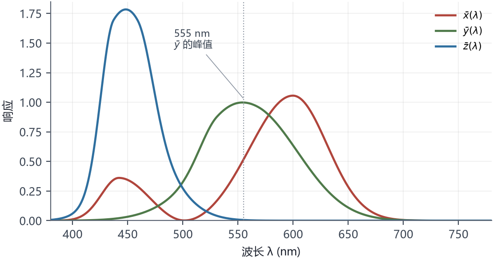
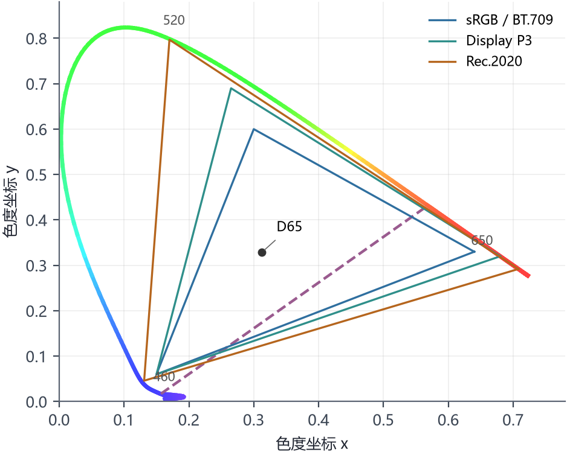

# 第 7 章 人眼与色匹配函数

## 7.1 三条曲线决定的三个数

第 5 章末尾留下一个结论：颜色是光谱的一次投影。这一章把这句投影写具体。

视网膜上有两种感光细胞。视杆细胞对弱光敏感，不区分颜色；视锥细胞负责明视觉和颜色，分三种，习惯上叫 S、M、L 型，分别对短波、中波、长波敏感。三条响应曲线在波长上重叠得很厉害，不是三条互不相干的窄带。一束光进入眼睛，三种细胞各给出一个响应，响应的大小是光谱与响应曲线的积分。大脑拿到的就是这三个数。

工程上用的不是三种视锥细胞的原始响应，而是一组叫配色函数（color matching functions）的曲线，记作 $\overline{x}(\lambda)$、$\overline{y}(\lambda)$、$\overline{z}(\lambda)$，如图 7-1。

三条曲线的形状值得记一下。$\overline{y}$ 是单峰，峰值在 555 nm，值恰好是 1，它被定义成明视觉的光谱光效率函数 $V(\lambda)$，也就是人眼对不同波长的相对敏感度。$\overline{x}$ 有两个瓣，主峰在 600 nm 附近，副峰在 442 nm 附近，中间还有一个很浅的凹陷。$\overline{z}$ 几乎全部集中在 400 到 500 nm 之间，在 445 nm 附近有最大值。三条曲线在 500 nm 以下重叠得最厉害，这就是为什么短波方向的颜色特别难分。

## 7.2 颜色匹配实验与负值

配色函数不是凭空定义的，它来自实验。

1920 年代末，Wright 和 Guild 各自做了颜色匹配实验。装置是这样一个二分视野：半边放待测光，另外半边放三盏可调亮度的原色灯，红、绿、蓝。被试调三盏灯的亮度，直到两边的颜色看起来完全一样，记录下三个亮度值。这三个数就是待测光在那组原色下的坐标。

实验发现，有些待测光无论怎么调都匹配不出来，必须把其中一盏灯移到待测光那一侧，相当于给它一个负的亮度。也就是说，某些颜色需要负的红光或负的蓝光才能匹配。这不是实验误差，它说明人眼能分辨的颜色空间虽然是三维的，但"用三个非负的数表示"这件事有边界。

CIE 1931 RGB 色彩空间是这套结果的标准化，三个原色选在 700 nm（红）、546.1 nm（绿）、435.8 nm（蓝）。它的配色函数在某些波段为负，负值就是"把原色挪到待测光一侧"的数学表现。负的光发不出来，计算时也很别扭，所以 CIE 在 1931 年对三条曲线做了一次线性变换，得到 XYZ 色彩空间。变换矩阵选得让三条新曲线都非负，并且让 $\overline{y}$ 正好等于 $V(\lambda)$。从 CIE 1931 RGB 到 XYZ 的变换是

$$\begin{pmatrix}X\\Y\\Z\end{pmatrix}=
\begin{pmatrix}
2.7689 & 1.7517 & 1.1302\\
1.0000 & 4.5907 & 0.0601\\
0.0000 & 0.0565 & 5.5943
\end{pmatrix}
\begin{pmatrix}R\\G\\B\end{pmatrix} . \tag{7.1}$$

这组数值出自 CIE 1931 的定义，也是几乎所有色彩学教材里引用的那一组。矩阵的第二行 $(1.0000,4.5907,0.0601)$ 说明绿原色对亮度的贡献远大于红和蓝，这是 $\overline{y}$ 由 $V(\lambda)$ 定义带来的直接后果。

XYZ 和 RGB 描述的是同一个三维空间，只是换了一组基。换基是线性变换，不丢信息，所以"XYZ 比 RGB 更准"这种说法没有意义。它的用处只有两个：三条曲线非负，计算时不会出现负的光；$\overline{y}$ 就是亮度，$Y$ 可以单独拿出来当亮度通道用。

## 7.3 色度图与色域

三刺激值的绝对大小没有意义，整体亮度可以缩放，有意义的是它们的比例。把 $X,Y,Z$ 归一化，得到色度坐标

$$x=\frac{X}{X+Y+Z},\qquad y=\frac{Y}{X+Y+Z},\qquad z=1-x-y . \tag{7.2}$$

三个坐标只有两个独立，所以颜色可以用二维的 $(x,y)$ 表示，亮度单独用 $Y$ 表示。把所有单色光的 $(x,y)$ 算出来连成曲线，再在两端补一条紫线，围成一个马蹄形，这就是图 7-2。

读这张图有几个固定的套路。越靠近边界越饱和，越靠近中心越灰。两种颜色混合，结果落在两点连线的线段上；三种颜色混合，结果落在三点围成的三角形里。穿过白点的直线两端是互补色。色度图不描述亮度，同一个 $(x,y)$ 可以从很暗到很亮。

显示器的三个原色在图上构成一个三角形，三角形内部是它能显示的所有颜色，叫色域（gamut）。sRGB 的三角形装不下可见色的全部，尤其是很饱和的青绿和深红。Display P3 把三个顶点往外推了一点，Rec.2020 推得更多，但 Rec.2020 的很多颜色现有显示器也做不到。一台显示器标称"覆盖 100% sRGB"，意思是它的三角形至少包含 sRGB 三角形，不代表它能显示 sRGB 之外的颜色。

色度图对渲染的直接用处是判断"这个颜色能不能显示"。渲染器内部用 XYZ 或光谱，最后一步才转 RGB，转出来有负值就说明超出色域，此时要么裁掉，要么映射。图 7-2 还能解释一个常见现象：在 Rec.2020 里调了一个很饱和的绿色，放到 sRGB 显示器上会变灰，因为那个点落在 sRGB 三角形外，只能被压到边界上。

## 7.4 从 XYZ 到 sRGB 的矩阵

显示器的三个原色不是 700/546.1/435.8 nm，而是另一组值。sRGB（也就是 BT.709）规定三个原色的色度坐标是

$$\text{R}:(0.640,0.330),\qquad \text{G}:(0.300,0.600),\qquad \text{B}:(0.150,0.060), \tag{7.3}$$

白点是 D65，色度坐标 $(0.3127,0.3290)$。这三个原色坐标加上白点，唯一确定了一个从线性 RGB 到 XYZ 的线性变换。

推导不复杂。给定一个色度坐标 $(x,y)$，对应的 XYZ 只差一个比例：$X:Y:Z=x:y:1-x-y$。把三个原色写成列向量 $\mathbf{p}_r,\mathbf{p}_g,\mathbf{p}_b$，任何颜色都是

$$\begin{pmatrix}X\\Y\\Z\end{pmatrix}=s_r\mathbf{p}_r+s_g\mathbf{p}_g+s_b\mathbf{p}_b , \tag{7.4}$$

三个比例因子由白点确定：白点 $(1,1,1)$ 必须映到 D65 的 XYZ。D65 的 $Y$ 归一化成 1 之后是

$$(X_w,Y_w,Z_w)=(0.95047,\,1.00000,\,1.08883), \tag{7.5}$$

于是解一个三元一次方程组就能得到 $s_r,s_g,s_b$。把 (7.3) 和 (7.5) 代进去，得到

$$\begin{pmatrix}X\\Y\\Z\end{pmatrix}=
\begin{pmatrix}
0.4124 & 0.3576 & 0.1805\\
0.2126 & 0.7152 & 0.0722\\
0.0193 & 0.1192 & 0.9505
\end{pmatrix}
\begin{pmatrix}R\\G\\B\end{pmatrix} . \tag{7.6}$$

反过来的矩阵是它的逆：

$$\begin{pmatrix}R\\G\\B\end{pmatrix}=
\begin{pmatrix}
3.2406 & -1.5372 & -0.4986\\
-0.9689 & 1.8758 & 0.0415\\
0.0557 & -0.2040 & 1.0570
\end{pmatrix}
\begin{pmatrix}X\\Y\\Z\end{pmatrix} . \tag{7.7}$$

(7.6) 和 (7.7) 出自 IEC 61966-2-1（sRGB 标准），四位小数是标准里给的位数。用 (7.3)、(7.5) 自己算一遍会得到 0.412391、0.357584、0.180481 这样的六位小数，与标准值的差在 $4\times10^{-5}$ 以内，差异来自白点色度只给到四位。这说明这张表不是拟合出来的，它就是从原色和白点推出来的。

第二行 $(0.2126,0.7152,0.0722)$ 值得单独记：三个数加起来正好是 1，所以 $(1,1,1)$ 的 $Y$ 是 1；绿色系数最大，所以绿色对亮度的贡献最大，这与 $\overline{y}$ 的峰值落在黄绿区是一致的。做灰度图时用这三个系数加权，用的就是这一行。

矩阵里有负数，所以某些 XYZ 会转出负的 RGB。负的 RGB 不是"负的光"，而是说这个颜色在 sRGB 三角形之外，用三个非负的 sRGB 原色拼不出来。图 7-3 给出了几个单色光的例子：532 nm 的线性 sRGB 是 $(-0.53,1.00,-0.09)$，490 nm 附近是 $(-1.01,1.00,0.35)$，580 nm 则是 $(1.00,0.45,-0.08)$。红和蓝都可能是负的，绿几乎总是正的，因为绿原色最接近光谱轨迹的中段。

![图 7-3　单色光在 sRGB 里的分量。左：不同波长单色光的线性 RGB，按最大分量归一，负值出现在色域之外。右：裁到 [0,1] 之后的显示色与原始分量，532 nm 的绿光裁掉负的红蓝之后变成了 sRGB 的纯绿](../images/07/fig7-3-gamut-clip.png)

显示器不能发负光，所以负分量必须处理。最简单的做法是裁到零，代价是颜色变了：532 nm 裁完变成 sRGB 的纯绿 $(0,1,0)$，饱和度和色相都偏了。更好的做法是色域映射（gamut mapping），沿着某个方向把颜色压回三角形内部，尽量保住色相。第 8 章会说明为什么"提前裁剪"在渲染里比"最后裁剪"危险得多：RGB 管线在每个材质乘法处都会裁一次，误差会随反弹次数累积。

## 7.5 配色函数的数值实现

渲染器每次评价光谱都要乘一次配色函数，所以这三条曲线必须能快速求值。CIE 官方给的是 1 nm 间隔的表，从 360 到 830 nm 共 471 个点，三条曲线共 1413 个数。查表加线性插值是最直接的做法，误差很小，但有两个麻烦：表要占内存，而且查表打断了向量化。

Wyman、Sloan 和 Shirley 在 2013 年给出一组分段高斯的解析拟合，把三条曲线写成若干非对称高斯之和：

$$\overline{x}(\lambda)=\sum_{i=0}^{2}\alpha_i\exp\left(-\frac{1}{2}\left[(\lambda-\beta_i)\,S(\lambda-\beta_i,\gamma_i,\delta_i)\right]^{2}\right), \tag{7.8}$$

其中 $S(x,\gamma,\delta)$ 在 $x<0$ 时取 $\gamma$，否则取 $\delta$，用来让高斯左右宽度不同。三条曲线的系数在表 7-1 里，$\gamma$ 与 $\delta$ 是宽度的倒数，单位是 1/nm。

| 曲线 | $\alpha$ | $\beta$ (nm) | $\gamma$ | $\delta$ |
|:---|:---|:---|:---|:---|
| $\overline{x}$ 第一瓣 | 0.362 | 442.0 | 0.0624 | 0.0374 |
| $\overline{x}$ 第二瓣 | 1.056 | 599.8 | 0.0264 | 0.0323 |
| $\overline{x}$ 第三瓣 | $-0.065$ | 501.1 | 0.0490 | 0.0382 |
| $\overline{y}$ 第一瓣 | 0.821 | 568.8 | 0.0213 | 0.0247 |
| $\overline{y}$ 第二瓣 | 0.286 | 530.9 | 0.0613 | 0.0322 |
| $\overline{z}$ 第一瓣 | 1.217 | 437.0 | 0.0845 | 0.0278 |
| $\overline{z}$ 第二瓣 | 0.681 | 459.0 | 0.0385 | 0.0725 |

表 7-1　CIE 1931 配色函数的多瓣拟合系数，出自 Wyman、Sloan、Shirley 2013 年发表在 JCGT 的论文。$\overline{x}$ 的第三瓣系数为负，这就是它中间那个凹陷。

这组拟合相对 1 nm 表的误差，论文报的是最大平方误差 $2.0\times10^{-4}$（$\overline{x}$）、$6.4\times10^{-5}$（$\overline{y}$）、$4.9\times10^{-4}$（$\overline{z}$），开方之后大约对应 0.014、0.008、0.022 的最大绝对误差。这个精度比 10 nm 分箱（最大平方误差 $7\times10^{-2}$）好两个数量级，和 10 nm 线性插值相当。它比实验本身的人与人之间的差异还小，所以对渲染完全够用。

解析拟合还有一个附带的好处：$\overline{y}$ 可以写成可采样的形式。第 10 章要用它做波长的重要性采样，那时候需要的是逆累积分布函数，而不是一个查表函数。表 7-1 里的 $\overline{y}$ 是两瓣高斯，逆 CDF 有闭式解；如果只有数据表，就得先建一条 CDF 再插值。

需要注意的是解析拟合在两端不靠谱。在 700 nm 以上，$\overline{x}$ 和 $\overline{y}$ 的绝对值都掉到 $10^{-5}$ 量级，拟合的相对误差可以到几十个百分点。绝对误差很小，对积分没有影响，但拿它算色度坐标就会得到荒谬的结果：用这组拟合算 780 nm 单色光的 $(x,y)$，会得到 $(0.05,0.95)$ 这种东西，而真值是 $(0.73,0.27)$。写代码时如果要把单色光画到色度图上，把范围限制在 400 到 700 nm 之间，或者直接用官方表。

## 7.6 颜色是三维投影

这一章的内容可以收成一句话：颜色是光谱在三条响应曲线上的投影。

投影是线性的，所以加色混合成立，两种光叠加，三刺激值直接相加。投影不是单射，所以同色异谱存在，满足同一组三刺激值的光谱有无穷多条。投影的核空间是那些三条积分都为零的光谱差别，人眼看不出它们，但它们在物理上真实存在，而且会在光与物质相互作用时表现出来。

把这件事写成公式。设两条光谱 $S_1,S_2$ 互为同色异谱体，$\mathbf{X}(S_1)=\mathbf{X}(S_2)$。把它们分别照在同一块材质 $R(\lambda)$ 上，反射光是 $S_1R$ 和 $S_2R$，三刺激值是

$$\mathbf{X}(S_1R)=\int S_1(\lambda)R(\lambda)\mathbf{c}(\lambda)\,d\lambda,\qquad
\mathbf{X}(S_2R)=\int S_2(\lambda)R(\lambda)\mathbf{c}(\lambda)\,d\lambda . \tag{7.9}$$

这两个积分一般不等于 $\mathbf{X}(S_1)$ 乘上某个"材质颜色"。$R(\lambda)$ 在 $\mathbf{c}(\lambda)$ 的三个分量之间做了不同的加权，$S_1$ 和 $S_2$ 的形状差异会被 $R$ 放大或者抵消。第 5 章图 5-2 就是这件事的数值版本：两条同色异谱的光谱，穿过同一块滤光片之后色差 30.1。

所以 RGB 渲染的误差不是"三个通道太少"这么简单。它是"在投影之后的三个数上做乘法"，而这个乘法在原始空间里是逐点相乘，投影之后就不再封闭。第 8 章把这句话写成线性代数，并给出一个可以自己算的判据。

---

颜色这条线索到这里就够用了：三条曲线、两个矩阵、一张色度图。曲线给出投影，矩阵在 XYZ 与显示 RGB 之间来回换，色度图告诉你哪些颜色能显示、哪些只能裁。剩下的问题全部落在同一处——投影丢了核空间，而光传输恰恰发生在核空间里。
