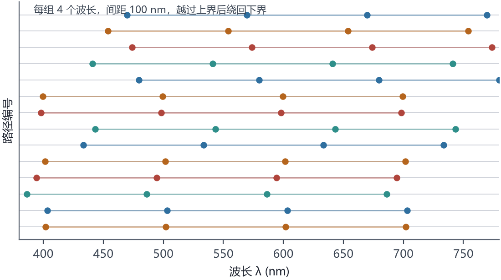
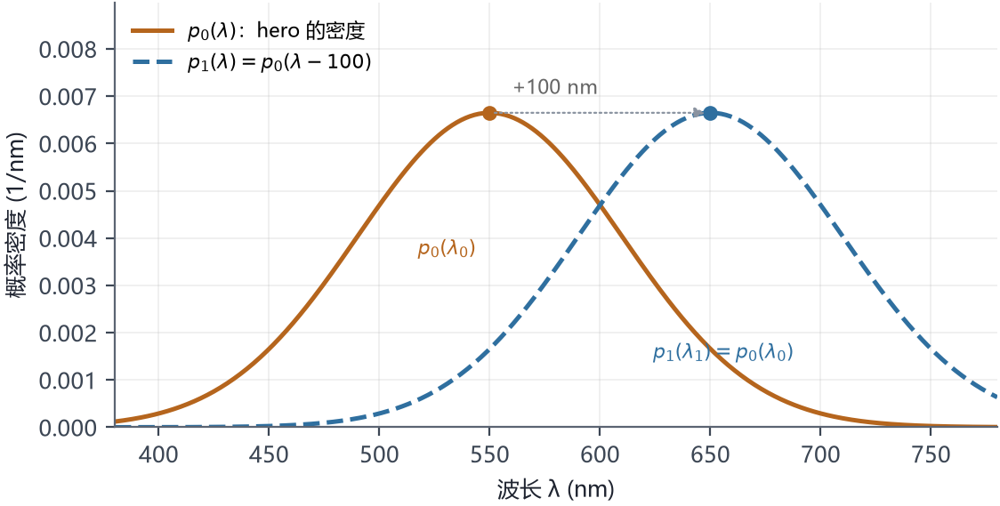
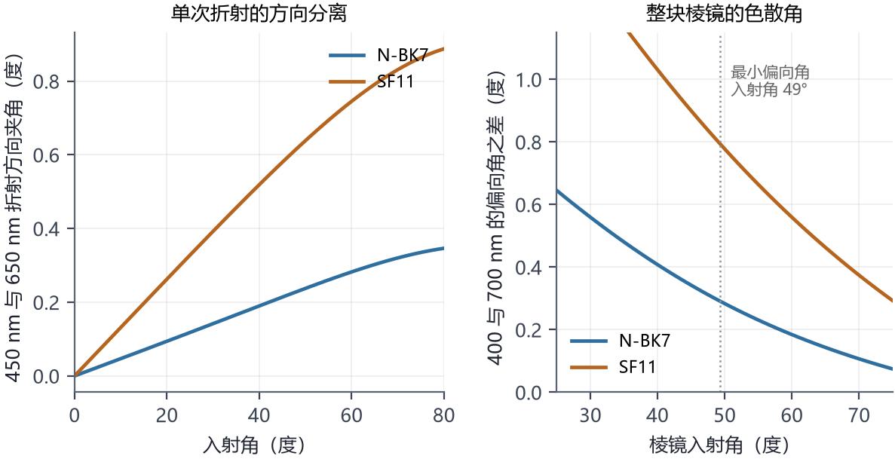

# 第 7 章 Hero Wavelength 采样

## 7.1 一条路径，n 个波长

第 5 章留下一个问题：一条路径携带多个波长时，方向采样应该用哪个波长。

如果每个波长各自采样方向，路径会分叉：四个波长就是四条几何路径，求交四次，可见性测试四次，光源连线四次。这等于跑了四遍单波长路径追踪，只是把结果打包在一起，几何成本一点没摊薄，光谱渲染也就失去了相对 RGB 的主要优势。

如果只用一个波长采样方向，其他波长跟着走同一条路径，几何只做一次。问题是这个"带头"的波长怎么选。固定用 550 nm，蓝色和红色的路径就用错了方向，BSDF 采样与实际的分布不匹配，方差会很大。随机选一个，每条路径的带头波长不同，四个波长的组合随路径变化，平均下来覆盖整个可见光。

Hero wavelength 是后者。Wilkie、Nawaz、Droske、Weidlich 和 Hanika 在 2014 年提出这个方法，给每条路径随机选一个 hero 波长，用 hero 的 BSDF 采样方向，另外三个波长按等间隔放在 hero 两边，四个波长共享同一条路径。图 7-1 画了 14 条路径的波长位置。



## 7.2 算法

设可见光区间是 $[\lambda_{\min},\lambda_{\max}]$，每条路径携带 $n$ 个波长。

第一步，从某个密度 $p(\lambda)$ 采样 hero 波长 $\lambda_0$。最简单的是均匀分布。

第二步，算间隔 $\Delta\lambda=(\lambda_{\max}-\lambda_{\min})/n$。

第三步，对 $i=0,\ldots,n-1$ 生成

$$\lambda_{i}=\lambda_{\min}+\Big((\lambda_{0}-\lambda_{\min})+i\,\Delta\lambda\Big)\bmod(\lambda_{\max}-\lambda_{\min}) . \tag{7.1}$$

取模运算叫 wrap：超过上界的波长绕回下界。$n=4$、区间 380 到 780 时，间隔 100 nm；hero 在 730 nm 时，四个波长是 730、830（绕回 430）、530、630。

第四步，用 $\lambda_0$ 的 BSDF 采样方向，所有波长共享这个方向。

第五步，路径上的每个光谱量按 $\lambda_i$ 分别评价，throughput 是 $n$ 个分量。

第六步，路径结束时把 $n$ 个分量的贡献求平均，得到这条路径的估计量。

## 7.3 估计量与它的概率密度

先把"路径贡献"写成一个只随波长变化的函数 $f(\lambda)$。它包含这条路径上的光源发射、每次反弹的 BSDF、投影因子、几何项，以及方向采样的概率密度；除了波长积分之外的所有因子都已经算进去。要估计的是 $I=\int f(\lambda)\,d\lambda$。

单波长路径的估计量是 $\hat I=f(\lambda)/p(\lambda)$。多波长路径的估计量是

$$\hat{I}=\frac{1}{N}\sum_{j=1}^{N}\frac{1}{n}\sum_{i=0}^{n-1}\frac{f_{j}(\lambda_{j,i})}{p_{i}(\lambda_{j,i})} , \tag{7.2}$$

内层平均一条路径上的 $n$ 个波长，外层平均 $N$ 条路径。

现在最关键的问题：分母里的 $p_i(\lambda_{j,i})$ 到底是什么？

它不是 hero 的密度，而是第 $i$ 个波长自己的边际密度。hero 的密度记作 $p(\lambda_0)$，第 $i$ 个波长由 $\lambda_i=\text{wrap}(\lambda_0+i\Delta\lambda)$ 确定。平移不改变形状，只移动位置，所以

$$p_{i}(\lambda)=p(\lambda-i\Delta\lambda) . \tag{7.3}$$

这件事可以先用离散的例子看清楚。掷一个六面骰子，点数均匀分布在 1 到 6；令 $Y=X+1$，$Y$ 均匀分布在 2 到 7，每个结果的概率还是 $1/6$，只是整体挪了一格。连续变量同理，只是把"每个结果的概率"换成"每个区间的概率密度"。设 $\lambda_0$ 的密度是 $p(\lambda_0)$，要求 $\lambda_1=\lambda_0+100$ 落在 $[a,b]$ 的概率，就等于 $\lambda_0$ 落在 $[a-100,b-100]$ 的概率；令 $\lambda=\lambda_0+100$，$\mathrm{d}\lambda=\mathrm{d}\lambda_0$，积分就变成 $\int_a^bp(\lambda-100)\,d\lambda$。所以 $\lambda_1$ 的密度是 $p(\lambda-100)$：形状与 $p$ 完全相同，只是整体右移 100 nm。



这里要区分"密度函数"和"采样点上的密度值"。$p_i(\lambda)$ 作为函数是 $p$ 的平移；但在采样点 $\lambda_i$ 上，

$$p_{i}(\lambda_{i})=p(\lambda_{i}-i\Delta\lambda)=p(\lambda_{0}) . \tag{7.4}$$

所以对一次普通的 hero 采样，$n$ 个采样点上的密度值全都等于 hero 的密度值。图 7-2 上两个点的高度相同，就是这件事的图示。如果只在采样点上做除法，存一个 $p(\lambda_0)$ 就够了。

那为什么实现里还要为每个波长存一个密度？因为它不只服务普通的 hero 采样。第 7.5 节会讲终止次级波长，那时被终止波长的概率质量要并到 hero 上，数组里的值就不再相同；荧光事件会重新生成一组波长，旧的密度也不能沿用。现在只要记住"普通采样时相同，特殊操作之后才分叉"。

估计量无偏，取决于每个 $\lambda_{j,i}$ 的边际密度是不是 $p_i$。把期望写开：

$$E[\hat{I}]=\frac{1}{n}\sum_{i=0}^{n-1}\int\frac{f(\lambda)}{p_{i}(\lambda)}\,p_{i}(\lambda)\,d\lambda=\int f(\lambda)\,d\lambda . \tag{7.5}$$

这里没有假设 $n$ 个波长相互独立。期望是线性的，只要每个波长的边际密度正确，无偏性就成立。相关性影响的是方差，不是均值。

## 7.4 方向采样只用 hero，为什么仍然无偏

这一节是整章最需要耐心的地方。

方向采样的密度记作 $q(\omega\mid\lambda_0)$，只依赖 hero 波长。对其他波长 $\lambda_i$，这个密度不是它们自己的 BSDF 分布。单条路径、第 $i$ 个波长的估计项是

$$\frac{f(\lambda_{i},\omega)}{p_{i}(\lambda_{i})\,q(\omega\mid\lambda_{0})} , \tag{7.6}$$

这里 $f$ 不含方向密度，方向密度单独写在分母上。把期望完整写开：hero 先从 $p(\lambda_0)$ 采，方向再从 $q(\omega\mid\lambda_0)$ 采，

$$E[\hat{I}]=\int p(\lambda_{0})\,d\lambda_{0}\int q(\omega\mid\lambda_{0})\,d\omega\;\frac{1}{n}\sum_{i=0}^{n-1}\frac{f(\lambda_{i},\omega)}{p_{i}(\lambda_{i})\,q(\omega\mid\lambda_{0})} . \tag{7.7}$$

$q(\omega\mid\lambda_0)$ 在分子和分母里完全一样，先约掉：

$$E[\hat{I}]=\frac{1}{n}\sum_{i=0}^{n-1}\int p(\lambda_{0})\,d\lambda_{0}\int f(\lambda_{i},\omega)\,\frac{1}{p_{i}(\lambda_{i})}\,d\omega . \tag{7.8}$$

对第 $i$ 项做变量替换 $\lambda=\lambda_i$。因为 $\lambda_i$ 只是 $\lambda_0$ 的平移，$\mathrm{d}\lambda=\mathrm{d}\lambda_0$，而 $p_i(\lambda)$ 正是 $\lambda_i$ 的边际密度（也就是 $\lambda_0$ 的密度平移之后的样子），所以 $p(\lambda_0)\,\mathrm{d}\lambda_0=p_i(\lambda)\,\mathrm{d}\lambda$。代进去，$p_i$ 也约掉：

$$E[\hat{I}]=\frac{1}{n}\sum_{i=0}^{n-1}\iint f(\lambda,\omega)\,d\omega\,d\lambda=\iint f(\lambda,\omega)\,d\omega\,d\lambda . \tag{7.9}$$

这就是要估计的积分。整个推导里没有要求 $q$ 等于某个波长的 BSDF 分布，只要求 $q>0$ 在所有 $f$ 非零的方向上成立。**方向密度可以任意选，选得好只影响方差，不影响均值。** 这句话是 hero wavelength 成立的根据。

无偏不等于好用。第 $i$ 项的权重是 $f(\lambda_i,\omega)/(p_i(\lambda_i)q(\omega|\lambda_0))$，如果 $q$ 和 $f(\lambda_i,\cdot)$ 的形状差得远，样本会落在 $f$ 很小的地方，权重出现大值，方差升高。

对非色散材质，所有波长的 BSDF 形状相同，只是整体缩放，hero 的方向对所有波长都合适，方差增加很小——这正是 hero wavelength 在普通场景里几乎免费的原因，Wilkie 等人报告的额外开销只有 3.5%。对色散材质，不同波长的峰值方向不同，用 hero 的方向评价 $\lambda_i$，样本可能落在 $\lambda_i$ 贡献很小的区域，权重出现尖峰。

## 7.5 色散：路径不能再共享

色散材质打破共享方向的前提。不同波长的折射率不同，折射方向不同，路径在第一次折射时就分开了。图 7-3 左画了单次折射的方向分离：450 nm 与 650 nm 在空气到 N-BK7 的界面上分开 0.05 到 0.35 度，SF11 上是 0.1 到 0.9 度，掠射时最大。右图是整块 60 度棱镜的色散角，400 与 700 nm 的偏向角相差 0.05 到 0.9 度。



0.3 度听起来很小，但它意味着两条光线在 1 米之外分开 5 毫米。如果强迫它们共享一条路径，其中一条的方向就是错的，权重会出现极大的偏差，图像上出现假色和色带。

处理方式有两种。

**路径分裂。** 每个波长在折射时各自算方向，路径分成 $n$ 条。这样每个波长都有自己的方向，密度和权重都正确，代价是几何成本乘以 $n$。实现上可以用递归或工作队列，管理起来比较麻烦，而且每经过一个色散界面就再分裂一次：三个界面之后是 $n^3$ 条。

**终止次级波长。** 只保留 hero 继续追踪，其他波长在第一次色散事件时终止。几何成本不变。为了让能量不至于明显偏少，实现里会把被终止波长的概率质量并到 hero 上，得到一个更大的 $p_0'$，使得在期望意义下

$$\frac{1}{n}\sum_{i=0}^{n-1}\frac{f_{i}}{p_{i}}\approx\frac{f_{0}}{p_{0}'} . \tag{7.10}$$

这个近似只有被终止波长的后续贡献与 hero 相近时才成立。如果它们的经历完全不同——比如 hero 穿过了玻璃继续前进，而 450 nm 在界面处全反射了——再好的密度合并也补不回没追踪的那部分路径。所以在一般色散场景里，终止次级波长是**有偏**的：它假设 hero 的未来可以代表其他波长的未来。只有被终止波长的后续贡献恰好为零，或者与 hero 完全相同，偏差才消失。

用两个波长看最直观。设 $n=2$，两个波长的密度都是 $p$。

两个波长贡献相同（$f_0=f_1=f$）时，原估计是 $(f/p+f/p)/2=f/p$；只留 hero、令 $p_0'=p$，估计还是 $f/p$，正好代表两个样本。

第二个波长完全不贡献（$f_1=0$）时，原估计是 $f_0/(2p)$；只留 hero 必须把 $p_0'$ 设成 $2p$，估计才是 $f_0/(2p)$。密度变大，权重变小，相当于让 hero 承担两个波长的概率质量。

第二个波长贡献是 hero 的两成（$f_1=0.2f_0$）时，不存在一个 $p_0'$ 能同时匹配均值和方差，合并只能做折中。这就是偏差的来源。

实践中的折中是**限制分裂深度**：只在最前面一两个色散界面分裂，后面的界面回到共享。大部分可见的色散发生在光线第一次进出玻璃时，内部反射对颜色的贡献较小。另一种是**自适应分裂**：比较两个波长的折射方向差，小于阈值就共享，大于阈值才分裂。低色散材料共享，高色散材料分裂，阈值可以用阿贝数或当前入射角来定。

## 7.6 方差的三个来源

Hero wavelength 的方差有三个来源。

第一个是 hero 波长本身的随机性。hero 均匀随机，$n$ 个波长等间隔覆盖整个可见光；对平滑光谱，这相当于对积分做了一次分层，方差比 $n$ 个独立样本低。第 6 章图 6-3 已经测过：平滑光谱上 $n$ 从 1 增到 16，误差降了将近 4 倍。

第二个是 $n$ 个波长之间的相关性。它们的贡献不是独立的，一个像素的 XYZ 误差不是 $n$ 个独立误差的平均，而是沿某条曲线分布。低 spp 时彩色噪声看起来更像色块，而不是细密的彩色颗粒。这对降噪器有影响：假设通道独立的降噪器会把 hero 的相关噪声过度平滑，损失细节。

第三个是方向密度与 BSDF 的匹配程度。非色散场景下匹配得很好，这一项可以忽略；色散、强吸收介质、荧光场景下匹配变差，这一项会主导方差。

## 7.7 局限与改进

Hero wavelength 有四条明显的局限。

**强色散。** 前面说过，色散让路径分叉，共享路径的假设失效。要么分裂，要么终止，两者都有代价。单纯增加 $n$ 不能替代分裂：只要次级波长还共享 hero 的方向，它们的方向就是错的，$n$ 再大也只是增加了更多方向错误的样本。

**窄带光源。** 如果光源只有一条很窄的谱线，而 hero 均匀采样，大部分路径的 $n$ 个波长都不在谱线上，贡献为零，只有少数路径命中，方差很大。这时应该按光源光谱采样 hero。这个做法有一个副作用：$n$ 个波长的边际密度是 $p$ 的平移，如果 $p$ 很窄，其他三个波长落在 $p$ 很小的地方，那些位置的样本会带着很大的权重。换句话说，按光源采样 hero 让"命中谱线"变容易，却让"谱线之外的部分"采样不足。稳妥的做法是把两个分布混起来，用多重重要性采样组合：

$$p(\lambda)=\sum_{k}w_{k}p_{k}(\lambda),\qquad\sum_{k}w_{k}=1 , \tag{7.11}$$

采样时先按权重选一个分量，再用平衡启发式计算每个样本的权重。这样窄带和宽谱部分都有覆盖，方差比单一分布稳定。

**荧光。** 荧光改变波长，输入和输出不在同一个波长上。$n$ 个波长是固定在一条路径上的，荧光事件之后原来的波长组不再适用，需要重新采样。第 11 章会讲具体做法。

**光谱介质。** 不同波长的消光系数不同，平均自由程也不同。$n$ 个波长共享一条路径，相当于假设它们的路径长度一样；在厚介质里这个假设的误差会变大，需要按波长分别采样距离，或者用最大消光系数做 delta tracking，把差异吸收进权重。

还有一条工程上的改进：**分层 hero**。把可见光区间分成 $N$ 层，每层采一个 hero，保证覆盖。这对窄带光源有帮助，实现也简单，代价是层数和 spp 要绑定。

## 7.8 一段骨架代码

下面的代码只保留数据流，省略光源采样、MIS、介质和俄罗斯轮盘赌的细节。它想说明的是三件事：波长组在路径开始时生成，路径上每个光谱量按波长分别评价，方向采样只用 hero。

```python
def sample_wavelengths(u, n=4):
    """hero 均匀采样，n 个波长等间隔 wrap。返回波长与各自的密度。"""
    hero = 380.0 + 400.0 * u
    step = 400.0 / n
    lams = 380.0 + (hero - 380.0 + step * np.arange(n)) % 400.0
    pdfs = np.full(n, 1.0 / 400.0)
    return lams, pdfs


def trace(ray, scene, rng, max_depth=16):
    lams, pdfs = sample_wavelengths(rng.random())
    beta = np.ones(len(lams))          # 逐波长的 throughput
    L = np.zeros(len(lams))

    for depth in range(max_depth):
        hit = scene.intersect(ray)
        if hit is None:
            break

        L += beta * hit.Le(lams)       # 自发光按波长评价

        # 方向只用 hero 采样
        wi, pdf_dir, _ = hit.bsdf.sample(ray.d, lams[0], rng)
        if pdf_dir == 0.0:
            break

        for i, lam in enumerate(lams):
            f = hit.bsdf.eval(ray.d, wi, lam)
            cos_t = abs(np.dot(wi, hit.n))
            beta[i] *= f * cos_t / pdf_dir

        ray = Ray(hit.p, wi)

    return L, lams, pdfs


def add_to_film(film, x, y, L, lams, pdfs):
    """把一条路径的贡献投影成 XYZ。"""
    w = 1.0 / (len(lams) * pdfs)
    xyz = (L * w * np.stack([cie_x(lams), cie_y(lams), cie_z(lams)])).sum(axis=1)
    film[x, y] += xyz
```

`sample_wavelengths` 里的 `%` 就是 wrap。`trace` 里方向采样只用了 `lams[0]`，但 throughput 对每个波长分别更新。`add_to_film` 里 `1/(n·p)` 同时完成了"对 $n$ 个波长求平均"和"除以波长密度"两件事，少写任何一个都会让亮度错。

---

Hero wavelength 的价值不在"四个波长"这个数字，而在一个可以证明的性质：方向密度可以任意选，只要它为所有可能有贡献的方向提供正的概率，估计量就无偏。这个性质把几何成本和光谱分辨率解耦——几何按一条路径算，光谱按四个波长算。它失效的地方也很明确：当不同波长真的走不同的路时（色散、荧光、厚介质），共享就变成了一种近似，而这个近似是有偏的。知道它在哪里有偏，就知道什么时候该分裂路径、什么时候该接受偏差。
