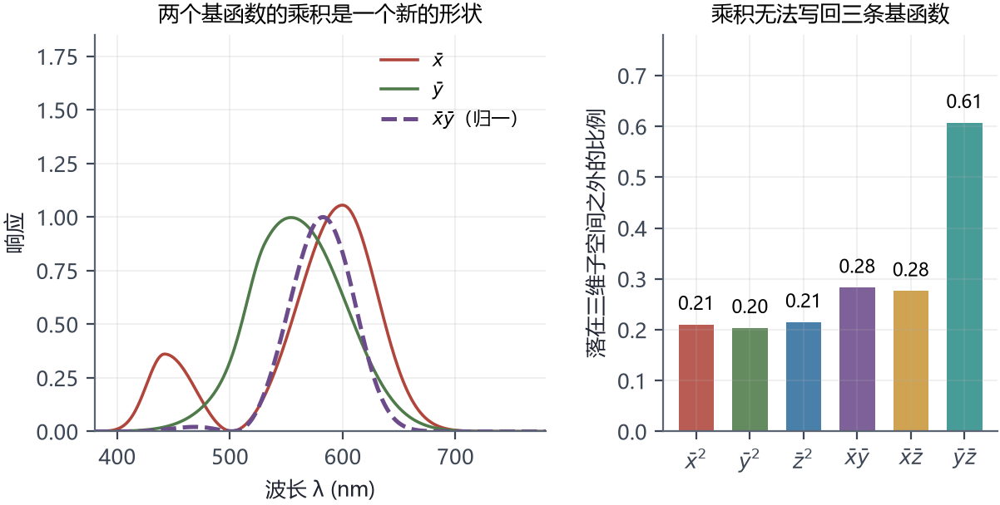
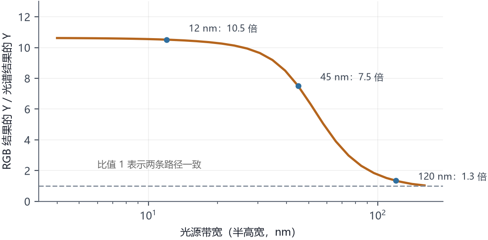
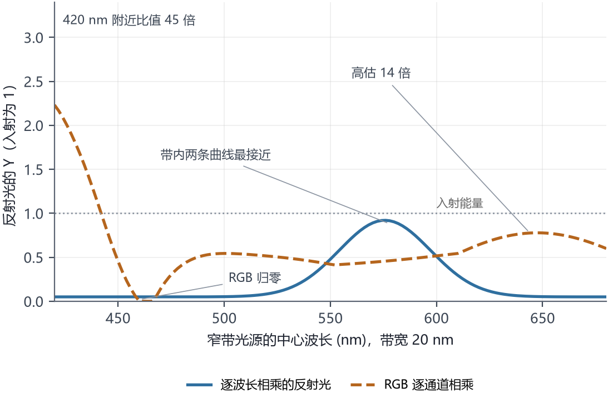

# 第 8 章 RGB 渲染到底假设了什么

## 8.1 三个通道的算术

一个 RGB 路径追踪器，核心数据结构只有三个浮点数。光源是三个数，材质是三个数，路径权重是三个数，两个颜色相乘就是逐分量相乘：

```python
def mul(a, b):
    return [a[0] * b[0], a[1] * b[1], a[2] * b[2]]
```

渲染方程里的半球积分也变成三个独立的积分，红通道一个，绿通道一个，蓝通道一个。每个通道里的光传输跟单色光完全一样，只是最后三个通道分别写进帧缓冲。

这套做法能工作，背后有一个线性代数的解释。RGB 是一个三维子空间里的坐标：给定三条基函数 $b_R,b_G,b_B$，任何光谱都可以近似写成

$$S(\lambda)\approx R\,b_R(\lambda)+G\,b_G(\lambda)+B\,b_B(\lambda) . \tag{8.1}$$

三条基函数可以是 sRGB 原色的光谱，也可以是配色函数的某个线性组合，两者只差一个 3×3 的可逆矩阵。在这个子空间里做加法、数乘、积分，结果都还在子空间里，所以 RGB 能表示光源、能表示材质、能表示积分的结果。

问题出在乘法。光与物质相互作用时，物理上是两条光谱逐点相乘：

$$S_{\text{out}}(\lambda)=S_{\text{light}}(\lambda)\,S_{\text{material}}(\lambda) . \tag{8.2}$$

把 (8.1) 代进去，乘积变成九项：

$$S_{\text{out}}=\sum_{i}\sum_{j}L_{i}M_{j}\,b_{i}(\lambda)b_{j}(\lambda) . \tag{8.3}$$

右边出现了 $b_R^2$、$b_Rb_G$、$b_Gb_B$ 这样的新形状。它们一般不能写回三条基函数的线性组合。RGB 逐分量相乘等于宣布 $b_R^2$ 只影响红色通道、$b_G^2$ 只影响绿色通道，交叉项全部为零——这是一个没有任何物理依据的假设。

## 8.2 乘积跑出三维子空间

把这件事量化。以三条配色函数为基，算出六个不同的两两乘积，再把每个乘积投影回 ${\rm span}\{\overline{x},\overline{y},\overline{z}\}$，看残差占多少。



结果在图 8-1 右：$\overline{x}^2$、$\overline{y}^2$、$\overline{z}^2$ 的残差是 20% 到 22%，交叉项 $\overline{x}\overline{y}$、$\overline{x}\overline{z}$ 是 28%，$\overline{y}\overline{z}$ 高达 61%。也就是说，对两条落在三维子空间里的光谱做逐点乘法，平均有两到六成的能量落在三个通道表示不了的地方。

这个结论可以更硬一点。如果六个乘积线性无关，它们张成的是六维空间，而三条基函数只能张成三维。三个数装不下六个独立的形状，无论怎么选那三个数。实际上可以验证这六条曲线确实线性无关，所以"用三个基函数精确表示一切乘积"在数学上不可能。

有人会说：误差 20% 又怎样，人眼看不出 20% 的差异。问题是这个误差不是随机的，它有结构，而且会随路径累积。一个光源的光谱和一块材质的反射率在波长上有特定位置的重叠，乘积的误差集中在那个位置；多次反弹之后，同一个偏差被反复施加，颜色就会系统性偏移，而不是随机噪声。图 5-1 的 95% 就是一个极端例子，误差不是 20% 而是 95%。

## 8.3 误差有多大

用一个可以复现的实验把量级测出来。光源是中心 490 nm 的高斯，材质是 $0.05+0.95\,g(\lambda;575,45)$ 的黄色塑料，$g$ 是半高宽 45 nm 的高斯。两条路径：一条把光谱逐点相乘再投影成 XYZ，另一条把光源和材质各自投影成 RGB 再逐分量相乘。比较反射光的 $Y$。



带宽从 4 nm 扫到 160 nm，比值从 11 倍单调降到 1.2 倍。曲线在 10 到 40 nm 之间下降最快，那正是光源的带宽开始跨过材质反射带边界的区间。误差的来源不是"带宽窄"本身，而是"光源的能量集中在一个材质不太反射的波段上"，RGB 看不到这个错位。

把光源的中心波长扫一遍，图像更难看。图 8-3 是这场扫描的结果，横轴是光源的中心波长，两条曲线分别是两条管线算出的反射光亮度。



两条曲线在 550 到 580 nm 之间靠得最近，这是"RGB 说得过去"的区域：光源的能量落在材质反射的波段里，两个三刺激值都抓住了主要信息。即便在这里，虚线仍然是实线的一半左右——光源是一条窄线，它的 sRGB 表示需要负的红色和蓝色分量，裁剪之后丢掉了那部分能量。这个问题下一节会单独讲。

往两边走，虚线迅速抬高，最高处达到入射能量的 2.2 倍——这不是"略微偏亮"，而是凭空造出能量。物理上反射光不可能超过入射光，RGB 乘法没有任何机制保证这一点，因为它不知道"重叠"这回事。

虚线在 460 nm 附近掉到 0.001，是同一个原因的反面：那里光源的蓝色分量强，材质的蓝色分量几乎为零，逐通道相乘把整个结果压掉了，而真实的反射率在那一段还有 0.05，不该是零。一端高估四十倍，另一端直接归零，中间还有一个对不上的"好区域"，这样的误差没有统一的修正办法。

## 8.4 什么时候 RGB 传输是精确的

RGB 传输不是永远错，它在一个明确的条件下精确：场景里所有光谱都落在同一个三维子空间里，并且这个子空间对逐点乘法封闭——也就是任意两个基函数的乘积还能写成三条基函数的组合。Meng、Simon、Hanika 和 Dachsbacher 在 2015 年的论文里把这件事讲清楚了，他们的结论是：三刺激值渲染只有在这样的代数结构下才与光谱渲染等价，而真实的配色函数不满足这个条件。

把条件写出来。设基函数张成的子空间是 $\mathcal{S}$，要求

$$b_i(\lambda)b_j(\lambda)\in\mathcal{S}\quad\text{对所有 }i,j . \tag{8.4}$$

如果 $\mathcal{S}$ 由三个指示函数构成——比如把 400 到 500、500 到 600、600 到 700 三段各取常值——那么乘积仍然落在同一个空间里，逐分量相乘完全正确。这是因为指示函数满足 $1_{A}\cdot1_{B}=1_{A\cap B}$，而三个区间的交还是这些区间之一。这种基对应的不是任何真实色彩空间，它是一个"三段式光谱仪"。

真实的基函数是平滑的、相互重叠的，乘积会产生新的、更窄的形状，条件 (8.4) 不成立。Meng 等进一步指出，即使把场景限制在"看起来正确"的范围内，RGB 传输与光谱传输给出的一致也只是近似的，误差取决于场景光谱与基函数的匹配程度。

这个判据有一个实用的推论。如果场景里只有宽谱光源和宽谱反射率，两者的形状都接近基函数的线性组合，误差就小；一旦出现窄带结构，条件 (8.4) 的违背程度急剧上升，误差跟着上升。图 8-2 的曲线就是这个推论的数值版本。

## 8.5 色域裁剪为什么会累积

RGB 管线还有第二个误差源，比乘法更隐蔽：裁剪。

一个窄带光源的颜色在色度图上靠近边界，转成 sRGB 会出现负值。显示器发不出负光，实现里通常在某个地方把它裁到零。裁剪一次只损失一点饱和度，问题是 RGB 管线里裁剪会发生很多次：光源进场景时裁一次，材质贴图上采样时裁一次，每次反弹的 throughput 更新时又裁一次，最后写帧缓冲时再裁一次。

每一次裁剪都是一次非线性操作，它把"刚好在色域外"的颜色压到边界上，丢掉的能量没有记录。多次反弹之后，这些丢失会累积成一个整体的偏色，而且这个偏色与路径长度有关：直接光照的区域偏得少，间接光照多的角落偏得多。参数量化之后，这种偏差看起来像"GI 太冷"或者"阴影发灰"，很难追到裁剪这一步。

光谱渲染把这个问题推迟到最后一步：中间过程保留完整光谱，只在投影成 XYZ、转 RGB 时裁一次。此时裁剪的误差只影响显示，不影响传输，而且可以用色域映射做得更讲究。

## 8.6 那为什么还用 RGB

因为大多数场景的光谱结构很温和。

日光、天空光、白炽灯、宽谱 LED 都是宽谱；漫反射材质、粗糙金属、塑料的反射率曲线也很平缓。在这些条件下，光谱的窄带结构不重要，三维投影已经保留了大部分信息，RGB 乘法的误差只有百分之几，肉眼看不出来。图 8-2 里 120 nm 带宽、光源中心 490 nm 时的 3 倍误差，看起来很大，但那个组合（窄带青光源 + 黄色材质）本身就不常见；换成 550 nm 的白光 LED 照白墙，误差不到 1%。

RGB 还有巨大的工程优势：三个通道，三次乘法，缓存友好，GPU 上一条指令处理一个像素。光谱渲染要存 $n$ 个波长，做 $n$ 次乘法，还要采样波长、计算概率密度，成本高出一个量级。

所以问题不是"RGB 对不对"，而是"这个场景需不需要光谱"。下面这份清单可以当判据，任何一项答"是"，RGB 都可能出错。

| 判据 | 典型的失效方式 |
|:---|:---|
| 窄带光源（激光、单色 LED、钠灯、汞灯） | 亮度错几十倍，色相全错 |
| 强窄带吸收（彩色玻璃、宝石、血液、叶绿素） | 透射色错，阴影发灰 |
| 色散（棱镜、钻石、水滴、玻璃雕塑） | 完全没有彩色边缘 |
| 荧光（增白剂、荧光笔、荧光矿物） | 颜色不随光源变化，能量不守恒 |
| 参与介质（雾、烟、牛奶、皮肤、大气） | 颜色饱和度不对，远处偏色 |
| 需要与测量数据对比 | 无法复现光谱相机的读数 |
| 混合光源下的彩色阴影 | 阴影一律是灰的 |
| 同色异谱材质 | 换光源后颜色关系全错 |

一项命中就值得考虑，三项以上基本应该上光谱。

## 8.7 代价在哪里

光谱渲染的代价可以分成三块，都不小。

第一块是算术。每条路径携带 $n$ 个波长，BSDF 评价、光源发射、介质透射都要做 $n$ 次。求交和可见性测试可以共享，所以总成本不是 $n$ 倍，但光谱评价这部分是实打实的 $n$ 倍。$n=4$ 时，在简单场景里总耗时大约是 RGB 的 1.2 到 1.5 倍；在 BSDF 很贵的场景里（多层材质、体积散射），这个倍数会往 $n$ 靠。

第二块是方差。RGB 渲染每个像素的每个通道由所有路径共同估计；光谱渲染的 XYZ 需要对波长积分，如果每条路径只采一个波长，每个样本只贡献很窄的一段，低 spp 时彩色噪声非常明显。增加每条路径的波长数可以压方差，但计算量也增加，而且波长之间的相关性会让方差下降得比 $1/n$ 慢。第 10、11 章的主题就是怎么把这块开销压回去。

第三块是数据。光谱材质、光谱光源、光谱介质，数据量比 RGB 大一个量级；纹理过滤、MIP map、环境贴图都要重新设计，因为这些操作在光谱上是不可交换的。绝大多数现成资产只有 RGB，第 12 章讲怎么把它们升到光谱。

这三块代价换来的是：正确的彩色光照、色散、荧光、光谱介质、同色异谱材质，以及一个能在物理上自洽地扩展的框架。值不值得取决于场景，而不是取决于哪一边更先进。

---

这一章把 RGB 渲染的假设写成了三句话：光可以用三个基函数的组合表示；这个三维子空间对逐点乘法封闭；裁剪带来的误差可以忽略。第一句在宽谱场景下勉强成立，第二句在数学上不成立，第三句在多次反弹时会累积。光谱渲染做的事，就是把这三句话里的每一条都换成一个可以检查的条件——用多少个波长、误差多大、裁剪发生在哪里。
