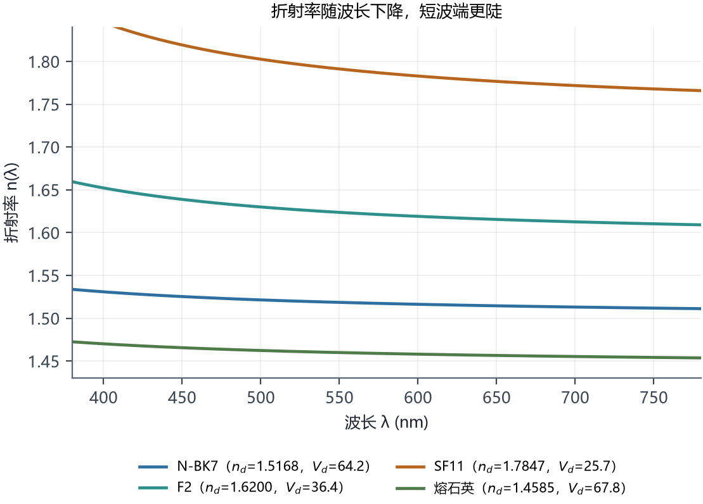
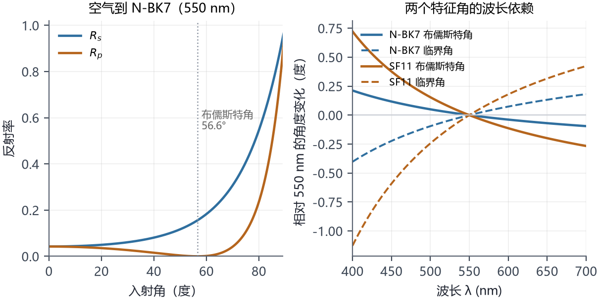
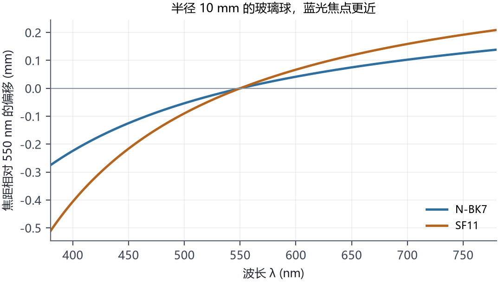

# 第 9 章 色散

## 9.1 一个折射率不够用

一束白光穿过一块玻璃棱镜，出射面上散开成一条彩带。第 1 章用这件事说明了 RGB 渲染的失效，这一章把它做成可以计算的模型。

现象背后的数字很小。N-BK7 在 400 nm 的折射率是 1.5308，700 nm 是 1.5131，差了 0.0178；SF11 从 1.8454 降到 1.7718，差了 0.0737。这么小的差别之所以能看见，是因为它在几何上被放大了两次：第一次是折射角对折射率的敏感度，第二次是传播距离。

用 60 度等边棱镜、最小偏向角入射算一下：N-BK7 的氢 F 线（486.1 nm）与 C 线（656.3 nm）的偏向角相差 0.71 度，F2 相差 1.67 度，SF11 相差 3.94 度，熔石英只差 0.57 度。0.71 度在一米外是 12 毫米，这就是为什么棱镜实验的屏幕要放得比较远。

RGB 渲染器通常给玻璃一个折射率，最多给红绿蓝三个。一个折射率意味着所有波长走同一条路径，出射光仍是一束白光；三个折射率意味着光被分成三条离散的线，中间没有橙色、黄色、青色。真实的棱镜给出连续谱。

## 9.2 两个色散公式

折射率随波长变化这件事有两个常用的拟合形式。

Cauchy 公式是

$$n(\lambda)=A+\frac{B}{\lambda^{2}}+\frac{C}{\lambda^{4}} , \tag{9.1}$$

其中 $\lambda$ 的单位是微米。$A$ 是长波端的折射率，$B$ 和 $C$ 描述色散强度。这个式子只有三项，参数少，适合解析推导或对精度要求不高的场合；它在吸收带附近会失效，因为那里折射率的变化不是这种平滑形式。

Sellmeier 公式是

$$n^{2}(\lambda)=1+\sum_{i=1}^{3}\frac{B_{i}\lambda^{2}}{\lambda^{2}-C_{i}} , \tag{9.2}$$

也是以微米为单位。它在可见光和近红外范围内对玻璃的拟合精度很高，Schott 的玻璃目录给每种玻璃一组系数。常用的四种玻璃的系数在表 9-1，代进公式画出来的曲线在图 9-1。

| 玻璃 | $B_1$ | $B_2$ | $B_3$ | $C_1$ (μm²) | $C_2$ (μm²) | $C_3$ (μm²) |
|:---|:---|:---|:---|:---|:---|:---|
| N-BK7 | 1.03961212 | 0.231792344 | 1.01046945 | 0.00600069867 | 0.0200179144 | 103.560653 |
| F2 | 1.34533359 | 0.209073176 | 0.937357162 | 0.00997743871 | 0.0470450767 | 111.886764 |
| SF11 | 1.73759695 | 0.313747346 | 1.89878101 | 0.013188707 | 0.0623068142 | 155.23629 |
| 熔石英 | 0.6961663 | 0.4079426 | 0.8974794 | 0.004679148 | 0.01351206 | 97.9340025 |

表 9-1　四种玻璃的 Sellmeier 系数。前三种出自 Schott 玻璃目录，熔石英出自 Malitson 1965 年的测量。$\lambda$ 以微米为单位，$C_i$ 是吸收带位置的平方。

把系数代进 (9.2) 算出的 $n_d$ 与阿贝数，与目录值对照：N-BK7 是 1.51680 / 64.17，F2 是 1.62004 / 36.37，SF11 是 1.78472 / 25.68，熔石英是 1.45846 / 67.82。四个都对到小数点后四位，说明系数抄对了。写代码时如果算出来的 $n_d$ 差很多，第一个要检查的就是波长单位——把纳米代进以微米为单位的公式，折射率会算出个位数。

阿贝数是描述色散强度的单一数字：

$$V_{d}=\frac{n_{d}-1}{n_{F}-n_{C}} , \tag{9.3}$$

其中 $n_d$、$n_F$、$n_C$ 分别是 587.6、486.1、656.3 nm 的折射率。$V_d$ 越小，色散越强。冕牌玻璃大约 60 到 65，火石玻璃 25 到 40，钻石 55 但折射率极高，色散仍然很明显。阿贝数的好处是把"色散有多强"压成一个可以放进材质面板的参数。

## 9.3 只有 nd 和 Vd 时怎么补出整条曲线

美术资产通常只给一个 $n_d$，或者再加一个阿贝数。能不能从这两个数反推 $n(\lambda)$？可以，用一个粗糙但实用的线性模型。

假设折射率随 $1/\lambda$ 线性变化，这是 Cauchy 公式的一阶截断：

$$n(\lambda)=A+\frac{B}{\lambda} . \tag{9.4}$$

令 $\lambda_d=0.5876$ μm，代入得 $A=n_d-B/\lambda_d$，于是

$$n(\lambda)=n_{d}+B\left(\frac{1}{\lambda}-\frac{1}{\lambda_{d}}\right) . \tag{9.5}$$

把 F 线和 C 线代进去，相减：

$$n_{F}-n_{C}=B\left(\frac{1}{\lambda_{F}}-\frac{1}{\lambda_{C}}\right) . \tag{9.6}$$

结合阿贝数的定义 (9.3)，解出 $B$：

$$B=\frac{n_{d}-1}{V_{d}}\cdot\frac{1}{\frac{1}{\lambda_{F}}-\frac{1}{\lambda_{C}}} . \tag{9.7}$$

代回 (9.5) 就得到整条曲线：

$$n(\lambda)=n_{d}+\frac{n_{d}-1}{V_{d}}\cdot\frac{\frac{1}{\lambda}-\frac{1}{\lambda_{d}}}{\frac{1}{\lambda_{F}}-\frac{1}{\lambda_{C}}} . \tag{9.8}$$

代入 N-BK7 的 1.5168 / 64.17，400 与 700 nm 之间的差是 0.018，与 Sellmeier 的 0.0178 只差 1%。代入火石玻璃的 1.62 / 25，差是 0.05 左右。对渲染来说这个精度够用，而且参数直观：美术给一个 $n_d$ 和一个 $V_d$，就能调出"像玻璃"和"像钻石"的差别。

吸收也可以这样参数化。透明介质的颜色主要来自选择性吸收，Beer–Lambert 定律写成 $T(\lambda)=\exp(-\tau(\lambda)s)$，其中 $\tau$ 是单位长度的衰减。如果只有"d 线的光学密度"和一个冷热参数 $S$，同样可以用 $1/\lambda$ 的线性模型：

$$OD(\lambda)=OD_{\text{ref}}+S\cdot\frac{\frac{1}{\lambda}-\frac{1}{\lambda_{d}}}{\frac{1}{\lambda_{F}}-\frac{1}{\lambda_{C}}} . \tag{9.9}$$

$S>0$ 时短波吸收更多，透射光偏暖（琥珀、茶色）；$S<0$ 时长波吸收更多，透射光偏冷（青色、蓝绿）。这个参数化不是从测量数据拟合出来的，它是一个美术友好的近似，价值在于可调。要真实材质，还是应该用分光光度计测一条 $T(\lambda)$。

## 9.4 逐波长的 Snell 定律

Snell 定律是 $\eta_i\sin\theta_i=\eta_t\sin\theta_t$。在光谱渲染里两侧的折射率都是波长的函数，于是每个波长有自己的透射方向。

写成向量形式，设 $\mathbf{d}$ 是单位入射方向，$\mathbf{n}$ 是指向入射侧的界面法线，$\eta=\eta_i/\eta_t$，则

$$\cos\theta_{i}=-\mathbf{d}\cdot\mathbf{n},\qquad
\mathbf{t}=\eta\,\mathbf{d}+\left(\eta\cos\theta_{i}-\sqrt{1-\eta^{2}(1-\cos^{2}\theta_{i})}\right)\mathbf{n} . \tag{9.10}$$

根号里为负时没有实数解，说明发生全反射，能量全部反射回去。这个判断必须逐波长做：同一个入射角，蓝光可能还在透射，红光可能已经超过临界角。

临界角本身也随波长变化：

$$\theta_{c}(\lambda)=\arcsin\frac{\eta_{t}(\lambda)}{\eta_{i}(\lambda)} . \tag{9.11}$$

图 9-2 右把两个特征角的波长依赖画了出来：以 550 nm 为基准，N-BK7 的布儒斯特角在可见光内移动 0.25 度，临界角移动 0.4 度；SF11 分别移动 0.9 度和 1.6 度。左图是 550 nm 下空气到 N-BK7 的菲涅耳曲线，$R_p$ 在布儒斯特角处降到零，$R_s$ 单调上升。

这两张图说明一件常被误解的事：**玻璃的反射颜色几乎不来自菲涅耳。** 布儒斯特角移动 0.25 度、临界角移动 0.4 度，对应到反射率上的变化不到千分之几，肉眼看不出来。看到的彩色边缘全部来自几何——不同波长的光线走了不同的路径，最终落在不同的位置上。只有金属（复折射率的虚部随波长变化大）和薄膜干涉才会让反射率本身带上颜色。

## 9.5 棱镜几何

棱镜是最干净的色散实验。顶角为 $A$ 的棱镜，光线从一侧入射，经两次折射，出射方向与入射方向的夹角叫偏向角 $\delta$。它可以写成两次折射的转角之和：

$$\delta=(i_{1}-r_{1})+(i_{2}-r_{2}) , \tag{9.12}$$

其中 $i$ 是入射角，$r$ 是折射角。棱镜顶角满足 $A=r_1+r_2$。把 Snell 定律代进去，对 $i_1$ 求导并令导数为零，得到最小偏向的条件 $i_1=i_2$，也就是对称光路。此时

$$\delta_{\min}=2\arcsin\left(n\sin\frac{A}{2}\right)-A . \tag{9.13}$$

这个式子把偏向角与折射率直接连起来。对 $A=60°$，N-BK7 在 550 nm 的 $\delta_{\min}$ 是 38.8 度，SF11 是 67.2 度。

偏向角的色散可以用微分近似：

$$\Delta\delta\approx\frac{d\delta}{dn}\,\Delta n . \tag{9.14}$$

60 度棱镜在最小偏向附近 $d\delta/dn$ 大约是 2，所以 $\Delta n=0.018$ 对应 $\Delta\delta\approx0.036$ rad，也就是 2 度。实际算出来是 0.71 度（F 到 C），比这个估计小，因为 F–C 之间的 $\Delta n$ 只有 0.0087 而不是 0.018。

图 1-3 和图 7-3 已经画过棱镜的光路和色散角，这里不再重复。要点只有一个：色散角正比于 $\Delta n$，而 $\Delta n$ 由材料决定，所以"换一种玻璃"是最有效的调色散手段，比调顶角有效。

## 9.6 实现：分裂、终止、自适应

色散在渲染器里的实现有三种策略。

**路径分裂。** 每个波长在折射时各自算方向，路径分成 $n$ 条。这是唯一严格正确的做法，代价是几何成本乘以 $n$，而且每经过一个色散界面就再乘一次。一块棱镜有两次折射，$n=8$ 时一条相机路径变成 64 条。玻璃雕塑有几十个界面，分裂会失控。

**终止次级波长。** 只保留 hero 继续追踪，其他波长在第一次色散事件时终止。几何成本不变，但这是有偏的近似，第 7 章推导过偏差的来源。它适合"色散只是点缀"的场景，不适合要精确颜色分离的场景。

**自适应分裂。** 比较两个波长的折射方向差，小于阈值就共享，大于阈值才分裂。低色散材料（水、冕牌玻璃）共享，高色散材料（火石玻璃、钻石）分裂。阈值可以用阿贝数或当前入射角来定。这是生产渲染器里最常见的做法，因为它把计算力花在看得见色差的地方。

三种策略可以组合：限制分裂深度（只在最前面一两个界面分裂）、按材料分流、剩下的交给光子图或双向方法补焦散。

色散焦散是另一个难点。玻璃球后面的亮线由"光→玻璃→漫反射面"这条路径产生，从相机出发要正好穿过玻璃再命中小光源，概率极低。图 9-3 给了一个量化的说明：半径 10 mm 的玻璃球，N-BK7 的焦距在 400 到 700 nm 之间变化 0.46 mm，SF11 变化 0.7 mm。0.5 mm 的焦点偏移在屏幕上就是一条有宽度的彩带，而不是一条线。要在渲染里得到它，相机路径的方差会非常大，通常要靠光子图从光源侧发射光子。

## 9.7 五个容易写错的地方

**单位。** Cauchy 和 Sellmeier 的波长单位是微米。把 550 代进去会得到 $n=1.0000$ 这样的结果，然后所有折射都变成直线。函数内部统一转换成微米，是最省事的防线。

**法线方向。** 折射公式假设法线指向入射侧。光线从玻璃内部射出时，法线与入射方向同向，要先翻转法线并交换 $\eta_i$ 与 $\eta_t$。做错时症状是"玻璃内部的光全部消失"，因为每个界面都被判成全反射。

**全反射的数值处理。** 根号内接近零时，浮点误差会让结果在透射和全反射之间跳变，表现为焦散边缘的噪点。做法是在判据上加一个小的 epsilon，或者用双精度算这一步。

**能量守恒。** 折射与反射的菲涅耳权重加起来要等于 1。只算折射会让能量丢失，掠射角变暗；两个都算但不按概率选，会让能量翻倍。正确做法是按菲涅耳反射率 $F$ 以概率 $F$ 反射、以 $1-F$ 折射，再把权重除以对应的概率。

**粗糙表面的色散。** 真实的玻璃表面有微小划痕，完全镜面的色散看起来很假。可以加一点粗糙度，用微表面模型，但粗糙表面的色散更复杂：每次微表面反射都会改变方向，色散与粗糙度耦合在一起。简单做法是只在镜面部分启用色散，漫反射部分用平均折射率。

---

色散把"波长"从颜色的一个属性变成了几何的一个参数。折射率是波长的函数，于是路径是波长的函数，于是同一个场景对不同波长有不同的几何。这一章给的系数和公式足够写出一个能渲染色散玻璃的渲染器，剩下的问题在介质里：光在玻璃内部走一段路，吸收也是波长的函数，而且路径长度本身也随波长变化。这是下一章的内容。
