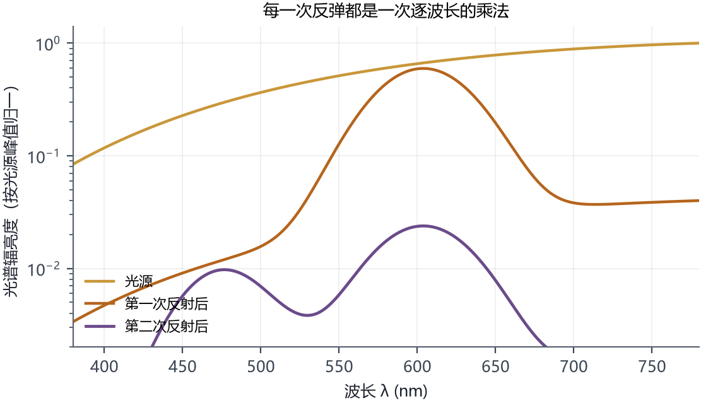
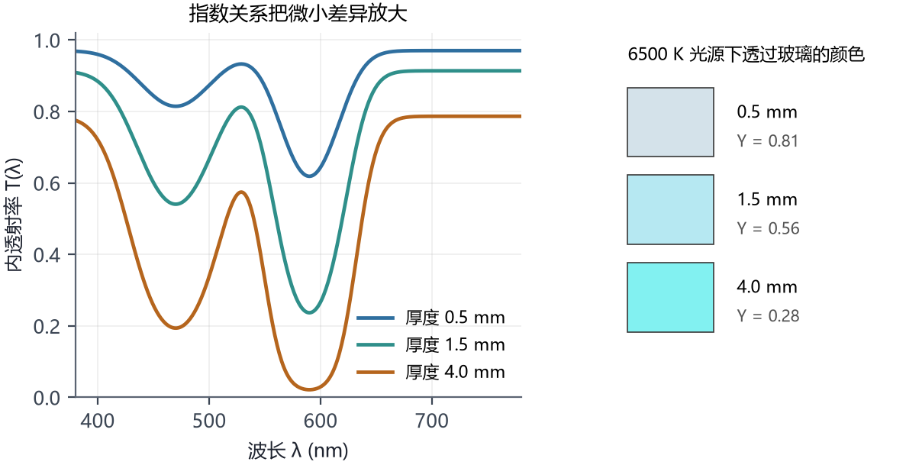
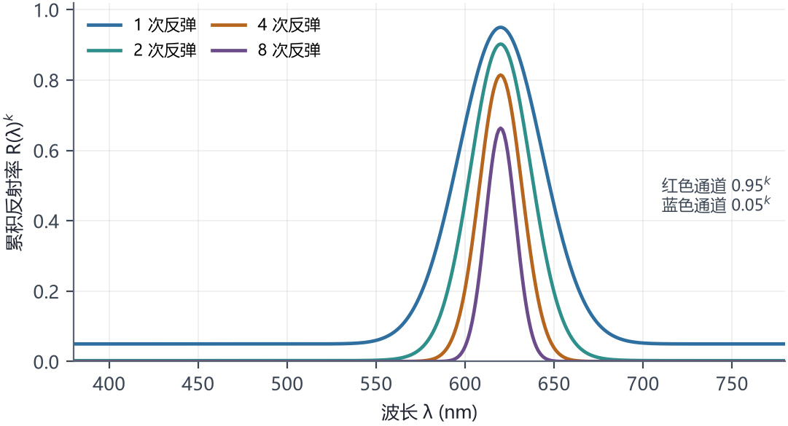

# 第 9 章 光谱光传输

## 9.1 给渲染方程加一个参数

第 6 章末尾写出的带波长的渲染方程，这里重写一遍，把每个量的波长依赖标清楚：

$$L_{o}(x,\omega_{o},\lambda)=L_{e}(x,\omega_{o},\lambda)+\int_{H^{2}}f_{r}(x,\omega_{i},\omega_{o},\lambda)\,L_{i}(x,\omega_{i},\lambda)\cos\theta_{i}\,d\omega_{i} . \tag{9.1}$$

和 RGB 版本比，结构没有任何变化：出射辐亮度等于自发光加半球积分。变化的是每个量的类型——它们从三元组变成了函数。

这个方程对每个波长独立成立。给定 $\lambda$，它就是一条单色光的渲染方程；把所有的 $\lambda$ 的解拼起来，就是光谱辐亮度。方程里没有对 $\lambda$ 的微分，也没有把不同 $\lambda$ 耦合起来的项（荧光是唯一的例外，见 9.5 节）。这个独立性是光谱渲染能共享几何的根本原因：一条路径的求交、可见性、方向采样只做一遍，剩下的光谱评价按波长分别做。

图 9-1 把一条路径上的光谱变化画了出来。光源是 3200 K 的黑体，先打到一面暖色墙（反射带在 600 nm），再打到一块偏冷的地面（反射带在 470 nm）。每经过一次反射，光谱就乘一次材质的反射率，形状跟着变；两次之后能量掉了两个量级，而且短波端掉得比长波端多，颜色整体偏暖。整个过程没有任何一步把光谱压成三个数。

## 9.2 路径积分与 throughput

把渲染方程递归展开，得到路径积分。忽略介质，一条路径 $\overline{x}=x_0x_1\cdots x_k$（$x_0$ 是相机，$x_k$ 是光源）的贡献是

$$I=\int\cdots\int L_{e}(x_{k},\lambda)\prod_{j=0}^{k-1}f_{j}(x_{j},\lambda)\,G(x_{j},x_{j+1})\,dA_{0}\cdots dA_{k}\,d\lambda , \tag{9.2}$$

其中几何项 $G(x,y)=\cos\theta_{x}\cos\theta_{y}/\|x-y\|^{2}$。PBRT 第 17 章有完整推导，这里只用它的结构：路径贡献是路径上所有光谱量的乘积，再对波长积分。

蒙特卡洛估计量把这个积分拆成两部分：路径采样和波长采样。设路径按 $p(\overline{x})$ 采样、波长按 $p(\lambda)$ 采样，估计量是

$$\hat{I}=\frac{L_{e}(x_{k},\lambda)\prod_{j}f_{j}(\lambda)\,G_{j}}{p(\overline{x})\,p(\lambda)} . \tag{9.3}$$

实现里 $p(\overline{x})$ 被拆成每个顶点的方向概率密度、光源采样密度、俄罗斯轮盘赌的存活概率；$G_j$ 被吸收进立体角与面积的转换。这些在 RGB 路径追踪里都已经处理过，光谱渲染只是把每个因子加上波长下标，再多除一个 $p(\lambda)$。

路径追踪器用一个叫 throughput 的变量累积这些因子。RGB 版本是三个浮点数，光谱版本是 $n$ 个采样值。第 $i$ 个波长分量在第 $k$ 次反弹后的更新是

$$\beta_{i}\leftarrow\beta_{i}\cdot\frac{f_{k}(\lambda_{i})\cos\theta_{k}}{p_{k}}\cdot T_{k}(\lambda_{i}) , \tag{9.4}$$

其中 $T_k$ 是这一段路径上的介质透射率。写法上和 RGB 完全一样，只是每个量都带下标 $i$。这条式子看多了会觉得平淡，但它是整本书最常被写错的一行：漏掉 $T_k$ 会让介质变成真空，用错 $p_k$ 会让能量凭空增减，把 $\beta$ 存成三个数会把前面所有推导作废。

## 9.3 三类光谱依赖

渲染器里所有和波长有关的东西，可以归成三类。

**发射。** 光源的 $L_e(\lambda)$ 可以是黑体、测量数据、上采样得到的近似光谱，或者几条窄谱线。对 delta 光源（点光源、方向光），发射在空间上是 delta 函数，但光谱仍然是连续函数：方向采样没有波长项，波长照样要单独采。

**BSDF。** 材质的光谱依赖有两个来源。一个是颜色，即反射率或透射率随波长变化，直接乘进 $f_r$。另一个是菲涅耳反射率，它通过折射率 $\eta(\lambda)$ 随波长变化。对金属，$\eta$ 是复数，实部是折射率，虚部是吸收系数，两者都随波长变——这是金属有颜色的物理原因。对电介质，$\eta$ 在可见光范围内变化不大，但在边缘会有色散，第 13 章会给具体系数。

**介质。** 吸收和散射系数都随波长变化，透射率由 Beer–Lambert 定律给出：

$$T_{r}(\lambda)=\exp\left(-\int_{0}^{d}\sigma_{t}(\lambda,s)\,ds\right) . \tag{9.5}$$

均匀介质里就是 $\exp(-\sigma_t(\lambda)d)$。指数关系会把微小的系数差异放大：图 9-2 里吸收带在 590 nm 附近，厚度从 0.5 mm 增到 4 mm，透射光从近白变成明确的青色，亮度从入射的 0.81 掉到 0.28。这就是为什么厚玻璃看起来是绿的，薄的却几乎透明——同一块玻璃，同一组系数，只是路径长度不同。

三类依赖在代码里的位置不同，写错时的症状也不同。发射写错，整张图偏色但结构正常；BSDF 的颜色写错，某个材质错；菲涅耳写错，边缘和掠射角错；介质写错，只有穿过介质的路径错，看起来像"局部过暗"。

## 9.4 逐波长的能量守恒

一个 BSDF 必须满足能量守恒，对光谱 BSDF 这个条件写成

$$\int_{H^{2}}f_{r}(\omega_{i},\omega_{o},\lambda)\cos\theta_{o}\,d\omega_{o}\le1\qquad\text{对每个 }\lambda . \tag{9.6}$$

注意"对每个 $\lambda$"这五个字。一个材质在 RGB 下平均看起来守恒，完全可能在某个窄波段反射率大于 1；反过来，一个光谱材质在每个波长上都守恒，RGB 平均之后也可能超标。这两种情况都不是理论上的罕见现象，而是实现时的常见错误：把几个项相加时用了 RGB 的权重，或者把透射项漏掉了。

多次反弹会把这种偏差放大成肉眼可见的饱和度变化。图 9-3 画了一个红色材质的反射率被自己乘 $k$ 次的结果：带内 0.95、带外 0.05，反弹 8 次之后，带外部分衰减到 $0.05^8\approx4\times10^{-11}$，带内还有 0.66。形状变窄，颜色变得极饱和。如果某个波长上反射率不小心取了 1.02，8 次之后那个波长就会被放大 1.17 倍，整张图在那里出现一块不自然的亮斑——这类错误在白炉测试里会立刻暴露，第 18 章会讲怎么测。

## 9.5 荧光：唯一破坏独立性的项

上面所有推导都假设不同波长互不影响：一个波长上的光只影响同一个波长。荧光打破这个假设。荧光材质吸收一个短波光子，把一部分能量转成热，剩下的以更长的波长重新发射，输入和输出不在同一个波长上。

带荧光的渲染方程要写成

$$L_{o}(x,\omega_{o},\lambda_{o})=L_{e}+\int_{H^{2}}\int_{\Lambda}f_{r}(x,\omega_{i},\omega_{o},\lambda_{i},\lambda_{o})\,L_{i}(x,\omega_{i},\lambda_{i})\cos\theta_{i}\,d\lambda_{i}\,d\omega_{i} , \tag{9.7}$$

$f_r$ 现在是一个二维核：给定入射波长 $\lambda_i$ 和出射波长 $\lambda_o$，返回转换系数。它不再是对角矩阵，而是一个满矩阵，能量守恒的条件变成

$$\int_{\Lambda}\int_{H^{2}}f_{r}(\lambda_{i},\lambda_{o})\cos\theta_{o}\,d\omega_{o}\,d\lambda_{o}\le1\qquad\text{对每个 }\lambda_{i} . \tag{9.8}$$

也就是说，给定一个入射波长，所有出射波长的能量加起来不能超过入射。荧光材料的量子效率通常小于 1，差额变成热。第 15 章会把这条约束、再辐射矩阵的构造和采样方法讲完。

除了荧光，拉曼散射、非线性光学、上转换也会造成波长耦合，渲染里几乎遇不到，可以忽略。荧光是这一册里唯一需要认真处理的耦合项，也是"波长独立"这条假设唯一的例外。

## 9.6 一条路径带多少个波长

理论上一条路径可以携带任意多个波长，实际上只能带 $n$ 个，每个波长一份 throughput。这 $n$ 个波长共享同一条几何路径：求交做一次，可见性测试做一次，方向采样做一次；但每个波长的 BSDF 评价、介质透射、光源发射要分别做。

$n$ 的选择是一个成本与方差的权衡。$n$ 太小，波长积分的方差大，低 spp 时彩色噪声明显；$n$ 太大，单条路径变贵，而且波长之间的相关性会让方差下降得比 $1/n$ 慢。PBRT 和 Mitsuba 的默认值都是 4，离线渲染常用 8 到 16，第 18 章会给一组实测数据。

共享路径带来一个微妙的问题：方向采样应该用哪个波长？如果每个波长各自采样方向，路径就分叉了，几何成本等于 $n$ 条单波长路径，光谱渲染失去了它的主要优势；如果只用一个波长采样方向，其他波长跟着走，就引入了相关性，概率密度也不匹配。这是第 11 章 hero wavelength 方法要解决的核心问题，它的答案不是"四个波长"，而是"一个随机起点加三个等间隔偏移，以及一套处理相关性的规则"。

## 9.7 从连续到离散

理论上的光谱是连续函数，渲染器只能存有限个采样值。有两种常见表示。

固定采样：在 $[380,780]$ 之间取 $n$ 个等间隔波长，存每个波长上的值。优点是简单、定长、容易向量化；缺点是分辨率固定，窄带特征可能整个被漏掉。

基函数表示：把光谱投影到一组基函数上，存系数而不是采样值。优点是压缩率高；缺点是基函数可能为负（第 12 章的讨论会用到这一点），乘法和裁剪都不直观。

不管用哪种表示，积分都要离散化。均匀采样时

$$\int_{\lambda_{\min}}^{\lambda_{\max}}f(\lambda)\,d\lambda\approx\frac{\lambda_{\max}-\lambda_{\min}}{n}\sum_{i=0}^{n-1}f(\lambda_{i}) , \tag{9.9}$$

非均匀采样时

$$\int f(\lambda)\,d\lambda\approx\frac{1}{n}\sum_{i=0}^{n-1}\frac{f(\lambda_{i})}{p(\lambda_{i})} . \tag{9.10}$$

两式等价：均匀采样的 $p(\lambda)=1/(\lambda_{\max}-\lambda_{\min})$，代进 (9.10) 就是 (9.9)。书里后面统一用 (9.10)，因为它对任何采样分布都成立，而且和第 10 章的方差分析用的是同一套语言。

这里有一个容易被误解的地方。只采 $n$ 个波长，不等于把光谱看成"只在这 $n$ 个点上非零、其他地方为零"的函数。采样值不是函数本身，而是用来估计积分的权重。均匀采一个点时积分估计不是零，而是那个点的值乘上区间长度；道理和第 10 章要讲的蒙特卡洛完全一样。

---

这一章做的事情是把颜色换成了函数。渲染方程不用改，路径积分的结构也不用改，只是每个量多了一个波长维度，throughput 从三个数变成一行数，最后多一次对波长的积分。唯一需要改写法的地方是荧光，它把对角核变成满核。剩下的全部工作是工程：波长怎么采、采几个、怎么让方差降下来，这是接下来两章的内容。
