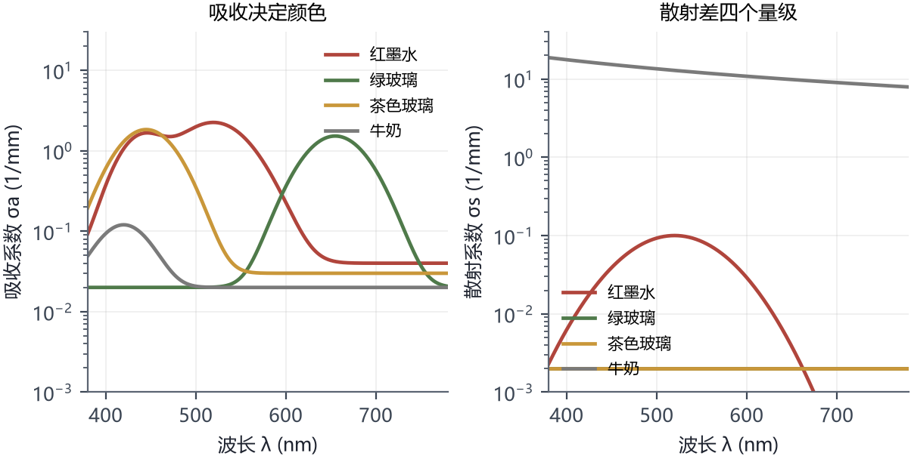
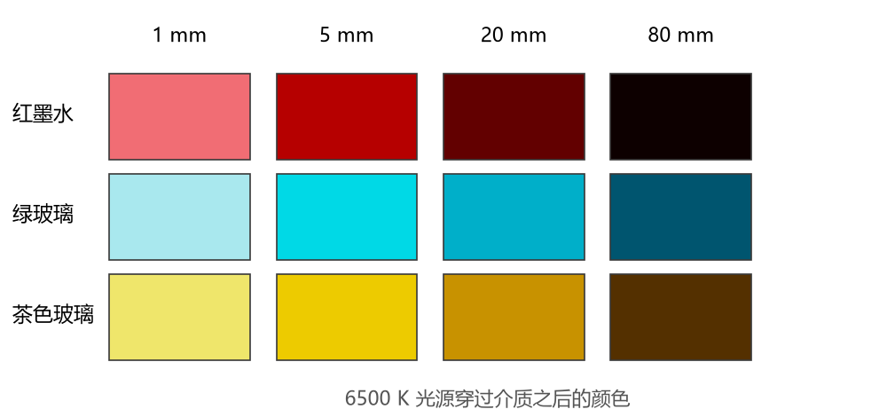
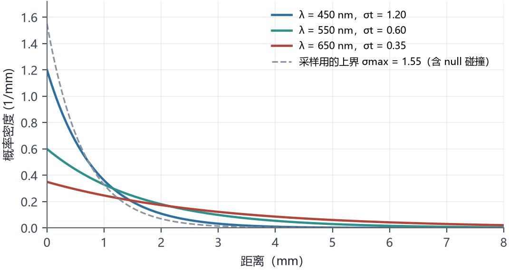

# 第 10 章 介质中的光谱传输

## 10.1 一杯红墨水

把一滴红墨水滴进一杯水，从侧面看是红的，从上往下看是暗的。同一个杯子，同一个光源，颜色随方向变化。这不是表面反射，光进了水里。

介质中的光传输由辐射传输方程（radiative transfer equation，RTE）描述：

$$(\omega\cdot\nabla)L(x,\omega)=-\sigma_{t}(x)L(x,\omega)+\sigma_{s}(x)\int_{S^{2}}p(\omega,\omega')\,L(x,\omega')\,d\omega'+L_{e}(x,\omega) . \tag{10.1}$$

左边是辐亮度沿方向 $\omega$ 的变化率。右边三项分别是消光、散射和介质自身的发射。这个方程对每个波长独立成立，把 $\lambda$ 加上去，$\sigma_t$、$\sigma_s$、$p$、$L_e$ 全都变成波长的函数。

第 1 章那个"青色灯照黄塑料"的错误在介质里会放大。RGB 渲染器给红墨水一个颜色，那是它在白光下的透射色的三刺激值；一旦光源换成窄带的绿光，真实的透射率接近零，而 RGB 仍然按"红光透射率高"来算，结果差出几十倍。

## 10.2 三个系数

介质的光学性质由三个系数描述，单位都是 1/长度。

吸收系数 $\sigma_a$：单位长度内被吸收的概率。被吸收的能量变成热，不再参与传输。

散射系数 $\sigma_s$：单位长度内被散射的概率。散射改变方向，能量还在。

消光系数 $\sigma_t=\sigma_a+\sigma_s$：单位长度内发生任何相互作用的概率。它的倒数是平均自由程，光子在被吸收或散射之前平均走的距离。

三个系数都随波长变化，介质就有颜色。图 10-1 左给了三种吸收介质：红墨水在 520 nm 和 440 nm 吸收最强，所以透过红光；绿玻璃在 655 nm 吸收最强，透过青绿；茶色玻璃在 445 nm 吸收最强，透过黄橙。三者都是纯吸收，散射系数只有 0.002 到 0.1 量级。

牛奶的曲线在右图里孤零零地高出一截：$\sigma_s$ 在 10 /mm 量级，比玻璃高四个数量级。它的吸收很小，所以进入介质的光会被反复散射，走出一条很长的随机路径，每次散射都可能被吸收一点，但更重要的是它会从各个方向出来。这就是"白"的机制：不是某个波长被特别反射，而是所有波长都被均匀地散射回来。天空的蓝、云的白、皮肤的次表面散射，都是同一类机制在不同尺度上的表现。

## 10.3 Beer–Lambert 与颜色的厚度依赖

只有吸收、没有散射时，透射率有解析解：

$$T_{r}(\lambda)=\exp\left(-\int_{0}^{d}\sigma_{t}(\lambda,s)\,ds\right) . \tag{10.2}$$

均匀介质里就是 $\exp(-\sigma_t(\lambda)d)$。指数关系会把微小的系数差异放大，也会把颜色随厚度的变化放大。

图 10-2 里每一行是同一块介质，只是厚度从 1 mm 增到 80 mm。红墨水在 1 mm 时是粉红（绿光被吸收了一部分，蓝光还在），5 mm 时是纯红，80 mm 时几乎全黑。这个变化不是线性的：吸收系数是常数，但透射率是它的指数。

这也是为什么薄玻璃几乎透明，厚玻璃明显偏绿。普通窗玻璃的 $\sigma_a$ 在红端比绿端高一点点，1 mm 厚时看不出来，20 mm 厚时整块玻璃就带上了绿色。

介质颜色的另一个特点是与光路长度耦合。一个玻璃球，中心附近的光路最长，边缘最短，所以中心颜色更饱和。这个效果在 RGB 渲染里完全丢失，因为 RGB 只有一个"玻璃颜色"，没有"路径长度"这个维度。

## 10.4 散射介质：为什么不是 Beer–Lambert

一旦散射不可忽略，(10.2) 就不成立了。光在介质里会转向，实际走过的路径远大于直线距离，有效光程被放大。

一个常用的近似是单次散射反照率

$$\alpha=\frac{\sigma_{s}}{\sigma_{t}} , \tag{10.3}$$

它描述一次碰撞中散射占的比例。$\alpha$ 接近 1 的介质（云、牛奶、白漆）会把光散射很多次才吸收，看起来明亮而白；$\alpha$ 接近 0 的介质（墨水、彩色玻璃）几乎每次碰撞都吸收，看起来暗而饱和。图 10-1 右的牛奶 $\sigma_s\approx12$、$\sigma_a\approx0.05$，$\alpha\approx0.996$；红墨水在 520 nm 处 $\sigma_a\approx2.4$、$\sigma_s\approx0.15$，$\alpha\approx0.06$。

要正确渲染散射介质，需要解 (10.1) 的积分形式，通常用路径追踪加体积采样：沿光线采样一个碰撞点，按 $\sigma_a/\sigma_t$ 和 $\sigma_s/\sigma_t$ 决定吸收还是散射，散射时按相位函数采样新方向。多次散射不需要特殊处理，它就是路径继续走。

对光谱渲染来说，麻烦在于每个波长的 $\sigma_t$ 不同。红墨水在 520 nm 的平均自由程是 0.4 mm，在 650 nm 是 20 mm，差了五十倍。如果所有波长共享一条路径、共享一个采样距离，其中一部分波长的权重会偏得离谱。

## 10.5 采样：从 delta tracking 到比例跟踪

均匀介质里，采样一个碰撞点的标准做法是按指数分布抽距离：

$$t=-\frac{\ln(1-\xi)}{\sigma_{t}} , \tag{10.4}$$

$\xi$ 是 $[0,1)$ 上的均匀随机数。这个分布正是 Beer–Lambert 透射率对应的密度，所以权重里不需要再除透射率。

问题出在光谱上。公式 (10.4) 里只有一个 $\sigma_t$，而我们有 $n$ 个。三个选择。

**用某个波长的 $\sigma_t$ 采样。** 通常用 hero 的。其他波长的权重里要多乘一个 $\exp(-(\sigma_{t,i}-\sigma_{t,\text{hero}})t)$，因为采样密度和它们自己的物理密度不匹配。这个修正是对的（无偏），但当两个 $\sigma_t$ 差得远时，权重会出现指数级的尖峰。红墨水里 450 nm 和 650 nm 的 $\sigma_t$ 差五十倍，修正项的指数能到几十，方差爆炸。

**用平均 $\sigma_t$ 采样。** 权重修正小一些，但仍然有偏或方差大。

**用上界 $\sigma_{\max}\ge\max_i\sigma_{t,i}$ 采样，再用 null 碰撞补偿。** 这就是 delta tracking（也叫 Woodcock tracking）。沿光线按 $\sigma_{\max}$ 采样候选点，在每个候选点上以概率 $\sigma_t/\sigma_{\max}$ 判为真实碰撞、以 $1-\sigma_t/\sigma_{\max}$ 判为"什么都没发生"（null collision），继续前进。图 10-3 画了这个结构：三条指数分布对应三个波长，虚线是采样用的上界，它必须覆盖所有波长。

delta tracking 的优点是它对所有波长用同一套采样距离，路径可以共享，权重只乘一个 0 或 1 的判定概率，不会有指数尖峰。缺点是它多花了一些"空"的采样：$\sigma_{\max}$ 与真实 $\sigma_t$ 差得越多，null 碰撞越多。在光谱介质里这个代价通常值得。

不均匀介质（雾、云、烟）用比例跟踪（ratio tracking）：距离仍然按 $\sigma_{\max}$ 采，但每个候选点乘一个 $\exp(-(\sigma_{\max}-\sigma_t)t)$ 的权重，而不是二值判定。比例跟踪的方差更低，实现也更简单，代价是不能像 delta tracking 那样"跳过"空区域。

## 10.6 光谱介质的三个实现问题

**距离与透射率必须用同一套 $\sigma_t$。** 常见错误是用平均 $\sigma_t$ 采样距离，再用逐波长的 $\sigma_t$ 算透射率，两者的密度不匹配，权重会偏。正确做法是采样用 $\sigma_{\max}$，透射率用逐波长的 $\sigma_t$，两者通过 null 碰撞的判定概率联系起来。

**俄罗斯轮盘赌要按波长判断。** 介质里不同波长的 throughput 差别很大（薄的地方红光能过、蓝光过不去），用一个平均的存活概率会把还在贡献的波长杀掉，或者把已经该终止的波长留着。按最大分量决定存活、按各自概率除权重，是稳妥的做法。

**相位函数与波长无关。** 弹性散射不改变波长，所以相位函数不需要光谱维度。这一点让介质的光谱渲染比荧光简单得多：$n$ 个波长共享几何、共享散射方向，只是 $\sigma$ 不同。

## 10.7 从介质到荧光

介质把波长耦合进来了，但耦合是"间接"的：不同波长的 $\sigma$ 不同，导致路径长度、透射率、颜色不同，波长本身没有改变。荧光是"直接"的耦合：一个波长进去，另一个波长出来。

两者的数学结构不一样。介质仍然是逐波长独立的方程，只是系数不同；荧光把方程从一个对角核变成一个满核。这也是为什么介质可以用 hero wavelength 加 delta tracking 处理，而荧光必须重新采样波长。

---

介质这一章的结论可以压成三句话。颜色来自吸收系数随波长的变化，指数关系把它放大成厚度依赖；散射介质不能用 Beer–Lambert，要走体积路径追踪；光谱介质的关键是让所有波长共享采样距离，再用 null 碰撞或比例跟踪补回差异。下一章处理真正改变波长的那一类材料。
