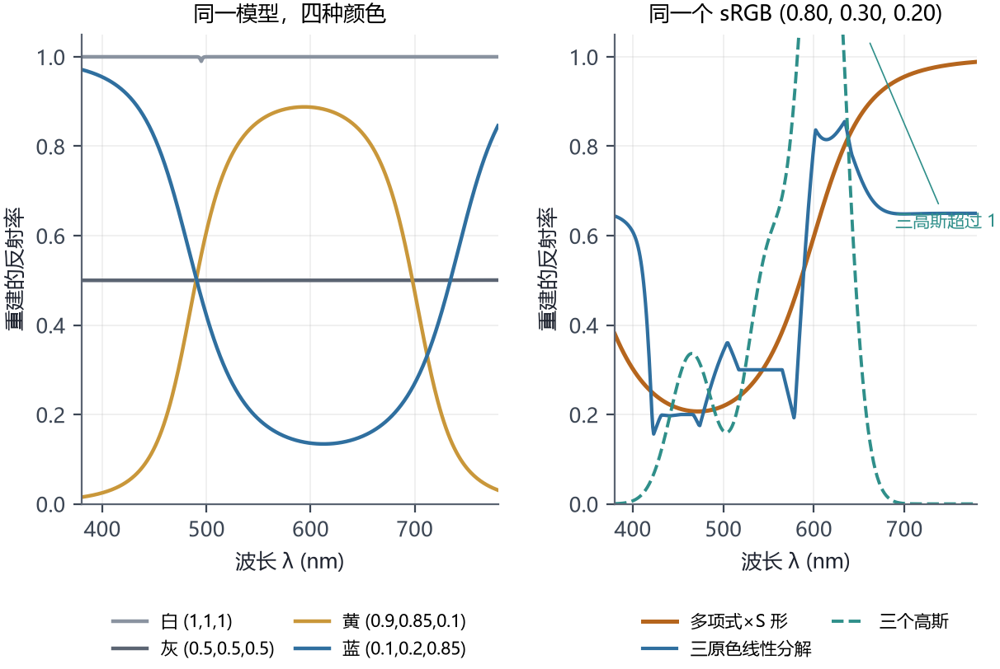
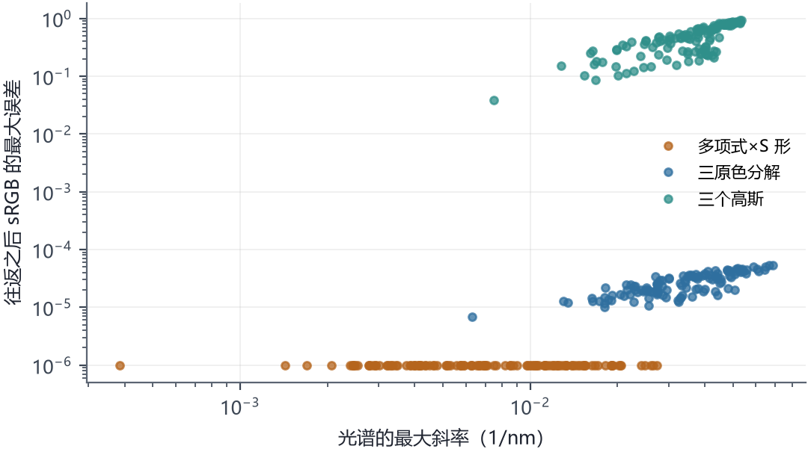
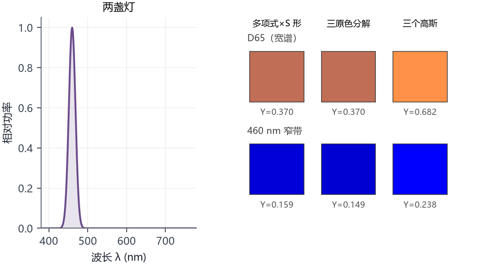

# 第 12 章 从 RGB 到光谱：上采样与基分解

## 12.1 一个欠定的问题

光谱渲染器需要光谱，而世界上绝大多数纹理、材质库、环境贴图都是 RGB 的。你不可能要求每个美术资产都附带一条 380 到 780 nm 的测量曲线，所以渲染器必须有一个"从 RGB 猜光谱"的模块，通常叫光谱上采样（spectral upsampling）。

"猜"这个字是关键。给定一个 RGB 三元组，满足它的光谱有无穷多条。第 7 章写过这个结论：三条积分等式约束一条曲线，曲线的自由度远大于三。设 $R_0(\lambda)$ 是一条满足目标的光谱，$N(\lambda)$ 是任意一条满足

$$\int N(\lambda)\,W(\lambda)\,\overline{x}(\lambda)\,d\lambda=0,\quad
\int N(\lambda)\,W(\lambda)\,\overline{y}(\lambda)\,d\lambda=0,\quad
\int N(\lambda)\,W(\lambda)\,\overline{z}(\lambda)\,d\lambda=0 \tag{12.1}$$

的光谱，$W$ 是白点光源的 SPD。那么 $R_0+N$ 与 $R_0$ 给出完全相同的 RGB。$N$ 落在三个积分算子的零空间里，零空间是无穷维的，解也是无穷维的。

要选出一条，必须加先验。这个先验的选择就是不同算法之间的全部差别：它决定了重建出的光谱长什么样，也决定了渲染结果在哪种光源下会出错。

## 12.2 先明确约束

在讲算法之前，先把约束列清楚。反射率和光源的约束是不同的。

反射率 $R(\lambda)$ 必须落在 $[0,1]$ 内。这不是"为了好看"，而是能量守恒：一个表面不能反射比它收到的更多能量。这个约束有一个几何后果，叫 MacAdam 极限：在给定亮度下，颜色饱和度有一个上界，超过它的颜色没有任何合法反射率能表示。sRGB 的大部分颜色落在这个界限之内，但不是全部——很饱和的青绿和深红贴近边界。

超过 MacAdam 极限的颜色可以用荧光材料实现：吸收短波、发射长波，等效地"把光搬过来"。这也是第 15 章的伏笔，Jung 等人 2019 年的工作就是利用这一点。

光源 SPD $L_e(\lambda)$ 没有上界，但要求非负，并且色度和相对亮度要与输入的 RGB 一致。白炽灯、LED、日光的 SPD 形状差别很大，上采样只能给出一个"看起来合理"的代表。

还有一条更隐蔽的约束：白色必须映射到白色。输入 $(1,1,1)$ 时，重建的反射率应该接近常数 1；否则白墙在渲染中会变暗或者偏色。这条约束在实现里最容易漏掉，因为它在窄色域下几乎自动满足，一换白点就暴露。

## 12.3 Jakob–Hanika：三系数的解析模型

2019 年 Jakob 和 Hanika 给出的方法与之前所有方法都不同：他们不存光谱，也不存基函数系数，而是把反射率写成一个三参数的解析函数。

$$f(\lambda)=S\left(c_{0}x^{2}+c_{1}x+c_{2}\right),\qquad x=\frac{\lambda-580}{100}, \tag{12.2}$$

其中 $S$ 是一个代数形式的 S 形函数：

$$S(u)=\frac{1}{2}+\frac{u}{2\sqrt{1+u^{2}}} . \tag{12.3}$$

$x$ 是归一化的波长，用 $(\lambda-580)/100$ 只是为了三个系数的量级可比，换成别的线性变换只是把系数重新缩放。

这个模型有两个设计考虑。第一，$S$ 把整个实数轴映到 $(0,1)$，所以**无论三个系数取什么值，重建的反射率永远在 $[0,1]$ 内**。能量守恒不需要额外的约束求解，它被编码进了函数形式。第二，抛物线的形状加上 S 形的饱和，能表达自然反射率的常见形态：一个中峰（绿、黄）、两个分离的峰（紫）、一段平坦的高反射（最亮的颜色）、一条常数曲线（白和黑）。图 12-1 左画了四个例子。

评价函数只要六次浮点运算（两次 fma 求多项式、一次 rsqrt、两次 fma 做 S 形），可以直接内联到着色器里，也可以完全向量化。

三个系数怎么求？求解的是

$$\hat{f}=\arg\min_{f}\left\|\mathbf{b}-T\int_{\Lambda}f(\lambda)\,W(\lambda)\,\mathbf{c}(\lambda)\,d\lambda\right\| , \tag{12.4}$$

其中 $\mathbf{b}$ 是目标 RGB，$T$ 是 XYZ 到该色彩空间的矩阵，$\mathbf{c}=(\overline{x},\overline{y},\overline{z})^{T}$，$\Lambda=[360,830]$ nm，范数用 CIE76 的 $\Delta E$。这是一个三参数的非线性最小二乘，用 Levenberg–Marquardt 求解，梯度用前向自动微分算，从零初值出发几次迭代就收敛。

直接对每个颜色单独求解行不通，因为解不唯一：饱和度很高或者很暗的颜色，输入上一个微小的扰动会让解跳到另一个分支，渲染时表现为材质颜色在不同光源下忽然变化。他们的做法是从一个中等亮度的颜色出发（比如 $\max\{r,g,b\}=0.1$），沿着同一条射线向更亮和更暗的方向逐步求解，每一步用上一步的解作为初值。这样得到的解在颜色空间里是连续的。

求解不能在每个纹素上做，只能预先算好。他们选了三个 $64^{3}$ 的查找表，按 RGB 三个通道中最大的那个索引，另外两个归一化之后作为表内坐标，共 9 MiB。表里存的是三个系数，不是光谱，所以纹素的内存占用与普通 RGB 纹理完全相同——读取时只是把三个数当成 $(c_0,c_1,c_2)$ 而不是 $(r,g,b)$。对暗色还加了一维 $\alpha=\max\{r,g,b\}$，用 smoothstep 非均匀分层，因为很亮和很暗两端的系数变化更快。

精度方面，论文报告 sRGB 色域内的色度误差为零——模型足够表达 sRGB 的全部颜色，误差只剩下 64³ 表的插值误差。宽色域（Rec.2020、ProPhoto、ACES 2065-1）需要另一套表，优化时间在 i7-6700K 上从 10 秒到 60 秒。

## 12.4 Jung：把荧光也算进来

Jung、Wilkie、Hanika、Jakob 和 Dachsbacher 在同一年把这条路线推到宽色域。动机很实际：宽色域空间里有些颜色落在 MacAdam 极限之外，没有任何能量守恒的反射率能表示它们。RGB 渲染器能毫不费力地画出这些颜色（它只是在三个数上做乘法），光谱渲染器却会失败。

他们的做法是承认这类颜色在物理上只能由荧光材料实现：一部分入射光被吸收，以更长的波长重新发射，等效地提高了饱和度和亮度。于是每个纹素存六个参数：三个用于弹性反射（沿用 Jakob–Hanika 的模型），三个用于荧光分量。

荧光分量的参数是发射峰波长 $\lambda_e$、混合比例 $c\in[0,1]$ 和 Stokes 位移 $s$。发射谱用一段三次 B 样条，拉伸和平移之后贴合不同的谱宽；吸收谱取发射谱在波数轴上的镜像，这是文献里对真实荧光材料的常见观察。量子效率固定为 $Q=0.96$，因为多数荧光材料的量子产率接近 1，留一个自由参数收益不大。

优化目标里加了一项平滑度惩罚。原因是有些颜色即使能由反射率表示，也需要非常"方块"的光谱——在 MacAdam 边界附近，合法反射率只能是接近 0 或 1 的箱形——这种光谱在蒙特卡洛里很难采样，也不像真实材料。他们用模型在可见光区间上的最大绝对导数度量平滑度，超过阈值 $t=0.016$ nm⁻¹ 的部分乘 100 加进目标函数。这个阈值取的是 Macbeth 色卡上观察到的最大导数，也就是说"比真实材料更陡的谱形要付代价"。超过阈值时，优化器会倾向用荧光分量去补颜色，得到更平滑的解。

这套方法还有一个对渲染很重要的副产品：荧光分量的吸收谱和发射谱都是解析形式，所以波长的重要性采样可以解析地做。第 15 章会用到这一点。

## 12.5 Mallett–Yuksel：三个原色就够了

2019 年还有一条完全不同的路线，来自 Mallett 和 Yuksel。他们问了一个看似不可能的问题：能不能找到三条固定的光谱 $S_r,S_g,S_b$，使得

$$R(\lambda)=r\,S_{r}(\lambda)+g\,S_{g}(\lambda)+b\,S_{b}(\lambda) \tag{12.5}$$

对 sRGB 立方体里的每个 $(r,g,b)$ 都成立？此前的工作普遍认为不行，理由很直观：三个固定的正函数线性组合，怎么可能覆盖整个立方体？他们的回答是：可以，而且这样的三原色有无穷多组。

关键的观察是：之前的方法都隐式地用了等能光源 E 作为白点，而 sRGB 的白点是 D65。用 E 去构造，方程

$$\mathbf{A}\,\mathbf{S}=\mathbf{b} \tag{12.6}$$

无解，因为在 E 光源下"白色"对应的三刺激值不是 sRGB 的 $(1,1,1)$。改用 D65，问题立刻变成一个带箱约束的最小二乘：

$$\min_{\mathbf{S}}\ \|\mathbf{A}\mathbf{S}-\mathbf{b}\|\quad\text{s.t.}\quad 0\le S(\lambda)\le1 , \tag{12.7}$$

其中 $\mathbf{A}$ 的三行是 $W\odot\overline{x}$、$W\odot\overline{y}$、$W\odot\overline{z}$ 在波长上的离散化，$\mathbf{b}$ 是目标颜色的 XYZ。对 $r$、$g$、$b$ 三个单位向量各解一次，得到三条原色；任意颜色就是三条原色的加权和，权重就是 RGB 本身。

这个方法的吸引力在于：**没有预计算，没有查找表，运行时就是三个乘加**。论文报告在全部 24 位 sRGB 颜色上往返误差的最大值是 $1.851\times10^{-5}$，比 sRGB 本身的量化误差还小两个数量级。

代价是光谱的形状。三条原色必须同时满足全部颜色，所以它们带有箱形和台阶，重建出的反射率也就跟着块状。图 12-1 右的蓝线就是这种形状：几个平台和几个陡跳。这样的光谱在物理上合法（都在 $[0,1]$ 内），但不像真实材料，而且在蒙特卡洛里更难采样——陡跳意味着 PDF 要么漏掉它，要么在它上面堆样本。

图 12-2 把三条路线放在同一张图上：每个点是一个随机颜色，横轴是光谱的最大斜率（平滑度的反面），纵轴是往返误差。多项式×S 形落在左下角（平滑且精确），三原色分解在它右上方（精确但粗糙），三个高斯的误差高出四个数量级。这三堆点很清楚地说明了三条路线的性格。

## 12.6 三条路线的取舍

| 项目 | 多项式×S 形 | 三原色分解 | 三个高斯 |
|:---|:---|:---|:---|
| 参数 | 3 个系数 | 3 个权重（就是 RGB） | 3 个权重 |
| 预计算 | 三个 $64^3$ 表，9 MiB | 无 | 无 |
| 运行时 | 查表 + 6 次浮点运算 | 3 次乘加 | 3 次乘加 |
| 往返误差 | sRGB 内为零 | $1.9\times10^{-5}$ | 10% 到 100% |
| 光谱平滑度 | 高 | 低（块状） | 低（但形状错） |
| 宽色域 | 支持（另建表） | 不支持 | 不支持 |
| 超出 MacAdam 极限 | 失败 | 失败 | 无所谓（本来就不物理） |

选择取决于用途。做离线渲染、需要平滑光谱和宽色域，用多项式×S 形；做实时、追求零开销、只用 sRGB、能接受块状光谱，用三原色分解；三个高斯只有教学价值，它清楚地展示了"不做约束会怎样"。

还有一条路线值得知道：Meng 等人在 2015 年用二维色度平面上的网格存光谱，插值得到中间值。它能覆盖很宽的颜色范围，但存储大、插值会边界不连续，后来被上面两种方法取代。

## 12.7 上采样之后，误差还在哪里

上采样能解决"没有光谱数据"的问题，不能恢复丢失的信息。给定一个 RGB，真实光谱可能是窄带的也可能是宽带的，上采样只能按先验选一条。如果场景的光源恰好落在先验没有预料到的位置，结果就会错。

图 12-3 是一个压力测试。同一个 sRGB 颜色 $(0.85,0.25,0.15)$，三条路线重建出三条不同的光谱。在 D65 下反射率分别是 0.370、0.370、0.682——前两个完全一致（都精确往返），第三个因为形状错了而亮了 84%。换成 460 nm 的窄带光源，三个结果是 0.159、0.149、0.238，最大相差 60%。

这就是上采样的天花板：**它保证的颜色一致性是相对于白点的，不是相对于任意光源的。** 换光源之后，不同先验给出的答案会分开，分开的幅度取决于光源光谱与先验假设的重叠程度。

实践上的处理办法有三条。关键材质用实测光谱，不要用 RGB 上采样——上采样是给"没有数据"的资产用的，不是给"有数据但懒得用"的资产用的。白点要和渲染器一致，把 sRGB 纹理当 D65 资产处理，不要混用。如果场景里有明确的窄带光源，可以在上采样时把光源光谱也纳入优化目标，代价是重建出的光谱对其他光源不再最优。

## 12.8 纹理与环境贴图

上采样的对象不只是材质颜色常数，还有纹理和环境贴图。

纹理通常是 RGB 图像。渲染时每个纹素先做过滤，再上采样成光谱。顺序不能反：过滤要在 RGB 空间做，因为纹理存的是 RGB；上采样在每个过滤后的样本上做，因为光谱重建是非线性的（多项式乘以 S 形），先上采样再过滤会得到不同的结果，而且过滤后的光谱可能不满足非负约束。

环境贴图的敏感性更高，因为它会被当成光源使用，光谱形状直接影响整张图的色偏。用多项式×S 形处理环境贴图时要注意：光源的 SPD 可以超过 1，而那个模型的输出被限制在 $(0,1)$，所以要先把 HDR 的亮度因子提出来，对归一化之后的色度做上采样，再乘回亮度。Jakob–Hanika 的论文明确说了他们的方法只针对反射率，光源要用另一套表。

还有一个开销问题：环境贴图的空间分辨率很高，逐像素上采样不便宜。把查找表做成纹理、用三线性插值在 GPU 上查，成本可以接受，因为表只有 9 MiB，一次性驻留显存。

---

这一章讲了三件事：上采样是欠定问题，先验决定一切；Jakob–Hanika 用一个三参数的解析函数把能量守恒编码进函数形式，代价是一张 9 MiB 的表；Mallett–Yuksel 证明三条固定原色就足够覆盖 sRGB，代价是块状光谱；Jung 等人把荧光加进来，把可表示的颜色推到 MacAdam 极限之外。三条路线都有明确的适用范围，选错不会立刻出错，只会在某个光源下悄悄偏色——这也是下一章要处理的问题：当折射率随波长变化时，"偏色"会变成几何上的分离。
