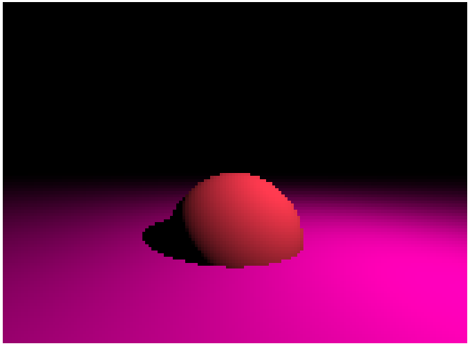
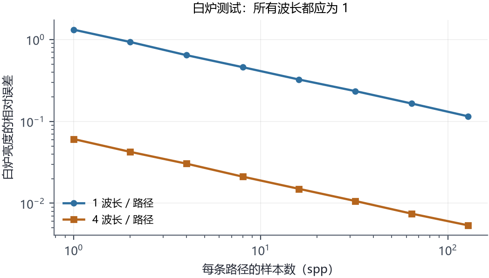
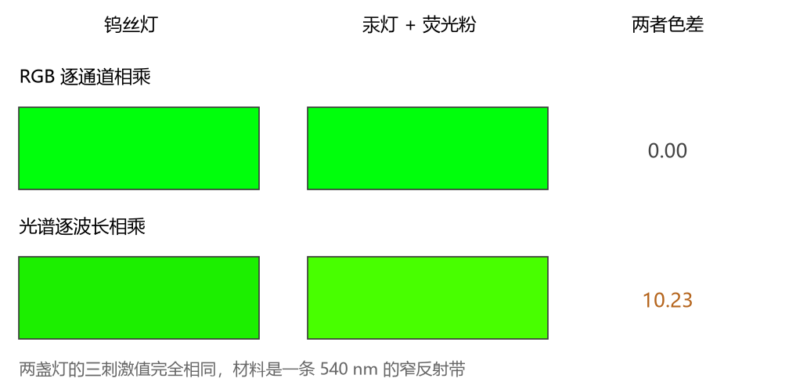
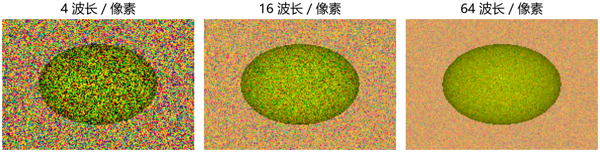

# 第 13 章 一个最小的光谱路径追踪器

## 13.1 目标

到这一章，零件都齐了。需要一个能跑起来的实现，把第 5 到第 9 章的内容装进一个程序里，并且能在第 1 章那个场景上给出正确的答案。

目标定得很低：一个球、一个平面、一个点光源，直接光照，不追踪间接光。这样做的理由是调试——光谱渲染的错误分散在波长采样、概率密度、BSDF 评价、配色函数投影四个地方，如果一上来就带间接光，出错时不知道该查哪一段。等直接光照的图像对上了，再加路径反弹。

程序要能回答三个问题：一条路径携带几个波长；波长怎么采、权重怎么算；怎么变成像素。剩下的都是工程。

## 13.2 数据结构

两个结构撑起整个程序。

`SampledWavelengths` 存 $n$ 个波长和它们的概率密度。生成方式是 hero 加等间隔 wrap：

$$\lambda_{i}=\lambda_{\min}+\big((\lambda_{0}-\lambda_{\min})+i\,\Delta\lambda\big)\bmod(\lambda_{\max}-\lambda_{\min}) . \tag{13.1}$$

hero 均匀采样时 $p=1/400$，$n$ 个波长的密度相同。如果 hero 换成别的分布，密度要按 (7.3) 各自计算。

`Spectrum` 就是长度 $n$ 的数组。这里不用类，直接用 NumPy 数组，所有运算都是逐元素的，写起来短，也不容易把"光谱"和"颜色"混起来——一个长度为 $n$ 的数组在程序里永远代表光谱，长度为 3 的数组永远代表 XYZ。

BSDF 的接口要区分"采样方向"和"评价光谱"两件事。采样方向只接收 hero 波长，评价光谱接收整个波长组：

```python
def sample(wo, lam_hero, rng):     # 返回 (wi, pdf)
    ...

def eval(wo, wi, lams):            # 返回长度为 n 的光谱
    ...
```

这个不对称是 hero wavelength 的接口体现。写成这样以后，代码里就不可能"每个波长各自采样方向"了，也不会误用次级波长的方向密度。

## 13.3 主循环

一条路径的循环只有五步：求交、累加自发光、采样方向、更新 throughput、继续前进。带波长的版本一模一样，只是 `beta` 和 `L` 从三个数变成一行数。

```python
beta = np.ones(n)          # 逐波长的 throughput
L = np.zeros(n)            # 逐波长的结果

for depth in range(max_depth):
    hit = scene.intersect(ray)
    if hit is None:
        break
    L += beta * hit.Le(lams)                   # 自发光按波长评价
    wi, pdf_dir = hit.bsdf.sample(ray.d, lams[0], rng)
    if pdf_dir == 0:
        break
    f = hit.bsdf.eval(ray.d, wi, lams)         # 每个波长一个值
    beta *= f * abs(wi @ hit.n) / pdf_dir
    ray = Ray(hit.p, wi)
```

注意 `f` 是一个数组，`beta *= ...` 是逐元素运算。这一行看起来平淡，但它是所有光谱差异的来源：第 4 章说的"逐波长相乘"，在代码里就是这个 `*`。

## 13.4 从光谱到像素

一条路径结束时，`L` 是一个长度为 $n$ 的数组。把它变成 XYZ，要做两次平均：对 $n$ 个波长求平均，以及除以波长密度。

$$X=\frac{1}{n}\sum_{i=0}^{n-1}\frac{L(\lambda_{i})\,\overline{x}(\lambda_{i})}{p(\lambda_{i})} . \tag{13.2}$$

$Y$ 和 $Z$ 同理。这一步最容易写错的地方是把 $1/n$ 和 $1/p$ 写成一个：$1/(np)$ 是对的，$1/n$ 或 $1/p$ 单独用都不对。前者的量纲能从 (13.2) 直接验证，后者会让亮度差 400 倍。

```python
xyz = (cmf(lams) * L[:, None] / (n * pdf[:, None])).sum(axis=0)
film[j, i] += xyz
```

`film` 存的是三个 double，不是光谱。所有路径的贡献都投影到同一组 XYZ 上，所以可以相加。渲染器内部不保存整条光谱，只在每条路径的存续期内保留 $n$ 个采样值。

## 13.5 完整代码

下面这份代码可以直接运行，只依赖 NumPy。它把 13.2 到 13.4 的内容串起来，另外加了一个点光源的阴影测试和一个球体求交。

```python
import numpy as np

LMIN, LMAX = 380.0, 780.0
NW = 4                                     # 每条路径的波长数


def sample_wavelengths(rng, n=NW):
    hero = rng.uniform(LMIN, LMAX)
    step = (LMAX - LMIN) / n
    lams = LMIN + np.mod(hero - LMIN + step * np.arange(n), LMAX - LMIN)
    return lams, np.full(n, 1.0 / (LMAX - LMIN))


def _g(lam, mu, s):
    return np.exp(-0.5 * ((lam - mu) / s) ** 2)


def cmf(lam):
    x = (0.362 * _g(lam, 442.0, 16.0) + 1.056 * _g(lam, 599.8, 37.9)
         - 0.065 * _g(lam, 501.1, 20.4))
    y = 0.821 * _g(lam, 568.8, 46.9) + 0.286 * _g(lam, 530.9, 16.3)
    z = 1.217 * _g(lam, 437.0, 11.8) + 0.681 * _g(lam, 459.0, 26.0)
    return np.stack([x, y, z], axis=-1)


SPHERE_C, SPHERE_R = np.array([0.0, 0.0, 3.0]), 1.0
LIGHT_P = np.array([2.0, 3.0, 1.5])


def sphere_albedo(lam):
    return 0.05 + 0.90 * np.exp(-0.5 * ((lam - 560.0) / 45.0) ** 2)


def plane_albedo(lam):
    return np.full_like(lam, 0.55)


def light_spd(lam):
    return (np.exp(-0.5 * ((lam - 452.0) / 12.0) ** 2)
            + np.exp(-0.5 * ((lam - 611.0) / 12.0) ** 2))


def intersect(o, d):
    best = (np.inf, None, None)
    oc = o - SPHERE_C
    b, c = 2 * oc @ d, oc @ oc - SPHERE_R ** 2
    disc = b * b - 4 * (d @ d) * c
    if disc > 0:
        t = (-b - np.sqrt(disc)) / (2 * (d @ d))
        if 1e-4 < t < best[0]:
            p = o + t * d
            best = (t, (p - SPHERE_C) / SPHERE_R, sphere_albedo)
    if abs(d[1]) > 1e-9:
        t = -o[1] / d[1]
        if 1e-4 < t < best[0]:
            best = (t, np.array([0.0, 1.0, 0.0]), plane_albedo)
    return best


def trace(o, d, lams):
    t, nrm, albedo = intersect(o, d)
    if nrm is None:
        return np.zeros_like(lams)
    p = o + t * d
    if nrm @ d > 0:
        nrm = -nrm
    L = LIGHT_P - p
    dist = np.sqrt(L @ L)
    cos_p = max(0.0, nrm @ (L / dist))
    tn, _, _ = intersect(p + 1e-4 * nrm, L / dist)
    vis = 0.0 if tn < dist - 1e-3 else 1.0
    return albedo(lams) / np.pi * light_spd(lams) * vis * cos_p / (dist * dist)


def render(w=64, h=48, spp=16, seed=0):
    rng = np.random.default_rng(seed)
    film = np.zeros((h, w, 3))
    eye = np.array([0.0, 1.0, 0.0])
    for _ in range(spp):
        lams, pdf = sample_wavelengths(rng)
        for j in range(h):
            for i in range(w):
                u = (i + 0.5) / w * 2 - 1
                v = 1 - (j + 0.5) / h * 2
                d = np.array([u * 1.2, v * 0.9, 1.0])
                d /= np.linalg.norm(d)
                S = trace(eye, d, lams)
                film[j, i] += cmf(lams) @ (S / pdf) / len(lams)
    return film / spp
```

`render` 返回的是 XYZ 图像，转成显示用 RGB 还要乘一次矩阵、做一次色调映射和伽马编码。用第 3 章的矩阵：

```python
M = np.array([[3.2406, -1.5372, -0.4986],
              [-0.9689, 1.8758, 0.0415],
              [0.0557, -0.2040, 1.0570]])
rgb = xyz_img @ M.T
rgb = np.clip(rgb / np.percentile(rgb, 99.0), 0, 1) ** (1 / 2.2)
```

这段程序跑 150×110、20 spp 大约几秒钟，结果如图 13-1。球面上有一条 560 nm 的反射带，光源是 452 与 611 nm 的两条窄线。球看起来是暗红色的，因为光源在 560 nm 附近几乎没有能量，球只反射了 611 nm 那一条线的一小部分。这个结论 RGB 渲染器给不出来——它会说"黄色球被品红光照亮，应该是红色"，恰好也蒙对了颜色，但亮度会高出一个数量级。



## 13.6 四个测试

**白炉。** 把场景换成一个恒定辐亮度的环境，所有材质设成反射率 1，出来的图像应该是常数。这个测试只查能量守恒，不查颜色，但它能抓住绝大多数概率密度的错误。图 13-2 是白炉的误差随样本数的变化：斜率为 $-1/2$，说明估计量无偏；4 波长与 1 波长的曲线几乎重合，说明短波长数不会带来偏差，只会带来方差。



**同色异谱的双灯。** 造两盏三刺激值完全相同、光谱完全不同的灯（一盏 2800 K 黑体，一盏"汞灯加荧光粉"），照在同一块窄带反射的材料上。RGB 管线给出的两个颜色完全相同，色差 0.00；光谱管线给出 10.23。这个测试的结果在图 13-3，它查的是"波长有没有真的参与运算"——如果一个号称光谱的渲染器在这个测试上给出 0，说明它在某处把光谱压成了 RGB。



**波长噪声。** 固定每像素的波长样本数，把 4、16、64 三档画在一起。图 13-4 的结果很直观：4 个波长时彩色噪点盖住了整个画面，16 个好转，64 个基本干净。注意噪声是彩色的，不是灰的，这是波长采样独有的特征——亮度通道的方差小，色度通道的方差大。



**成品。** 跑一张有遮挡、有阴影的图（图 13-1），确认几何部分没有被光谱改动破坏。

## 13.7 还缺什么

这份代码故意缺了四样东西。

**间接光。** 循环里没有继续追踪，只算了一次直接光照。加上反弹就是标准的路径追踪，改动量很小：把 `beta` 乘上新的 BSDF、把 `L` 累加、把光线换成反射方向。

**俄罗斯轮盘赌。** 没有终止机制，深度固定。加轮盘赌时要注意按最大分量决定存活，按各自概率除权重，否则不同波长的存活率不一致，颜色会偏。

**介质与荧光。** 这两个会改变波长的结构，第 10、11 章讲过。介质要按 $\sigma_{\max}$ 采样距离，荧光要重新生成波长组。

**分裂与焦散。** 色散场景需要路径分裂，第 9 章讲过三种策略。这份代码的 `bsdf.sample` 只返回一个方向，支持不了分裂。

缺的这四样都是"在骨架上加一层"，不是"重新设计"。把骨架写对，扩展就是填细节；骨架写错，扩展的时候会不断怀疑是骨架的问题还是新加的部分有问题。

---

这一章的程序不到一百行，但它把前面所有章节的结论串了一遍：波长组怎么生成、方向为什么只用 hero、throughput 怎么逐波长更新、怎么投影成 XYZ、权重里的 $1/(np)$ 从哪来。四个测试对应四种错误：白炉查能量守恒，双灯查波长是否真的参与运算，噪声图查采样是否足够，成品图查几何是否被破坏。下一章把这套东西扩到能渲染色散玻璃，并给出和 RGB 渲染器对比的判据。
