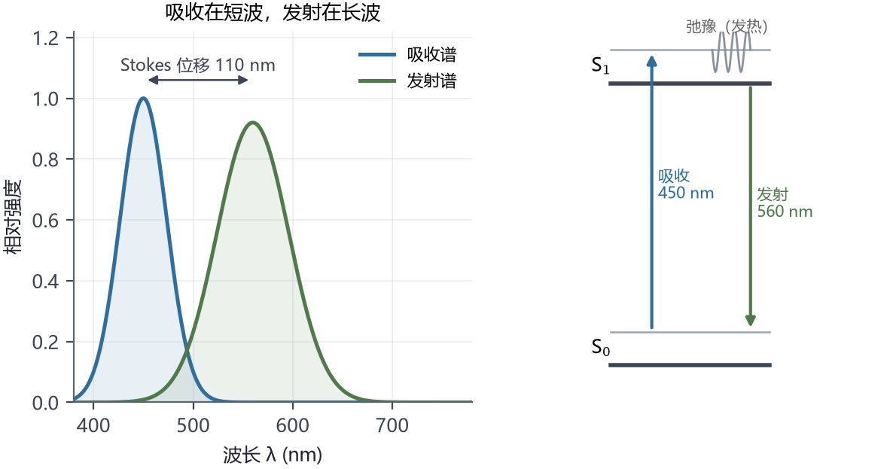
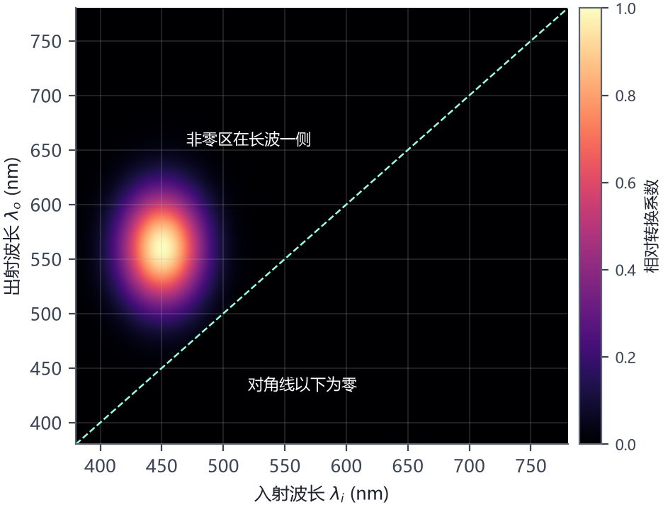
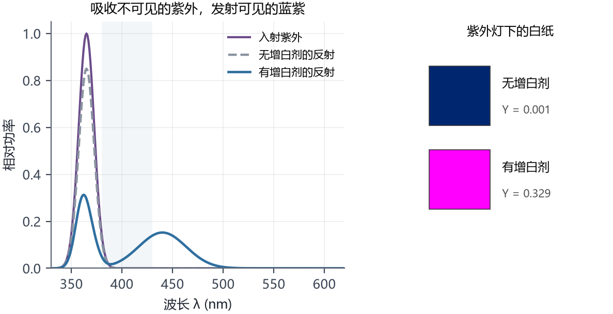

# 第 15 章 荧光与波长变换

## 15.1 一支荧光笔

拿一支黄色荧光笔在纸上画一条线，在白光下它是一条普通的黄线。把房间的灯关掉，换成一盏紫光灯，那条线会亮起来，而且是刺眼的黄绿色，比周围的白纸亮得多。纸在紫光下几乎全黑，笔迹却在发光。

这件小事里有三件事同时发生：材料吸收了不可见的紫外，把它变成可见的光；发射出来的波长比吸收的更长；发射的亮度可以超过周围表面反射的亮度，因为那部分能量本来不在可见光里。

RGB 渲染器对这种情况没有对应的机制。它可以给材质一个"荧光颜色"，但那只是一个三元组，既不知道能量从哪来，也不知道能量去了哪。要让渲染器答对，必须把波长转换写进方程。

## 15.2 Stokes 位移

荧光材料的两个基本光谱是吸收谱和发射谱。图 15-1 左是一个典型例子：吸收峰在 450 nm，发射峰在 560 nm，两者有一小段重叠。发射峰比吸收峰更靠长波，这个位移叫 Stokes 位移，名字来自 1852 年 Stokes 对荧光的第一批观察。

位移的能量去哪了？变成了热。光子能量 $hc/\lambda$，450 nm 的光子是 2.76 eV，560 nm 的光子是 2.21 eV，差 0.55 eV 在材料内部以非辐射的方式耗散掉。图 15-1 右是能级图：光子把电子从基态 $S_0$ 激发到 $S_1$ 的某个振动能级，电子先通过振动弛豫落到 $S_1$ 的最低能级（这一步放热，不发光），再从那里跃迁回基态，发出一个能量较低的光子。

因为弛豫很快（皮秒量级），发射几乎总是从 $S_1$ 的最低振动能级开始，所以**发射谱的形状基本不随激发波长变化**。这条经验规律叫 Kasha 规则，它是后面那个荧光模型能够成立的前提。

## 15.3 再辐射矩阵

把荧光写进渲染方程，需要把 BSDF 从"一个波长的输入到同一个波长的输出"扩展成"任意输入波长到任意输出波长"。这个二维的核叫再辐射矩阵（re-radiation matrix），记作

$$R(\lambda_{i},\lambda_{o}) , \tag{15.1}$$

表示波长 $\lambda_i$ 的入射光有多大比例在 $\lambda_o$ 上出射。普通材质的 $R$ 只在 $\lambda_i=\lambda_o$ 时非零，是一个对角核；荧光材料的 $R$ 在 $\lambda_o>\lambda_i$ 一侧有值，是一个上三角核。

图 15-2 是一个例子。横轴是入射波长，纵轴是出射波长，颜色是转换系数的相对大小。非零区域集中在对角线上方的一个斑块里，斑块的中心在 $(450,560)$，这就是 $450$ nm 的吸收带与 $560$ nm 的发射带的交点。对角线以下全黑，因为荧光不产生短波。

能量守恒的约束写在矩阵上很直接：

$$\int_{\Lambda}\int_{H^{2}}R(\lambda_{i},\lambda_{o})\,f_{\text{dir}}(\omega_{i},\omega_{o})\cos\theta_{o}\,d\omega_{o}\,d\lambda_{o}\le1\qquad\text{对每个 }\lambda_{i} , \tag{15.2}$$

$f_{\text{dir}}$ 是方向部分（反射或透射的分布），$R$ 是波长部分。给定一个入射波长，所有出射波长的能量加起来不能超过入射。荧光材料的量子效率通常小于 1，差额变成热。

## 15.4 一个能用的模型

再辐射矩阵不能直接从测量数据里拿——分光荧光计测一条完整的 $R$ 需要几千次测量，成本很高。实用的是一个低维参数模型。

Jung、Hanika、Marschner 和 Dachsbacher 在 2018 年给出一个简单的漫反射荧光模型，把 $R$ 分解成吸收谱与发射谱的乘积：

$$R(\lambda_{i},\lambda_{o})=q\cdot a(\lambda_{i})\cdot e(\lambda_{o}) , \tag{15.3}$$

其中 $q$ 是量子效率，$a$ 是吸收谱（归一化到峰值 1），$e$ 是发射谱（归一化到积分为 1）。这个形式就是 Kasha 规则的数学版本：发射谱的形状与激发波长无关，所以可以写成外积。

能量守恒要求

$$q\int a(\lambda_{i})\,d\lambda_{i}\le1 , \tag{15.4}$$

否则材质会凭空造能量。实现时通常把 $q$ 和 $a$ 的归一化放在一起处理，保证乘积不超过 1。

材质的总 BSDF 是普通反射与荧光部分的和：

$$f_{r}(\lambda_{i},\lambda_{o})=(1-q_{\text{abs}})\,f_{\text{reflect}}(\lambda_{i})\,\delta(\lambda_{i}-\lambda_{o})+q\,a(\lambda_{i})\,e(\lambda_{o}) . \tag{15.5}$$

第一部分是对角核，就是普通的反射；第二部分是满核，描述波长转换。两部分的能量加起来不超过 1，这是材质合法的条件。

Hua、Tázlar、Fichet 和 Wilkie 在 2023 年给出了一个更完整的方案，用矩阵形式存测量得到的再辐射数据，并配一套重要性采样的解析构造。它适合需要真实荧光数据的场合，实现比 (15.3) 复杂得多。

## 15.5 采样：一次事件改变波长

在路径追踪里，荧光事件的处理分两步。

第一步，按吸收谱决定是否吸收。入射波长 $\lambda_i$ 被吸收的概率正比于 $a(\lambda_i)$，其余部分按普通反射处理。这一步用俄罗斯轮盘赌实现：抽一个随机数，小于 $q\,a(\lambda_i)$ 就进入荧光分支，否则按反射处理，权重相应调整。

第二步，从发射谱里采一个出射波长 $\lambda_o$。密度是 $e(\lambda_o)$，权重除以它。采完之后，路径继续走，但波长已经变了。

这一步把 hero wavelength 的结构打乱了。原来的 $n$ 个波长是等间隔分布在一整条路径上的，荧光事件之后原来的波长组不再适用：$\lambda_0$ 变成了 $\lambda_o$，$\lambda_1$ 变成了另一条路径的起点。有两种处理方式。

一种是只保留一个波长继续追踪，其他终止。这等于在荧光事件处把光谱分辨率降到 1，方差上升，但实现简单，而且荧光本身已经把光谱"洗"了一遍，多个波长之间的相关性不强。

另一种是重新生成一组 $n$ 个波长，以 $\lambda_o$ 为中心。这保持了光谱分辨率，但要在权重里补上"重新生成"的概率比，实现上容易出错。

图 15-3 是一个数值例子：一盏 365 nm 的紫外灯照白纸，纸里有和没有荧光增白剂两种情况。没有增白剂时，纸只反射紫外，可见光部分的输出几乎为零（$Y=0.001$）；有增白剂时，紫外被吸收并在 440 nm 附近发射，输出变成明亮的蓝紫（$Y=0.329$）。亮度相差三百倍，而这个差别完全来自波长转换。

这个例子也说明了荧光渲染的一个特性：**输出亮度可以接近或超过入射的可见光亮度**。因为来源是可见光波段之外的能量，这在 RGB 渲染里无法表达——RGB 光源没有紫外通道，材质也没有"往可见光里搬"的机制。

## 15.6 荧光与上采样

第 12 章讲过 Jung 等人 2019 年的宽色域上采样，那里用荧光解决的是另一个问题：有些颜色落在 MacAdam 极限之外，没有任何能量守恒的反射率能表示。

把两件事放在一起看，会发现它们是同一个模型的两种用法。上采样时，荧光分量是一个"自由度"，用来把颜色推到合法反射率之外；渲染时，同一个荧光分量是一个"物理过程"，把短波的能量搬到长波。前者是为了让 RGB 输入有解，后者是为了让紫外光有去处。两者的数学形式相同，都是 (15.3) 那样的外积。

这也带来一个实现上的好处：如果一个材质是从宽色域 RGB 上采样得到的，它已经带有荧光参数，渲染器可以直接使用；不需要额外标记"这里有荧光"。代价是所有材质都多了一份荧光参数的存储与采样开销，即使绝大多数材质的荧光分量是零。

## 15.7 五个容易写错的地方

**能量守恒。** 吸收谱、发射谱、量子效率的乘积不能超过 1。$q$ 设得太大，或者发射谱忘了归一化，图像会出现能量增殖：越渲染越亮，多条路径叠加之后爆掉。检查方法很简单，把材质放进白炉，看亮度是否守恒（第 18 章）。

**波长组的生命周期。** 荧光事件后原来的波长组失效，要重新生成。如果代码里还在用旧的密度，权重会错得很难查——因为错误只出现在有荧光的像素上。

**多次荧光。** 发射出来的光可能被同一材质再次吸收，发生第二次荧光。真实材料有这个可能，概率不高。渲染时可以限制荧光次数，或者按量子效率自然衰减。注意第二次荧光必须重新采样波长，不能沿用第一次的。

**方向与波长解耦。** 漫反射荧光的角分布与波长无关，所以方向采样不需要知道出射波长。如果是镜面荧光（很少见），方向就与波长耦合，处理起来复杂得多。

**测量的白点。** 分光荧光计测出的 $R$ 是相对于某个激发光源的，换光源之前要做归一化。这个坑和上采样的白点问题同源。

---

荧光是这本书里唯一真正改变波长的机制。它把渲染方程从一个对角核变成一个满核，把波长积分从一个一维积分变成二维积分，把 hero wavelength 的"一条路径一组波长"变成"一条路径上波长可能换组"。代价是复杂度和方差，回报是紫外灯下的荧光笔、洗衣粉增白剂、荧光矿物、生物成像这些场景第一次在物理上成立。

下一章换一个维度：偏振。它和光谱一样是被 RGB 丢掉的自由度，但和光谱正交——一个管波长，一个管方向上的振动状态。
