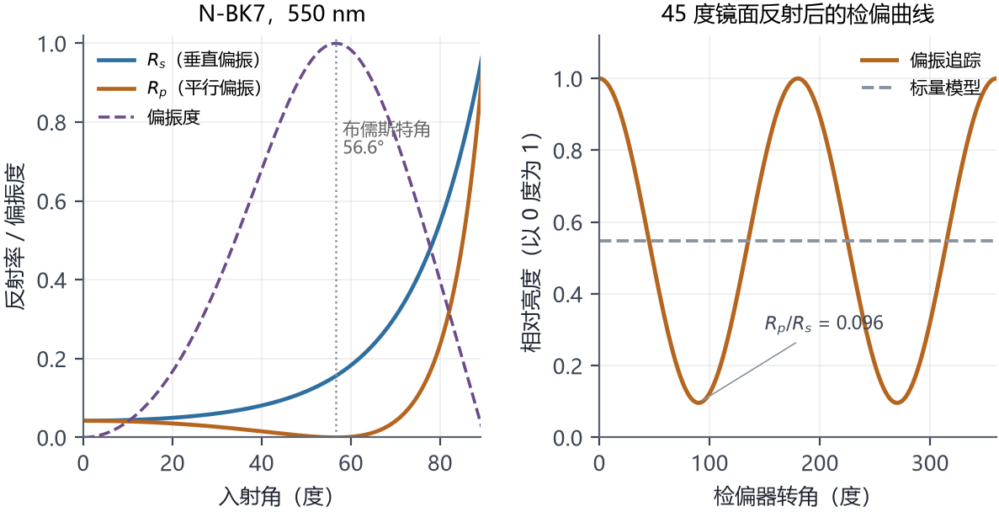
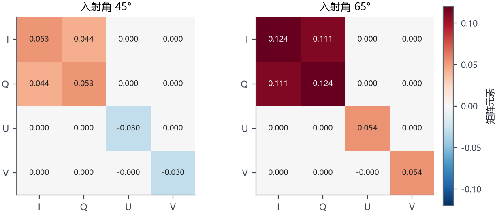

# 第 16 章 偏振接口

## 16.1 一片偏振片

在一盏灯前面放一片偏振片，后面放一台相机。转动偏振片，相机的读数基本不变——灯光是自然光，各个方向的振动都有，转过 90 度之后还是一样的平均值。

在灯和相机之间加一面镜子，让光以 45 度入射再反射到相机。再转动第二片偏振片（检偏器），读数会明显变化：某个角度最亮，转 90 度之后最暗，比值接近 10:1。图 16-1 右就是这个曲线。

这个现象说明反射过程改变了光的偏振状态。入射光是自然光，$s$ 分量和 $p$ 分量的强度相同；反射之后两个分量乘上不同的系数 $R_s$ 和 $R_p$，比例就变了。45 度入射时 N-BK7 的 $R_s=0.050$、$R_p=0.005$，比值 9.6 倍，所以检偏器转一圈看到的亮度比也是 9.6 倍。

标量渲染器看不到这件事。它把光当成一个数，反射时乘一个平均反射率，出射光仍然是"自然光"，检偏器转一圈读数不变。图 16-1 右的虚线就是它的答案：一条常数 0.54。



## 16.2 斯托克斯矢量与 Mueller 矩阵

描述偏振态最方便的工具是斯托克斯矢量（Stokes vector）：

$$\mathbf{S}=\begin{pmatrix}I\\Q\\U\\V\end{pmatrix} , \tag{16.1}$$

$I$ 是总强度，$Q$ 是两个正交方向的强度差，$U$ 是另外一对正交方向的强度差，$V$ 是圆偏振分量。自然光是 $(I,0,0,0)$；线偏振是 $(I,Q,U,0)$ 且 $Q^2+U^2=I^2$；部分偏振满足 $Q^2+U^2+V^2<I^2$。偏振度定义为

$$d=\frac{\sqrt{Q^{2}+U^{2}+V^{2}}}{I} . \tag{16.2}$$

光学元件对偏振态的作用是一个 $4\times4$ 的矩阵，叫 Mueller 矩阵：

$$\mathbf{S}_{\text{out}}=\mathbf{M}\,\mathbf{S}_{\text{in}} . \tag{16.3}$$

图 16-2 画了 N-BK7 单界面在 45 度和 65 度入射时的 Mueller 矩阵。结构很清楚：$I$ 与 $Q$ 之间有耦合（前两行两列），$U$ 与 $V$ 之间有一个对角块，其余为零。



矩阵里最值得看的是 $U$、$V$ 那一块的符号。它由 $\sqrt{R_sR_p}\cos\delta$ 和 $\sin\delta$ 组成，$\delta$ 是 $r_s$ 与 $r_p$ 的相位差。在布儒斯特角以下，$r_s$ 和 $r_p$ 同号，$\delta=0$，这块是正的；在布儒斯特角以上，$r_p$ 反号，$\delta=\pi$，这块变成负的。这就是为什么偏振片在布儒斯特角两侧看到的现象会反过来。

对渲染来说，Mueller 矩阵就是"偏振模式下的 BSDF"。标量模式返回一个数（或者一条光谱），偏振模式返回 16 个数（或者 $16\times n$ 个数，如果每个波长都要）。

## 16.3 光谱与偏振是两个正交的维度

把两个扩展放在一起看：

| 模式 | 每条路径携带的量 | BSDF 的返回 | 存储 |
|:---|:---|:---|:---|
| 标量 | 1 个数 | 1 个数 | 1 |
| 光谱 | $n$ 个波长样本 | $n$ 个数 | $n$ |
| 偏振 | 4 个斯托克斯分量 | $4\times4$ 矩阵 | 16 |
| 光谱 + 偏振 | $n\times4$ | $n$ 个 $4\times4$ 矩阵 | $16n$ |

两个维度是正交的：波长描述"哪个频率的光"，偏振描述"这个频率的光怎么振动"。加波长不会改变偏振的代数结构，加偏振也不会改变波长的积分方式。所以理论上可以自由组合。

代价是 $16n$ 倍的状态。$n=4$ 时是 64 个数，远超 SIMD 寄存器的容量，路径状态要落到内存，缓存不友好。这也是为什么大多数渲染器默认不开偏振：不是为了省那点公式，而是为了省这个数据量。

## 16.4 什么时候必须开偏振

偏振在四类场景里不可忽略。

**偏振片和液晶。** 相机滤镜、LCD 屏幕、3D 眼镜，这些元件的整个工作原理就是偏振。标量渲染器无法表示它们。

**布儒斯特角附近的强反射。** 水面、玻璃、清漆在特定角度下反射光几乎是完全偏振的。如果场景里恰好有这个角度，标量渲染的反射亮度会错 30% 到 50%，因为 $R_s$ 和 $R_p$ 的差被平均掉了。

**多次反射。** 每一次反射都在加大两个分量的比例差。图 16-1 左的偏振度曲线说明，在布儒斯特角附近一次反射就能把自然光变成完全偏振；多次反射之后，即使入射角不在布儒斯特角附近，出射光也可能高度偏振。

**天空与大气。** 瑞利散射产生的天空光是部分偏振的，偏振方向与太阳位置有关。这个效应在摄影里被偏振镜利用，在渲染里要求把大气散射写成 Mueller 矩阵。

除了这四类，偏振的影响通常小于 5%，可以忽略。工程上的做法是提供一个开关：默认标量，需要时打开，此时 BSDF 的接口从"返回一个数"变成"返回一个矩阵"。

## 16.5 接口怎么设计

如果把偏振当成一个可开关的模式，接口要满足三条。

**统一的返回类型。** 最省事的做法是让 BSDF 始终返回一个结构，标量模式下只填 $M_{00}$，偏振模式下填满 16 个。这样调用方不需要改代码，代价是标量模式也要传一个 4×4 的结构（通常会被编译器优化掉）。

**明确的坐标系。** 偏振态是相对于某个参考方向定义的，反射时 $s$ 和 $p$ 的方向会翻转。实现里必须把参考方向随路径一起传，或者在每次交互时重新定义并做一次旋转。常见的错误是忘记旋转，结果是偏振态在两次反射之间"跳"了一下，图像出现条纹。

**相位的处理。** 只有 $\cos\delta$ 和 $\sin\delta$ 会影响 $U$、$V$ 分量，而 $\delta$ 来自复反射系数。对电介质，$\delta$ 只取 0 或 $\pi$；对金属和全反射，$\delta$ 是连续变化的，必须用复数算。这也是偏振渲染比标量渲染慢得多的原因之一：每个界面都要处理复数。

## 16.6 加进路径追踪器要改哪几行

第 17 章那份实现里，throughput 是一个长度为 $n$ 的数组。打开偏振之后，它变成一个 $n	imes4$ 的数组，每个波长四个斯托克斯分量。

改动集中在三处。

第一处是光源与相机的初始状态。自然光写成 $(1,0,0,0)$，圆偏振光写成 $(1,0,0,\pm1)$，线偏振光写成 $(1,\cos2	heta,\sin2	heta,0)$，偏振度 $d$ 的部分偏振光是这几种的凸组合。相机也有一条"接收曲线"，可以是一个偏振片（只让某个方向通过），也可以是全接收。

第二处是每次反弹。throughput 的更新从标量乘法变成矩阵乘法：

```python
S = np.zeros(n * 4)          # 每个波长四个分量
for i, lam in enumerate(lams):
    M = bsdf.mueller(wo, wi, lam)      # 4x4
    S[4*i:4*i+4] = M @ S[4*i:4*i+4]
```

矩阵与波长一起循环，所以代价是 $n$ 次 $4	imes4$ 的乘法，而不是 $n$ 次标量乘法。

第三处是俄罗斯轮盘赌。标量模式下按 throughput 的大小决定存活概率，偏振模式下要按总强度 $I$，而且必须保证"杀掉一条路径"不会破坏偏振态——只缩放不改变分量比例，所以按 $I$ 决定存活、按同一个因子除四个分量即可。

还有一个细节：方向采样。BSDF 的采样分布通常是按 $I$ 设计的，与偏振态无关，这在物理上没有问题（采样分布可以任意选，只要密度正确），但它意味着采样不会"偏向"某个偏振方向，方差会稍高。要降低方差，可以按当前斯托克斯矢量选一个更适合的基，代价是实现复杂。

## 16.7 光谱偏振的一个额外好处

把两个维度都打开，会得到一些只在光谱偏振下才出现的效果。

金属在不同波长下的复折射率不同，所以 Mueller 矩阵也随波长变化。一块抛光的金属表面反射的自然光，在不同波长上的偏振度不一样，出射光因此带上一点点颜色——这个颜色无法用 RGB 加偏振表示，因为它需要每个波长一个矩阵。

全反射时 $s$ 和 $p$ 的相位差随入射角连续变化，这叫相位延迟（retarder 效应）。棱镜内部的全反射会把线偏振变成椭圆偏振，转换的程度与波长有关。这个效应在光学设计里被用来做波片，在渲染里只有在渲染玻璃雕塑内部的多次全反射时才看得见。

这两个效果都很弱，通常不值得为它们开启偏振。知道它们存在，比实现它们更有用——它们说明了"偏振 + 光谱"不是两个独立模块的简单叠加，它们在物理上是同一个电磁场的两个侧面。

---

这一章没有给出完整的偏振渲染器，只给了接口和判据。你需要知道的只有三件事：偏振用 4 个斯托克斯分量描述，BSDF 变成 4×4 的 Mueller 矩阵；它和波长是正交的维度，可以同时打开，代价是 $16n$ 倍的状态；在偏振片、布儒斯特角、多次反射、天空这四类场景里不能忽略它，其余场景可以。下一章回到主线，把这些部件拼成一个能跑的光谱路径追踪器。
