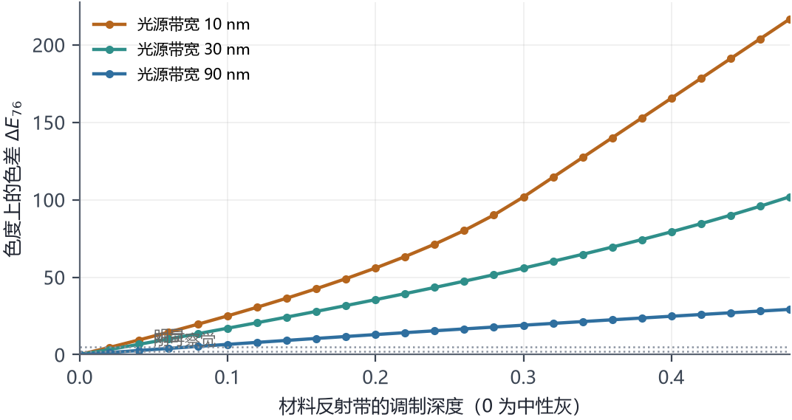
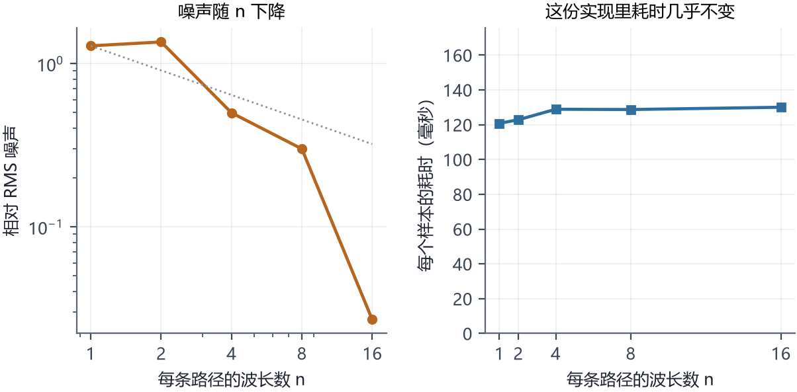
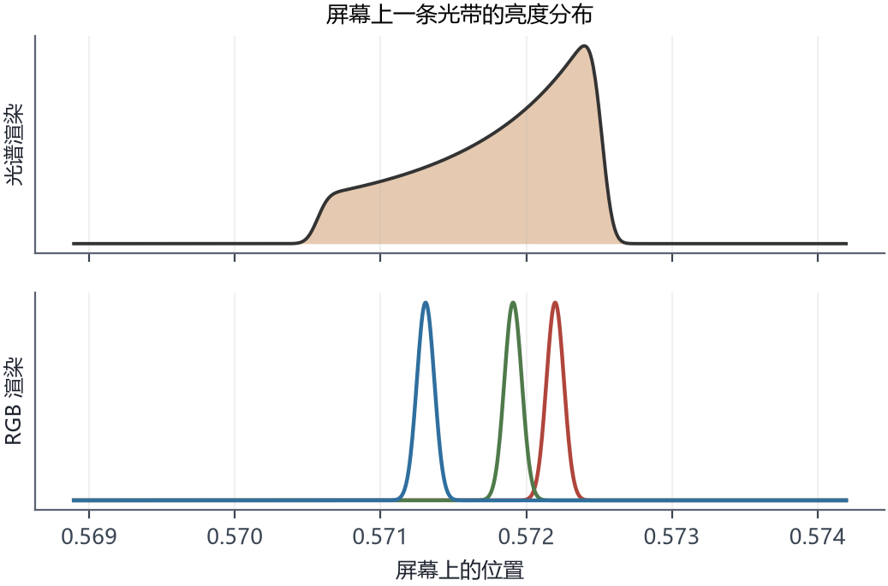
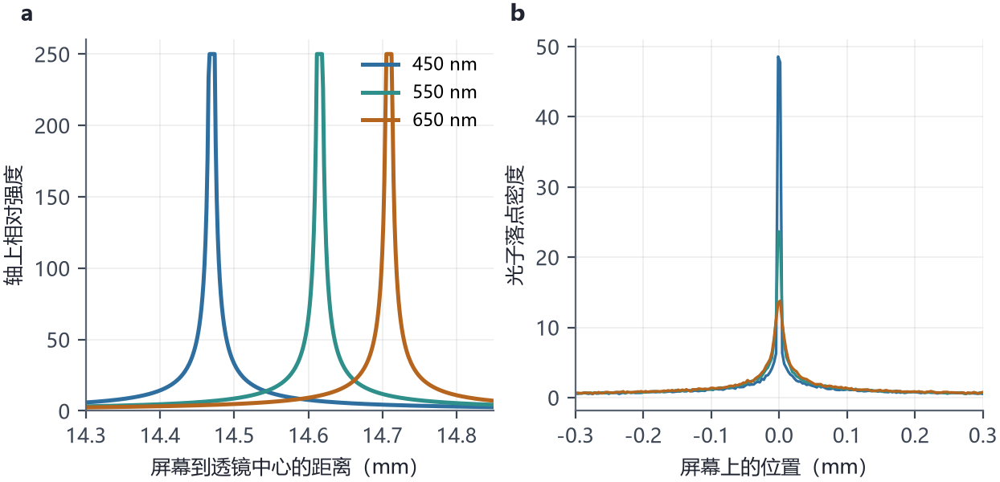

# 第 18 章 验证、性能与完整场景

## 18.1 先让白炉通过

渲染器写出来之后，第一件事不是渲染一个漂亮的场景，而是把它放进一个均匀发光的环境里，材质设成反射率 1，看输出是不是常数。

这个测试叫白炉。物理上它为什么必须成立，一句话就能说清：一个反射率为 1 的物体在均匀环境里，反射出来的辐亮度等于环境本身的辐亮度，从任何方向看都一样。渲染结果是常数，说明能量守恒、概率密度匹配、加权正确；出现暗角、色斑、亮边，说明某个环节错了。

白炉对光谱渲染的要求比 RGB 多两条。第一，每个波长都要守恒，不是平均之后守恒。一个材质在 550 nm 反射率 1.02、在 650 nm 反射率 0.98，平均下来是 1，RGB 的平均值看不出来，但白炉会显示出一条色带。第二，波长的密度必须正确，否则整张图会整体偏亮或偏暗，而且偏的量与样本数有关。第 17 章的图 17-2 就是白炉的收敛曲线：误差按 $-1/2$ 的斜率下降，说明估计量无偏；4 波长与 1 波长的曲线几乎重合，说明波长数不改变均值。

白炉能抓到的错误，按出现频率排：BSDF 没有归一化（$\rho/\pi$ 漏了 $\pi$）、俄罗斯轮盘赌的存活概率算错、波长密度漏乘、介质的距离密度与透射率不匹配、配色函数查表越界返回零。这五个都是"不崩溃、只偏色"的错误，靠看图像很难发现，白炉几秒钟就能暴露。

## 18.2 解析对比

白炉只验证能量，不验证几何和光谱形状。第二层验证是拿有解析解的场景对比。

**棱镜偏向角。** 60 度等边棱镜，最小偏向角是 $\delta_{\min}=2\arcsin(n\sin30°)-60°$。N-BK7 在 550 nm 是 38.8 度，SF11 是 67.2 度。渲染器里放一块棱镜，平行光入射，测出射方向，与解析值比对。对不上就先查折射公式里的 $\eta$ 是不是写反了，再查法线朝向。

**透射率。** 一块厚度为 $d$ 的吸收介质，透射率是 $\exp(-\sigma_t d)$。渲染一张正对光源的薄片，测像素值与解析值比对。这个测试还能查出"用平均 $\sigma_t$ 采样、用逐波长 $\sigma_t$ 算透射率"这类密度不匹配的错误，因为那种错误的偏差随厚度增加。

**球透镜焦距。** 半径 $R$ 的玻璃球，焦距（从球心量）是 $f=nR/(2(n-1))$。半径 10 mm 的 N-BK7 球在 550 nm 的焦距是 14.65 mm，400 nm 是 14.52 mm。渲染一个球、一束平行光，测聚焦位置，同时验证几何和色散。

**圆盘辐照度。** 半径 $R$ 的圆盘光源，轴线上距离 $d$ 的辐照度是 $L\pi R^2/(R^2+d^2)$。这个测试查的是立体角积分和光源采样的密度，尤其适合查"光源采样与 BSDF 采样的 MIS 权重是否平衡"。

四个测试覆盖了几何、透射、聚焦、采样四个方面。它们的共同点是简单到可以手算，任何一个对不上，都说明某一块代码有问题，而不是"参数没调好"。

## 18.3 和 RGB 渲染器对比的判据

最有用的一类验证是"同一场景，两条管线，差多少"。它不是要证明光谱更准——那是定义问题——而是要回答"这个场景里 RGB 的误差是否超过可接受范围"。

第 8 章已经给过一组数据，那组数用的是亮度比。这里换一个更适合做判据的量：色度上的色差。

做法是这样：固定场景（一盏窄带灯、一块有色材料），把 RGB 管线与光谱管线各算一遍，把两者的结果都归一化到相同的亮度，再算色差。归一化到相同亮度是必须的，因为亮度差会掩盖色度差，而人眼对色度的敏感度更高。

图 18-1 给出了判据的形状。三个结论值得记住。

中性灰材料在任何光源下色差都是零。这解释了为什么大多数产品可视化场景不需要光谱渲染：白墙、灰地板、浅色塑料，反射率曲线很平，RGB 的误差本来就小。

误差随材料的"颜色深度"单调上升。调制深度 0.48（相当于 575 nm 处反射率 0.95、两端 0.05）时，10 nm 带宽的光源给出的色差超过 200，30 nm 带宽大约 100，90 nm 带宽也有 25。这三个数都远高于"明显"的阈值 5。

误差随光源带宽单调下降，但下降得慢。90 nm 带宽的光源已经接近"宽谱"，色差仍然有 25 到 50。这说明"宽谱光源就安全"这个直觉是错的——只要材料有颜色，RGB 就有误差，只是量级从"荒谬"降到"看得见"。

实践中可以用三个阈值：色差小于 2 视为可接受（低于人眼的辨别阈），2 到 5 之间记录在案但可以交付，大于 5 就必须改用光谱渲染或者换材质。这不是一个严格的工程标准，但它比"看起来差不多"可靠。

## 18.4 色差度量选哪个

书里统一用 CIE76 的 $\Delta E_{76}$：

$$\Delta E_{76}=\sqrt{(L_1-L_2)^2+(a_1-a_2)^2+(b_1-b_2)^2} , \tag{18.1}$$

其中 $L,a,b$ 是 CIELAB 坐标。选它是因为简单、可以手算、在讨论误差量级时够用。

它的缺点也很明确：CIELAB 在饱和区域不均匀，同样 10 个单位的色差，在低饱和区和在高饱和区的人眼感受差别可以有两三倍。工业上更常用 CIEDE2000，公式长得多，但在整个色域上的均匀性更好。

什么时候该换用 CIEDE2000？当误差落在 2 到 5 这个"刚好可察觉"的区间，并且需要判断"到底能不能接受"时。在这个区间里，$\Delta E_{76}$ 的不均匀性会直接影响判断。当误差在 50 以上时，用哪个度量都无所谓，结论都是"错得很厉害"。

还有一件事要注意：色差度量是定义在 CIELAB 上的，而 CIELAB 需要一个白点。比较两个颜色时，两者必须用同一个白点，否则测出来的差异包含白点差。书里的脚本统一用 D65 的 XYZ $(0.95047,1.00000,1.08883)$。

## 18.5 性能

光谱渲染比 RGB 慢多少，这个问题没有统一答案，因为它取决于求交成本与光谱成本的比例。

在复杂场景里，求交占大头，光谱评价只是在命中点做几次乘法，$n=4$ 时总耗时可能只比 RGB 高 20% 到 50%。在简单场景里（几个球、几盏灯），求交很便宜，光谱那一层就变成了主要开销，耗时可以接近 $n$ 倍。

第 17 章那份用 Python 写的实现属于后者，但情况有点特殊：它的耗时几乎全部花在逐像素的 Python 循环上，所以增加 $n$ 几乎不花时间。图 18-2 是实测：

噪声从 1.33 降到 0.036，是 37 倍；耗时从 46 毫秒到 49 毫秒，几乎没变。这说明在这份实现里，增加波长数是"免费"的——它当然不是真的免费，只是开销被 Python 的解释器开销盖住了。换成 C++ 或 GPU 实现，光谱那一层会显出来，耗时会更接近线性。

这也是选 $n$ 的原则：**先测，再定。** 测两件事，一是每个样本的耗时随 $n$ 的变化，二是达到给定噪声所需的样本数随 $n$ 的变化。前者给出成本，后者给出收益，两条曲线一乘就是效率。实践中的经验值仍然成立——离线 4 到 8，交互 3 到 4——但它应该被验证，而不是被照抄。

## 18.6 完整场景：一块棱镜

用一个场景把前面的东西串起来：一块 60 度等边棱镜，一束白光穿过，落在屏幕上。

图 18-3 是两块屏幕上的亮度分布。上图是光谱渲染的结果，121 个波长各自按自己的折射率走，落点叠成一条连续的光带。下图是 RGB 渲染的结果，三个折射率对应三条线，线之间是空的。两者描述的是同一个场景，差异不是"精度"而是"有没有中间的颜色"。

这个场景的验证点有四个。色散角对不对：400 与 700 nm 的偏向角相差 0.18 度（入射角 10 度），与解析值比对。光带的连续性：光谱渲染的落点应该覆盖整个区间，没有断层。能量守恒：把所有落点的亮度积分起来，应该等于入射光减去两次菲涅耳反射的损失。边缘的锐利程度：光带的边界应该由光源的角尺寸决定，而不是由波长采样数决定——如果边界随 $n$ 变化，说明采样不足。

在更复杂的场景里（玻璃球、玻璃雕塑、水滴），色散会与焦散叠加。第 13 章讲过球透镜的纵向色差：半径 10 mm 的球，焦点在 400 到 700 nm 之间移动 0.46 mm。这个移动量决定了焦散边缘的宽度，也决定了需要多少条路径才能把它渲染干净。相机路径穿过玻璃命中小光源的概率很低，通常要靠光子图从光源侧补。

## 18.7 焦散：为什么这里要请光子图

棱镜是"光穿过一次"的场景，路径短，方差可控。换成玻璃球、玻璃雕塑、水面，色散会与焦散叠加，采样难度上一个台阶。

从相机出发，一条路径要形成焦散，必须从漫反射面出发、进入玻璃、折射、出射，然后正好命中小光源。命中的概率等于光源面积除以半球上被玻璃张开的立体角，常见场景里是万分之一量级。大多数路径在玻璃里就散了，少数命中的贡献极大，图像上表现为一堆白色噪点。加采样数只会让噪点变多，不会让焦散变平滑。

从光源出发，方向反过来：光子从灯上出发，穿过玻璃，落到地面，记录一次。落点在地面上，命中概率接近 1。这就是光子图在这里不可替代的原因。

光子的初始功率按

$$\Phi=\frac{L_e\,A\,\pi}{N\,p(\lambda)} \tag{18.5}$$

分配，其中 $A$ 是光源面积，$N$ 是光子数，$p(\lambda)$ 是波长采样密度。除以 $p(\lambda)$ 是因为每个光子只代表一个波长样本，而我们要估的是波长积分；均匀采样时它就是一个常数。

穿过玻璃时，光子按菲涅耳选择反射或折射，按 Beer–Lambert 乘上 $e^{-\sigma_t s}$。只有**至少经过一次镜面界面**的光子才记录，直接打到地面的光子不记录——那部分直接光照由相机路径的光源采样负责，重复计算会翻倍。

记录时把功率投到 XYZ 并乘上表面反照率与配色函数：

$$P_{XYZ}=\Phi\,a(\lambda)\,\mathbf{c}(\lambda) . \tag{18.6}$$

只记录**第一个**漫反射交点。之后的漫反射反弹不再记录，这会丢掉间接焦散，但能大幅降低噪声；间接焦散很弱，相机路径的漫反射反弹会补上一部分。

查询用均匀网格，格子边长等于核半径 $r$。估计式是

$$L_o=\frac{1}{\pi^2 r^2}\sum_{p\in\mathcal{N}}P_{XYZ} , \tag{18.7}$$

分母的两个 $\pi$ 各有来处：一个是核面积 $\pi r^2$，一个是朗伯 BRDF 的 $1/\pi$。光子功率是通量，除以面积得辐照度，乘反照率再除以 $\pi$ 得辐亮度。

实现上还有三个细节。第一，核半径与光子数要一起调：$r$ 太小则噪，太大则糊，经验值是让每个查询落在几十到几百个光子之间。第二，加一个"孤立光子抑制"：一个查询命中少于 8 个光子就返回零，这会引入一点偏差，但能消掉墙面上的杂散亮点。第三，相机路径只在第一个波长上查一次光子图，再把结果乘上当前波长的 throughput，这样焦散会被玻璃染色——穿过青色玻璃的路径，焦散也是青的。

还要防萤火虫：如果一条相机路径已经经过漫反射、又穿过玻璃命中光源，直接丢弃这次发光。这条路径正是光子图已经估计过的"漫反射→玻璃→光源"，再从相机侧采一次只会多出极少数极亮的样本。

## 18.8 还没走到的几条路

这一节说三件本书没有展开、但迟早会遇到的事。

**光谱双向路径追踪。** 双向方法在 RGB 下已经成熟，加上波长维度之后，子路径两端的波长组要一致，接受概率里要含波长密度，色散还会让一条路径分裂成多条。第 13 章提过限制分裂深度、按材料分流的折中，但完整推导需要重新做一遍——这是目前理论空白最多的一块。

**实时光谱。** 实时管线里没人真的在每次着色时采波长。常见做法是把光谱响应预积分成"波长 × 粗糙度"的查找表，或者在材质层面只保留色散高光这一项，其余仍走 RGB。代价是丢掉同色异谱与荧光，收益是能在 16 毫秒里跑完。什么时候这个取舍划算，取决于场景里有没有窄谱光源与色散体。

**显示与色域映射。** 光谱渲染算出的颜色可能落在 sRGB 之外，甚至是物理上不存在于显示器上的颜色。把它压回显示色域有两条路：逐通道裁剪，简单但会让饱和色失去层次；按色度压缩，保留色相但降低饱和度。哪一条更好取决于用途——做产品图要保色相，做对比图要保明度。这一步发生在渲染之后，和物理无关，但它决定了前面所有精度最终能不能被看见。

三件事有一个共同点：它们都不是"再写一个函数"能解决的，而是要把采样、能量、显示三层重新对齐。第 19、20 章的神经基底解决的是其中一个局部问题，剩下的仍然开着。

## 18.9 一张检查清单

把上面所有内容压成一张清单，按顺序做，每一步都应该能在几分钟内完成。

1. 白炉：均匀环境 + 反射率 1，输出应为常数，每个波长都守恒。
2. 单色光源 + 白墙：检查波长采样与密度，图像应该是均匀的单一色调。
3. 同色异谱双灯：两盏三刺激值相同的灯照同一块有色材料，RGB 给出 0，光谱应该给出非零色差。
4. 棱镜：测色散角，与 $\delta_{\min}$ 的解析值比对，误差应小于 1%。
5. 有色介质：测透射率随厚度的变化，与 $\exp(-\sigma_t d)$ 比对。
6. 荧光：测能量守恒，输出不应该超过输入；测颜色随激发波长的变化，应该符合 Kasha 规则。
7. 色差判据：用图 18-1 的方法算出场景的色差，决定要不要用光谱。
8. 性能：测耗时与噪声随 $n$ 的变化，定一个 $n$。

八步做完，基本可以确认渲染器是对的。剩下的差异通常来自色调映射、降噪、或者比较时用的白点不同，而不是物理错误。

---

验证这件事，说到底是在建立"我知道它为什么对"的信心。白炉告诉你能量守恒，解析对比告诉你几何和光谱对，双灯测试告诉你波长真的参与了运算，色差判据告诉你什么时候该用它。四类证据合起来，比任何一张漂亮的渲染图都有说服力。
