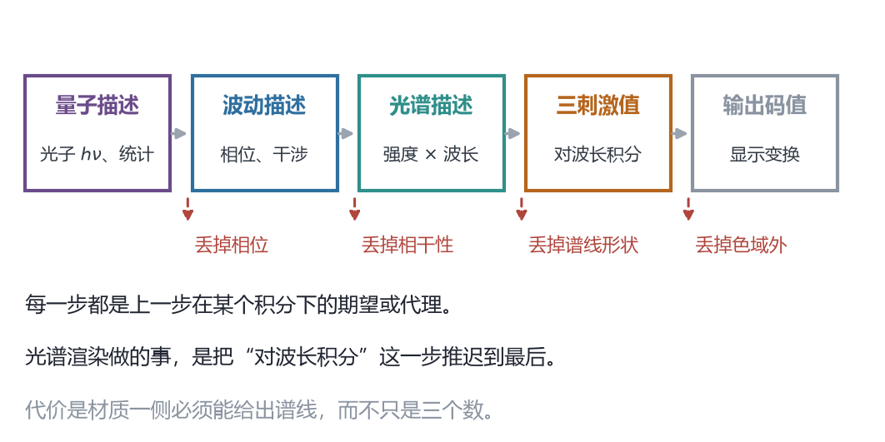
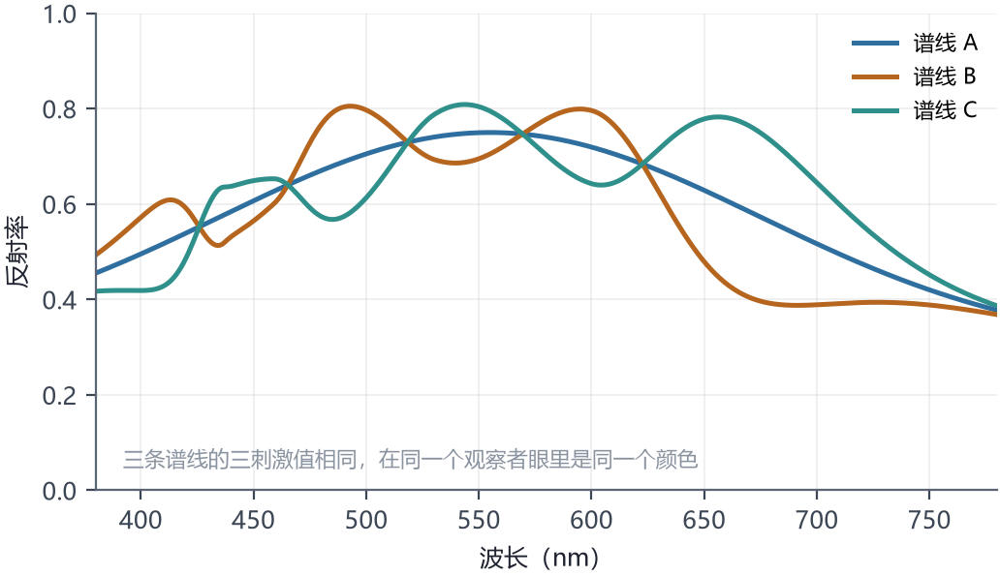
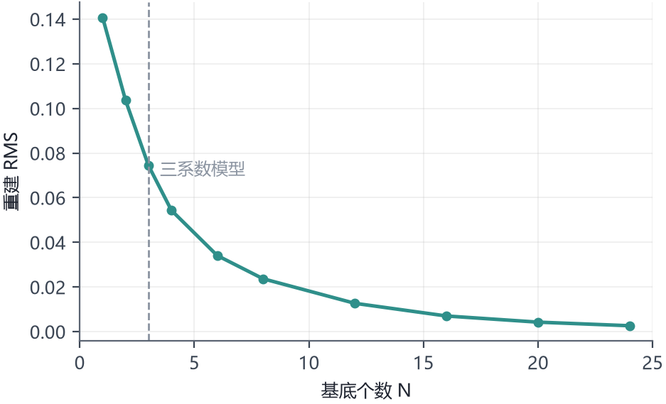
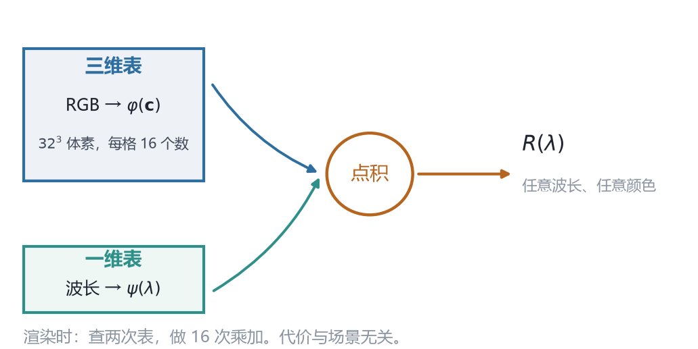

# 第 19 章 神经基底：把 RGB 映射成一条谱线

## 19.1 从三通道到无穷通道的梯子

先把"为什么会有这个问题"摆清楚。渲染器里每一层描述光的方式，都是上一层的一种收缩。

最底下一层是量子描述：光子有能量 $h\nu$，落在某个波长上。往上一层是波动描述：把相位与相干性平均掉，得到复振幅，再取模平方得到强度。再往上，强度按波长排开，就是光谱。光谱再对波长积分，加权以观察者响应，得到三刺激值。三刺激值再经过显示器的变换，变成三个通道的码值。

每一层都是上一层在某个积分下的期望或者代理，这个"收缩"关系不是哪本书的约定，而是物理上真实发生的：探测器、人眼、相机传感器，做的都是加权积分。同一层内部还会有更细的代理，比如用 split-sum 把环境光的高光积分拆成两张预积分表，那是几何光学内部的近似，不是跨层的收缩。

RGB 渲染之所以够用，是因为大多数场景里这条梯子可以一路走到底而不出问题。但一旦中间某一环被换掉，比如光源是两条窄谱线，或者材质有荧光，收缩就不可逆了。光谱渲染做的就是少收缩一次：把"对波长积分"这一步推迟到最后。

推迟之后，材质一侧就要提供比三个数更多的信息。这是这一章要解决的问题：美术只给三个数，怎么补出那条谱线。

## 19.2 一个 RGB 值背后是一族谱线

约束写在积分里。给定一条反射率谱 $R(\lambda)$，它对应的三刺激值是

$$X=\int_\Lambda R(\lambda)\,\bar{x}(\lambda)\,d\lambda,\qquad
Y=\int_\Lambda R(\lambda)\,\bar{y}(\lambda)\,d\lambda,\qquad
Z=\int_\Lambda R(\lambda)\,\bar{z}(\lambda)\,d\lambda . \tag{19.1}$$

三个方程，未知量是一个连续函数。解的集合是一个无穷维仿射空间：任取一条满足约束的谱线，加上任意一条满足

$$\int_\Lambda \Delta(\lambda)\,\bar{x}(\lambda)\,d\lambda=\int_\Lambda \Delta(\lambda)\,\bar{y}(\lambda)\,d\lambda=\int_\Lambda \Delta(\lambda)\,\bar{z}(\lambda)\,d\lambda=0 \tag{19.2}$$

的扰动 $\Delta$，得到的三刺激值完全一样。式 (19.2) 的解空间叫同色异谱黑，它的维数等于无穷减去三。

把这件事摊开来看，RGB 管线里的三样东西，在光谱里各有一个连续版本：

| RGB 管线 | 光谱管线 |
| --- | --- |
| 反照率贴图，三个通道 | 表面反射率的谱分布 $R(\lambda)$ |
| 光源颜色，三个通道 | 光源的光谱功率分布 $L_e(\lambda)$ |
| 输出码值，三个通道 | 观察者响应 $\bar{x},\bar{y},\bar{z}$ 的投影 |

三行对应得很整齐：反射率乘光源谱，再被观察者响应积分，就是屏幕上的颜色。RGB 管线把每一步都压成三个数，光谱管线只压最后一步。

这就是升维问题的本质。它不是一个欠定方程组的数值问题，而是"欠定"这件事本身没有唯一答案，必须引入额外信息。第 12 章的三条路线引入的是解析约束：光滑性、非负性、与某个基底的接近程度。这一章引入的是数据：在真实材料的分布上，哪条谱线更常见。

## 19.3 线性基底为什么不够

最直接的做法是把谱线写成一族基底的线性组合：

$$R(\lambda)=\sum_{k=1}^{N}c_k\,\psi_k(\lambda) , \tag{19.3}$$

系数由三刺激值确定，$N=3$ 时恰好可解，$N>3$ 时再补 $N-3$ 个约束。第 12 章讲的 Jakob–Hanika 与 Mallett–Yuksel 都属于这一类，区别只在基底怎么选、约束怎么加。

这条路线的天花板由基底决定。拿一族真实材料的谱线做实验：把它们投影到前 $N$ 个主成分上，看重建误差随 $N$ 怎么下降。

曲线说明两件事。三个基底只能描述"大致颜色"，谱线的粗细起伏全丢：误差 0.074，肉眼能看出重建曲线比真实曲线平。要到十六个左右，误差才降到 0.007。而三个基底恰好对应三刺激值的三个约束，所以任何"三系数 + 解析约束"的模型，天花板都在图上那条 $N=3$ 的竖线附近。

要提高精度，就得让基底的个数上去。但基底一多，三刺激值就不足以定系数了，必须再找一个从 RGB 到系数的映射。这个映射可以是一个查表，也可以是一个网络。这就是"神经基底"要干的事。

## 19.4 张量积形式

把未知函数写成两个变量的函数：

$$f(\mathbf{c},\lambda)=R(\lambda),\qquad \mathbf{c}=(R,G,B) . \tag{19.4}$$

如果直接拿一个网络吃四维输入 $(\mathbf{c},\lambda)$ 输出一个数，每次查询都要跑一遍网络。渲染器里每一条光线、每一个交点都要查一次，这个代价不能接受。

换一个结构。假设这个函数可以写成两个特征映射的内积：

$$f(\mathbf{c},\lambda)=\boldsymbol{\varphi}(\mathbf{c})\cdot\boldsymbol{\psi}(\lambda)
=\sum_{k=1}^{N}\varphi_k(\mathbf{c})\,\psi_k(\lambda) , \tag{19.5}$$

其中 $\boldsymbol{\varphi}:\mathbb{R}^3\to\mathbb{R}^N$ 只吃颜色，$\boldsymbol{\psi}:\mathbb{R}\to\mathbb{R}^N$ 只吃波长。

这个形式的好处立刻显现。$\boldsymbol{\varphi}$ 的自变量只有三个数，可以预先算成一张三维查找表；$\boldsymbol{\psi}$ 的自变量只有一个数，可以算成一张一维查找表。渲染时查两次表，做 $N$ 次乘加，就得到任意波长上的反射率。

$$f(\mathbf{c},\lambda)=\underbrace{\text{LUT}_{3D}[\mathbf{c}]}_{\text{查一次，得 }N\text{ 个数}}\cdot\underbrace{\text{LUT}_{1D}[\lambda]}_{\text{查一次，得 }N\text{ 个数}} . \tag{19.6}$$

代价与 $N$ 线性相关，与场景复杂度无关。$N=16$ 时是 16 次乘加，比一次纹理采样还便宜。

这个形式还有一个解释：把 $\boldsymbol{\psi}$ 的 $N$ 个分量看成 $N$ 条基函数，把 $\boldsymbol{\varphi}$ 的 $N$ 个分量看成系数，式 (19.5) 就是式 (19.3)，只不过系数不再是解方程解出来的，而是由颜色查出来的。

## 19.5 线性模型是它的特例

对照第 12 章的 Mallett–Yuksel 模型：它把谱线写成三个原色的线性组合，

$$R(\lambda)=R\,s_r(\lambda)+G\,s_g(\lambda)+B\,s_b(\lambda) , \tag{19.7}$$

其中 $s_r,s_g,s_b$ 是三条固定的原色谱线。

把 (19.7) 套进 (19.5)：取 $N=3$，$\boldsymbol{\varphi}(\mathbf{c})=\mathbf{c}$，$\boldsymbol{\psi}(\lambda)=(s_r,s_g,s_b)$，两者恰好相等。所以 Mallett–Yuksel 是张量积形式在 $N=3$、两个映射都取恒等时的特例。

这个观察有用。它说明神经基底不是另起一套体系，而是在同一个框架里把两个映射放开：$\boldsymbol{\varphi}$ 从恒等变成一个学出来的非线性映射，$N$ 从 3 增加到十几二十。第 12 章那三条路线都可以看成这个框架里的特定选择。

它也说明了一件事：$N$ 增大带来的表达能力，必须由数据来兑现。如果训练数据只有几十条谱线，$N$ 加到 64 也只是把噪声拟合得更细。

## 19.6 网络结构上的三个决定

形式定下来之后，剩下的是让两个映射可训练。有三个细节在实现里必须处理，否则训练不收敛或者结果不可用。

**输出要有值域。** 反射率必须落在 $[0,1]$（更严格地说是 $[0,1]$ 内的非负函数）。让网络自由输出，会得到负值或者超过 1 的值，渲染时要么裁掉（丢能量），要么放大（造能量）。做法是在最后一层加一个 sigmoid，把输出压进 $(0,1)$。

**亮度要有先验。** 训练数据里，深色的样本少，浅色的样本多，网络会倾向把浅色学好。一个便宜的先验是：能量加倍，谱线整体加倍。所以把颜色归一化后再送进网络，输出时再乘回去：

$$\boldsymbol{\varphi}(\mathbf{c})=\Big(\max_{i}c_i\Big)\cdot\boldsymbol{\varphi}_{\text{net}}\!\left(\frac{\mathbf{c}}{\max_i c_i}\right) . \tag{19.8}$$

这样网络只需要学"色相"这一部分，亮度由外面的乘法负责。它同时保证了一件物理上必须成立的事：输入全零，输出全零。

**波长要有高频能力。** 谱线不是光滑的低频函数，真实材料有一堆窄吸收带。全连接网络对高频信号很钝，标准做法是把标量波长展开成一组高频函数再送进去：

$$\boldsymbol{\psi}(\lambda)=\text{MLP}\Big(\big[\sin(2^0\pi t),\cos(2^0\pi t),\sin(2^1\pi t),\cos(2^1\pi t),\dots\big]\Big) , \tag{19.9}$$

其中 $t$ 是把波长归一化到 $[0,1]$ 后的值。这就是位置编码，作用是把一维输入映射到高维，让网络容易拟合快速振荡的曲线。不加编码时，一个两层网络只能拟合很平缓的曲线，窄吸收带完全跟不上；加上之后，同样的网络能把几十纳米宽的谷底描出来。代价是输入维度变高，第一层的计算量和参数都跟着涨。

三个决定都不改变式 (19.5) 的结构，只影响两个映射能不能被训练出来。

## 19.7 参数量与精度

$N$ 是唯一需要权衡的超参数。它同时决定了三件事：表达能力、查表的内存、每次查询的乘加次数。

$N$ 太小，表达能力不够，和第 12 章的三系数模型差不多：在下一章的同一组测试里，三系数解析模型的误差是 0.308，十二个基底加学习映射是 0.157；$N$ 太大，训练数据不够，泛化变差，而且一维表在波长方向的分辨率要求也跟着上去。

一个实用的起点是 $N=16$。一维表在 380 到 780 nm 上取 128 个点，就是 $128\times16$ 个浮点数，$8$ KB；三维表取 $32^3$ 个体素，每个体素 16 个系数，在 16 位精度下是 1 MB。两张表加起来不到 2 MB，可以整块放进显存。

精度方面要提醒一句：这里说的"准"是指"在该数据集的分布上准"，不是"物理上真"。同一条 RGB 对应的真实谱线有无穷多条，网络给出的是其中一条，它的合理性完全取决于训练数据覆盖了哪些材料。

---

这一章给出了形式：一个张量积，两张查找表，三个实现上的决定。

形式本身不难，难的是把两个映射训练出来。下一章讲数据从哪来、损失怎么定义，以及训练完之后怎么知道它学到了什么。
