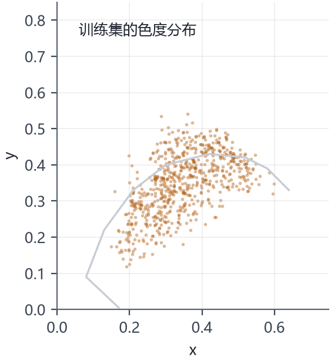
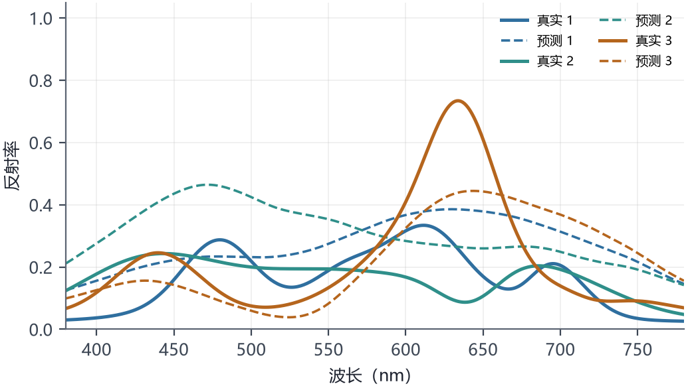
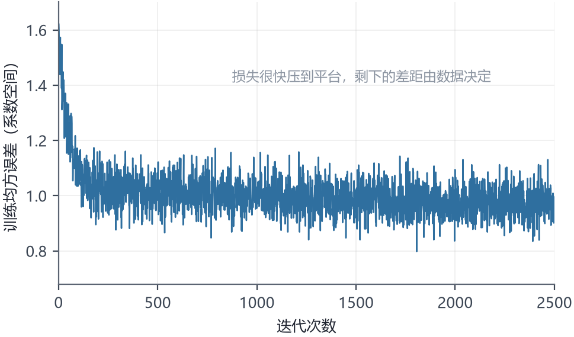
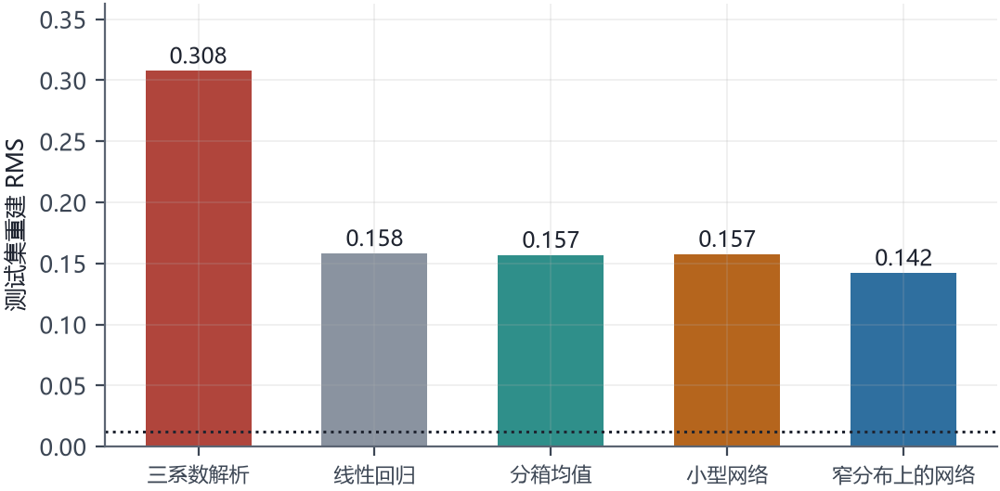
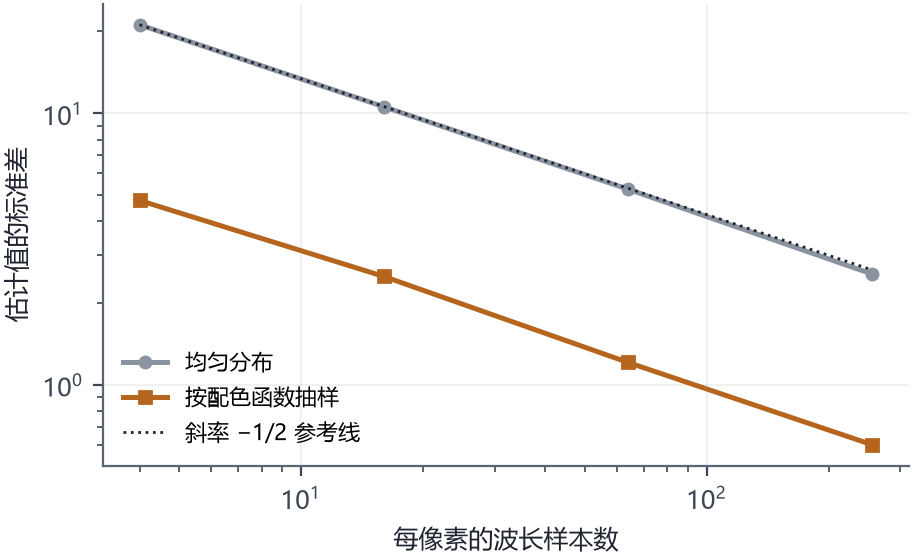

# 第 20 章 训练、验证与接进渲染器

## 20.1 数据只有二十几条

上一章把形式定下来了：两个特征映射，两张查找表。剩下的问题是这两个映射从哪里来。

理想情况下，训练数据应该是一大批"颜色加谱线"的配对：某种材料的反射率谱，以及它在某个色彩空间里的三个数。现实里这样的配对很少。公开的材料光谱库里，一块标准色卡只有二十四条谱线；再全一点的数据库有几百条，但覆盖的材料类型仍然有限，而且大多数是涂料与塑料，布料、皮肤、金属氧化物都很少。

二十几条谱线训练不出一个泛化良好的映射。所以第一件事是造数据。

思路是把已有的谱线当作基向量，用两种运算生成新的配对。

**线性混合。** 取两条已知的（颜色，谱线）配对，按比例插值：

$$f\big((\mathbf{x}_1,s_1),(\mathbf{x}_2,s_2),t\big)=\big((1-t)\mathbf{x}_1+t\mathbf{x}_2,\;(1-t)s_1+t s_2\big) . \tag{20.1}$$

这对应两种颜料按比例调和，也对应两块材料在贴图上做双线性插值。

**乘性混合。** 颜色逐通道相乘，谱线逐波长相乘：

$$g\big((\mathbf{x}_1,s_1),(\mathbf{x}_2,s_2)\big)=\big(\mathbf{x}_1\odot\mathbf{x}_2,\;s_1\odot s_2\big) . \tag{20.2}$$

这对应"光穿过两层滤光片"，也对应两次反弹时的能量相乘。它生成的颜色往往比线性混合更饱和，正好补上线性混合覆盖不到的区域。

随机抽两条色卡、随机决定用哪种算子、随机取混合系数，就能从二十四条谱线生成几万条训练样本。生成的样本不是真实材料，但它们遵守同一套物理约束：非负、有界、三刺激值与谱线一致。



## 20.2 损失里的波长不能均匀抽

训练目标是让网络在某条谱线上接近真实值。最直接的做法是逐波长算平方误差再平均：

$$L=\frac{1}{|\Lambda|}\int_\Lambda\big(f(\mathbf{x},\lambda)-s(\lambda)\big)^2\,d\lambda . \tag{20.3}$$

这个式子在数值上要离散化，也就是抽一批波长来算。均匀抽样和按某个分布抽样，结果不一样。

原因是渲染对人眼的敏感度不均匀。550 nm 附近的一点误差，投影到 $Y$ 通道上就是可见的；700 nm 以外同样的误差，投影上去几乎为零。均匀抽样把容量平均分给所有波长，等于把一半的模型容量花在看不见的地方。

所以按亮度函数抽样：

$$q(\lambda)=\frac{\bar{y}(\lambda)}{\int_\Lambda \bar{y}(\lambda')\,d\lambda'} , \tag{20.4}$$

损失变成加权形式

$$L\approx\frac{1}{N}\sum_{i=1}^{N}\frac{\big(f(\mathbf{x},\lambda_i)-s(\lambda_i)\big)^2}{q(\lambda_i)}\cdot\frac{1}{|\Lambda|} , \tag{20.5}$$

其中 $\lambda_i\sim q$。如果直接把 $q$ 当权重乘上去，等价于回到均匀抽样；真正想要的是"按 $q$ 抽样但少乘一点补偿"，让视觉敏感的波段拿到更多样本，同时不完全放弃其他波段。实践中常用的是折中：按 $q$ 抽样，权重取 $q$ 的平方根，或者干脆不做补偿。

抽样分布只影响训练的加权，不改变网络的形式。它和渲染时的波长采样是同一个分布，20.5 节会直接拿它当 pdf 用。

## 20.3 网络学到的是条件期望

这一节要讲一件容易被误解的事。

同一个 RGB 对应无穷多条谱线。网络看到 $\mathbf{x}$，不可能知道真实的那一条是哪一个，它只能给出"在这个颜色下，谱线的平均样子"。用平方误差训练时，这个"平均"有精确定义：

$$f^\star(\mathbf{x},\lambda)=\mathbb{E}\big[s(\lambda)\,\big|\,\mathbf{x}\big] . \tag{20.6}$$

也就是说，最优解是条件期望，不是任何一条真实谱线。

这个结论解释了几个现象。

预测出来的曲线比真实曲线平。真实材料有窄吸收带，误差在这些带子上最大；平方误差的最优解会把这些细节抹平，因为不同的材料在同样的 RGB 下带子位置不同，平均之后互相抵消。

换损失函数会换答案。用绝对误差，最优解是条件中位数；用对抗损失或者感知损失，网络会"挑"一条看起来真实的谱线，而不是平均。三种选择没有对错，只有用途不同：要颜色准确用平方误差，要纹理细节用对抗损失。

加输入才能减误差。误差的来源是"信息不够"，不是"模型不够大"。同一章后面的实验会看到：把模型从线性回归换成两层网络，误差几乎不变；而把训练数据换成更窄的分布，误差明显下降。这说明瓶颈在输入的信息量。



## 20.4 一个能跑的小实验

形式和数据都讲完了，下面把它跑一遍。这个实验不是为了复现某个具体方法的结果，而是为了看清误差从哪里来。

设置如下。合成两族谱线：宽分布（两到四个宽高斯叠加，再乘一到三个窄吸收带，饱和度 0.15 到 1.0）与窄分布（两个宽高斯，饱和度 0.45 到 1.0）。宽分布六千条训练、一千二百条测试，窄分布四千条训练、八百条测试。

模型用主成分做基底，$N=12$；映射用两层 64 个单元的全连接网络，tanh 激活，平方误差，小批量随机梯度，2500 步。作为对照，再算三个基线：三系数解析模型（用前三个基底，按三刺激值解系数）、线性回归（RGB 直接回归到十二个系数）、分箱条件均值（把 RGB 空间切成 $8^3$ 个格子，每格存系数平均值）。



结果如下。

| 方法 | 测试集重建 RMS |
| --- | --- |
| 三系数解析 | 0.308 |
| 线性回归（12 基底） | 0.158 |
| 分箱条件均值 | 0.157 |
| 两层网络（12 基底） | 0.157 |
| 两层网络（窄分布数据） | 0.142 |
| 十二基底用真值重建（参照） | 0.013 |

三个数字值得解释。

第一，从三系数换到十二基底加学习映射，误差从 0.308 降到 0.157，差不多减半。这是"基底数量"带来的收益，和第 19 章那条主成分曲线对得上。

第二，线性回归、分箱、网络三者几乎打平。这不是网络没训好，而是它们都收敛到了同一个条件期望。输入只有三个数，能提供的信息就那么多，再复杂的模型也只能逼近这个上限。

第三，窄分布数据上误差降到 0.142。分布越窄，同色异谱越少，同样的输入能确定更多信息。这印证了 20.3 节的结论：误差的主项是信息不足。



这个实验有一个明确的局限：合成谱线的同色异谱比真实材料严重得多。真实的涂料、塑料、布料，谱线形状受颜料化学的限制，同一个 RGB 下的变化远小于随机生成的高斯叠加。所以在真实数据上，同样结构的网络通常能比线性方法明显更好。要验证这一点，需要真实的色卡光谱数据，本书没有附。

## 20.5 波长的采样分布

渲染端还有一个分布要定：每条路径上的波长从哪里抽。

第 11 章用的是均匀分布，也就是在可见光范围内等概率取波长。这在结构上最省事，但它不是方差最小的选择。

把像素的积分写出来：

$$I_c=\int_\Lambda S_c(\lambda)\,L(\lambda)\,d\lambda , \tag{20.7}$$

其中 $S_c$ 是通道 $c$ 的配色函数，$L$ 是到达像素的辐亮度。按任意分布 $q(\lambda)$ 抽 $N$ 个波长，估计量是

$$\hat I_c=\frac{1}{N}\sum_{i=1}^{N}\frac{S_c(\lambda_i)\,L(\lambda_i)}{q(\lambda_i)} , \tag{20.8}$$

方差是

$$\operatorname{Var}(\hat I_c)=\frac{1}{N}\left[\int_\Lambda\frac{\big(S_c(\lambda)L(\lambda)\big)^2}{q(\lambda)}\,d\lambda-I_c^2\right] . \tag{20.9}$$

方括号里第一项是我们要压的。用柯西–施瓦茨不等式可以看出来，当

$$q(\lambda)\propto\big|S_c(\lambda)\,L(\lambda)\big| \tag{20.10}$$

时这一项取到最小值，此时方差趋近于零——因为积分变成了确定性的。

问题在于 $L(\lambda)$ 事先不知道，它正是要求的东西。所以最优分布不可得，只能找一个可靠的近似。$S_c$ 是已知的，$L$ 在大多数场景里随波长变化缓慢（除了色散与荧光），于是退而求其次：

$$q(\lambda)\propto S_c(\lambda) . \tag{20.11}$$

也就是按配色函数抽样。它的含义很直接：人眼看不见的波长少抽，看得见的波长多抽。这个分布比均匀分布好得不止一点：在同一组测试里，每像素四个波长时标准差从 21.2 降到 4.8，大约四倍。



实现上有两种做法。一种是把配色函数归一化成累积分布，用逆变换采样；另一种是直接用解析拟合的逆累积分布。第二种更快，因为配色函数可以用几条高斯与对数正态曲线拼出来。下面这组系数比第 7 章那组多瓣拟合粗糙一些，误差在百分之一量级，但每条曲线都是单个高斯或对数正态，累积分布有闭式解，采样最省事：

$$\bar{x}(\lambda)\approx 1.065\,e^{-\frac12\left(\frac{\lambda-595.8}{33.33}\right)^2}+0.366\,e^{-\frac12\left(\frac{\lambda-446.8}{19.44}\right)^2} , \tag{20.12}$$

$$\bar{y}(\lambda)\approx 1.014\,e^{-\frac12\left(\frac{\ln\lambda-\ln 556.3}{0.075}\right)^2} , \tag{20.13}$$

$$\bar{z}(\lambda)\approx 1.839\,e^{-\frac12\left(\frac{\ln\lambda-\ln 449.8}{0.051}\right)^2} . \tag{20.14}$$

每条曲线都是截断的高斯或者对数正态，累积分布有闭式解，逆变换可以直接算。三个通道各自按自己的曲线抽，渲染时按当前像素属于哪个通道（或者三个都算）挑一个。

要注意三件事。截断会让归一化常数变掉，积分要重新算，否则 pdf 不等于 1。按 $S_c$ 抽样时，$x$ 与 $z$ 两条曲线在长波与短波端都很小，抽到极端波长的概率接近零，色散场景里可能漏掉需要的光谱细节。还有一点，$L$ 变化剧烈时（荧光、窄带光源），按 $S_c$ 抽样的优势消失，甚至变差，这时候要么换回均匀分布，要么把已知的光源谱也算进 $q$。

## 20.6 接进渲染器

训练完的两个映射要变成两张表。

三维表把颜色映射到 $N$ 个系数。输入是归一化后的 RGB，输出 $N$ 个数。表的边长取 32 就够：颜色空间的非线性不强，$32^3$ 加上三线性插值，误差已经在千分级。

一维表把波长映射到 $N$ 个数。波长范围 380 到 780 nm，取 128 个采样点，中间线性插值。$N=16$ 时这张表只有 2048 个数。

两张表加起来不到 2 MB。渲染时的查询是

```python
def spectral_albedo(rgb, lam_index, lut3d, lut1d):
    phi = sample_lut3d(lut3d, rgb)      # N 个数
    psi = sample_lut1d(lut1d, lam_index)  # N 个数
    return np.dot(phi, psi)
```

一次三线性插值加一次线性插值，加 $N$ 次乘加。和一次纹理采样同量级。

要注意的是精度与存储的取舍。三维表用 8 位存会让暗部的颜色失真明显，因为暗部的系数本身很小，量化误差占比大；用 16 位浮点比较稳。三维表如果放不进显存，可以退化成二维图集或者稀疏体素，代价是插值变复杂。

另一个代价在方差上。波长维度的引入让每条路径多了一个随机量，同样的样本数下噪声变大。第 9 章讨论过每路径带几个波长，第 11 章的 hero wavelength 用来压制相关性。波长本身的抽样分布见上一节，它决定的是另一件事：同样多的样本，方差有多大。神经网络只改变"反射率怎么查"，不改变这些采样结构。

## 20.7 验证与局限

验证分三层。

第一层查映射本身。取一批已知谱线的材料，把它们的 RGB 喂进网络，比较输出的谱线与真实谱线：色差应该小，波形可以不同。如果色差就大，说明网络的输出没有满足三刺激值约束，通常是训练时归一化或者基底变换写错了。

第二层查渲染。用同一组材质参数，分别用 RGB 管线与光谱管线渲染，比较无降噪的结果：色差应该在阈值内，色散、荧光这类效果只出现在光谱一侧。这一层的目的是确认波长真的参与了运算，而不是被悄悄压回三个通道。

第三层查端到端。与参考实现对比，看差异是集中在某些材质上还是均匀分布。集中在饱和色上，说明数据覆盖不够；集中在暗部，说明量化精度不够；集中在高光上，说明能量归一化有问题。

局限也要说清楚。

数据覆盖决定上限。图 20-1 里训练集的色度分布是人为造的，真实材料库的分布更偏，饱和色更少。网络在没见过的颜色上会外推，外推的结果通常偏灰。

同色异谱没有"正确的答案"。给定一个 RGB，真实谱线可能是很多条中的任意一条，评价标准只能是"在给定用途下是否合理"，不可能是"是否等于真值"。

性能是有代价的。存储多 2 MB，每次查询多十几次乘加，波长维度的方差需要更多样本。这些代价在离线渲染里可以忽略，在移动端要仔细算账。

---

这一章把神经基底从形式变成了可以跑的东西：怎么造数据、损失怎么定义、模型学到的是什么、接进渲染器要付多少代价。

有一件事值得记住：这条路线并没有消除同色异谱，只是把它从"数学上无解"变成"在数据分布下有偏好"。换一批训练数据，同一个 RGB 会得到另一条谱线。理解这一点，比记住任何一个网络结构都重要。
