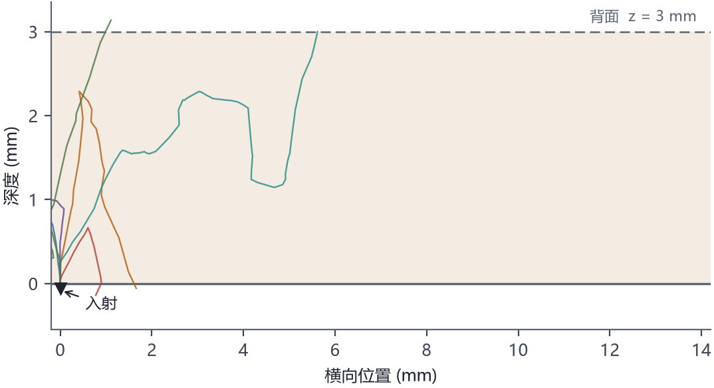
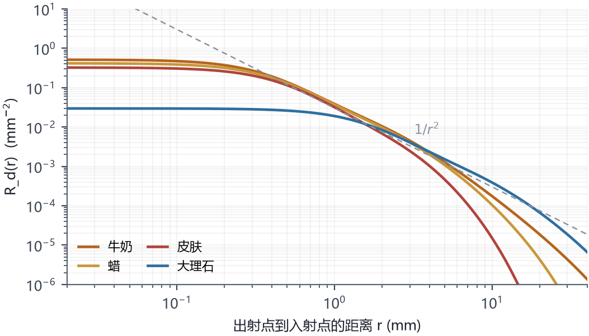

# 第 1 章 为什么 BRDF 不够用

## 1.1 一块蜡

桌上一块白蜡，台灯在它左上方。看正面，是一块不亮不暗的灰白。看左侧迎着灯的那一面，白得发亮，边缘有一圈柔和的过渡。把蜡块拿起来对着窗，逆着光看，整块蜡变成半透明的橙黄，边缘最厚的地方颜色最深，薄的棱角处几乎是透明的亮。

同一个物体，从三个角度看到三种完全不同的东西，而它的表面没有变化，材质也没有变化。变化的是光在它内部走过的路程。

再看数字。蜡的折射率约 1.44，一部分光在表面就被反射回去了，这部分是镜面反射，和塑料、玻璃没有区别。剩下八成多的光进了介质。进入之后，光遇到的是微晶蜡的颗粒，颗粒的尺度在几微米，与可见光波长同一量级或更大。每次遇到颗粒，光的方向被改变一次，改变的角度分布很宽。同时，蜡本身对蓝光吸收得比红光多一点，这在薄的地方看不出来，光走的路程一长，颜色就显出来。

台灯照在蜡上，出射的光斑并不局限在入射点。用手指遮住一半入射光，出射的那一团亮并没有被切成两半，它会从遮住的地方渗过来一点，渗出多远取决于材料。这个"渗"的距离，蜡大概是两三毫米。

## 1.2 渲染方程假定了一件事

渲染方程写成

$$L_o(x,\omega_o)=\int_{\Omega} f_r(x,\omega_i,\omega_o)\,L_i(x,\omega_i)\,\cos\theta_i\,d\omega_i . \tag{1.1}$$

这个式子有一个不显眼但很硬的前提：入射点与出射点是同一个点 $x$。所有的入射光都从这一点进，所有的出射光都从这一点出，中间的交换没有空间跨度。

对于金属、塑料、石头、涂了漆的木地板，这个前提成立得非常好。它们的反射发生在表面的一层原子或者一层薄膜里，厚度是纳米量级，相对于任何可见的几何尺度都可以当成零。所以把点当成一个点，误差可以忽略。

对于蜡、皮肤、牛奶、玉石、纸、树叶、大理石、牙齿、奶酪，这个前提不成立。光进入介质，走了几毫米，再从别处出来。入射点和出射点之间隔了一段距离，而这段距离恰好和物体本身的细节尺度同量级。一只手指的宽度是一厘米，光在皮肤里走两三毫米，这个比例足以让边缘发红、让背光透亮。

把这段距离当成零，会得到什么？会得到一块塑料。塑料的表面反射是对的，颜色也能调，但所有依赖"光在内部走一段"的现象全部消失：没有背光透亮，没有边缘发光，没有薄处比厚处亮。调参调不出来，因为参数控制的是一维的反射率，而缺失的是二维的空间分布。

图 1-1 是在介质里追踪出来的几条真实路径。每一条都从表面同一点进入，在内部拐了很多弯，最后从另一个位置出来，其中最长的横向位移接近 6 mm，是板厚的两倍。路径的形状没有规律，但统计上有规律：横向位移的典型尺度由两个系数的比值决定。这个尺度，就是 BRDF 缺失的那个参数。

## 1.3 三个必须解释的量

把需要解释的现象列一下，会发现它们各自对应一个可以测量的量。

**出射点偏离入射点多远。** 给定一束很细的光打进去，出射的能量在表面上摊开成一个光斑。光斑的宽度是材料属性，蜡是几毫米，牛奶是一毫米左右，皮肤是两三毫米，大理石可以到几厘米。这个宽度分布就是 BSSRDF 的径向剖面 $R_d(r)$，单位是每平方毫米，因为它是一张概率密度。

**颜色从哪里来。** 表面反射的颜色来自界面的选择性反射，灰色金属是灰的，金色金属是金的，这个颜色和视角有关。次表面散射的颜色来自吸收：光走了一段路，某些波长被吃掉了。因为红光在皮肤里吸收最少，走得最远，所以皮肤薄的地方透出来是红的。同一个材料，厚的地方偏暗偏深，薄的地方偏亮偏红，颜色随厚度变化，这个性质 BRDF 完全表达不了。

**透过去多少。** 一片 0.1 mm 的白纸，正面看是白的，背面打光看是亮的。一块 5 mm 的白玉，正面看是白的，背面打光只透出一点点暗红。透过率随厚度的变化，由介质里的两个系数和厚度共同决定。BRDF 里没有厚度这个变量。

图 1-2 把四种材料的剖面画在一起。四条曲线的形状出奇地像：近处是一个平台，中段贴着斜率 $-2$ 的直线，远处被指数因子一刀切断。真正的区别是横轴上的位置，牛奶的截断在 2 mm，皮肤在 1 mm 出头，大理石要到 20 mm 以后。这个位置就是材料的“扩散尺度”，它把不同材质的差异压缩成了一个长度。

## 1.4 多出来的那一个维度

从公式上看，BRDF 是一个定义在"两个方向"上的函数 $f_r(\omega_i,\omega_o)$，取值单位是 $\mathrm{sr^{-1}}$。BSSRDF 是一个定义在"两个点加两个方向"上的函数

$$S(x_i,\omega_i;x_o,\omega_o) , \tag{1.2}$$

它的量纲是 $\mathrm{m^{-2}\,sr^{-1}}$。多出来的 $\mathrm{m^{-2}}$ 不是笔误，它正是"入射点与出射点分开"这件事在量纲上的痕迹：函数要对出射点的面积积分才能给出辐亮度，所以它必须是每单位面积。

量纲这一条在后面会反复用到。当你在代码里看到一个 BSSRDF 的返回值，检查它的单位，如果少了 $\mathrm{m^{-2}}$，多半是在某处把面积分偷偷丢掉了；如果多了，多半是重复积了一次。第 3 章会把这件事说清楚。

代价也很直接。BRDF 的采样是二维的，BSSRDF 的采样是四维的，多出来的两维是出射点的位置。四维积分意味着，即使用重要性采样，也要比 BRDF 多花一到两个数量级的样本才能压到同样的噪声。这件事贯穿全书：为什么要有那么多近似模型，说到底都是为了把这四维积分降到可以承受的代价。

## 1.5 模糊不是答案

一个容易想到的偷懒办法是：把 BRDF 的结果做一遍模糊，当作次表面散射。很多屏幕空间方案确实这么干，效果也不算难看。但它和真正的 BSSRDF 之间有三道过不去的坎。

模糊不改变总能量。把一张图模糊一遍，亮度的总和不变。真实的次表面散射不是这样：光进入介质后，一部分被吸收，吸收多少取决于走的路程；厚的地方吸收得多，薄的地方吸收得少。模糊出来的结果，厚薄区域的亮度差永远只有表面着色留下的那一点点。

模糊不知道厚度。同一张皮肤贴图，在不同的模型上应该给出不同的透光量，因为几何厚度不同了。屏幕空间的模糊只能看到屏幕上的颜色，看不到深度，也看不到背面。结果是耳朵、鼻翼、指缝这些薄的地方全都透不出光，而这恰好是皮肤最容易被认出来的特征。

模糊不知道方向。真实的次表面散射在掠射角时会把能量往表面附近推，因为光斜着进去，很快又出来。模糊是一个各向同性的卷积，它没有这个方向依赖，边缘的衰减曲线对不上。

这三道坎各有对应的补丁，第五篇会逐一讲。但它们补的都是外观，不是物理。想把物理做对，只能把那个带长度的核加进渲染方程里。

## 1.6 什么时候可以退回 BRDF

不是所有材料都需要 BSSRDF。判断标准不是材料"看起来"是否半透明，而是光在内部走的距离相对于观察尺度是否可忽略。

一根头发的直径是 70 微米，光在角质层里走十几微米就出来了，相对于一根头发的粗细，这个距离不算小，所以头发需要专门的散射模型：圆柱几何、三条内部路径，本书不展开。但相对于整个头部，一根头发可以当成一根细圆柱，问题降成一维。

一颗鹅卵石，如果表面粗糙、颜色均匀、不透明，BRDF 够用。同一颗石头如果换成一块同色的玉髓，光能透进去一厘米，BRDF 就不够。

一条毛巾，纤维内部有散射，但纤维直径很细，光在纤维内部走的路程远小于一根纤维的粗细，所以整条毛巾的外观主要由纤维表面的反射和纤维之间的遮蔽决定，可以用织物的模型：纤维级散射加纱线级的遮蔽，本书不展开。同一块材料压成一片 2 mm 厚的实心片，就得用 BSSRDF。

判断的粗略标准是：如果介质的特征衰减长度（第 4 章定义，约等于 $\sqrt{D/\sigma_a}$）小于物体的最小特征尺寸的十分之一，BRDF 通常够用；如果两者同量级，就必须处理内部传输。

---

这一章摆出了 BRDF 撑不住的具体场面，也指出了缺的那个东西是什么：一个带长度的核。要把它写进公式，先得把"多少光"这个说法变成可以运算的量，这是下一章的事。
