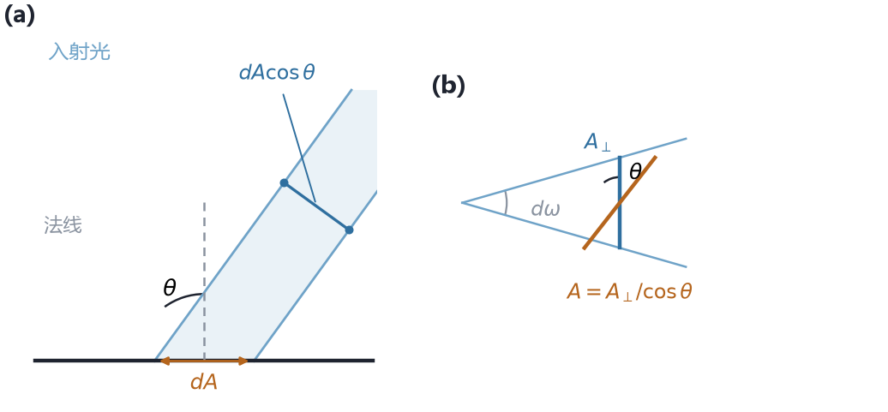
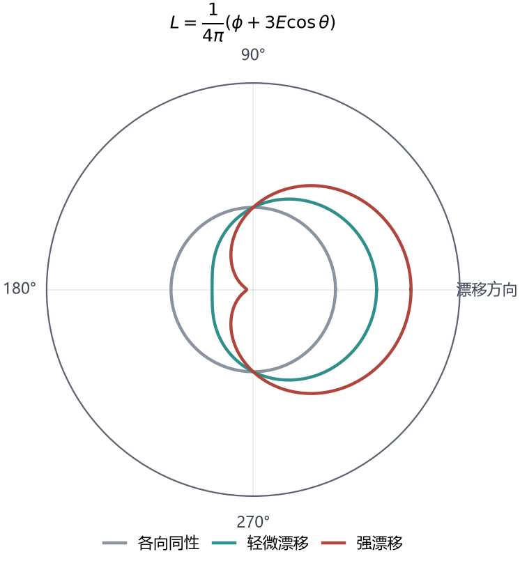

# 第 2 章 辐射度量学：把"多少光"说清楚

## 2.1 一句话里藏着四个量

两个渲染工程师讨论一张图，会说"这块太亮了"。物理学家不会这么说，因为有四种不同的东西都可以叫"亮"：光源发出了多少功率，这些功率落在多大面积上，落到某个方向上还剩多少，眼睛在这个方向上接收到多少。四个量的单位互不相同，数值可以差好几个数量级，混用一次就会得到一个荒谬的结果。

这种混用在次表面散射里特别容易发生，因为问题本身就横跨两种情形。同一个材料，从外面看是一个表面，要谈"这个方向上有多少光射出来"；从里面看是一个体积，要谈"这一点附近有多少光在四处乱窜"。前者用辐亮度，后者用光通量密度，两者差一个 $4\pi$ 的因子。把这个因子丢在推导中间，最后得到的 $R_d(r)$ 会整体差四倍，而曲线形状完全正常，看上去很像"参数没调好"。

这一章把这几个量钉死，并且给出它们之间所有会用到的换算关系。

## 2.2 从功率到辐亮度

一切从功率开始。辐射通量（radiant flux）$\Phi$ 是单位时间穿过某个面的能量，单位瓦特。它是一个标量，不区分方向，也不区分面积。

要描述一个面被照亮的程度，把通量除以面积，得到辐照度（irradiance）

$$E=\frac{d\Phi}{dA}\qquad[\mathrm{W\,m^{-2}}] . \tag{2.1}$$

辐照度是一个宏观量，它把从各个方向来的光加在一起，丢掉了方向信息。想知道"往哪个方向有多少"，必须在辐照度里再分出方向：考虑入射方向 $\omega$ 附近一个很小的立体角 $d\omega$，它贡献的辐照度记为 $dE$，比值

$$L=\frac{dE}{d\omega\cos\theta}=\frac{d^2\Phi}{dA\cos\theta\,d\omega} \tag{2.2}$$

就是辐亮度（radiance），单位 $\mathrm{W\,m^{-2}\,sr^{-1}}$。分母里的 $\cos\theta$ 是投影因子，$\theta$ 是入射方向与面法线的夹角。

这个因子来自一个几何事实：一束截面为 $dA_\perp$ 的光，斜着打在表面上，覆盖的面积是 $dA_\perp/\cos\theta$。同样的功率铺在更大的面积上，所以单位面积分到的功率要乘 $\cos\theta$。反过来，如果已知单位面积上的辐亮度，要通过一个斜置的窗口，窗口的投影面积就是 $A\cos\theta$。

图 2-1 把这两个投影画在一起。左边是光束与表面的关系，右边是同一个立体角在两个不同朝向的面上的"脚印"。定义里的两个余弦因子都来自这张图。

## 2.3 辐亮度为什么是不变量

辐亮度有一个在渲染里极其重要的性质：在真空中沿一条射线传播时，它不随距离改变。

拿两块面积都是 $A$ 的平行板，相距 $r$，都正对着。左边那块以辐亮度 $L$ 发光，问右边那块接收到多少辐照度。左边那块向右边张开的立体角是 $A/r^2$，所以

$$E=\int L\cos\theta\,d\omega\approx L\cdot\frac{A}{r^2} . \tag{2.3}$$

同时，左边那块发出的总功率是 $\Phi=L\cdot A\cdot(A/r^2)=L A^2/r^2$，落到右边那块面积 $A$ 上，辐照度又是 $\Phi/A=L A/r^2$。两种算法一致。关键的一点是：功率按 $1/r^2$ 衰减，立体角也按 $1/r^2$ 缩小，两个因子在辐亮度这个量里正好抵消。

这个性质是光线追踪能成立的全部理由。相机在远处和近处看到同一个发光面，测到的辐亮度相同，所以一条射线携带的量不随它走过的距离变化，可以一路带到底再乘以像素面积。

进入介质之后，这条性质要修正。在折射率为 $n$ 的介质里，真正不随传播改变的是 $L/n^2$。空气到皮肤的折射率比约 1.4，$n^2\approx1.96$，进入介质后辐亮度下降近一半。这个因子在界面处必须处理，否则能量会在表面无端地增减。本书后面凡是涉及界面，都用透过率 $T$ 统一处理，不单独提 $n^2$，但心里要记着它在那里。

## 2.4 介质里的两个量：光通量密度与通量矢量

在介质内部，光从所有方向来。这时把辐亮度在整个球面上积分，得到光通量密度（fluence rate）

$$\phi(x)=\int_{4\pi}L(x,\omega)\,d\omega\qquad[\mathrm{W\,m^{-2}}] . \tag{2.4}$$

注意积分范围是整个球面 $4\pi$，不是半球。这一点和表面上的辐照度不同。介质内部没有"朝外"这个方向，光可能朝任何方向走。

带方向的积分给出通量矢量（flux vector）

$$\mathbf{E}(x)=\int_{4\pi}L(x,\omega)\,\omega\,d\omega , \tag{2.5}$$

它是一个矢量，单位同样是 $\mathrm{W\,m^{-2}}$，描述光整体往哪个方向流。Fick 定律（第 10 章）就是把它和光通量密度的梯度联系起来的一条经验关系。

两个量之间还有一个恒等关系，在第 9 章的球谐展开里会自然出现：如果辐亮度在球面上是各向同性的，$L=\phi/4\pi$，通量矢量恒为零。如果辐亮度有一个小的方向性漂移，可以写成

$$L(x,\omega)=\frac{1}{4\pi}\phi(x)+\frac{3}{4\pi}\mathbf{E}(x)\cdot\omega . \tag{2.6}$$

这个形式叫 P1 近似。它把任意一个方向分布压缩成两个量：总量和漂移方向。图 2-2 把它的几何形状画了出来。

偏心圆的说法值得解释。把 (2.6) 写成 $L=\frac{1}{4\pi}(\phi+3E\cos\theta)$，在极坐标里画 $r(\theta)=a+b\cos\theta$，这正是圆的极坐标方程（圆心在 $(b/2,0)$，半径 $a$）。所以 P1 近似下的方向分布永远是一个偏心圆，它不可能出现两个峰，也不可能为负——除非漂移大到 $3E>\phi$，那时圆会穿过原点，物理上意味着出现了负辐亮度。第 9 章会说明这个条件什么时候被破坏。

## 2.5 表面上的换算

现在回到表面。介质内部的辐亮度要变成射出来的光，经过两道手续。

第一道是界面。内部辐亮度 $L$ 到达界面时，一部分被全反射回来，一部分透射出去。透射出去的那部分，方向按 Snell 定律偏折，辐亮度按 $n^2$ 缩放。如果界面足够平，这一道手续是精确的。

第二道是半球积分。出射的辐亮度 $L_o$ 在出射半球上积分，得到出射度

$$M(x)=\int_{2\pi}L_o(x,\omega_o)\cos\theta_o\,d\omega_o . \tag{2.7}$$

对于各向同性的出射（Lambertian），$L_o$ 与方向无关，积分给出 $\pi L_o$，不是 $2\pi L_o$。这个 $\pi$ 经常被写成 $2\pi$，因为半球的总立体角是 $2\pi$；错在忘了乘 $\cos\theta$。

把这两道手续串起来，可以得到一个后面反复用到的结论：如果介质内部的场完全各向同性，$L=\phi/4\pi$，并且界面不反射，那么出射度

$$M=\int_{2\pi}\frac{\phi}{4\pi}\cos\theta\,d\omega=\frac{\phi}{4\pi}\cdot\pi=\frac{\phi}{4} . \tag{2.8}$$

这个 $\phi/4$ 是"内部各向同性场在无反射界面上的出射通量"。它和 Fick 定律给出的 $M=D\,\partial\phi/\partial z$ 是两个不同的表达式，前者是精确的半球积分，后者是扩散近似下的通量。两者在边界附近不一致，差别的修正正是第 12 章外推边界要处理的内容。

## 2.6 量纲检查清单

把用到的量列成一张表，方便回头核对。

| 量 | 符号 | 单位 | 备注 |
| --- | --- | --- | --- |
| 辐射通量 | $\Phi$ | W | 标量 |
| 辐照度 | $E$ | $\mathrm{W\,m^{-2}}$ | 落在表面上，按面积分 |
| 出射度 | $M$ | $\mathrm{W\,m^{-2}}$ | 离开表面，按面积分 |
| 辐亮度 | $L$ | $\mathrm{W\,m^{-2}\,sr^{-1}}$ | 带方向，射线上的主角 |
| 光通量密度 | $\phi$ | $\mathrm{W\,m^{-2}}$ | 全方向积分，介质内部 |
| 通量矢量 | $\mathbf{E}$ | $\mathrm{W\,m^{-2}}$ | 带方向，驱动扩散 |
| BRDF | $f_r$ | $\mathrm{sr^{-1}}$ | 一个方向到一个方向 |
| BSSRDF | $S$ | $\mathrm{m^{-2}\,sr^{-1}}$ | 面积 + 两个方向 |

表的最后两行是这本书的主角。BRDF 没有长度量纲，因为它描述的交换发生在一点上，面积约掉了。BSSRDF 有 $\mathrm{m^{-2}}$，因为它描述的交换跨越了两个点，出射点的面积没有被约掉——要得到辐亮度，必须再对出射面积积一次分。

这个差别可以直接从定义推出来。设入射点在 $x_i$，入射方向的辐亮度是 $L_i$，它在 $x_i$ 附近一个小面积上的入射通量是 $L_i\cos\theta_i\,d\omega_i\,dA_i$。这些光有一部分从 $x_o$ 附近的小面积 $dA_o$ 出发，往 $\omega_o$ 方向去。把出射的辐亮度增量写成

$$dL_o(x_o,\omega_o)=S(x_i,\omega_i;x_o,\omega_o)\,L_i(x_i,\omega_i)\cos\theta_i\,d\omega_i\,dA_i , \tag{2.9}$$

两边量纲一比就得到 $S$ 的单位：左边是 $\mathrm{W\,m^{-2}\,sr^{-1}}$，右边除 $S$ 以外的因子是 $\mathrm{W\,m^{-2}\,sr^{-1}}\cdot\mathrm{sr}\cdot\mathrm{m^2}$，所以 $S$ 必须是 $\mathrm{m^{-2}\,sr^{-1}}$。这个推导假设了 $dA_o$ 足够小，出射的辐亮度在整个 $dA_o$ 上均匀；不成立时要把 $S$ 理解成一个核，用积分代替乘法。第 3 章会把这个式子写成完整的渲染方程。

---

这一章建立的换算关系在后面每一章都会用到，其中三个最容易错的地方值得单独记住：辐亮度对立体角的积分在介质内部是 $4\pi$，在表面上只取 $2\pi$；各向同性场的辐亮度是 $\phi/4\pi$ 而不是 $\phi/2\pi$；Lambertian 表面的出射度是 $\pi L$ 而不是 $2\pi L$。下一章用这些关系把 BSSRDF 拼进渲染方程。
