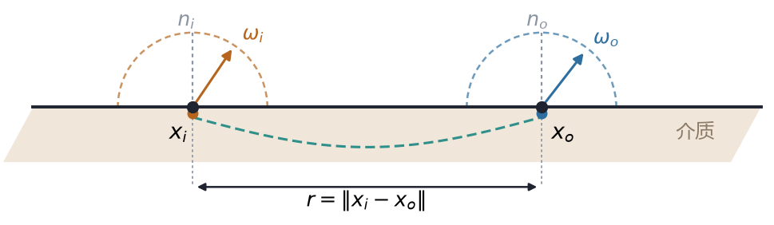
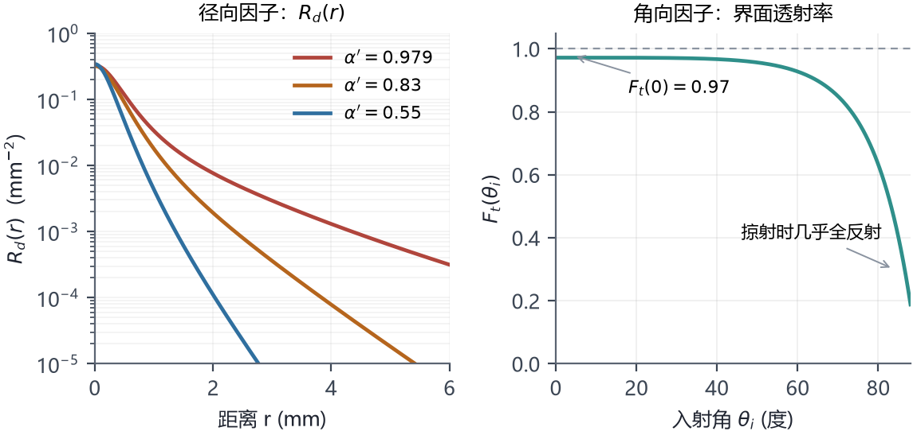
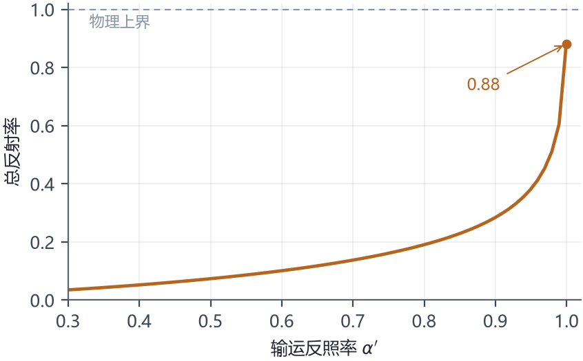

# 第 3 章 BSSRDF 的定义、量纲与渲染方程

## 3.1 一个点换成两个点

第 1 章说清楚了一件事：BRDF 之所以算不出蜡的通透，是因为它假定入射点和出射点是同一个点。把这个假定去掉，剩下的问题就很具体了：写出一个新的核，让它可以接受两个不同的点。

定义没有太多选择。给定入射点 $x_i$ 与入射方向 $\omega_i$，再给定出射点 $x_o$ 与出射方向 $\omega_o$，我们希望得到的量是：从前一组条件出发，在后一组条件上产生多少辐亮度增量。写成比值

$$S(x_i,\omega_i;x_o,\omega_o)=\frac{dL_o(x_o,\omega_o)}{d\Phi_i(x_i,\omega_i)}=\frac{dL_o(x_o,\omega_o)}{L_i(x_i,\omega_i)\cos\theta_i\,d\omega_i\,dA_i} . \tag{3.1}$$

这个函数叫双向表面散射反射分布函数（bidirectional surface scattering reflectance distribution function，BSSRDF），名字里的 surface scattering 强调的是光进入了表面之下的体积。

分母里有三样东西：入射辐亮度、入射立体角、入射点附近的面积。分子是出射辐亮度。三个分母因子都有物理意义——因为光是从一个立体角进、在一块面积上进、从另一个方向出。BRDF 的分母少了面积，因为它的入射和出射共享同一点，面积约掉了。

## 3.2 单位与它的含义

把量纲写出来。出射辐亮度的单位是 $\mathrm{W\,m^{-2}\,sr^{-1}}$；分母是 $\mathrm{W\,m^{-2}\,sr^{-1}}\times\mathrm{sr}\times\mathrm{m^{2}}=\mathrm{W}$。所以

$$[S]=\mathrm{W\,m^{-2}\,sr^{-1}\,W^{-1}}=\mathrm{m^{-2}\,sr^{-1}} . \tag{3.2}$$

两个因子各有分工。$\mathrm{sr^{-1}}$ 来自"出射方向是一个方向"，这一项和 BRDF 一样。$\mathrm{m^{-2}}$ 来自"出射点是一个位置"，这一项是 BRDF 没有的，它标记着入射点与出射点可以分开。

这个 $\mathrm{m^{-2}}$ 在实现里会以两种形式出现。如果你把 $S$ 当成一个概率密度去采样，$\mathrm{m^{-2}}$ 意味着要对着出射点的面积采样，采样的测度是 $dA_o$；如果只对方向采样，会漏掉面积权重，结果整体偏小，而且偏小的倍数随场景尺度变化，看起来像是"散射太弱"。如果你把 $S$ 当成一个卷积核，$\mathrm{m^{-2}}$ 意味着核的归一化必须满足

$$\int S(x_i,\omega_i;x_o,\omega_o)\,dA_o=\text{某个带 }\mathrm{sr^{-1}}\text{ 的量} , \tag{3.3}$$

而不是归一化到 1。归一化到 1 是二维卷积的习惯，用在这里会差一个面积因子。

## 3.3 渲染方程的样子

把 (3.1) 反解出 $dL_o$，再对入射面积与入射方向积分，得到带次表面散射的渲染方程

$$L_o(x_o,\omega_o)=\int_{A}\int_{\Omega}S(x_i,\omega_i;x_o,\omega_o)\,L_i(x_i,\omega_i)\,\cos\theta_i\,d\omega_i\,dA_i . \tag{3.4}$$

和普通渲染方程比，多了一层对入射面积的积分。面积积分域是整个表面 $A$，不只是 $x_o$ 附近的一小块；这就是为什么次表面散射的代价高——每一个着色点都要考虑整个表面上所有其它点的贡献。

真实实现从不会这样做，因为代价是平方级的。常见的做法有三种：把 $S$ 近似成只依赖距离的核，用层次结构或预积分加速面积分；把 $S$ 近似成局部卷积，用屏幕空间的多遍模糊；或者在光线追踪里把它当成一种特殊的光线，从出射点反向追到入射点。三种做法都在第五篇里出现。

图 3-1 是这组符号的几何。注意两件事：两个点可以有不同的法线，所以 $\cos\theta_i$ 和 $\cos\theta_o$ 分别用各自的法线；两点之间的距离 $r$ 是欧氏距离，沿着表面量还是直线量，在曲面上会有差别，这个差别在第五篇的采样里要处理。

## 3.4 互易性

光路是可逆的。把入射和出射互换，物理过程不变，所以

$$S(x_i,\omega_i;x_o,\omega_o)=S(x_o,\omega_o;x_i,\omega_i) . \tag{3.5}$$

这条性质有两个用处。一是检查实现：如果你的采样器对调两个点之后结果不同，说明某处的面积权重或 Jacobian 不对称。二是设计算法：在双向方法里，可以用它把"从光源出发"和"从相机出发"的路径接到一起。

互易性对介质的均匀性有要求。如果介质内部有渐变（比如皮肤的分层、血液的流动），严格说互易性只在同一位置的同一方向上成立，跨层的时候要小心。大多数实现忽略这一点，因为误差小于其它近似。

## 3.5 什么时候它退化回 BRDF

如果介质的厚度趋于零，光不可能在内部横向走远，$S$ 就会集中到 $x_i=x_o$ 附近，成为一个带权重的 delta 函数：

$$S(x_i,\omega_i;x_o,\omega_o)\;\longrightarrow\;f_r(x_o,\omega_i,\omega_o)\,\delta(x_i-x_o) . \tag{3.6}$$

把它代进 (3.4)，面积积分把 delta 函数积掉，剩下的正是普通的渲染方程。这个极限说明两件事：BSSRDF 是 BRDF 的推广，不是替代；一个正确的 BSSRDF 实现必须在厚度趋于零时自动退化，否则它在薄物体的边缘会出问题。

反过来，如果介质极厚且吸收极强，光进去就出不来，$S$ 的积分趋于零，材质表现为纯黑加表面反射。这也是一个可以用来检查实现的极限。

## 3.6 可分离形式

完整的 $S$ 是一个六元函数（两个点、两个方向），采样和存储都不现实。Jensen 在 2001 年提出一个大胆的分解：

$$S(x_i,\omega_i;x_o,\omega_o)\approx\frac{1}{\pi}\,F_t(\eta,\omega_i)\,R_d(\|x_i-x_o\|)\,F_t(\eta,\omega_o) , \tag{3.7}$$

其中 $F_t$ 是界面的透射率，$R_d$ 是径向剖面，$\eta$ 是相对折射率。

这个式子的意思是：光进入时的方向依赖、在内部传播时的空间分布、出去时的方向依赖，三件事互不影响，可以分开算、乘起来。$1/\pi$ 是一个约定因子，它让 $R_d$ 的积分等于总反射率，同时把 $\mathrm{sr^{-1}}$ 补上。

分解的正确性依赖三条假设。介质是均匀的半无限体，这样 $R_d$ 只依赖距离；表面是平面，这样两个点的法线一致，两个 Fresnel 因子可以独立相乘；界面足够光滑，这样可以忽略粗糙度对折射方向的影响。三条假设在真实资产上都不完全成立，但合起来的误差在实际项目里可以接受，这就是它活到今天的原因。

图 3-2 把两半分开画。右图的角向因子在垂直入射时约 0.97，掠射时掉到 0.2 以下——这是 Fresnel 透射的典型形状。把它乘进 $S$，等于说"斜着进来的光只有一部分进了介质"，其余被界面反射掉了。

## 3.7 能量怎么检查

一个材质最多只能把入射的能量全部反射或透射出去，这要求

$$R_{\text{tot}}=\int_{A}\int_{\Omega}S(x_i,\omega_i;x_o,\omega_o)\,\cos\theta_i\,d\omega_i\,dA_o\le 1 \tag{3.8}$$

对任意入射方向成立。等号只在完全无吸收、无透射的材料上取到。

这个检查很重要，因为它能一次性暴露很多实现错误。图 3-3 画了偶极子的总反射率随输运反照率 $\alpha'$ 的变化（$\eta=1.4$）。曲线在 $\alpha'=0.99$ 时是 0.61，看上去离 1 很远，但这不是模型的错：剩下的 39% 真的被吸收了。原因是界面。全反射把射向界面的光退回介质内部（$\eta=1.4$ 时一半的立体角都在临界角以外），光在里面的平均路程被拉到二十毫米量级，乘上 $\sigma_a=0.02\ \mathrm{mm^{-1}}$ 就是四成。第 13 章会把这条曲线与蒙特卡洛逐点对比，两者的差别在 1% 以内。

## 3.8 这套定义的边界

第三章的这套语言有一个隐含的假设：介质的外部是真空或者空气，界面是一个明确的平面。真实场景里这两个条件经常不成立。

皮肤外面有一层油脂，折射率 1.47，和皮肤的 1.4 很接近，这一层可以合并进表皮。但如果皮肤上有一层水膜，折射率 1.33，界面就变成了两层，光在水膜里可能横向走一段再进入皮肤，这时 (3.7) 的两个 $F_t$ 因子就不对称了。

毛发的情况更极端。一根头发的直径是 70 微米，光在内部走的路程和直径同量级，所以"表面之下有一个半无限介质"这个图像完全失效，需要把头发当成一个圆柱形的介质来解。这部分内容在毛发那一册，这里只提一句：$S$ 的定义仍然适用，但 $R_d$ 不再是平面上的径向剖面，而是圆柱面上的角分布。

冰、蜂蜜、果冻这类材料，表面可能不是平面而是曲面。曲率半径小于扩散长度时，光会沿着曲面绕过去，这叫曲面导光，$R_d$ 的平面解会低估远处的出射。处理办法是把表面分成若干小块，每块用局部平面近似，块与块之间用 BSSRDF 的远场项连起来。

这些限制不是这本书的重点，但要知道它们在哪儿。一个模型的适用范围和它的公式一样重要。

---

这一章给出了 BSSRDF 的定义、单位、渲染方程、互易性和可分离形式。其中可分离形式是后面所有模型的基础，它把六元函数拆成一个径向剖面和两个角向因子，代价是三条假设。接下来要问的是：这个径向剖面从哪里来？答案要先从"光在介质里怎样被吸收和散射"开始，这是第二篇的内容。
