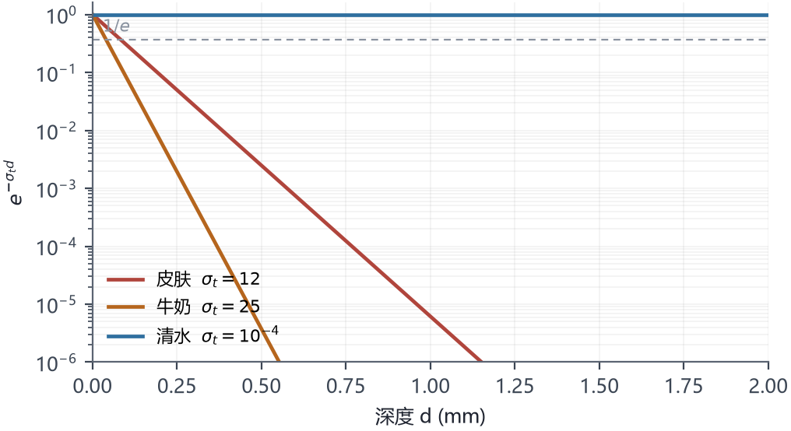
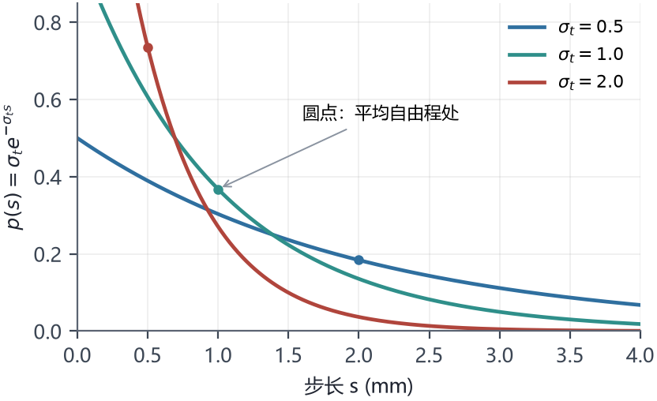

# 第 4 章 吸收、散射与 Beer–Lambert

## 4.1 一杯兑了水的牛奶

一勺牛奶倒进一杯水里，搅匀。整杯液体从白色变成淡淡的乳白。再加一勺，颜色浓一些。把杯子举到灯下，光穿过杯子，透出来的颜色偏蓝白——和从正面看到的乳白不一样。

换成一杯咖啡，同一盏灯，透过来的光几乎没有了，只有边缘一圈棕色。咖啡和牛奶的差别不在颜色，在"光能不能穿过去"。

再看厚度的作用。牛奶杯放在桌上，杯底的白线看不清楚；把它倒进一个浅浅的盘子里，白线能看见。同样多的牛奶，只因为厚度从 6 厘米变成 5 毫米，透光度就完全不一样。

这三个观察指向同一件事：光在介质里走的路程越长，剩下的越少，而且减少的方式是指数的。这一章把这个"指数的"说清楚，并且把"减少"分成两种完全不同的机制。

## 4.2 两种机制

光在介质里前进，每隔一段距离会遇到一个颗粒。颗粒可以是细胞的线粒体、脂肪球、蜡的微晶、纸纤维，也可以是分子本身。遇到之后，有两种结局。

一种是把光子的能量吃掉，变成热或者荧光。这叫吸收（absorption）。吸收有很强的波长选择性：血红蛋白吃绿光吃得厉害，红光几乎不管；黑色素对短波吃得更狠。这就是为什么皮肤在薄处透出来是红的。

另一种是改变光子的方向，能量不变。这叫散射（scattering）。散射本身不改变颜色，但会改变光走的路：本来一条直线能穿过去，被散射几次以后方向乱了，路径变长，被吸收的机会变大。散射间接地影响颜色。

两种结局的概率都用"单位长度上的发生率"来描述。设一段极短的路程 $ds$，光在这段路上被吸收的概率是 $\sigma_a\,ds$，被散射的概率是 $\sigma_s\,ds$，两者的和是被任何事件打断的概率

$$\sigma_t=\sigma_a+\sigma_s , \tag{4.1}$$

叫消光系数（extinction coefficient）。三个量的单位都是长度的倒数，本书统一用 $\mathrm{mm^{-1}}$，因为皮肤、蜡、纸的尺度都在毫米量级。用厘米或米也行，换算时注意别混。

$\sigma_s$ 可以拆成两个因子：单位体积内的颗粒数密度 $N$（$\mathrm{mm^{-3}}$）乘以单个颗粒的散射截面 $\sigma_{\text{sca}}$（$\mathrm{mm^{2}}$）。吸收同理。这样拆开的好处是它把宏观系数和微观结构接上了：把牛奶稀释一倍，$N$ 减半，$\sigma_s$ 也减半，颜色变淡但色调不变——这正是 4.1 节观察到的。

## 4.3 沿直线的衰减

先考虑最简单的情况：只有吸收，没有散射，或者散射弱到可以忽略。一束辐亮度为 $L$ 的光走过 $ds$，被吸收掉的比例是 $\sigma_a\,ds$，于是

$$dL=-\sigma_a L\,ds . \tag{4.2}$$

从 $0$ 积到 $d$：

$$\int_{L_0}^{L(d)}\frac{dL}{L}=-\int_0^d\sigma_a\,ds \quad\Longrightarrow\quad L(d)=L_0\,e^{-\sigma_a d} . \tag{4.3}$$

这就是 Beer–Lambert 定律。它说的是：沿一条直线，辐亮度按指数衰减，衰减的速率是吸收系数。

有散射时，式子里的 $\sigma_a$ 换成 $\sigma_t$，得到的是"没有被任何事件打断的直线传播部分"：

$$L_{\text{unscattered}}(d)=L_0\,e^{-\sigma_t d} . \tag{4.4}$$

注意这个式子量的是"一次都没撞上"的那部分光，不是总光强。总光强里还有被散射过来的贡献，那部分要靠第 6 章的方程算。把 (4.4) 当成总衰减，是这一章之后最常见的错误。

图 4-1 把三种材料的衰减画在一起。同为 1 毫米，清水几乎不衰减，皮肤衰减掉六个数量级，牛奶更多。这就是为什么一杯清水看不出体积散射，而一滴牛奶就能把整杯水变白。

## 4.4 平均自由程与它的分布

$\sigma_t$ 的倒数

$$\ell=\frac{1}{\sigma_t} \tag{4.5}$$

叫平均自由程（mean free path），它是两次事件之间的平均距离。

"平均"这个词要小心。距离不是一个固定值，它是一个随机变量，服从指数分布

$$p(s)=\sigma_t e^{-\sigma_t s},\qquad s\ge0 . \tag{4.6}$$

验证一下：$\int_0^\infty p(s)\,ds=1$，均值 $\int s\,p(s)\,ds=1/\sigma_t$。指数分布有一个特殊的性质，无记忆性：已经走了 $s_0$ 还没撞上，再走 $s$ 才撞上的概率分布和从头开始一样。这不是数学游戏，它是蒙特卡洛里"用 $-\ln u/\sigma_t$ 采样步长"的依据，也是第 19 章随机游走的基础。

指数分布也解释了一个常见现象：薄片为什么比厚片亮得多。厚度减半，$e^{-\sigma_t d}$ 不是减半而是开平方——对光学厚度 2 的片子，减到厚度 1，直线透过率从 $e^{-2}=0.135$ 变成 $e^{-1}=0.368$，接近三倍。

## 4.5 三个无量纲数

把 $\sigma$ 和几何尺度组合起来，可以得到几个纯数，它们决定问题的性质。

光学厚度 $\tau=\sigma_t L$，$L$ 是物体的特征厚度。$\tau\ll1$ 时物体是透明的，$\tau\approx1$ 时半透明，$\tau\gg1$ 时不透明。注意这里的"不透明"只是说直线光被挡住了，散射光仍然可能从别处出来。

单次散射反照率

$$\alpha=\frac{\sigma_s}{\sigma_t} , \tag{4.7}$$

它是"一次事件是散射"的条件概率。$\alpha=1$ 的介质完全不吸收，光只在里面改方向，最终必然从某处出去。$\alpha$ 小的时候，光走不了几步就被吃掉了，介质看起来是深色的。

输运反照率

$$\alpha'=\frac{\sigma_s'}{\sigma_t'}=\frac{(1-g)\sigma_s}{\sigma_a+(1-g)\sigma_s} , \tag{4.8}$$

它比 $\alpha$ 大，因为前向散射几乎不改变光的整体前进方向，等于"没散射"。$g$ 是相函数的平均余弦，下一章讲。在皮肤里 $\alpha\approx0.99$，$\alpha'\approx0.995$，两个数都在 1 附近，看上去差不多，但它们在公式里出现的位置不同，用错会让结果差几个百分点——第 15 章会算这笔账。

把 ($\tau,\alpha,g$) 三个数报出来，一个介质的光学行为就基本确定了。任何一本光学手册里的组织参数表，报的都是这三个或者它们的等价形式。

| 材料 | $\sigma_a$ (mm⁻¹) | $\sigma_s$ (mm⁻¹) | $g$ | 来源 |
| --- | --- | --- | --- | --- |
| 皮肤（真皮，550 nm） | 0.02–0.05 | 10–30 | 0.8–0.9 | Jacques 2013 综述的范围 |
| 牛奶（全脂） | 约 0.002 | 20–40 | 0.85–0.95 | 常见文献取值 |
| 白蜡 | 0.002–0.01 | 10–20 | 0.8–0.9 | 常见文献取值 |
| 白色大理石 | 0.001–0.01 | 3–10 | 0.9 | 常见文献取值 |
| 纸（单层） | 0.01 | 30–60 | 0.8 | 常见文献取值 |

表里的范围很宽，这不是文献不精确，是材料本身的差异大。同一个人的皮肤，不同部位、不同季节，$\sigma_s$ 可以差两倍。

## 4.6 这个模型在哪儿会碎

Beer–Lambert 是这一册里最简单也最容易被误用的公式。它有三个前提，每一个都有明确的破坏方式。

它假设介质是均匀的。皮肤的角质层、表皮、真皮、皮下脂肪，每层的系数差好几倍；一块带纹理的大理石，白纹和灰纹的散射系数能差一个量级。均匀假设失效时，正确做法是分层，每层用各自的系数，层间用边界条件接起来（第 16 章）。

它假设颗粒之间互不相关。当颗粒密度很高、间距接近波长时，散射不再是各自独立的，会出现相干效应（比如某些生物组织的结构色）。这属于波动光学，本册不处理。

它只描述沿直线的光。一旦散射显著，被散射到别的方向的光可能又被散射回来，这一部分必须用辐射传输方程描述。判断标准是光学厚度：$\tau<0.1$ 时用 Beer–Lambert 误差很小，$\tau>1$ 就必须考虑多次散射。

还有一件容易忽略的事：$\sigma_a$ 和 $\sigma_s$ 都依赖于波长。皮肤在 550 nm 和 650 nm 的吸收系数差三倍以上，用单个标量系数渲染出来的皮肤会是灰的或者脏的。第五篇会把波长维度接进来，这一册的推导先用标量，因为公式的结构与波长无关：对每个波长各算一遍，最后按光谱权重合成。

---

这一章建立了介质的两个基本参数，给出了直线衰减的解析形式和三个无量纲数。但光被散射之后往哪个方向走，这一章没有回答——$\sigma_s$ 只告诉你"会散射"，没告诉你"散到哪儿"。下一章补这一环。
