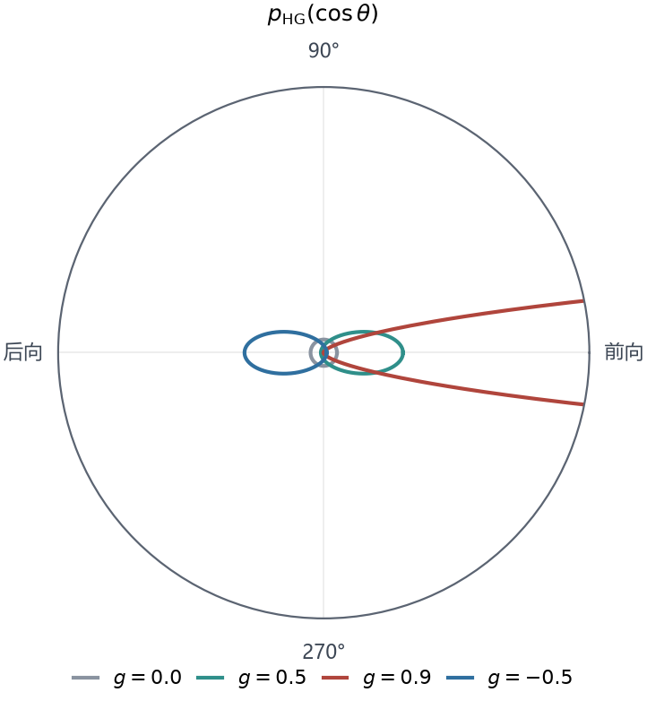
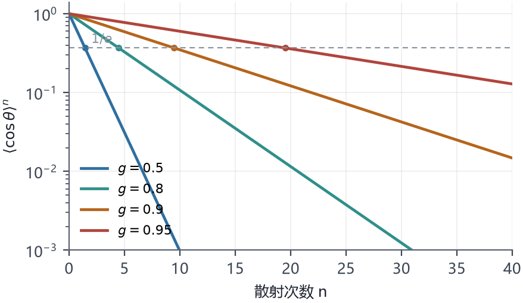
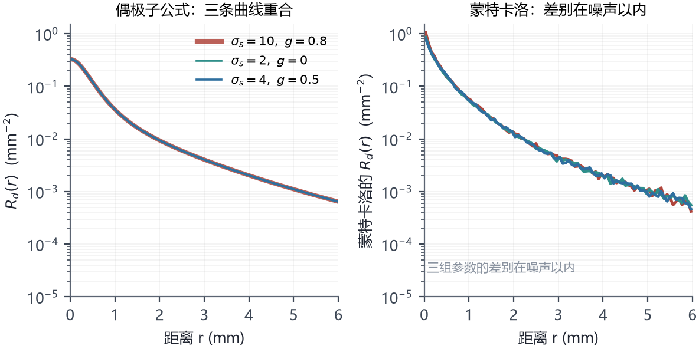

# 第 5 章 相函数与相似关系

## 5.1 散射之后往哪走

第 4 章给出的 $\sigma_s$ 只说了一件事：一段路程上有多大概率发生散射。它没说散射之后光往哪个方向去。同样是 $\sigma_s=10\ \mathrm{mm^{-1}}$ 的两种介质，如果一种把光几乎都往前推，另一种把光均匀撒向各个方向，外观会相差极大：前者看起来像透明的（光一直往前走），后者看起来像乳白的。

这个"往哪走"的分布，由相函数（phase function）描述。定义成条件概率密度：设入射方向为 $\omega'$，散射后的方向落在 $\omega$ 附近 $d\omega$ 内的概率是 $p(\omega',\omega)\,d\omega$。它是一个密度，所以必须满足归一化

$$\int_{4\pi}p(\omega',\omega)\,d\omega=1 . \tag{5.1}$$

在均匀介质里，$p$ 只依赖两个方向之间的夹角 $\theta$，写成 $p(\cos\theta)$。这个简化很重要，它让 $p$ 变成一个一维函数，可以画出来、可以拟合、可以采样。

## 5.2 各向同性散射

最简单的情况是各个方向等概率：

$$p_{\text{iso}}=\frac{1}{4\pi} . \tag{5.2}$$

分母是 $4\pi$ 而不是 $2\pi$，因为散射发生在整个球面上，不是半球。这个 $4\pi$ 和另一件事配合：如果一个场在球面上各向同性，它的辐亮度是 $\phi/4\pi$（第 2 章）。两处的 $4\pi$ 是同一个，来源相同。

各向同性散射的物理原型是尺度远小于波长的颗粒（瑞利散射的近似）或者尺度远大于波长的颗粒在多次内部反射之后的平均效果。真实介质里很少有纯粹的各向同性，但它是一个重要的参照，因为后面所有的理论都是在"接近各向同性"这个假设下建立的。

## 5.3 Henyey–Greenstein 相函数

真实的散射通常有方向偏好。细胞器、脂肪球、纤维的尺度比波长大，前向散射占优；雾滴、牛奶的颗粒更明显。描述这种偏好最常用的函数是 Henyey 与 Greenstein 在 1941 年研究星际尘埃时提出的：

$$p_{\text{HG}}(\cos\theta)=\frac{1}{4\pi}\frac{1-g^2}{(1+g^2-2g\cos\theta)^{3/2}} . \tag{5.3}$$

参数 $g$ 是平均余弦

$$g=\langle\cos\theta\rangle=\int_{4\pi}p(\cos\theta)\cos\theta\,d\omega , \tag{5.4}$$

取值在 $[-1,1]$。$g=0$ 退化成各向同性；$g>0$ 表示前向散射占优，$g<0$ 表示后向；$g$ 接近 1 时几乎全前向。

$g$ 有一个不太显眼但非常有用的性质：HG 的 Legendre 展开系数恰好是 $g^l$。也就是把 $p$ 按 Legendre 多项式展开

$$p(\cos\theta)=\frac{1}{4\pi}\sum_{l=0}^{\infty}(2l+1)\,a_l\,P_l(\cos\theta) , \tag{5.5}$$

HG 给出 $a_l=g^l$。这使得任何按阶展开的理论（第 9 章的球谐展开）在 HG 下都有极简的形式：$l$ 阶矩就是 $g^l$。



图 5-1 画了四条曲线。注意 $g=0.9$ 那条：能量高度集中在前方一个很窄的锥里，同时整个后向半球有一个很小的、几乎平坦的底。真实的前向散射介质都有这个特征——绝大部分光沿原方向，极小一部分被大角度偏折，而正是这一小部分决定了光能扩散多远。

## 5.4 相似关系

现在到了这一章最关键的一步。$g=0.9$ 意味着光在散射之后基本还沿原方向走，那么"发生一次散射"这件事对光的整体路径几乎没有影响。连续发生几十次小角度偏折，累积起来才相当于一次大角度偏折。

把这件事量化。设光的方向经过 $n$ 次散射，每次的平均余弦是 $g$。方向记忆的期望值（把方向看成一个单位向量，取它的期望）按 $g^n$ 衰减。要让它掉到 $1/e$，需要



$$n=\frac{1}{-\ln g}\approx\frac{1}{1-g}\qquad(g\to1) . \tag{5.6}$$

在这 $n$ 次散射里，光走过的路程是 $n/\sigma_s$，所以方向被打乱所需的距离是

$$\ell^*=\frac{1}{(1-g)\sigma_s}=\frac{1}{\sigma_s'} . \tag{5.7}$$

这就是输运平均自由程（transport mean free path）。它是"光真正忘掉方向"的尺度，而不是"光撞上颗粒"的尺度。皮肤里 $\sigma_s\approx10\ \mathrm{mm^{-1}}$、$g=0.8$，于是 $\ell^*=0.5\ \mathrm{mm}$——比 $\ell=0.1\ \mathrm{mm}$ 大五倍。这就是为什么皮肤的半透明看起来对应"毫米"这个尺度，而不是"0.1 毫米"。

有了 $\ell^*$，可以定义一组约化系数

$$\sigma_s'=(1-g)\sigma_s,\qquad \sigma_t'=\sigma_a+\sigma_s',\qquad \alpha'=\frac{\sigma_s'}{\sigma_t'} . \tag{5.8}$$

相似关系（similarity relation）说：一个 $(\sigma_a,\sigma_s,g)$ 的强前向散射介质，在多次散射为主的问题里，与一个 $(\sigma_a,\sigma_s',0)$ 的各向同性介质近似等价。右边那个介质的相函数是 $1/4\pi$。

这个等价不是精确的。它成立的条件是：光经历了足够多次散射，使得单次偏折的细节被平均掉；观察的是远离光源的场；边界效应对结果的影响小于散射细节的影响。



图 5-2 验证了这一点。三组 $\sigma_s,g$ 分别是 $(10,0.8)$、$(2,0)$、$(4,0.5)$，$\sigma_t'$ 都是 2。左边是代入偶极子公式的结果，三条曲线本来就只能重合，因为公式里只剩 $\sigma_a$ 与 $\sigma_s'$；右边是同样三组参数的蒙特卡洛，这才是真正的检验。两边的结论一致：径向剖面对 $g$ 的细节不敏感，差别落在采样噪声（约 5%）以内。

## 5.5 相似关系在哪里碎

相似关系是这本书后面所有推导的入口。第三篇的 P1 近似、Fick 定律、扩散方程，全部建立在"介质可以用约化系数描述"这个前提上。它碎的方式有四种。

**单次散射。** 只散射一次的光，其方向分布就是相函数本身，$g$ 的影响完全暴露。第 7 章会算这一项，它恰好集中在光源附近，所以第 15 章讨论扩散失效时，第一件事就是把这部分单独拿回来。

**薄层。** 一片光学厚度小于 2 的薄片，光在里面只散射一两次，$\sigma_t'$ 描述的"等效各向同性"还没建立起来。这时用 $\sigma_t'$ 算出来的透射率会偏高，因为它默认光已经忘了方向，而实际上光还是朝前走的。

**边界。** 界面上光的角分布不是各向同性的，靠近界面的一层（厚度约一个 $\ell^*$）里，$g$ 的影响仍然存在。这正是第 12 章外推边界要修的东西。

**极端 $g$。** $g>0.95$ 时，$\ell^*$ 可以是 $\ell$ 的二十倍以上，中间那段"多次小角度偏折"的过渡区变得很宽，相似关系在这个过渡区里误差变大。真实的雾、云、某些生物组织属于这种情况。

## 5.6 采样

实现的时候需要两件事：按 $p$ 采样一个散射方向，以及计算 $p$ 的值（用来算 pdf）。HG 两件事都有闭式解。

采样的标准做法是逆变换。对 HG，设 $u$ 是均匀随机数，则

$$\cos\theta=\frac{1}{2g}\left[1+g^2-\left(\frac{1-g^2}{1-g+2gu}\right)^2\right] , \tag{5.9}$$

方位角 $\phi=2\pi v$，$v$ 是另一个均匀随机数。$g=0$ 时公式退化，需要单独处理成 $\cos\theta=2u-1$。这个式子在 $g$ 接近 1 时要小心数值精度：分母 $1-g+2gu$ 可能很小，建议用双精度并且把 $g$ 限制在 $[0.999]$ 以内。

采样出来的方向要相对入射方向旋转。做法是给入射方向造一组正交基 $(t,b)$，然后

$$\omega'=\sin\theta\cos\phi\,t+\sin\theta\sin\phi\,b+\cos\theta\,\omega . \tag{5.10}$$

这组基的选择不影响结果，但影响数值稳定性：当 $\omega$ 接近 $+z$ 时，用 $(1,0,0)$ 作辅助轴，否则用 $(0,0,1)$，可以避免叉积退化。

代码大致是这样：

```python
def sample_hg(wi, g, u1, u2):
    if abs(g) < 1e-6:
        ct = 2.0 * u1 - 1.0
    else:
        s = (1.0 - g * g) / (1.0 - g + 2.0 * g * u1)
        ct = (1.0 + g * g - s * s) / (2.0 * g)
    st = np.sqrt(max(0.0, 1.0 - ct * ct))
    phi = 2.0 * np.pi * u2
    a = np.array([0.0, 0.0, 1.0]) if abs(wi[2]) < 0.9 else np.array([1.0, 0.0, 0.0])
    t = np.cross(a, wi)
    t /= np.linalg.norm(t)
    b = np.cross(wi, t)
    return st * np.cos(phi) * t + st * np.sin(phi) * b + ct * wi
```

$p$ 的值用 (5.3) 直接算，注意 $\cos\theta=\omega\cdot\omega'$。

---

这一章给出了介质的第三个参数 $g$，并且把它压缩进约化系数。相似关系是后面所有近似的起点：它把"强前向散射"换成"等效各向同性"，代价是丢掉光源附近和边界附近的信息。下一章把这些规则合成一个方程，也就是辐射传输方程。
