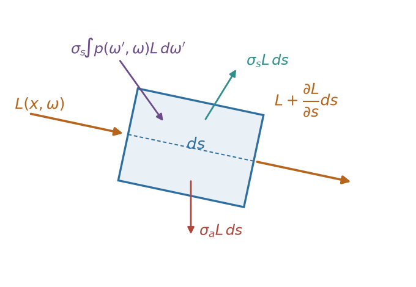
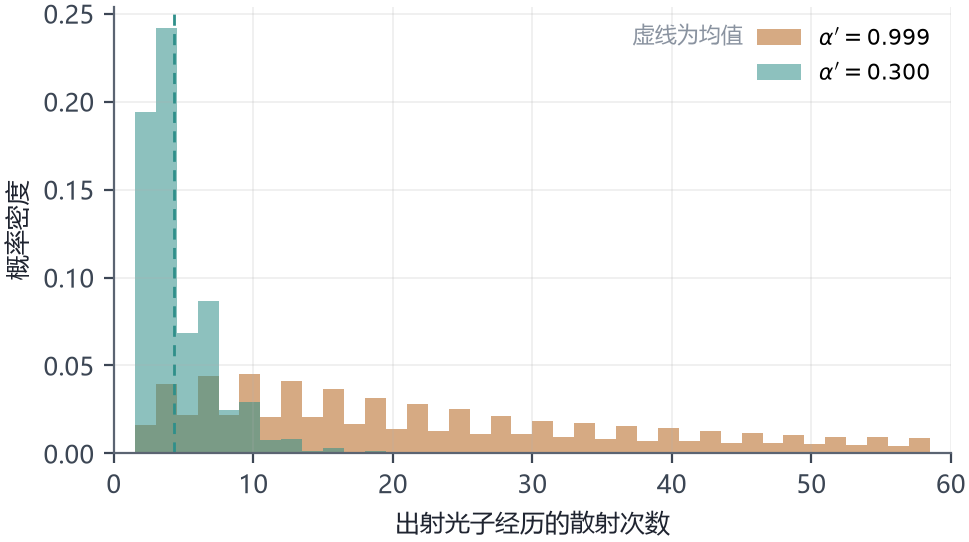

# 第 6 章 辐射传输方程

## 6.1 从一个光子走不出去说起

把一块 3 毫米厚的白玉放在灯下，背光是暗的，但把它换成 0.5 毫米厚的一片，背光就透出一层柔和的亮。第 4 章的 Beer–Lambert 说 3 毫米处直线透过率是 $e^{-3\sigma_t}$，如果 $\sigma_t=10\ \mathrm{mm^{-1}}$，这个数是 $10^{-13}$，等于零。可实际看到的不是零。

多出来的光是被散射过来的。它没有走直线，而是走了一条折线，每次转折都损失一点能量，最后从背面出来。要把这些折线全部加起来，需要一个关于整个光场的方程，而不是关于一条射线的公式。

这个方程叫辐射传输方程（radiative transfer equation，RTE）。Chandrasekhar 在 1950 年研究恒星大气时给出了它的完整形式，Ishimaru 在 1978 年把它系统地带进散射介质。它的推导只有一个输入：能量守恒。

## 6.2 微分体元的能量账本

取一个小圆柱体，截面 $dA$、长度 $ds$，轴沿方向 $\omega$。光从一端进，从另一端出，沿途与介质发生作用。图 6-1 是这个账本。

**进出的差额。** 辐亮度沿 $\omega$ 的变化率是 $\partial L/\partial s=\omega\cdot\nabla L$，走过 $ds$ 后变成 $L+(\omega\cdot\nabla L)\,ds$。差额就是 $(\omega\cdot\nabla L)\,ds\cdot dA$。

**被吸收的。** 体积内的吸收体总数是 $\sigma_a\,ds\,dA$（每单位体积每单位面积的吸收截面乘体积），每个吸收掉 $L$，所以损失 $\sigma_a L\,ds\,dA$。

**被散射出去的。** 同理，损失 $\sigma_s L\,ds\,dA$。注意这一项是"从 $\omega$ 这个方向离开"，散射到别的方向去了。

**从别处散进来的。** 各个方向 $\omega'$ 上的光都可能散射到 $\omega$ 方向。来自 $\omega'$ 方向、立体角 $d\omega'$ 内的辐亮度是 $L(\omega')$，散射到 $\omega$ 的概率密度是 $p(\omega',\omega)$，贡献是 $\sigma_s L(\omega')\,p(\omega',\omega)\,d\omega'$。对全方向积分，得到 $\sigma_s\int_{4\pi}L(\omega')\,p(\omega',\omega)\,d\omega'\,ds\,dA$。

四项相加，两边除以 $ds\,dA$：

$$\omega\cdot\nabla L(x,\omega)=-\sigma_t L(x,\omega)+\sigma_s\int_{4\pi}p(\omega',\omega)\,L(x,\omega')\,d\omega' . \tag{6.1}$$

这就是辐射传输方程的定常形式。左边是光沿射线的变化，右边第一项是消光，第二项是内散射源。如果有自发辐射或者别的体光源 $Q$，右边再加一项 $Q(x,\omega)$。

写成算子的形式更紧凑：

$$\frac{dL}{ds}=-\sigma_t L+\sigma_s\int p\,L\,d\omega' , \tag{6.2}$$

$\frac{d}{ds}=\omega\cdot\nabla$ 是沿射线的方向导数。这个形式的好处是把方程读成一句话：沿一条射线走，辐亮度的变化率等于"损失"加"补充"。

## 6.3 无散射、无吸收的极限

先检查两个极限，确认方程没有写错。

$\sigma_t=0$ 时右边全为零，$dL/ds=0$，辐亮度沿射线不变。这正是第 2 章的辐亮度不变性。这个检验很重要：一个正确的 RTE 必须包含"真空不改变辐亮度"这一条，否则在空气里传播的光会莫名其妙地变亮或变暗。

只有吸收没有散射时，$\sigma_s=0$，方程变成 $dL/ds=-\sigma_a L$，解是 $e^{-\sigma_a s}$，回到 Beer–Lambert。

只有散射没有吸收时，$\sigma_a=0$，样品的总能量守恒。后面会用它做白炉检验（第 22 章）。

## 6.4 边界条件

方程是一阶的，需要每条射线上一个初值。介质占 $z<0$，表面是 $z=0$，从外面射入的辐亮度记为 $L_{\text{in}}$。对朝内的方向（$\omega\cdot n<0$，$n$ 是外法线），

$$L(0,\omega)=L_{\text{in}}(0,\omega)+R\,L(0,\omega_r) . \tag{6.3}$$

第一项是外部照进来的光，第二项是内部射到界面上被反射回去的部分，$\omega_r$ 是 $\omega$ 关于法线的镜像。$R$ 是 Fresnel 反射率，与角度有关。

对朝外的方向（$\omega\cdot n>0$），没有边界条件——那是待求的出射辐亮度，解完方程之后从内部取极限得到。

这个边界条件的结构解释了一件事：界面的反射把出射的光又送回了介质。做法线方向的反射率只有 4%，但掠射方向可以到 100%，所以界面对光的"回收"在掠射时非常强。第 12 章的外推边界就是把这件事折算成一个虚构的零值面。

## 6.5 Neumann 级数

RTE 是线性的，可以把它写成算子形式再展开。定义两个算子：消光算子 $S$（乘 $-\sigma_t$）和内散射算子 $K$（卷积上 $p$ 再乘 $\sigma_s$）。方程变成

$$\frac{dL}{ds}=S L+K L . \tag{6.4}$$

把 $S$ 移到左边，形式解是 $L=(d/ds-S)^{-1}KL$，展开成级数：

$$L=L_0+L_1+L_2+\cdots,\qquad L_n=(K\,G_0)^n L_0 , \tag{6.5}$$

其中 $G_0$ 是"只有消光"的传播算子，$L_0$ 是未经散射的入射光。每一项 $L_n$ 对应"恰好散射 $n$ 次"的那部分光。

这个展开在数学上叫 Neumann 级数，在物理上就是"按散射次数分类"。它的收敛性取决于单次散射反照率 $\alpha$：$\alpha<1$ 时每一阶都比上一阶小，级数收敛；$\alpha=1$ 时不收敛（在无吸收的介质里，光散射无穷多次才出去，但每次的能量在几何上被摊薄，最终仍然收敛，只是收敛慢）。

级数的前三项有明确的名字。$L_0$ 是直射光，走直线，按 $e^{-\sigma_t s}$ 衰减。$L_1$ 是单次散射光，只拐一个弯。$L_2$ 及以上是多次散射光。

## 6.6 为什么它解不动

RTE 是一个含五个自变量（三个空间、两个方向）的积分微分方程。积分项让它对方向耦合，微分项让它对空间耦合。除了少数几个几何，没有解析解。

有解析解的情形屈指可数：无限均匀介质中的点源（在扩散近似下有解，第 11 章）、半无限介质在特定相函数下的相似解（Chandrasekhar 的 H 函数，只在各向同性散射下有用）、平行平面介质在离散纵标法下的数值解（大气辐射传输的标准工具）。

图形学里遇到的几何几乎都不在这个名单上。模型是任意的，光源是任意的，介质是不均匀的。所以实际做法只有三条路：数值解（蒙特卡洛、离散纵标、有限元）、近似解（扩散、P3、相似关系）、查表加拟合。

蒙特卡洛是"正确但慢"的那条路。它不直接解方程，而是追踪大量光子，每个光子按概率选择步长和散射方向，统计出射分布。它的误差按 $1/\sqrt{N}$ 下降，要降一个数量级需要一百倍的样本。第 19 章会详细写。

近似解是这一册后面大半的内容。近似的方式有共同的结构：先按某个基函数展开方向依赖，再截断，得到一个关于少数几个矩的方程。截断到一阶就是扩散理论（第三篇），截断到三阶就是 P3（第 17 章会提到）。

图 6-2 是蒙特卡洛统计出来的散射次数分布。两个反照率下的形状差别很大：$\alpha'\approx0.999$（浅肤色、牛奶）时均值是 113 次，分布拖得很长，图只画到 60 次就截断了；$\alpha'\approx0.3$（深色材料）时均值只有 4.3 次，八成的光子根本没出得来（被吸收了）。这种差别决定了“截断到几阶”这件事与材料强相关：对低反照率介质，只算前两阶就够；对高反照率介质，必须处理上百阶，也就是必须用扩散或者随机游走。

## 6.7 方程之外

RTE 本身建立在几条假设上，值得说清楚，因为后面的所有近似都继承它们。

它假设散射是独立的，即每个颗粒的散射不受邻居影响。它假设散射是瞬时的，忽略了光在介质里的传播延迟——对稳态渲染无所谓，对瞬态成像（比如飞行时间相机）就必须用含时的 RTE。它假设偏振可以忽略，把辐亮度当成标量；偏振要用 Stokes 矢量代替，方程变成四个耦合的方程。

还有一条容易被忽略：RTE 描述的是能量的期望值，它不包含散斑、干涉这类相干效应。当介质的结构有周期性（比如某些蝴蝶翅膀、蛋白石），颜色来自结构而不是色素，RTE 就无能为力。

---

这一章把第 4 章和第 5 章的两条规则合成一个方程，并且说明了它为什么解不动。Neumann 级数给出了一条分类的路：直射、单次散射、多次散射。下一章先算单次散射这一项，它是唯一能写出闭式解的部分，也是理解后面近似为什么失效的钥匙。
