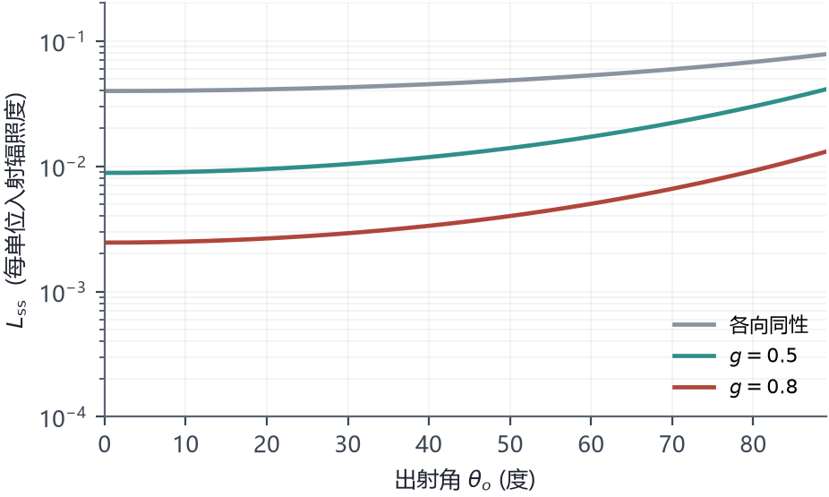
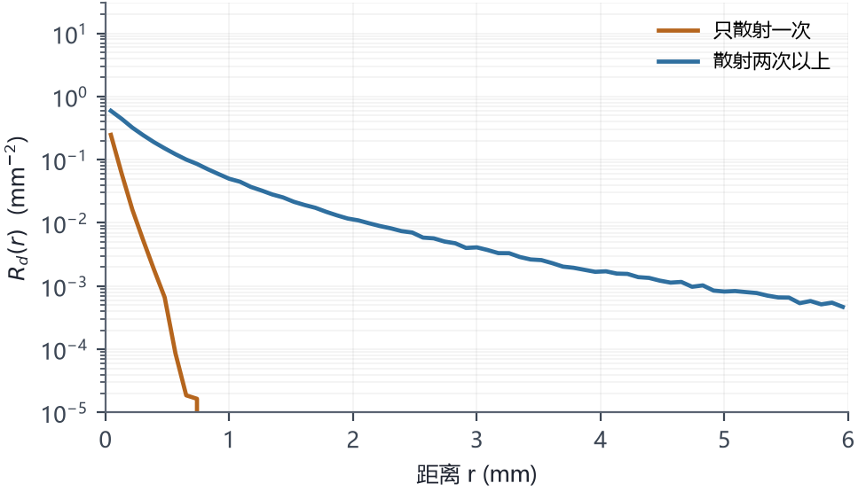
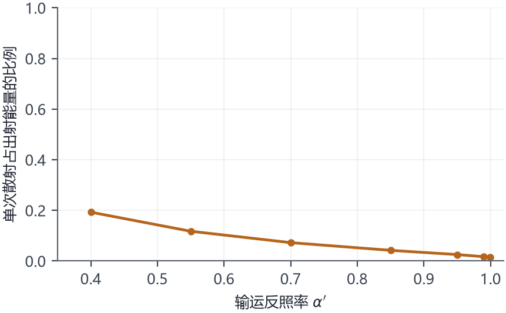

# 第 7 章 单次散射

## 7.1 激光笔打在白纸上

把一支激光笔垂直打在一张白纸上。光点很小，边缘有一圈极淡的红晕，红晕只在纸上延伸半毫米左右就没了。纸看起来完全不透明——把灯放在纸后面，正面看不到任何光。

换成一块 2 毫米厚的白玉，同一个激光笔，红晕延伸到三四毫米，而且颜色变了：中心的点偏白，中间一圈偏黄，最外面一圈明显发红。

前一个例子里几乎所有的光都只散射了少数几次就出来了，因为纸太薄；后一个例子里光在内部来回反弹了很多次，红晕的成分主要是"走了很久"的光。这一章算只散射一次的那部分。它在厚介质里能量占比很小，但它是唯一能写出闭式解的部分，也是理解"为什么光斑中心那一块特别亮"的入口。

## 7.2 闭式解

考虑平面波垂直入射到半无限介质，入射辐照度为 $E_0$。介质里深度 $z$ 处的准直光束是 $E_0e^{-\sigma_t z}$。

现在要算出射辐亮度：表面上一点，朝出射方向 $\omega_o$（与法线夹角 $\theta_o$）的辐亮度。这条视线从表面进入介质，方向是 $-\omega_o$。沿视线取参数 $s$ 为到表面的距离，则该点的深度是 $z=s\cos\theta_o$。

这一步最容易错。入射光朝介质内部传播（记法线朝外，则为 $-\hat n$），出射光朝外（$+\hat n$ 一侧）。两者的夹角不是 $\theta_o$，而是 $\pi-\theta_o$。所以在这一点上，被散射到 $\omega_o$ 方向的概率要用 $p(-\cos\theta_o)$ 而不是 $p(\cos\theta_o)$。

源强（单位体积、单位立体角发出的功率）是

$$\text{源}(s)=\sigma_s\,p(-\cos\theta_o)\,E_0\,e^{-\sigma_t s\cos\theta_o} . \tag{7.1}$$

从这一点回到表面，光还要走 $s$，衰减 $e^{-\sigma_t s}$。沿途积分：

$$L_{\text{ss}}(\theta_o)=\sigma_s\,p(-\cos\theta_o)\,E_0\int_0^{\infty}e^{-\sigma_t s(1+\cos\theta_o)}\,ds . \tag{7.2}$$

积分是初等的，$\int_0^\infty e^{-as}ds=1/a$，于是

$$L_{\text{ss}}(\theta_o)=\frac{\sigma_s\,p(-\cos\theta_o)}{\sigma_t\,(1+\cos\theta_o)}\,E_0 . \tag{7.3}$$

两个性质值得记住。

它不依赖表面上的位置。平面波照在均匀半无限介质上，单次散射在任何位置给出相同的辐亮度。原因是对称性：把表面平移，几何不变。

角分布里有一个 $1/(1+\cos\theta_o)$ 因子，它和相函数无关，来自"视线在介质里走多长"：朝法线方向看，视线很快穿出；朝掠射方向看，视线在介质里走很长一段，沿途都是散射源。所以掠射端总是被抬高，除非相函数把那里压成零。

## 7.3 能量占多少

把 (7.3) 在出射半球上积分，得到单次散射贡献的漫反射率：

$$R_{\text{ss}}=2\pi\int_0^{\pi/2}\frac{\sigma_s\,p(-\cos\theta)}{\sigma_t(1+\cos\theta)}\cos\theta\sin\theta\,d\theta . \tag{7.4}$$

各向同性相函数 $p=1/4\pi$ 时可以手算：

$$R_{\text{ss}}=\frac{\alpha}{2}\int_0^1\frac{u}{1+u}\,du=\frac{\alpha}{2}(1-\ln2)\approx0.153\,\alpha . \tag{7.5}$$

各向同性散射的介质里，单次散射最多带走 15.3% 的能量，剩下的 84.7% 要么被吸收，要么经过多次散射才出来。

前向散射的介质里这个数小得多。$p(-\cos\theta)$ 在 $\cos\theta\approx1$ 附近（也就是背散射方向）取值很小，而 $1/(1+\cos\theta)$ 的权重恰好落在那里。数值积分给出 $g=0.5$ 时 $0.046\alpha$，$g=0.8$ 时 $0.013\alpha$，$g=0.9$ 时 $0.006\alpha$。皮肤、牛奶、蜡的 $g$ 都在 0.8 到 0.9 之间，所以单次散射在这些材料里只占百分之一的量级。

图 7-1 画出了三条角分布。各向同性那条在接近法线处约为 $0.04$，掠射处升到 $0.13$；$g=0.8$ 那条在法线方向只有 $2\times10^{-3}$，比各向同性低二十倍，而在掠射端仍然有 $4\times10^{-2}$。前向散射介质在正面看是暗的，掠射看是亮的，这个反差完全由相函数决定。

## 7.4 位置上的分布

(7.3) 说的是平面波，位置均匀。真实测量用激光笔，光斑只有零点几毫米，这时单次散射有了位置分布。

从数学上说这件事很麻烦。铅笔束在三维里是一个二维 delta 函数，散射体积是一条线而不是一个体积。沿这条线积分会在"视线与散射线重合"的方向上对数发散——沿光束方向看，视线和散射体的交叠长度无限。真实光束有有限直径，所以不会真的无穷，但峰值很高。

处理方式是承认单次散射在位置上有两种成分。一种是"沿光束方向的强前向散射"，它在几何光学里就是透射光斑的中心；另一种是"大角度偏折后从旁边出来"，它构成一个半径一到两个平均自由程的环。前者要用有限束宽处理，后者可以用蒙特卡洛统计。

图 7-2 是这个分割的结果。单次散射曲线很陡，在 0.8 毫米处已经掉了四个数量级；多次散射曲线平缓得多，尾巴拖到十几毫米。两条曲线在整个范围内相差一个量级左右——这正是 $g=0.8$ 时单次散射只占 1% 的几何表现。

## 7.5 折射与掠射

上面的推导忽略了界面折射。加上之后三件事会变。

入射光进入介质时方向偏折，折射后的方向不再是法线方向，散射角要用折射后的方向算。出射时同样偏折，内部角度 $\theta_o'$ 与外部角度满足 $\sin\theta_o=\eta\sin\theta_o'$。把内部的角度分布映射到外部还要乘 Jacobian：

$$d\omega'=\frac{\cos\theta_o'}{\eta^2\cos\theta_o}\,d\omega . \tag{7.6}$$

这个 Jacobian 在实现里经常被漏掉，漏掉之后掠射方向偏暗。

第三件事更重要：内部角度超过临界角的光无法直接射出，只能全反射回介质。$\eta=1.4$ 时临界角是 45.6°，这意味着内部接近一半的立体角的单次散射光被"回收"进了多次散射。所以 (7.4) 算出来的是"射向界面的通量"，换算成"射出表面的通量"还要乘透射率。对 $\eta=1.4$，这个因子大约是 0.5，把 $g=0.8$ 的 1.3% 降到 0.65%。

## 7.6 这一项的用处

既然只占百分之一，为什么还要单独算？三个理由。

**薄层是它的主场。** 一片 0.1 毫米厚的纸，光学厚度大约 3，光在里面平均散射三次，其中相当一部分只散射一次。薄层的透射率几乎完全由单次散射决定，用扩散模型算会错得很离谱（第 16 章会算这笔账）。

**角分布的形状。** 单次散射的角分布直接暴露相函数，而扩散模型把方向信息全丢了。在掠射角观察薄片、毛发、织物这类物体时，正确的角向亮暗变化只能靠单次散射项提供。

**诊断用。** 把单次散射项加进模型再和蒙特卡洛比对，可以把误差分离开：如果近源区仍然偏差大，说明问题在多次散射的模型上，而不是丢了一项。这个分离在第 22 章的调试流程里是第一步。

图 7-3 给出比例随材料白度的变化。趋势是清楚的：材料越暗，单次散射的相对重要性越高，因为多次散射的光在走远之前就被吸收了。所以在渲染深色皮肤、咖啡、墨汁这类材料时，单次散射项的权重比渲染牛奶时要大。

---

这一章得到了唯一有闭式解的那一项，还得到了一个反直觉的结论：对皮肤这类强前向散射的材料，单次散射只占百分之一。真正撑起外观的是剩下那 99%，也就是多次散射。下一章要说明为什么多次散射必须换一套工具，而不能继续按散射次数一项一项算。
