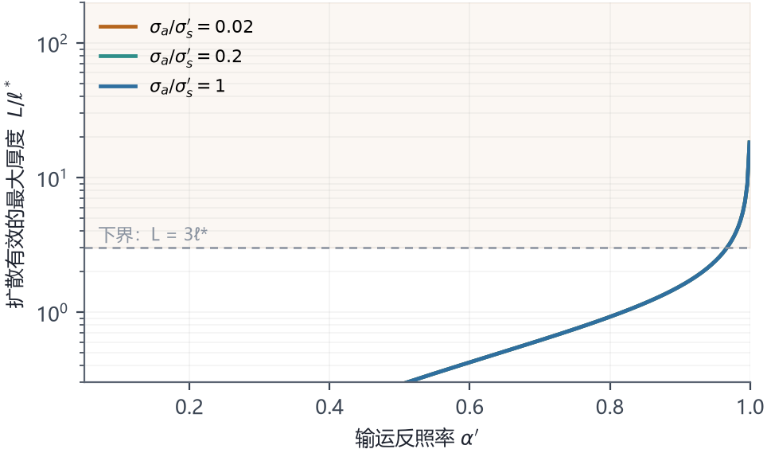
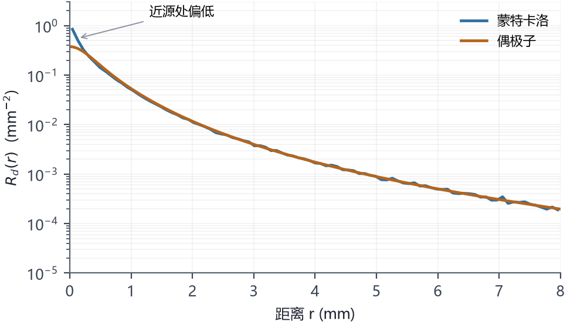

# 第 8 章 多次散射与扩散理论的出场

## 8.1 一百多次

上一章的图 7-3 里有一个数字：皮肤参数下，出射光子平均经历 112 次散射。这个数字来自蒙特卡洛统计，做法很简单——每散射一次计一，出射时把计数记下来，最后取平均。

112 次意味着什么？意味着如果按 Neumann 级数一项一项算，要算到第 112 项才能覆盖大部分能量，而且每一项都比上一项更复杂：第 $n$ 项要对 $n$ 个散射点、$n$ 个方向做积分，维数是 $5n$。算到第 20 项就已经不可能，更别说 112 项。

可是这 112 次散射的结果，看上去却只是"一亮一暗"——光斑有形状，边缘柔和，没有细节。这正是关键：当散射次数很多时，逐次的细节被平均掉了，剩下的只有少数几个宏观量。多次散射的可计算性来自这种平均，而不是来自更快的积分。

## 8.2 随机游走与它的极限

把光子的路径看成一次随机游走。每一步的长度服从指数分布，每次转折的方向服从相函数。游走 $N$ 步之后，位置是一个随机变量。

概率论给了一个定理：独立同分布的随机变量之和，经过适当的尺度变换，趋于正态分布。这就是中心极限定理。它的意思是，$N$ 很大时，光子位置的分布不再依赖每一步的细节（相函数的具体形状），只依赖前两阶矩——均值与方差。均值由方向分布的各向异性决定，方差由步长与散射角的方差决定。

这个结论直接对应到物理上。$N$ 大时：

- 光子位置的空间分布趋于高斯型，而高斯型是扩散方程的基本解；
- 分布只依赖 $\sigma_s'$（它决定方差增长的速度）和 $\sigma_a$（它决定总量衰减），不依赖相函数的高阶矩；
- 这就是相似关系（第 5 章）的另一种说法。

所以扩散理论不是"一个粗糙的近似"，它是"随机游走在 $N\to\infty$ 时的极限"。它的误差来自 $N$ 不是无穷大：在光源附近、在薄层里、在边界上，$N$ 只有几步甚至一步，中心极限定理还没生效。

## 8.3 从游走到扩散方程

把上面的论证写成公式，需要三个量。

光子的密度（单位体积内的光子数）记作 $n(x)$，它与光通量密度 $\phi$ 成正比。光子的净流动（单位时间穿过单位面积的净光子数）记作 $\mathbf{J}$。经验上，净流动正比于密度的负梯度：

$$\mathbf{J}=-D\,\nabla n , \tag{8.1}$$

比例系数 $D$ 就是扩散系数。这条经验关系叫 Fick 定律，第 10 章会从 P1 近似推出来，这里先把它当成"密度高的地方往密度低的地方流"的数学表达。

再写守恒：单位体积内光子数的变化率等于流入减流出减吸收，

$$\frac{\partial n}{\partial t}=-\nabla\cdot\mathbf{J}-\sigma_a c\,n+S , \tag{8.2}$$

$c$ 是介质中的光速，$S$ 是源项。把 (8.1) 代入，取稳态（$\partial n/\partial t=0$）：

$$D\nabla^2 n-\sigma_a c\,n=-S . \tag{8.3}$$

这就是扩散方程。它比 RTE 简单得多：只含一个未知函数（标量密度），只含二阶导数，没有方向变量。代价是所有方向信息都丢了。

注意 (8.2) 里的 $\sigma_a c$ 出现得很自然：吸收让光子以速率 $\sigma_a c$ 消失。如果改用光通量密度 $\phi$ 而不是光子数密度，(8.3) 写成

$$D\nabla^2\phi-\sigma_a\phi=-Q , \tag{8.4}$$

两边除以 $D$：

$$\nabla^2\phi-\mu_{\text{eff}}^2\phi=-\frac{Q}{D},\qquad \mu_{\text{eff}}=\sqrt{\frac{\sigma_a}{D}} . \tag{8.5}$$

$\mu_{\text{eff}}$ 叫有效衰减系数。它的倒数 $1/\mu_{\text{eff}}$ 就是光在介质里能扩散多远，也就是第 1 章说的那个"扩散尺度"。

## 8.4 两个尺度

现在可以看清扩散理论适用的条件了。它需要两个长度都足够大。

第一个是散射次数对应的长度。光要在横向扩散开，必须散射足够多次，所以物体的尺寸至少要几个输运平均自由程：$L\gtrsim3\ell^*$。

第二个是吸收对应的长度。光在扩散开之前不能被吸收掉，所以扩散长度要大于物体的尺寸：$1/\mu_{\text{eff}}\gtrsim L$，或者等价地 $\sigma_a L^2/D\lesssim1$。

两个条件合起来，给出扩散有效的区域：

$$3\ell^*\lesssim L\lesssim\frac{1}{\mu_{\text{eff}}} . \tag{8.6}$$

这个区间可能很窄，也可能根本不存在。$\alpha'$ 接近 1 时 $\mu_{\text{eff}}$ 很小，区间很宽；$\alpha'$ 低于 0.5 时 $\mu_{\text{eff}}$ 和 $1/\ell^*$ 同量级，区间几乎消失，扩散理论就没有意义了。

皮肤落在中间：$\ell^*\approx0.5\ \mathrm{mm}$，$\mu_{\text{eff}}\approx0.35\ \mathrm{mm^{-1}}$，区间是 $1.5\ \mathrm{mm}$ 到 $2.9\ \mathrm{mm}$。一根手指的厚度是 10 毫米，超出了上界——所以手指深处（超过 3 毫米）的光会被吸收掉，只有表层那两三毫米参与透光。这解释了为什么手指边缘透出来的光是红色的：走得更远的光都被吸收了。

图 8-1 把这两个条件画在一张图上。注意扩散有效区不是整个参数平面的一部分，而是一个带状区域：太薄不行，太厚也不行。实际项目里最常出错的是薄的那一侧，因为物体常常是薄壳（纸、叶子、耳朵、手指）。

## 8.5 蒙特卡洛作为裁判

扩散理论对不对，最终要靠蒙特卡洛来判。原因是蒙特卡洛直接模拟 RTE 定义的随机过程，除了统计噪声没有别的近似；扩散理论是一串近似的产物，哪一步出问题不容易看出来。

两者的对比方式是把同一组 $(\sigma_a,\sigma_s,g)$ 代进去，比较径向剖面与总反射率。图 8-2 是这种对比的一个例子。

图 8-2 里两条曲线的差别只有一种：近源处（$r<0.3\ \mathrm{mm}$）偶极子偏低，最大偏低三倍。这一段是扩散假设还没成立的地方，真实的光在这里主要是低阶散射，而偶极子从第一步就把光源当成一个埋在介质里的各向同性点源，等于跳过了那几步。除了这一段，从 0.3 毫米到十几毫米的整段剖面上，两条曲线的差别在 5% 以内。

这个对比结果比很多人预期的要好。它说明对于一个均匀、半无限、折射率匹配的介质，扩散理论不只是“定性正确”，而是定量到百分之一。真正的误差来自那些它不适用的几何：薄层、多层、强吸收、光源附近的角向分布（第 15、16 章）。

## 8.6 为什么不直接用蒙特卡洛

既然蒙特卡洛是"正确答案"，为什么不直接用它？

因为它慢。一个着色点要收敛到可用的噪声水平，需要几千条路径；每条路径要散射上百次，每次都要采样相函数。对一张 1080p 的图、每个像素一个着色点、每个点一千条路径，总散射次数是 $10^{11}$ 量级。这在离线渲染里勉强可以做（几十分钟到几小时），在实时渲染里完全不可能。

更麻烦的是蒙特卡洛的噪声特性。它对光源位置、几何遮挡的响应是高频的，降噪器很难处理，因为次表面散射的噪声在屏幕空间里不是白噪声，而是有结构的（沿着厚度方向相关）。这就是为什么生产管线里既有解析模型又有蒙特卡洛：解析模型给实时预览和批量渲染，蒙特卡洛给关键镜头和参考图。

还有一条折中的路：用蒙特卡洛预计算一张表，把结果存成参数化的形式（比如按 $\alpha'$ 和距离的二维表），渲染时查表插值。这条路在第 17、19 章都会出现。

---

这一章说明了多次散射为什么不能用级数硬算，也说明了扩散理论是什么：它是随机游走在步数很多时的极限，适用条件是"够厚"和"够白"。从下一章开始，把这个极限一步步写出来：先展开，再截断，最后解方程。
