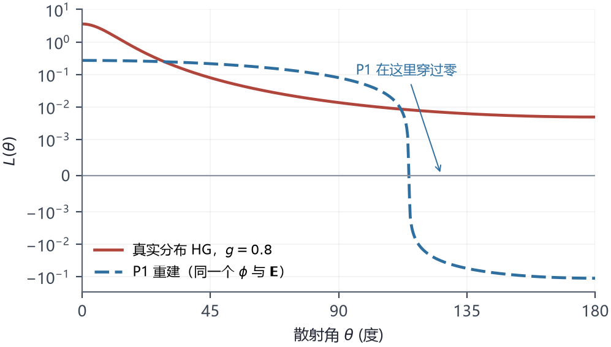
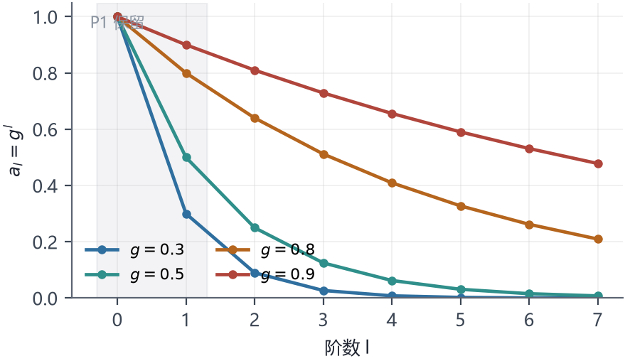

# 第 9 章 球谐展开与 P1 近似

## 9.1 方向是麻烦的来源

辐射传输方程里最讨厌的东西是方向 $\omega$。它出现在三个地方：左边的方向导数、右边的消光项、以及积分项里的被积函数。空间变量可以用有限差分或者有限元处理，方向变量不行——它定义在一个球面上，而球面没有自然的网格。

有三种处理方向的方式。离散纵标法把球面切成若干方向，每个方向解一个方程，方向之间用求积公式耦合，代价是方向数越多方程越多。蒙特卡洛把方向交给随机数。球谐展开把方向写成一组正交基函数的和，然后把方程投影到这组基上，变成一个关于系数的方程组。

球谐展开的好处是它与 RTE 的结构特别合拍：RTE 里的积分项是一个球面上的积分，而球谐函数是球面上的正交基，积分项在基底下变成乘法（因为相函数只依赖夹角，它的球谐展开把积分变成逐项相乘）。坏处是要截断，而截断会丢掉信息。

## 9.2 球谐函数

球谐函数 $Y_l^m(\omega)$ 是球面上的正交完备基，$l$ 是阶，$m$ 从 $-l$ 到 $l$。前几阶的形状是这样的：

$l=0$ 只有一个函数，是常数 $1/\sqrt{4\pi}$，描述各向同性。

$l=1$ 有三个函数，正比于 $\omega_x,\omega_y,\omega_z$，描述"朝某个方向偏"。

$l=2$ 有五个函数，是二次型，描述"沿某个方向拉长或压扁"。

因为本书只处理标量辐亮度（不处理偏振），用实球谐更方便：

$$L(x,\omega)=\sum_{l=0}^{\infty}\sum_{m=-l}^{l}L_{lm}(x)\,Y_{lm}(\omega) , \tag{9.1}$$

系数由投影得到：

$$L_{lm}(x)=\int_{4\pi}L(x,\omega)\,Y_{lm}(\omega)\,d\omega . \tag{9.2}$$

这个展开在数学上没有问题——球谐是完备的，无穷多项能精确表示任何平方可积的角分布。问题在实际：系数有无穷多个。

## 9.3 截断到一阶

把 (9.1) 截断到 $l=1$，得到四个系数。用物理量重新写这四个系数，会得到更直观的形式：

$$L(x,\omega)\approx\frac{1}{4\pi}\phi(x)+\frac{3}{4\pi}\mathbf{E}(x)\cdot\omega . \tag{9.3}$$

第一项是 $l=0$ 的系数，就是光通量密度除以 $4\pi$。第二项是 $l=1$ 的三个系数，组合成通量矢量。这个式子在第 2 章出现过（图 2-2 的偏心圆），那里是从"各向同性加一点漂移"的角度引入的，这里是从球谐展开推出来的——两条路得到同一个结果。

(9.3) 只有两个自由度：一个标量 $\phi$ 和一个矢量 $\mathbf{E}$。任何一个角分布在 P1 近似下都被压成这两样东西。这意味着 P1 无法表示任何有结构的角分布：不能有峰，不能有谷，不能有两个方向同时亮。

图 9-1 展示了这个局限。$g=0.8$ 的 HG 在正前方有一个长瓣，在 90 度以外几乎为零。P1 只能用偏心圆去拟合它，而偏心圆的形状由前两阶矩决定：为了匹配 $g=0.8$，圆必须偏得很厉害，结果在背向穿过了原点变成负值。

这个负值不是画图的错误，它是 P1 失效的直接信号：当 $3|\mathbf{E}|>\phi$ 时，(9.3) 在某些方向上给出负辐亮度。物理上不可能，数学上说明截断太粗暴。

## 9.4 两个矩方程

有了截断，就可以把 RTE 投影到 $l=0$ 和 $l=1$ 上。投影的方式是对 (6.1) 两边分别乘以 $1$ 和 $\omega$，再对全方向积分。

**零阶矩。** 对 (6.1) 两边积 $\int_{4\pi}d\omega$。左边变成

$$\int_{4\pi}\omega\cdot\nabla L\,d\omega=\nabla\cdot\int_{4\pi}\omega L\,d\omega=\nabla\cdot\mathbf{E} . \tag{9.4}$$

右边第一项是 $-\sigma_t\phi$。第二项是

$$\sigma_s\int_{4\pi}\int_{4\pi}L(\omega')\,p(\omega',\omega)\,d\omega'\,d\omega=\sigma_s\int_{4\pi}L(\omega')\,d\omega'=\sigma_s\phi , \tag{9.5}$$

这里用了相函数的归一化 (5.1)。两项合并，$\sigma_t-\sigma_s=\sigma_a$：

$$\nabla\cdot\mathbf{E}+\sigma_a\phi=0 . \tag{9.6}$$

这是连续性方程：通量矢量的散度等于被吸收掉的部分。如果介质有源，右边还要加源项。

**一阶矩。** 对 (6.1) 两边积 $\int_{4\pi}\omega\,d\omega$。左边是

$$\int_{4\pi}\omega\,(\omega\cdot\nabla L)\,d\omega=\nabla\cdot\int_{4\pi}\omega\otimes\omega\,L\,d\omega=\nabla\cdot\left(\frac{\phi}{3}\mathbf{I}\right)=\frac{1}{3}\nabla\phi , \tag{9.7}$$

中间那一步需要算 $\int\omega\otimes\omega\,L\,d\omega$。把 (9.3) 代进去，只有第二项贡献（因为 $\int\omega\otimes\omega\,d\omega=(4\pi/3)\mathbf{I}$ 而 $\int\omega\otimes\omega\,(\mathbf{E}\cdot\omega)\,d\omega$ 是一个全对称三阶张量的缩并，等于零）。结果是一个各向同性的二阶张量，所以散度变成一个梯度。

右边第一项是 $-\sigma_t\mathbf{E}$。第二项是

$$\sigma_s\int_{4\pi}\omega\int_{4\pi}L(\omega')\,p(\omega'\cdot\omega)\,d\omega'\,d\omega=\sigma_s\,g\,\mathbf{E} , \tag{9.8}$$

因为内层积分是相函数的一阶矩，等于 $g\omega'$。合并：

$$\frac{1}{3}\nabla\phi=-\left(\sigma_a+(1-g)\sigma_s\right)\mathbf{E}=-\sigma_t'\mathbf{E} . \tag{9.9}$$

把两个方程写在一起：

$$\nabla\cdot\mathbf{E}=-\sigma_a\phi,\qquad \frac{1}{3}\nabla\phi=-\sigma_t'\mathbf{E} . \tag{9.10}$$

这两个式子是整个第三篇的起点。第一个是守恒，第二个是 Fick 定律。注意第二个式子里出现的是 $\sigma_t'$ 而不是 $\sigma_t$——相似关系在这里自动冒出来了，它不是额外加的假设，是相函数一阶矩的直接结果。

## 9.5 一阶矩决定了什么

(9.10) 的第二个式子说明：光往哪流，由光通量密度的梯度决定，比例系数是 $-1/(3\sigma_t')$。这个系数只依赖 $\sigma_t'$，不依赖相函数的高阶矩。换句话说，P1 近似下，相函数的全部细节被压缩成一个数 $g$，而这个数只通过 $\sigma_t'$ 起作用。

这就是为什么相似关系在扩散里如此牢固：不是因为它是一个好的物理近似，而是因为它在这一层近似里是精确的。任何在 P1 框架内做的模型，都只能看到 $\sigma_t'$，看不到 $g$ 的剩余信息。

那么 $g$ 的剩余信息在哪里起作用？在 P1 之外。当二阶矩（$l=2$）被保留时，$g^2$ 会以另一个系数的形式出现；P3 近似里就有 $g^2$ 的项。这就是为什么 P3 比 P1 准，也是为什么单次散射项（它直接包含完整的相函数）不能被 P1 替代。

图 9-2 给出了为什么强前向散射让 P1 变差。$g=0.8$ 时 $g^2=0.64$ 仍然很大，截掉它等于丢了一个和 $g$ 同量级的项。$g=0.3$ 时 $g^3=0.027$，截断的代价就小得多。

## 9.6 边界与源

两个矩方程是 P1 的近似的全部，但它们没有边界条件。这不奇怪：原始的 RTE 是一阶的，边界条件是"指定入射方向上的辐亮度"；投影之后每个方程是二阶或一阶的，边界条件的数量对不上。

这是 P1 近似的一个结构性缺陷，它不能用严格的边界条件。实际做法是用"半空间的通量平衡"来近似：假定边界附近辐亮度的角分布是线性的（也就是 P1 形式），然后要求"射进来的通量等于反射回来的通量"。第 12 章会把这个条件化简成一个关于 $\phi$ 和 $\partial\phi/\partial n$ 的线性关系。

源项也要重新表述。RTE 里的源是"单位体积、单位立体角发出的功率"，在 P1 里被投影成两个量：零阶矩（各向同性部分）和一阶矩（方向性部分）。准直光束的投影很特殊：它在零阶矩和一阶矩上都有分量，而且一阶矩占主导（因为准直光高度定向）。这就解释了为什么把激光笔当成"埋一个各向同性点源"是一个近似——真实的光源在 P1 里有一阶矩，只有在散射若干次之后一阶矩才衰减到可以忽略。

---

这一章把方向变量换成了两个矩，得到了守恒方程和 Fick 定律。代价是丢掉了所有二阶以上的角信息，而这个代价在 $g$ 大的时候不小。下一章把这两个方程合成一个，得到扩散方程，并说明它的解长什么样。
