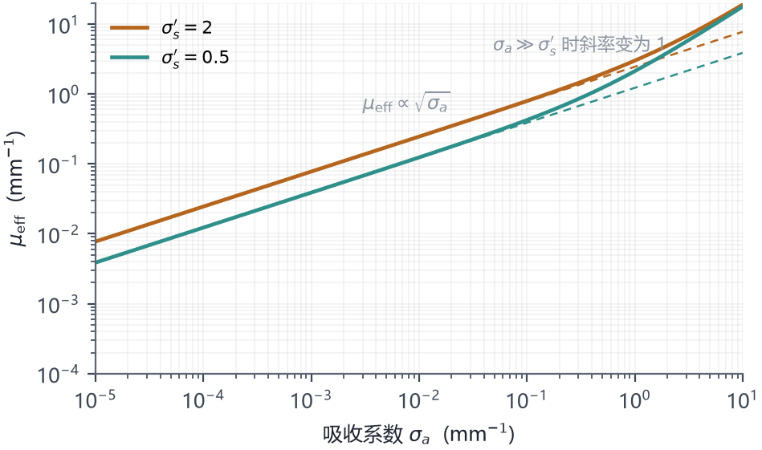
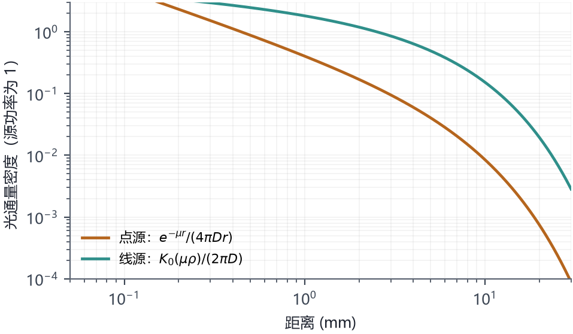

# 第 10 章 Fick 定律与扩散方程

## 10.1 一杯静置的牛奶

一杯牛奶静置一会儿，上层比下层稀一点，因为脂肪球在往上浮。这个密度梯度会导致扩散：脂肪球从密的地方往稀的地方走，单位时间穿过单位面积的粒子数正比于浓度梯度。

光在介质里的行为在数学上和这个过程一模一样。差别只在于扩散的东西从分子变成了光子，浓度变成了光通量密度。这不是类比，它是同一个方程在不同物理量上的表现：随机游走的宏观极限总是扩散方程。

上一章的两个矩方程里已经藏着这个方程。把 (9.10) 的第二个式子代进第一个，就得到扩散方程。这一章做这件事，然后把方程解出来，看看解的形状意味着什么。

## 10.2 从两个矩方程到一个方程

第 9 章得到的两式是

$$\nabla\cdot\mathbf{E}=-\sigma_a\phi,\qquad \frac{1}{3}\nabla\phi=-\sigma_t'\mathbf{E} . \tag{10.1}$$

第二式可以直接读成 Fick 定律：

$$\mathbf{E}=-D\nabla\phi,\qquad D=\frac{1}{3\sigma_t'}=\frac{1}{3\left(\sigma_a+(1-g)\sigma_s\right)} . \tag{10.2}$$

$D$ 是扩散系数，单位是长度。它的量纲值得注意：扩散系数通常的单位是"面积除以时间"，这里因为是稳态问题、长度用毫米，$D$ 就成了长度的量纲。这不是笔误，它来自 $\sigma$ 的量纲是长度的倒数。

把 (10.2) 代进第一式：

$$\nabla\cdot\left(-D\nabla\phi\right)=-\sigma_a\phi . \tag{10.3}$$

$D$ 在均匀介质里是常数，可以提到外面：

$$D\nabla^2\phi=\sigma_a\phi . \tag{10.4}$$

两边除以 $D$：

$$\nabla^2\phi=\frac{\sigma_a}{D}\phi=\mu_{\text{eff}}^2\phi . \tag{10.5}$$

这就是稳态扩散方程。加上源项 $Q$（单位体积单位时间注入的通量），形式是

$$\nabla^2\phi-\mu_{\text{eff}}^2\phi=-\frac{Q}{D} . \tag{10.6}$$

$\mu_{\text{eff}}$ 有两个等价的写法：

$$\mu_{\text{eff}}=\sqrt{\frac{\sigma_a}{D}}=\sqrt{3\sigma_a\sigma_t'}=\sqrt{3\sigma_a\left(\sigma_a+(1-g)\sigma_s\right)} . \tag{10.7}$$

第二个写法更常用，因为它只用到原始参数。$\mu_{\text{eff}}$ 的倒数就是光在介质里扩散的特征长度，习惯叫扩散长度，有的文献记作 $\delta$。

图 10-1 里有一个实用的结论。$\sigma_a\ll\sigma_s'$ 时，$\mu_{\text{eff}}\approx\sqrt{3\sigma_a\sigma_s'}$，随吸收按平方根变化：吸收增大四倍，衰减率只增大两倍。这意味着在半透明材料上，把吸收系数调大有"收益递减"——颜色变深得比参数变化慢。渲染时如果发现调 $\sigma_a$ 效果太钝，多半就是这个平方根。

## 10.3 三个解

扩散方程在不同几何下的解都是初等的。三个最常用的：

**一维平板。** 无限大的平板，厚度 $L$，两侧边界上 $\phi=0$。解是两个指数函数的差：

$$\phi(z)=A\left(e^{-\mu_{\text{eff}}z}-e^{-\mu_{\text{eff}}(2L-z)}\right) , \tag{10.8}$$

其中 $z$ 从一侧边界量起。这个形式在第 16 章处理薄层时会用到，它自动满足两侧的零边界条件。

**无限介质中的点源。** 这是最重要的一个，第 11 章专门处理。解是

$$\phi(r)=\frac{P}{4\pi D}\frac{e^{-\mu_{\text{eff}}r}}{r} , \tag{10.9}$$

$P$ 是源功率。$1/r$ 来自点源在三维空间里的几何扩散，$e^{-\mu_{\text{eff}}r}$ 来自吸收。

**无限介质中的线源。** 二维问题的基本解，用零阶修正 Bessel 函数：

$$\phi(\rho)=\frac{P}{2\pi D}K_0(\mu_{\text{eff}}\rho) . \tag{10.10}$$

$K_0$ 在远处的渐近行为是 $e^{-x}/\sqrt{x}$，比三维的 $1/r$ 衰减得慢。这个差别在处理纤维、毛发这类准一维几何时很重要。

图 10-2 把三维与二维的解叠在一起。近处三维解更亮（点源的 $1/r$ 比线源的对数发散更陡），远处二维解更亮（缺失的那一维几何摊薄让它衰得慢）。处理纤维状几何时这个差别不能忽略。

三个解的共同点是它们都只依赖 $\mu_{\text{eff}}$ 和 $D$。也就是说，一旦把 $\sigma_a,\sigma_s,g$ 压成这两个数，几何之外的一切信息都没了。两个参数完全不同的介质，只要 $\mu_{\text{eff}}$ 和 $D$ 相同，扩散方程给出的光场完全相同。这个退化是扩散理论的一个特征，也是它的局限：它没法区分"强散射弱吸收"和"弱散射强吸收"这两种完全不同的物理。

## 10.4 Fick 定律在哪里失效

Fick 定律是 P1 截断的直接结果，所以 P1 的失效方式它全都有。具体有三条。

**梯度太大的地方。** 光源附近，光通量密度在几个平均自由程内变化好几个数量级，梯度很大。这时 P1 假设的"角分布是线性函数"完全不成立，因为光还是高度定向的。Fick 定律给出的通量会偏小，因为它假定方向已经随机化了。

**边界附近。** 界面上光的角分布是半球的，不是线性的。Fick 定律在边界处需要一个修正，这个修正就是第 12 章的外推边界。

**强吸收。** $\sigma_a$ 接近或者超过 $\sigma_s'$ 时，$\mu_{\text{eff}}$ 变得和 $\sigma_t'$ 同量级，光走不到一个扩散长度就被吸收了。这时扩散方程的解和真实解差别很大：真实的光还没来得及"扩散"就被吃掉了。

三条合起来，就是第 8 章那个区间条件 (8.6) 的另一种表述。

## 10.5 一个数值细节：D 的定义

$D$ 的定义在不同文献里不一样。本书用 $D=1/(3\sigma_t')$，这是最常见的形式。另一些文献用 $D=1/(3\sigma_s')$，理由是吸收很小时 $\sigma_t'\approx\sigma_s'$。还有用 $D=1/(3(\sigma_a+(1-g)\sigma_s))$ 和 $D=1/(3(\sigma_s+(1-g)\sigma_a))$ 的。

这些差别在 $\alpha'$ 接近 1 时可以忽略，在 $\alpha'$ 小的时候会带来明显的不同。原因是"吸收"到底是在扩散方程里显式出现（本书的做法），还是被折进扩散系数。两种做法的物理解释不同：显式出现强调"光子在扩散过程中被吃掉"，折进系数强调"吸收让扩散变慢"。

实现时选一个，然后在整条链上保持一致。混用会导致 $\mu_{\text{eff}}$ 的计算出错，而 $\mu_{\text{eff}}$ 出错的表现是"颜色对但尺寸不对"——光斑的宽度和预期的差一个固定比例。

---

这一章把两个矩方程合成一个二阶方程，并且给出了三个几何下的解。所有解的形状都是"几何衰减乘指数衰减"：$1/r$ 或者 $K_0$ 负责几何，$e^{-\mu_{\text{eff}}r}$ 负责吸收。下一章把点源的解单独拿出来，因为它是构成偶极子的那块砖。
