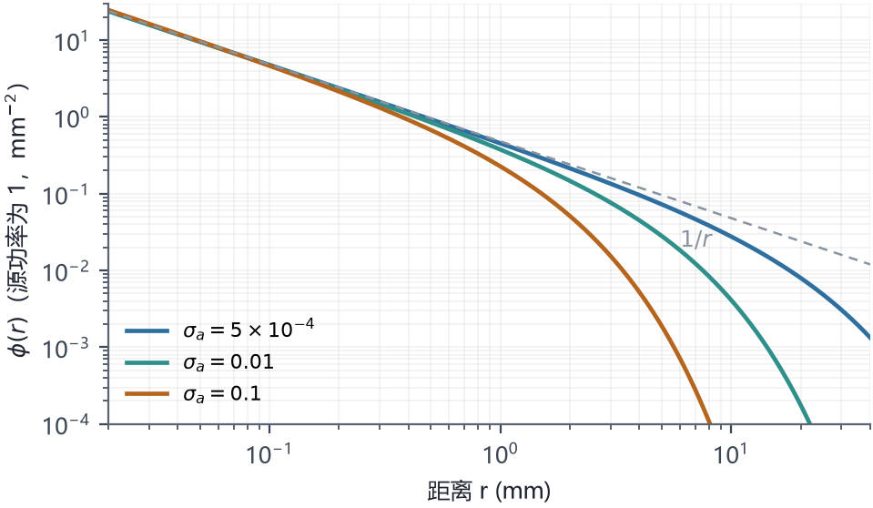
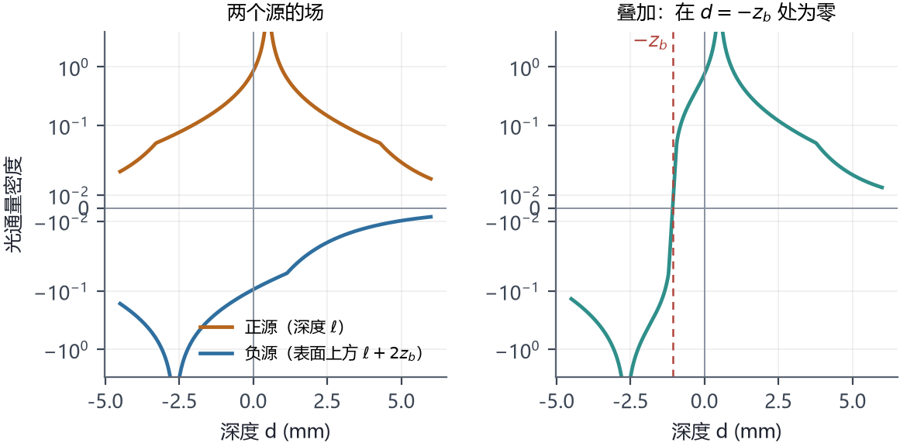

# 第 11 章 Green 函数

## 11.1 一块埋在地里的灯

想象在介质内部某个点上放一个很小的灯泡，向各个方向均匀发光。介质会吸收和散射，光往外扩散，形成一团光晕。离灯越远，光晕越暗。

这团光晕的形状就是这一章要算的东西。它有一个专门的名字：无限介质中的 Green 函数。名字里的"Green"是因为它是线性方程的基本解——任何分布的源都可以看成很多点源的和，而每一个点源的贡献都由 Green 函数给出，把它们加起来就得到总的光场。

在次表面散射里，Green 函数是所有模型的砖块。偶极子是两个 Green 函数相加（一正一负），多极子是无穷多个，光子束扩散是一个沿直线的积分。所以这一章值得慢慢做。

## 11.2 球对称的解

扩散方程 (10.6) 在均匀介质、无源区里是

$$\nabla^2\phi-\mu_{\text{eff}}^2\phi=0 . \tag{11.1}$$

点源有球对称性，所以 $\phi$ 只依赖半径 $r$。球坐标下的拉普拉斯算子作用在只依赖 $r$ 的函数上是

$$\nabla^2\phi=\frac{1}{r^2}\frac{d}{dr}\left(r^2\frac{d\phi}{dr}\right)=\frac{1}{r}\frac{d^2}{dr^2}(r\phi) . \tag{11.2}$$

第二个等号是一个恒等式，它把算子化简成"对 $r\phi$ 求二阶导再除以 $r$"。这一步是解这个方程的关键：把 $u=r\phi$ 代入，方程变成

$$\frac{1}{r}\frac{d^2u}{dr^2}=\mu_{\text{eff}}^2\frac{u}{r}\quad\Longrightarrow\quad\frac{d^2u}{dr^2}=\mu_{\text{eff}}^2u . \tag{11.3}$$

一个常系数二阶线性常微分方程，通解是两个指数：

$$u=Ae^{-\mu_{\text{eff}}r}+Be^{+\mu_{\text{eff}}r} . \tag{11.4}$$

$r\to\infty$ 时光通量密度必须趋于零，所以 $B=0$。于是

$$\phi(r)=\frac{A}{r}e^{-\mu_{\text{eff}}r} . \tag{11.5}$$

剩下的常数 $A$ 由源的功率定。

## 11.3 定常数：靠近源看

源附近的吸收可以忽略，因为光还没走远。取 $\mu_{\text{eff}}\to0$ 的极限，(11.5) 变成 $\phi=A/r$。

在没有吸收的无限介质里，一个功率为 $P$ 的各向同性点源产生的光通量密度必须满足能量守恒。以源为心取半径 $r$ 的球面，穿过球面的总通量等于 $P$：

$$\oint\mathbf{E}\cdot d\mathbf{S}=P . \tag{11.6}$$

由 Fick 定律 $\mathbf{E}=-D\nabla\phi$，径向分量是 $E_r=-D\,d\phi/dr=D A/r^2$。球面积是 $4\pi r^2$，所以

$$4\pi r^2\cdot\frac{DA}{r^2}=P\quad\Longrightarrow\quad A=\frac{P}{4\pi D} . \tag{11.7}$$

合起来：

$$\phi(r)=\frac{P}{4\pi D}\frac{e^{-\mu_{\text{eff}}r}}{r} . \tag{11.8}$$

这个式子值一千个字。它把"点源的光晕"拆成两个因子：$1/r$ 是几何，来自三维空间里能量摊在面积上；$e^{-\mu_{\text{eff}}r}$ 是吸收，来自光在扩散过程中被吃掉。两个因子的乘积就是图 11-1 的样子。

图 11-1 里可以读出一个实用的规则：曲线的转折点大约在 $r=1/\mu_{\text{eff}}$ 处。比它近的地方是几何主导，比它远的地方是吸收主导。这个长度就是扩散长度，第 8 章把它当成"光在介质里能走多远"的估计。

## 11.4 通量与出射度

有了 $\phi$，通量矢量由 Fick 定律给出。对球对称的解，梯度只有径向分量：

$$\frac{d\phi}{dr}=-\frac{P}{4\pi D}\frac{e^{-\mu_{\text{eff}}r}}{r^2}\left(1+\mu_{\text{eff}}r\right) , \tag{11.9}$$

所以

$$E_r=-D\frac{d\phi}{dr}=\frac{P}{4\pi}\frac{e^{-\mu_{\text{eff}}r}}{r^2}\left(1+\mu_{\text{eff}}r\right) . \tag{11.10}$$

这个量的形状在偶极子里会反复出现。它比 $\phi$ 多一个 $1/r$ 的幂次，衰减更快，并且在 $r\to0$ 时像 $1/r^2$ 一样发散。

发散这件事不是物理的。真实的点源不存在，光源总有一个有限大小；而且靠近源的地方扩散近似本身不成立。所以 (11.8) 和 (11.10) 只在 $r$ 大于一个输运平均自由程时可信。第 13 章处理偶极子时，会用 $z_r=1/\sigma_t'$ 这个深度把源的奇点绕开——物理上相当于承认"光在进入介质一个输运自由程之后才变成各向同性源"。

## 11.5 二维的版本

如果源的形状是线而不是点，对称性从球对称降为柱对称，方程变成

$$\frac{1}{\rho}\frac{d}{d\rho}\left(\rho\frac{d\phi}{d\rho}\right)-\mu_{\text{eff}}^2\phi=0 . \tag{11.11}$$

这个方程的解是零阶修正 Bessel 函数 $K_0$：

$$\phi(\rho)=\frac{P}{2\pi D}K_0(\mu_{\text{eff}}\rho) . \tag{11.12}$$

$K_0$ 在近处的行为是 $-\ln(\mu\rho)$，在远处是 $e^{-\mu\rho}/\sqrt{\rho}$。两个行为都和三维不同：近处是对数发散（比 $1/r$ 温和），远处多了一个 $1/\sqrt{\rho}$ 的几何因子。

这个差别在什么时候重要？当几何的某一维远大于另外两维时。一根纤维、一束头发、一条细长的手指点，都属于这种情况。直接用三维解会把亮度估低，因为它假定了能量往三个方向摊开，而实际上只往两个方向摊。

图 11-2 展示了叠加原理的用处。扩散方程是线性的，多个源的解可以直接相加。当两个源的符号相反、位置对称时，它们的场在某个平面上抵消——这个平面就是后面要用的外推边界。

## 11.6 这个解的适用范围

Green 函数 (11.8) 是扩散方程在无限介质里的精确解，它的误差全部来自"扩散方程本身是否成立"，而不是解错了。具体三条。

**近源区不成立。** $r\lesssim\ell^*$ 时，解给出的值偏大（因为 $1/r$ 发散而真实的光斑有有限的峰值）。修正方式是把源当成有一定大小的分布，或者把这一段交给单次散射。

**强吸收不成立。** $\mu_{\text{eff}}$ 与 $\sigma_t'$ 同量级时，光走不到一个扩散长度就被吸收，扩散方程的解会高估远处的亮度。

**各向异性源不成立。** 真实的入射光是准直的，不是各向同性的。把它当成各向同性点源，等于假定光在进入介质后立刻忘了方向。这个假设的误差在近源区最大，第 18 章的方向偶极子专门修它。

## 11.7 有限体积里怎么用

Green 函数是为无限介质准备的，真实物体是有限的。把它用到有限物体上有两种做法，各自的误差方向相反。

第一种是把物体当成半无限（用第 12 章的外推边界），远处截断不管。这适合物体的一维尺寸远大于扩散长度的情况（躯干、墙面），误差在边缘附近。

第二种是把物体切成若干块，每块用局部的 Green 函数，块之间用"面上通量连续"接起来。这相当于把积分方程离散化，精度取决于块的大小，块数一多代价就上去了。

第三种做法介于两者之间，也是实际项目里最常见的：在着色点附近用 Green 函数（局部），在远处用环境光或者预计算的 irradiance 近似（全局）。两块之间有一个过渡半径，取三到五个扩散长度。这个做法的误差主要来自过渡处的接缝，通常用权重函数抹平。

## 11.8 一个可以手算的检查

Green 函数 (11.8) 有一个可以手算的性质：把 $\sigma_a$ 设为 0，总通量应当等于源功率，与半径无关。

验证：$\phi=P/(4\pi Dr)$，径向通量 $E_r=-D\,d\phi/dr=P/(4\pi r^2)$，乘球面积 $4\pi r^2$ 得 $P$。这一步全部是代数，但它检查了三件事：$1/(4\pi D)$ 这个系数对不对，Fick 定律的符号对不对，以及 $1/r$ 的幂次对不对。实现里这三处最容易写错，而且写错之后曲线形状变化不大，肉眼很难发现。

有吸收时，半径 $r$ 的球面上的总通量是 $P\,e^{-\mu_{text{eff}}r}(1+\mu_{text{eff}}r)$，比 $P$ 小。小的那部分就是 $r$ 以内被吸收掉的能量。这个式子可以用来检查实现的能量账本：把各半径的通量加起来，应当等于源功率。

---

这一章得到了扩散理论的基本砖块：一个点源在无限介质里的光场。它的形状是 $1/r$ 乘指数衰减，两个因子分别对应几何和吸收。下一章处理砖块与真实几何之间的那道缝：表面。
