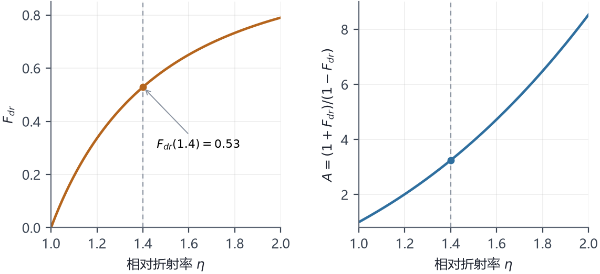
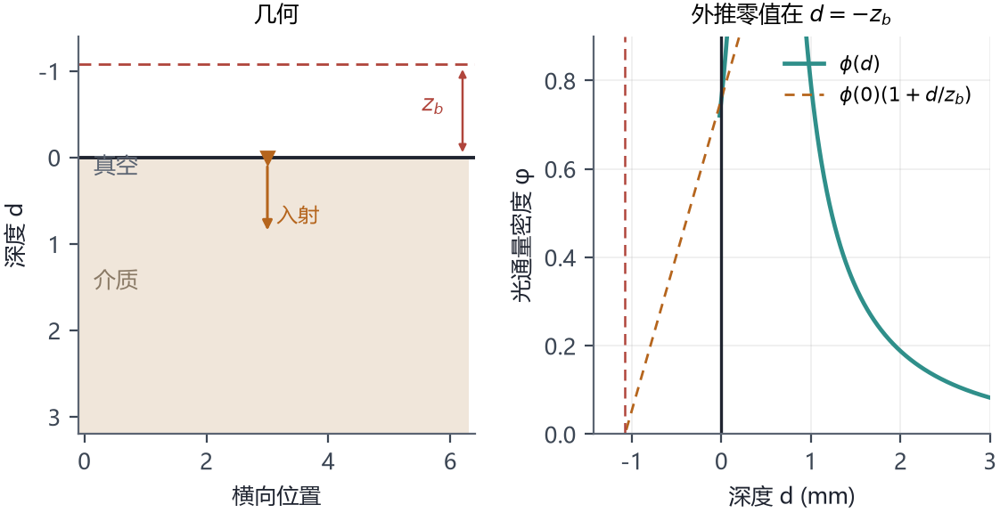

# 第 12 章 边界条件与外推边界

## 12.1 一束光从水里射向空气

在水下抬头看，头顶有一个圆形的窗户，窗外是水面之上的世界。窗户之外是镜面——那是全反射区，光从水里射向水面，角度太斜，出不去，被水面弹了回来。

次表面散射里的界面同时具有这两种行为。法线方向附近的光能出去，掠射方向的光被弹回来。出去的那部分变成我们看到的颜色，回来的那部分继续在介质里游荡，最终可能从别处出去，也可能被吸收。

扩散方程本身对这件事一无所知。它只是一个关于 $\phi$ 的方程，方程里没有"外面"。所以必须在边界上补一个条件，把"有一部分光会跑掉、有一部分会回来"这件事写成 $\phi$ 与它的导数之间的关系。

## 12.2 从半球积分到边界条件

用第 9 章的 P1 形式，界面附近的辐亮度是

$$L(\omega)=\frac{\phi}{4\pi}+\frac{3}{4\pi}\mathbf{E}\cdot\omega . \tag{12.1}$$

现在站在界面内侧，把半球分成两半：朝外的（$\omega\cdot n>0$）和朝内的。朝外的那一半里，光正在离开介质；朝内的那一半里，光正在进入介质。

离开介质的通量是

$$J_{\text{out}}=\int_{\Omega_+}L(\omega)\,(\omega\cdot n)\,d\omega=\frac{\phi}{4}+\frac{E_n}{2} , \tag{12.2}$$

进入介质的通量是

$$J_{\text{in}}=\int_{\Omega_-}L(\omega)\,(-\omega\cdot n)\,d\omega=\frac{\phi}{4}-\frac{E_n}{2} , \tag{12.3}$$

其中 $E_n=\mathbf{E}\cdot n$ 是通量矢量的法向分量。两式的推导只用了一个事实：在半球上 $\int(\omega\cdot n)^2d\omega=2\pi/3$。

反射回来的那部分等于进入的通量乘漫反射率 $F_{dr}$。界面上没有光源时，离开的通量正好等于反射回来的：

$$J_{\text{out}}=F_{dr}\,J_{\text{in}} . \tag{12.4}$$

代进 (12.2) 和 (12.3)：

$$\frac{\phi}{4}+\frac{E_n}{2}=F_{dr}\left(\frac{\phi}{4}-\frac{E_n}{2}\right) . \tag{12.5}$$

整理出 $E_n$ 与 $\phi$ 的关系：

$$E_n=-\frac{1-F_{dr}}{2(1+F_{dr})}\,\phi . \tag{12.6}$$

再用 Fick 定律 $E_n=-D\,\partial\phi/\partial n$：

$$\phi=2AD\,\frac{\partial\phi}{\partial n},\qquad A=\frac{1+F_{dr}}{1-F_{dr}} . \tag{12.7}$$

这个式子叫 Robin 边界条件，也叫第三类边界条件。它的意思是：边界上光通量密度的值正比于它的法向导数。比例系数里包含了 $D$（介质属性）和 $A$（界面属性）。

$A$ 的名字叫反射参数。$F_{dr}=0$ 时（无反射界面）$A=1$；反射越强，$A$ 越大，因为反射把更多的光留在介质里，边界处的梯度必须更陡才能把能量送出去。

## 12.3 漫反射率

$F_{dr}$ 是"从介质内部射向界面的漫射光，有多大比例被反射回来"。定义是

$$F_{dr}=\frac{1}{\pi}\int_{2\pi}F(\theta)\cos\theta\,d\omega=2\int_0^{\pi/2}F(\theta)\cos\theta\sin\theta\,d\theta , \tag{12.8}$$

$F(\theta)$ 是 Fresnel 反射率，$\theta$ 是内部角度，超过临界角时 $F=1$。

这个积分没有初等解，需要数值算。Donner 与 Jensen 在 2005 年的论文里给了一个多项式拟合（引自 Egan 等 1973）：

$$F_{dr}\approx\begin{cases}-0.4399+0.7099/\eta-0.3319/\eta^2+0.0636/\eta^3, & \eta<1\\ -1.4399/\eta^2+0.7099/\eta+0.6681+0.0636\eta, & \eta>1\end{cases} \tag{12.9}$$

$\eta=1.4$ 时这个多项式给出 0.530，与直接数值积分的结果一致到小数点后三位。

图 12-1 里有两个值得注意的地方。

$F_{dr}$ 在 $\eta=1$ 附近上升得很快。$\eta$ 从 1 到 1.1，$F_{dr}$ 从 0 跳到 0.12。这意味着折射率的小误差会带来不小的能量误差，尤其是在折射率接近空气的材料上（比如冰、水凝胶）。

$A$ 对 $F_{dr}$ 的敏感度更高。$F_{dr}=0.53$ 时 $A=3.25$，而 $F_{dr}=0.3$ 时 $A=1.86$。因为 $A$ 是比值，分母 $1-F_{dr}$ 很小，$F_{dr}$ 的一点变化会被放大。

## 12.4 外推边界

(12.7) 是一个微分方程形式的边界条件，用起来不方便。可以把它换成一个更直观的形式。

假设边界附近 $\phi$ 随深度线性变化（这个假设在离边界一两个自由程内成立），那么把这条直线向外延长，它会与零相交于某个深度。这个深度记为 $-z_b$，而由 (12.7) 可以算出

$$z_b=2AD . \tag{12.10}$$

证明只需一步：设 $\phi(d)=\phi_0(1-d/z_b)$（$d$ 是向内的深度），则 $\partial\phi/\partial n=-\partial\phi/\partial d=\phi_0/z_b$，代入 (12.7) 得 $\phi_0=2AD\phi_0/z_b$，即 $z_b=2AD$。

图 12-2 是这个变换的几何。原来的问题定义在 $d>0$，边界条件是一个混合条件；变换之后问题定义在 $d>-z_b$，边界条件是 $\phi=0$。区域大了一点，条件简单了很多。

这个技巧在扩散问题里叫镜像法。它的价值在于：$\phi=0$ 的平面可以用一对符号相反的源来满足，而一对源的场我们已经会算了（第 11 章）。所以第 13 章的偶极子几乎是自动得到的。

要把这一节的分寸说清楚。外推平面上的零值被精确满足，但它只是 Robin 条件的一个线性化版本。图 12-2 右图里的真实场在表面附近弯曲得厉害，切线斜率和 $\phi(0)/z_b$ 差了三倍，所以 Robin 条件本身并没有被精确满足。这个差别不是推导错了，是"把边界附近的曲线当成直线"的代价。它的宏观后果很小（总反射率差侾 1%），局部后果不小（光源正下方那几毫米的亮度会偏低），第 15 章会把这两个后果分开算。

$z_b$ 的量级值得记住。皮肤（$\eta=1.4$，$\sigma_s'=2\ \mathrm{mm^{-1}}$）时 $D=0.167\ \mathrm{mm}$，$A=3.25$，$z_b=1.08\ \mathrm{mm}$——比一个输运平均自由程（0.5 mm）还大。这是因为反射把光推回了介质内部，等效的"零平面"被推到了表面之外一毫米的地方。

## 12.5 有限厚度的边界

一块厚度为 $L$ 的平板有两个界面。上界面的外推平面在 $d=-z_b$，下界面的在 $d=L+z_b$。两个平面都要求 $\phi=0$。

这时单个偶极子不够了，因为满足上面一个条件会破坏下面一个。解决办法是无限次镜像：把上界面的镜像再对下界面镜像，再对上界面镜像，如此往复。得到的就是第 16 章的多极子。

这个结构在数学上对应一个周期为 $2(L+2z_b)$ 的源序列。周期越小（板越薄），需要的项越多，收敛越慢。板厚趋于零时序列发散——这不是数学缺陷，是物理的：一块零厚度的板不需要扩散理论。

## 12.6 边界条件在哪里碎

Robin 条件建立在三个假设上。

**平面。** 界面的曲率半径必须远大于 $z_b$。手指的直径是 10 毫米，$z_b$ 是 1 毫米，比例是 10，勉强可以；一根头发的直径是 0.07 毫米，比例是 0.06，完全不行。毛发必须用圆柱几何的解。

**光滑。** 界面粗糙时，Fresnel 的角依赖被平均掉，$F_{dr}$ 的有效值会变。粗糙度大于波长时，需要用微表面的统计来描述透射，这属于布料和粗糙表面那一册的内容。

**单层。** 皮肤表面有油脂、有汗、有化妆品。多层界面的每一层都有自己的 Fresnel 和厚度，正确的做法是用传输矩阵或者逐层迭代，而不是一个 $A$。

三条假设里，第一条在实际项目里最容易被忽略。渲染人脸时，鼻翼、耳廓、指缝这些地方的曲率半径和 $z_b$ 同量级，用平面解会把透光估少。补偿的办法是人为调大 $z_b$，代价是别处的透光变多。

---

这一章把界面折算成一个虚构的零值平面，把混合边界条件变成了简单边界条件。这个变换本身只是一个代数操作，但它让第 13 章的偶极子成为可能：一旦边界是 $\phi=0$，就可以用一对符号相反的源来满足它，而这两个源就是偶极子。
