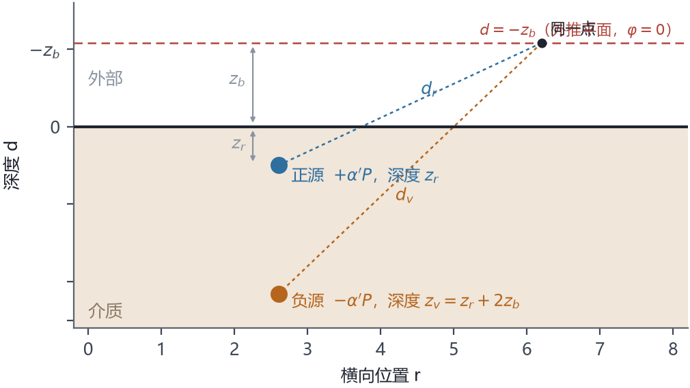
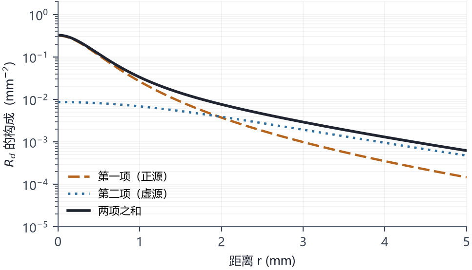
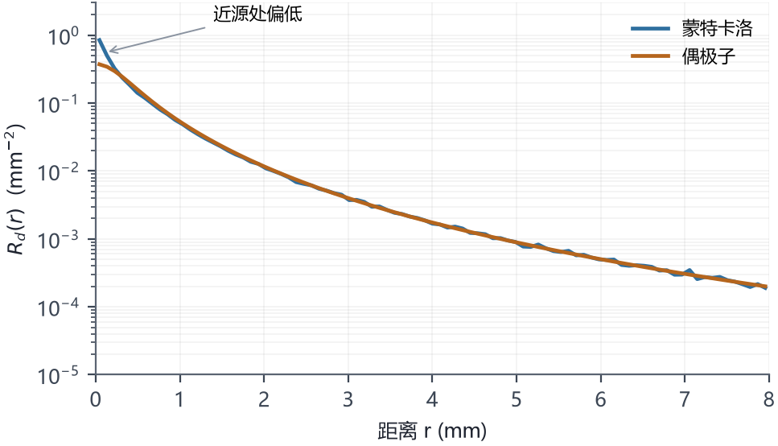

# 第 13 章 偶极子

## 13.1 一条曲线的来历

到这一章，需要的零件都齐了。

有一个点源在无限介质里的光场（第 11 章）：

$$\phi(r)=\frac{P}{4\pi D}\frac{e^{-\mu_{\text{eff}}r}}{r} . \tag{13.1}$$

有一个把表面折算成零值平面的办法（第 12 章）：在表面上方 $z_b$ 处要求 $\phi=0$，而 $z_b=2AD$。

有一个把光场变成出射亮度的关系（第 2 章与第 10 章）：出射度等于 Fick 定律给出的法向通量。

把这三样拼起来，就得到一条曲线 $R_d(r)$：单位功率的光从一点进去，从距离 $r$ 处出来的比例密度。这条曲线是这一册的主角，它的解析形式在 2001 年由 Jensen、Marschner、Levoy 与 Hanrahan 给出，二十多年过去，仍然是实时渲染和离线渲染的默认选项之一。

值得完整推一遍的理由不是历史，而是结构：后面所有改进模型（多极子、量化扩散、方向偶极子）都是在这个结构上做局部替换。看懂了这块砖怎么砌的，换砖的时候就知道该动哪里。

## 13.2 把入射光变成一个埋着的源

真实的入射光从外面来，是一束准直光；扩散方程要的是一个体源。两者之间差一步转换。

物理图像是这样：光进入介质后，走大约一个输运平均自由程，方向被散射随机化得差不多了。从这之后，它在扩散方程眼里就可以当成一个各向同性的点源。

源的位置：表面下方深度

$$z_r=\frac{1}{\sigma_t'}=\frac{1}{\sigma_a+(1-g)\sigma_s} . \tag{13.2}$$

源强：$\alpha'P$，其中 $P$ 是入射功率。

位置取 $1/\sigma_t'$ 是一个选择，不是推导的结果。合理的理由有三条：量纲上它是对的量；物理上 $\sigma_t'$ 是唯一与"方向被打乱"相关的长度尺度；实验上 Pattersen 等在 1989 年用这个值拟合蒙特卡洛，误差很小。文献里也有取 $1/\sigma_t$ 或 $0.6/\sigma_t'$ 的，彼此差 10% 到 20%，选定一个之后整条链要保持一致。

源强取 $\alpha'P$ 的理由来自能量：我们要求 $\alpha'\to1$ 时总反射率趋于 1（无吸收介质里所有光最终都出来）。第 13.6 节会验证这一点确实成立。

## 13.3 镜像

现在把整个空间当成无限介质，放两个源：正源在表面下方 $z_r$ 处，负源在表面上方 $z_v=z_r+4AD=z_r+2z_b$ 处。光通量密度是两者之差：

$$\varphi(r,d)=\frac{\Phi}{4\pi D}\left[\frac{e^{-\mu d_r}}{d_r}-\frac{e^{-\mu d_v}}{d_v}\right] , \tag{13.3}$$

$d_r,d_v$ 是场点到两个源的距离。

这样放的理由是让 $\varphi$ 在外推平面 $d=-z_b$ 上为零。取该平面上任一点，它到正源的距离是 $\sqrt{r^2+(z_r+z_b)^2}$，到负源的距离是 $\sqrt{r^2+(z_v-z_b)^2}$，而 $z_v-z_b=z_r+2z_b-z_b=z_r+z_b$。两个距离相等，源强相反，所以贡献处处抵消。

两个源的位置关系有一个直观的解释。负源可以看成"介质外部那块被挖掉的空间"的替身：真实问题里没有介质的地方，用一个负的源把它填平。

图 13-1 是这个几何。注意负源在表面之外，图上把介质画在下半部分，负源在上半部分。$z_v$ 里那个 $2z_b$ 就是外推平面到负源之间的距离。

## 13.4 求表面出射度

出射度由 Fick 定律给出，等于法向通量。先算单个源在深度 $z$ 处（$z$ 可以为负，表示在表面之上）的贡献。距离 $d_0=\sqrt{r^2+(d-z)^2}$，对深度 $d$ 求导：

$$\frac{\partial}{\partial d}\left(\frac{e^{-\mu d_0}}{d_0}\right)=\left(-\mu-\frac{1}{d_0}\right)\frac{e^{-\mu d_0}}{d_0}\cdot\frac{d-z}{d_0} . \tag{13.4}$$

在 $d=0$ 处 $(d-z)/d_0=-z/d_0$。三个因子相乘，再乘 Fick 定律的 $-D$ 和外法线方向，得到

$$M_0(r)=\frac{P}{4\pi}\cdot\frac{z\,(1+\mu d_0)\,e^{-\mu d_0}}{d_0^{3}} ,\qquad d_0=\sqrt{r^2+z^2} . \tag{13.5}$$

这一步里 $D$ 消掉了：$\varphi$ 前面的 $1/(4\pi D)$ 与 Fick 定律里的 $D$ 正好抵消。$\mu d_0$ 是无量纲组合，括号里的 1 来自 $-1/d_0$ 那一项。

现在把两个源加起来。正源的 $z=z_r>0$，贡献为正；负源的 $z=-z_v<0$，而 $\varphi$ 里它带负号，两个负号相乘变正。所以两项在出射度里**相加**：

$$R_d(r)=\frac{\alpha'}{4\pi}\left[\frac{z_r\left(1+\mu d_r\right)e^{-\mu d_r}}{d_r^{3}}+\frac{z_v\left(1+\mu d_v\right)e^{-\mu d_v}}{d_v^{3}}\right] , \tag{13.6}$$

$$d_r=\sqrt{r^2+z_r^2},\qquad d_v=\sqrt{r^2+z_v^2},\qquad z_v=z_r+2z_b .$$

这个"负源在光通量密度里减、在出射度里加"的翻转，是偶极子公式里最容易推错的一步。原因不神秘：负源在表面之上，它的场在法线方向上的变化率与正源相反，取绝对值之后符号就翻了过来。如果照抄 (13.3) 的减号去写出射度，得到的曲线总能量为零，在远处还会出现负值。

## 13.5 两项的形状

(13.6) 里的两项分工明确，但分工的方式和直觉不同。

第一项是"源直接照到表面上的光"。它的尺度由 $z_r\approx0.5\ \mathrm{mm}$ 决定，所以很窄，在 $r=0$ 处最亮，一毫米外掉两个数量级。

第二项是"边界送回来的光"的替身。它的尺度由 $z_v\approx2.7\ \mathrm{mm}$ 决定，所以又宽又平。它在 $r=0$ 处只有第一项的百分之一二，但在 $r\approx1.5\ \mathrm{mm}$ 附近就追上了第一项，之后完全主导。

图 13-2 把两项分开画。面积分的结果是第一项贡献 0.42，第二项贡献 0.20，合计 0.61——第二项占了总能量的三分之一。它不是可以省略的小修正，而是光斑外围那一圈的全部来源。

这个结构解释了一个视觉特征：靠近光源的地方颜色最接近入射光，越往外越偏红。近处的光走的路短，吸收少；远处的光在介质里绕了一圈，蓝绿光被吃掉了。换成带波长的参数之后，这个颜色梯度会自动出现，不需要额外做任何事。

## 13.6 三个极限

**$r\to0$。** $d_r\to z_r$，$d_v\to z_v$，公式给出有限值：

$$R_d(0)=\frac{\alpha'}{4\pi}\left[\frac{1+\mu z_r}{z_r^2}e^{-\mu z_r}+\frac{1+\mu z_v}{z_v^2}e^{-\mu z_v}\right] . \tag{13.7}$$

有限而不是无穷，因为源被埋在 $z_r>0$ 处。这个有限值是偶极子能直接塞进着色器的前提：如果它在 $r=0$ 发散，采样就没法处理。

**$r\to\infty$。** 两项都按 $e^{-\mu r}/r^2$ 衰减，比值趋于常数，所以整条曲线按 $e^{-\mu r}/r^2$ 衰减。对数坐标下是一段斜率 $-2$ 的直线被指数弯折，正是第 1 章图 1-2 的形状。

**$\alpha'\to1$。** $\mu\to0$，指数因子全部变成 1，公式退化成纯代数形式 $[z_r/d_r^3+z_v/d_v^3]/(4\pi)$，它的面积分恰好是 1。这个性质可以用来检查实现的归一化：把 $\sigma_a$ 设为 0，积分 $2\pi rR_d$，结果应当非常接近 1。

## 13.7 与蒙特卡洛对照

公式再漂亮也要和真值对一遍。图 13-3 是这种对照：同一组参数，一边是 (13.6)，一边是把 15 万个光子在同样的介质里追出来的统计结果，两侧折射率匹配。

三个观察。

曲线形状对得很好。从 0.3 毫米到十几毫米，两条线在 5% 以内重合。这说明 $1/r^2$ 加指数衰减的结构是对的，$\mu_{\text{eff}}$ 的取值也是对的。

近源处偏低。$r<0.3\ \mathrm{mm}$ 时偶极子只有蒙特卡洛的三分之一。这一段的光主要是低阶散射，甚至包括只散射一次的那部分，而扩散模型从第一步就把光当成各向同性源，跳过了这些。

总量几乎相同。偶极子 0.912，蒙特卡洛 0.911。近源那一块的误差不影响总量，因为那一块面积很小。

对大多数渲染用途，这个精度绰绰有余。这是偶极子能活二十多年的原因：它不精确，但在能量和形状上都足够接近，而且是一个能手算、能手推、能一行代码实现的公式。

## 13.8 参数怎么影响外观

公式里有四个独立的物理参数：$\sigma_a,\sigma_s,g,\eta$。它们对剖面的影响可以分开看。

$\sigma_s'$ 决定宽度。它出现在 $\sigma_t'$、$D$、$\mu_{\text{eff}}$ 里，增大它会把曲线压窄、抬高。这是"散射越强，光越集中"的数学表现。

$\sigma_a$ 决定尾部。它主要影响 $\mu_{\text{eff}}$，所以增大它会削掉远处而几乎不动近处。这是"深色材料看起来更闷"的来源。

$g$ 只通过 $\sigma_t'$ 起作用。保持 $\sigma_s'$ 不变而改变 $g$ 时，剖面完全不变——第 5 章验证过这一点。

$\eta$ 通过 $A$ 和 $z_b$ 起作用。增大 $\eta$ 会把负源推得更远（$z_b$ 从 0.33 增到 1.08），同时把更多光反射回介质内部。后一个效应占主导：$\eta$ 从 1 增到 1.4，总反射率从 0.75 掉到 0.61，因为全反射把光困在介质里，路径变长，吸收变多。这一条与蒙特卡洛一致（0.75 对 0.62）。

这张地图在调参时有用。想让光斑更大，降 $\sigma_s'$；想让远处更暗，升 $\sigma_a$；想让近处更亮，升 $\eta$ 或者换方向偶极子（第 18 章）。

## 13.9 它在哪里碎

偶极子的失效方式在第四篇会详细算，这里先列清单。

**薄层。** 一块 0.2 毫米的纸，偶极子给出的反射率和 5 毫米的块几乎一样，因为它看不见背面。真实情况是光从背面直接透过去，反射率低得多。

**低反照率。** $\alpha'$ 低于 0.5 时，$\mu_{\text{eff}}$ 与 $\sigma_t'$ 同量级，扩散假设几乎不成立，偶极子会高估远处。

**方向性光源。** 斜入射时出射光斑不在入射点正下方，而是朝光的传播方向偏移。偶极子对 $r$ 对称，给不出这个偏移。

**多层与曲面。** 皮肤有三层，手指是弯的，偶极子假设一个半无限平面。第 16、21 章处理。

**近源。** 已经量化过，三倍。这个误差在渲染掠射光或者高光附近时会显出来，表现为"皮肤太干净，缺少那一层细密的散射感"。

---

这一章推出了偶极子，并且和蒙特卡洛对了一遍。结论是：对均匀的半无限介质，它在形状上准到 5%，在能量上准到千分之一，只有光源正下方那一小块偏低三倍。这个精度足以支撑绝大多数渲染，但不足以支撑"物理准确"四个字——所以后面还有九章。
