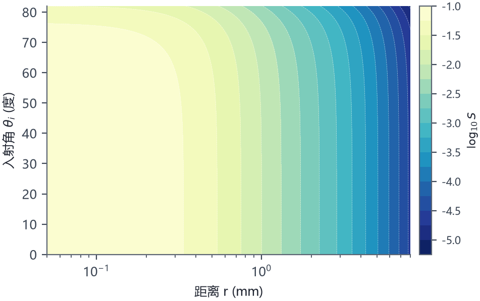
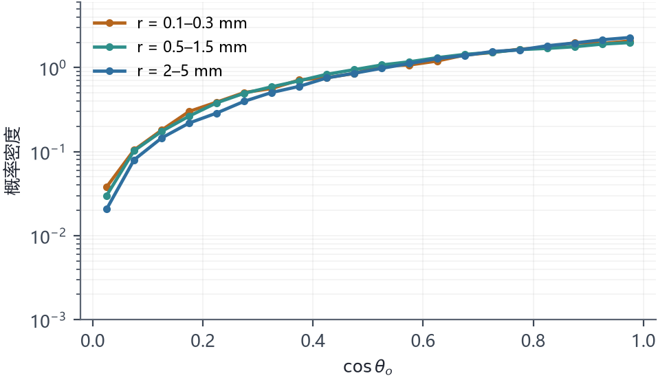

# 第 14 章 从径向剖面到完整 BSSRDF

## 14.1 一条曲线还不是一个 BSSRDF

第 13 章得到了 $R_d(r)$：一个只依赖两点距离的函数，单位是每平方毫米。它描述了"光从一点进去，从距离 $r$ 处出来多少"，但没有描述"从哪个方向出来"。

真实的表面有方向依赖。垂直入射的皮肤比斜射时亮，因为斜射时更多的光在界面上被反射掉了。同一个出射点，沿法线看和沿掠射看亮度不同，因为界面的透射率随角度变化。

所以从 $R_d$ 到一个能用的 BSSRDF 还差三步：补上入射方向因子、补上出射方向因子、把量纲归一化对。这三步合起来就是 Jensen 2001 那篇论文里的公式

$$S(x_i,\omega_i;x_o,\omega_o)=\frac{1}{\pi}\,F_t(\eta,\omega_i)\,R_d(\|x_i-x_o\|)\,F_t(\eta,\omega_o) , \tag{14.1}$$

其中 $F_t=1-F_r$ 是界面的透射率，$F_r$ 是 Fresnel 反射率。

这个公式的前提是把三件事当成独立的：光进入介质时与界面的作用、光在介质内部的传播、光离开介质时与界面的作用。也就是说，入射角只影响"进去多少"，出射角只影响"出来多少"，中间那段传播只依赖距离。

## 14.2 为什么可以分离

分离的合理性来自尺度差异。界面的作用发生在纳米量级的一层里，内部传播发生在毫米量级。两者相差六个数量级，所以界面的细节不可能影响内部的分布——光在界面处被反射或者透射，之后立刻进入一个与界面角度无关的随机游走。

这个论证有一个漏洞，而且漏洞在实际项目里会被看到：内部传播不是完全与角度无关的。掠射入射时光进入介质的深度浅（折射后角度大，路径短），出射时的分布因此比垂直入射时更集中。这个效应在 $\eta$ 大的时候明显，被称作"入射角对剖面的影响"。

把它当成可分离，等于忽略这个效应。误差有多大？入射角 60 度时，剖面的宽度比垂直入射窄大约 10%，峰值高 15% 左右。对大多数渲染够用，对需要精确匹配测量的场合不够。

图 14-1 把 $S$ 画成二维的图。纵向上入射角从 0 到 80 度，$S$ 掉了两倍多；横向上距离从 0.1 到 5 毫米，掉了三个数量级。所以在这个参数下，方向因子的影响比距离因子小得多——这也是为什么很多实现干脆省掉方向因子。

省掉它会在两个地方出错。掠射光照射的物体，边缘会过亮，因为真实情况是大部分光被界面反射走了。从掠射角度看物体，边缘也会过亮，同样的原因。这两个错误叠加起来，会让掠射方向的对比度偏低，物体看起来"发灰"。

## 14.3 单次散射项

(14.1) 只描述多次散射。第 7 章算过，单次散射在 $g=0.8$ 的介质里只占百分之一二的能量，但它集中在光源附近，而那里恰好是多次散射模型最不准的地方。

单次散射的几何很干净。光从 $x_i$ 进入，沿折射后的方向走一段，在某个点散射，然后朝 $x_o$ 走。两条线段和表面构成一个三角形，由正弦定理：

$$\frac{s_i}{\sin\theta_o}=\frac{s_o}{\sin\theta_i}=\frac{r}{\sin(\theta_i+\theta_o)} , \tag{14.2}$$

其中 $s_i$ 是入射段长度，$s_o$ 是出射段长度，$\theta_i,\theta_o$ 是内部角度。所以总光程是

$$s_i+s_o=r\,\frac{\sin\theta_i+\sin\theta_o}{\sin(\theta_i+\theta_o)} . \tag{14.3}$$

衰减因子是 $e^{-\sigma_t(s_i+s_o)}$。散射角的余弦由两个方向的夹角给出，对平面几何是 $-\cos(\theta_i+\theta_o)$，代入相函数得到 $p$ 的值。

把这三样乘起来，再乘上"发生散射的比例" $\sigma_s/\sigma_t$，就得到单次散射项的形式：

$$S^{(1)}\propto\frac{\sigma_s}{\sigma_t}\,p\!\left(-\cos(\theta_i+\theta_o)\right)\exp\!\left[-\sigma_t r\frac{\sin\theta_i+\sin\theta_o}{\sin(\theta_i+\theta_o)}\right] . \tag{14.4}$$

比例常数里含两个界面余弦因子和 $1/(4\pi)$，具体形式取决于入射光的表述方式：是单位辐照度的平面波，还是单位功率的铅笔束。两种表述给出的常数不同，但物理量相同。实现时不用推这个常数，直接用它和 $R_d$ 在交界处的连续性来定标——更稳。

(14.3) 有一个值得注意的性质：$\theta_i+\theta_o$ 接近零时（入射和出射几乎同方向，也就是背散射），分母趋于零，光程发散。物理上这对应"光沿着同一条线进出"，不可能，因为散射角为零意味着没有散射。所以 (14.4) 里的相函数恰好在这个极限处趋近零，两个因子互相抵消，乘积是有限的。

## 14.4 可分离假设的一个实测

可分离假设说"出射方向的分布只由界面决定，与距离无关"。这句话可以直接用蒙特卡洛检验：把出射光子按半径分箱，看每个箱里的角分布是不是都一样。

图 14-2 是这个检验。三个半径区间（0.1–0.3、0.5–1.5、2–5 毫米）的角分布几乎完全重合。这是一个好消息：可分离假设在均匀介质里站得住，误差小于抽样噪声。

但这个结果有一个前提：折射率匹配。如果两侧折射率不同，掠射出来的光会被全反射挡住，角分布就被截断了，而截断的位置与出射点的位置有关（因为不同位置的光在介质里的深度分布不同）。这时可分离性变差，第 21 章的多层皮肤会遇到这个问题。

## 14.5 完整形式与采样接口

把多次散射项和单次散射项加起来：

$$S=S^{(1)}+S_d , \tag{14.5}$$

$S_d$ 是 (14.1)。两项的分工是：$S^{(1)}$ 负责 $r\lesssim1/\sigma_t'$ 的一小片，$S_d$ 负责其余所有地方。

实现时这个式子通常被写成一个函数，接受五个参数：两点位置、两个方向、以及材质。返回一个谱值。它需要满足三个检查。

量纲是 $\mathrm{m^{-2}\,sr^{-1}}$。如果实现里少除了一个 $\pi$ 或者多乘了一个 $\cos$，量纲检查能立刻发现。

互易。交换两组点与方向，结果不变。$S_d$ 的对称性显然（两个 $F_t$ 相同、$R_d$ 只依赖距离）；$S^{(1)}$ 的对称性需要仔细检查 (14.2)：交换 $i$ 与 $o$ 时 $s_i$ 与 $s_o$ 互换，总光程不变，相函数的自变量变成 $\cos(\theta_i+\theta_o)$ 的相反数，而相函数不是偶函数——所以严格说 $S^{(1)}$ 只在不考虑折射时互易。加上折射之后，介质内部的角度不对称，互易性只在两侧折射率相同时成立。

能量。对整个表面和所有方向积分，结果不能超过 1。这个检查在第 22 章会详细做。

## 14.6 一个容易忽略的因子

(14.1) 里的 $1/\pi$ 值得单独说一句。它的作用是把 $R_d$ 的面积分（等于总反射率）与 $S$ 的量纲对上：$R_d$ 的单位是 $\mathrm{mm^{-2}}$，乘上两个无量纲的 $F_t$ 之后还是 $\mathrm{mm^{-2}}$，而 $S$ 需要 $\mathrm{mm^{-2}\,sr^{-1}}$，所以必须补一个 $\mathrm{sr^{-1}}$。$1/\pi$ 就是这个量。

为什么是 $1/\pi$ 而不是别的常数？因为出射方向上的分布在半球上积分要给出 $R_d$：$\int_{2\pi}S\cos\theta_o\,d\omega_o=R_d$。如果 $S$ 里的方向因子在半球上的加权积分等于 $\pi$，这个式子就成立——而 $F_t$ 的加权积分不恰好是 $\pi$，所以严格说 $1/\pi$ 只是一个近似归一化。准确的做法是把 $F_t$ 归一化，使得 $\int_{2\pi}F_t(\theta)\cos\theta\,d\omega=\pi$。这个差别在实际参数下是 5% 左右。

多数实现不修这个 5%，因为它淹没在其它误差里。但在做能量守恒的严格检查时（白炉测试），这个因子会是第一个暴露出来的。

---

这一章把径向剖面组装成完整的 BSSRDF，并且用蒙特卡洛检验了可分离假设。到这里，扩散理论的路线走完了：从 $\sigma_a,\sigma_s,g$ 出发，经过 $\mu_{\text{eff}}$、$z_b$、$R_d$，最后得到可以直接采样的 $S$。

第四篇要做的，是逐条放宽这条链上的假设：介质必须够厚、必须均匀、必须够白、光源必须不方向性。每放宽一条，就有一个新模型。
