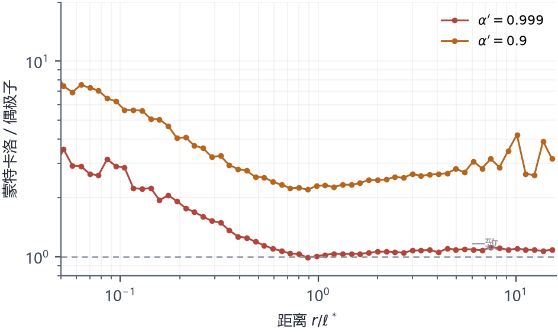
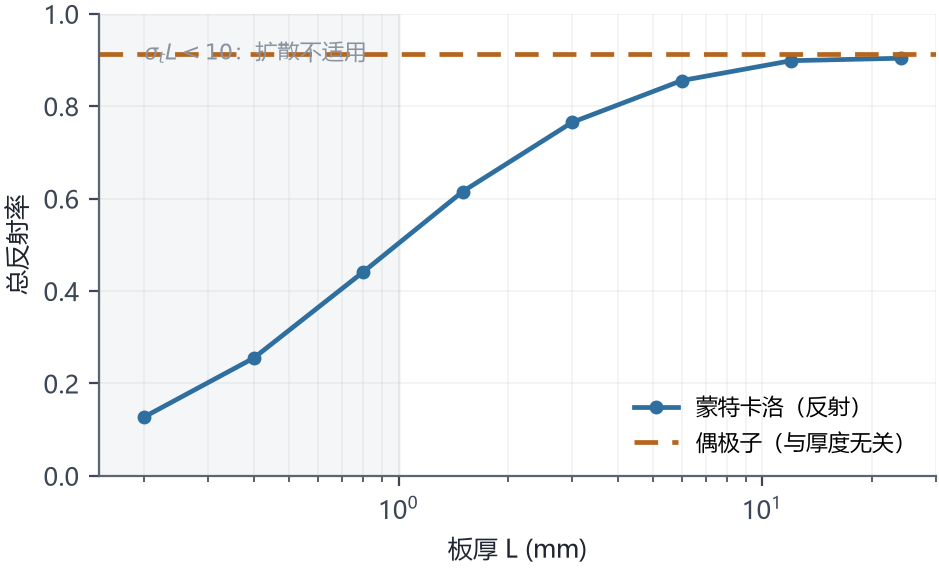

# 第 15 章 扩散在哪里失效

## 15.1 一只耳朵

把一只耳朵对着窗户。耳廓的边缘是半透明的红色，中间部分不透明。同一个器官，同一块皮肤，只因为厚度从三毫米变成一毫米，透光量差了十几倍。

用偶极子算这个场景，会得到什么？偶极子的公式里没有"厚度"这个变量。它假设介质在下方无限延伸，所以耳廓和膝盖在它眼里是一样的。结果是耳廓太暗、膝盖也许还行——但真正的错误是它根本不知道两者有区别。

这不是参数调错了，是模型缺了一个维度。这一章把偶极子会失效的几种场合列清楚，并且给出可以检查的判据，而不是含糊的"介质要够白"。

## 15.2 判据一：近源

第 13 章的对比已经量化过一次：$r<0.3\ \mathrm{mm}$ 时偶极子只有蒙特卡洛的三分之一。

原因是扩散模型把光源换成了一个各向同性的点源，等于假定"光在走第一步之前就忘了方向"。真实的光在进入介质后保持原方向走了一段，这一段里的散射事件少、方向偏前，出来的光比扩散模型预计的多。

用 $\ell^*$ 表达这个判据：失效范围大约是 $r\lesssim\ell^*$。皮肤 $\ell^*=0.5\ \mathrm{mm}$，失效范围就是半毫米；大理石 $\ell^*=1.7\ \mathrm{mm}$，失效范围接近两毫米。

图 15-1 是这张判据的定量版本。$\alpha'=0.999$ 那条曲线在 $r/\ell^*<0.5$ 时停在 3 附近，在 1 之后回到 1。$\alpha'=0.9$ 那条整体抬高到 8，它回到 1 的过程也更慢，并且在 $r>3\ \mathrm{mm}$ 之后又抬了起来——那里出射光子已经很少（总反射率只有 39%），噪声占了主导。

反照率越低，近源误差越大，这个趋势有物理解释。偶极子把入射光换成埋在一个输运自由程深处的各向同性源，等于假定光在第一个自由程里已经散射很多次到方向随机化。高反照率介质里这个假定勉强成立（光确实会散射很多次）；低反照率介质里光散射两三次就出来了，甚至一次就出来，扩散图像从第一步就错了。

处理近源误差有三个办法。加单次散射项（第 14 章），它补的正是这一段；换方向偶极子（第 18 章），它把源的各向同性假设换成有方向的；或者干脆把近源的部分交给蒙特卡洛，远处用偶极子。

## 15.3 判据二：薄层

薄层的问题更严重，因为它不是"某个距离上偏差"，而是"整个模型的结构不对"。

一块厚度 $L$ 的板，光可以从背面出去。偶极子假设背面不存在，所以它把本该透过去的光全都算进了反射。误差的量级是透射率本身：$L$ 小于 $3\ell^*$ 时，透射率可以到 50%，偶极子的反射率就高估一倍。

图 15-2 里虚线是偶极子的预测，它是一条水平线——这是这一章最有说服力的一张图，因为它把"模型缺一个维度"这件事画成了一条本该弯曲却被画直的线。

判断的标准是光学厚度 $\sigma_t L$。大于 20 时偶极子的误差在 10% 以内，10 到 20 之间误差 20% 到 30%，小于 10 就完全不能用。注意这里的 $\sigma_t$ 不是 $\sigma_t'$：薄层里光走的次数少，相似关系还没建立，所以用的是真实的消光系数。

## 15.4 判据三：低反照率

$\alpha'$ 低于 0.5 时，$\mu_{\text{eff}}$ 与 $\sigma_t'$ 同量级，扩散方程里的"扩散"这个词已经不适用了：光在走完一个扩散长度之前就被吸收，根本没有机会扩散。

这时偶极子会做什么？它给出的剖面形状还是 $1/r^2$ 乘指数，但真实的剖面在近处更陡、远处更平。积分的结果是偶极子高估远处、低估近处，总量可能对，形状不对。

渲染深色材料时这个错误会显出来：墨汁、黑巧克力、深色皮肤。它们的共同特征是"边缘很硬"——光斑的边界清楚，没有柔和的光晕。偶极子会给出一圈不存在的柔光。

处理办法有两个。用 $\alpha$ 而不是 $\alpha'$ 来做扩散（有些实现这么做，等于放弃了相似关系）；或者干脆承认扩散不适用，改用蒙特卡洛。

## 15.5 判据四：强吸收与有限尺寸

还有一个容易忽略的失效方式：物体的尺寸小于扩散长度。

皮肤 $\mu_{\text{eff}}=0.35\ \mathrm{mm^{-1}}$，扩散长度 2.9 毫米。耳廓厚 1 毫米，鼻翼厚 2 毫米，指尖厚 5 毫米。前两个都小于扩散长度，第三个勉强超过。

这时偶极子的边界条件失效：它假设外推平面无限延伸，而实际上物体只有几毫米宽，外推平面在物体的边缘之外就不存在了。几何越细，误差越大。

一个粗略的修正办法是把 $z_b$ 按曲率缩小，让外推平面"贴"在物体上。这个做法在实时渲染里很常见，效果还行，但它没有物理依据，只是把误差摊平。

## 15.6 把这些判据排成一张表

| 失效方式 | 判据 | 典型误差 | 修正 |
| --- | --- | --- | --- |
| 近源 | $r<\ell^*$ | 偏低 3 到 8 倍（随 $\alpha'$ 变化） | 加单次散射、方向偶极子 |
| 薄层 | $\sigma_t L<20$ | 反射率高一倍 | 多极子（第 16 章） |
| 低反照率 | $\alpha'<0.5$ | 形状错，远处偏高 | 归一化剖面（第 17 章）、蒙特卡洛 |
| 有限尺寸 | 物体小于 $1/\mu_{\text{eff}}$ | 边缘偏暗或偏亮 | 缩 $z_b$、按曲率修正 |
| 多层 | 层厚小于 $\ell^*$ | 颜色错 | 分层模型（第 21 章） |

这张表是选型的第一道筛子。拿到一个资产，先量它的厚度、$\alpha'$、特征尺寸，对着表看哪一条被触发。如果只有第一条，偶极子加单次散射就够；如果第二、三条都被触发（比如一片薄纸、一片叶子），就得上多极子或者随机游走。

## 15.7 一个反例

值得说清楚的是，有些"看起来应该失效"的场合其实没问题。

一块很厚的蜡，$\alpha'=0.99$，厚度 30 毫米。按判据三（低反照率）不触发，按判据二（薄层）不触发，按判据四（有限尺寸）也不触发。偶极子给的结果和蒙特卡洛差 4%。这块蜡看起来非常"半透明"，因为它的边缘薄，但实际上大部分区域的扩散条件很好。

反过来，一块很薄的白纸，$\alpha'=0.99$，厚度 0.1 毫米。它看起来完全不透明，但按判据二，扩散完全失效——纸的透光靠的是单次散射的直射通道，不是扩散。

所以"看起来半透明"和"扩散适用"是两件不同的事。前者取决于视觉上的对比度，后者取决于厚度与 $\ell^*$ 的比例。

---

这一章给出了四条判据和一张选型表。它们的共同点是都可以在写代码之前算出来：量厚度、算 $\ell^*$、算 $\alpha'$、算扩散长度，四个数就能决定用哪个模型。下一章处理表里第二行：薄层与多极子。
