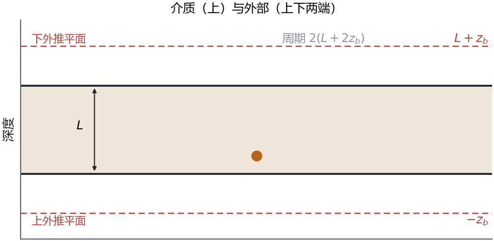
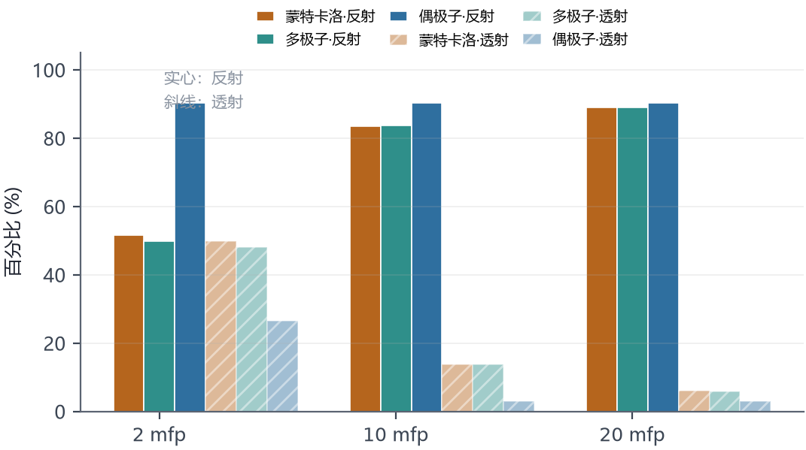
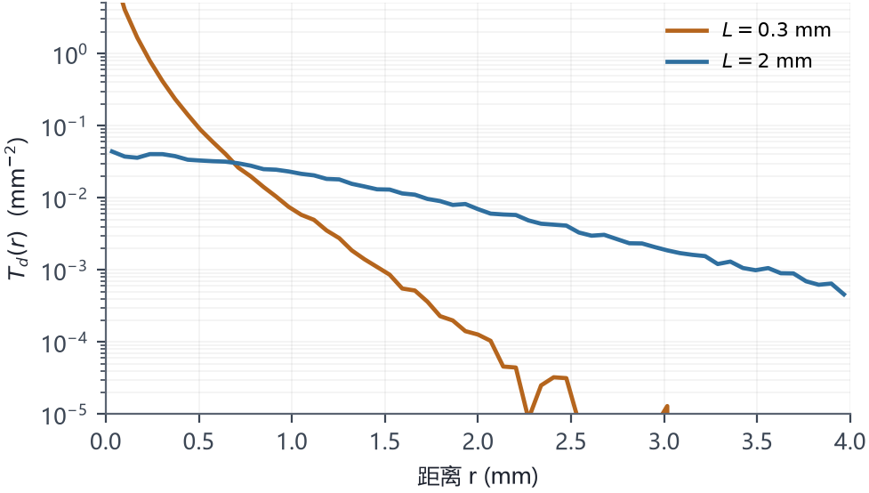

# 第 16 章 多极子与薄层

## 16.1 一张纸和一块玉

同样厚度的两张白纸叠在一起，不透光。同样厚度的两片白玉叠在一起，透光，而且透出来的是一片均匀的乳白。把纸换成 0.05 毫米厚，透光就明显了；把玉磨到 0.05 毫米，几乎全透。

厚度是这一章的主角。第 13 章的偶极子对厚度完全无感，它的公式里根本没有 $L$ 这个符号。真实物体的厚度从几十微米到几十厘米，跨越四个数量级，一个不含厚度的模型不可能覆盖。

## 16.2 两个边界

一块厚度为 $L$ 的平板有两个界面。上界面的外推平面在表面之上 $z_b$，下界面在底面之下 $z_b$。把坐标定在深度上，两个平面分别在 $d=-z_b$ 与 $d=L+z_b$。

边界条件是 $\varphi=0$ 在这两个平面上都成立。

一对源只能满足一个条件。要同时满足两个，必须无限次镜像：把上界面的镜像（负源）再对下界面镜像，得到一个新源；把这个新源再对上界面镜像，如此往复。每镜像一次，源的深度增加 $2(L+2z_b)$。

$$z_{r,i}=2i(L+2z_b)+z_r,\qquad z_{v,i}=2i(L+2z_b)-z_r-2z_b,\qquad i\in\mathbb{Z} . \tag{16.1}$$

每个正源配一个负源，出射度是它们贡献的总和：

$$R_d(r)=\sum_{i=-\infty}^{\infty}\left[\frac{\alpha'z_{r,i}(1+\mu d_{r,i})e^{-\mu d_{r,i}}}{4\pi d_{r,i}^3}-\frac{\alpha'z_{v,i}(1+\mu d_{v,i})e^{-\mu d_{v,i}}}{4\pi d_{v,i}^3}\right] , \tag{16.2}$$

透射的同理，把 $z$ 换成 $L-z$：

$$T_d(r)=\sum_{i=-\infty}^{\infty}\left[\frac{\alpha'(L-z_{r,i})(1+\mu d_{r,i})e^{-\mu d_{r,i}}}{4\pi d_{r,i}^3}-\frac{\alpha'(L-z_{v,i})(1+\mu d_{v,i})e^{-\mu d_{v,i}}}{4\pi d_{v,i}^3}\right] . \tag{16.3}$$

注意 $z$ 在这里是带符号的：负源在表面之上，$z_v$ 取负值，整个项因此翻号。这个写法与第 13 章的"两项相加"等价，因为 (16.2) 里的 $z_{v,i}$ 本身就带负号。

图 16-1 是这串镜像。板厚趋于零时周期趋于 $4z_b$，源的密度趋于无穷，级数发散——这不是数学缺陷，是"零厚度的板"这个极限本身没有意义。

## 16.3 这个修正有多大

Donner 与 Jensen 在 2005 年给出了一个可以直接比的表：他们用蒙特卡洛、多极子和偶极子分别算了一块厚板的反射率与透射率，板的光学厚度从 2 个平均自由程增加到 20 个。

图上三组柱子，从左到右是反射 2/10/20 mfp、透射 2/10/20 mfp。读数如下：

光学厚度 2 时，蒙特卡洛反射 51.6%、透射 49.8%；多极子反射 49.8%、透射 48.1%；偶极子反射 90.2%、透射 26.5%。

光学厚度 10 时，蒙特卡洛 83.4%/13.8%；多极子 83.8%/13.8%；偶极子 90.2%/3.0%。

光学厚度 20 时，蒙特卡洛 89.0%/6.0%；多极子 89.0%/5.9%。

这张表说明三件事。多极子在所有厚度上都与蒙特卡洛吻合（差 1% 到 2%）；偶极子在 20 mfp 时已经收敛（90.2% 对 89.0%）；在 2 mfp 时偶极子错得离谱，反射率高估 39 个百分点，透射率低估 23 个百分点。

2 mfp 的板是什么概念？皮肤在 550 纳米下的平均自由程是 0.1 毫米，2 mfp 就是 0.2 毫米——正是耳廓、鼻翼、眼睑的厚度。所以耳廓的透光用偶极子算必然错，这不是调参能解决的。

## 16.4 透射光斑

薄层有一个偶极子完全无法描述的现象：透射光斑的形状。

把一片 0.3 毫米的白瓷片放在灯上，背面看到的不是一块均匀的亮，而是一片中间最亮、向边缘衰减的光斑，光斑的宽度比正面入射的光斑宽好几倍。这个宽度由散射决定。

图 16-3 是这个剖面。薄板（$L=0.3\ \mathrm{mm}$）的透射光斑很窄，半衰减半径约 0.25 毫米，总透射 81%；厚板（$L=2\ \mathrm{mm}$）的光斑宽得多，半衰减半径约 1.2 毫米，总透射 31%。两条曲线在 $r\approx0.8\ \mathrm{mm}$ 处交叉：近处是薄板亮（光没散开就出来了），远处是厚板亮（光在里面散开了，从更远的地方出来）。

这个现象在渲染里的对应物是"背光透射"：耳朵、手指、树叶、灯罩。它们的外观几乎完全由 $T_d(r)$ 决定，而 $R_d$ 只负责正面。一个只有反射项的实现会把所有这些物体渲染成不透明的。

## 16.5 级数的收敛

多极子是一个无穷级数，实现时必须截断。截断的项数取决于板厚的相对值。

板厚 $L\gg\ell^*$ 时，$2(L+2z_b)$ 很大，$i=\pm1$ 的源已经远到贡献可以忽略，取 $i=0$ 就够，也就是偶极子。

板厚与 $\ell^*$ 同量级时，周期约 $4z_b\approx4\ \mathrm{mm}$，源的衰减长度是 $1/\mu_{\text{eff}}$。需要的项数大约是 $3/(\mu_{\text{eff}}(L+2z_b))$。皮肤参数下这是一两项。

板厚远小于 $\ell^*$ 时，需要的项数急剧增加，而且每一项的贡献互相抵消，数值上会出现严重的相消误差。这时级数不收敛，必须换方法。

实用的判据是光学厚度大于 2 才用多极子，小于 2 直接上蒙特卡洛。这个界限和 Donner 表里"2 mfp 时多极子还能对上"的观察一致——那是运气好（相消还没失控），不是保证。

## 16.6 多层

多极子的结构可以直接推广到多层。每一层有自己的 $\sigma_a,\sigma_s,g$，层与层之间的界面有两种处理方式：折射率不同时，用 Fresnel 透射与反射，把光在层间的往返算进去；折射率相同时，只要求 $\varphi$ 与 $D\partial\varphi/\partial n$ 连续。

Donner 与 Jensen 的论文处理的就是这个情形，他们用"在每一层里放一组多极子，层间用边界条件耦合成一个线性系统"的办法。五层皮肤的求解需要解一个 $10\times10$ 的线性系统，代价不大。

第 21 章会把皮肤的分层参数具体给出来。这一章只需要记住一件事：分层不是把每层单独算完相加，那样会漏掉层间的多次反射。

## 16.7 一个实现顺序的建议

多极子的实现有顺序可循，按下面的顺序写，每一步都能单独验证。

先写单层偶极子，用第 13 章的公式，和蒙特卡洛对一次（半无限）。这一步对了，说明 $D$、$\mu_{text{eff}}$、$z_b$ 都对。

再把 $i=\pm1$ 的镜像加上，检查厚板（$L>20\ell^*$）的结果是否与单偶极子几乎一样。如果差别很大，说明镜像的符号或者周期算错了。

然后减薄，看反射率是否随厚度下降、透射率是否随厚度上升，并且两者之和是否接近 1（无吸收时）。这一步能抓住 (16.2) 与 (16.3) 里的符号错误。

最后加层。层间的界面对折射率相同时只要 $\varphi$ 与 $D\partial\varphi/\partial n$ 连续，对折射率不同时要加 Fresnel 项。先用两层、层厚相等的简单情形验证（这时结果应当与同厚度的均匀介质接近）。逐步增加层数与折射率差。

---

这一章处理了"介质不够厚"这一条假设。多极子把偶极子的两个源变成无穷多个，代价是级数收敛性的问题；在光学厚度大于 2 时它能把反射率和透射率都算到 2% 以内，小于 2 时它和偶极子一样不可信。

下一章换一个角度：不修边界，改修剖面本身。
